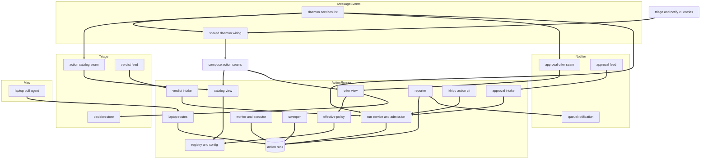
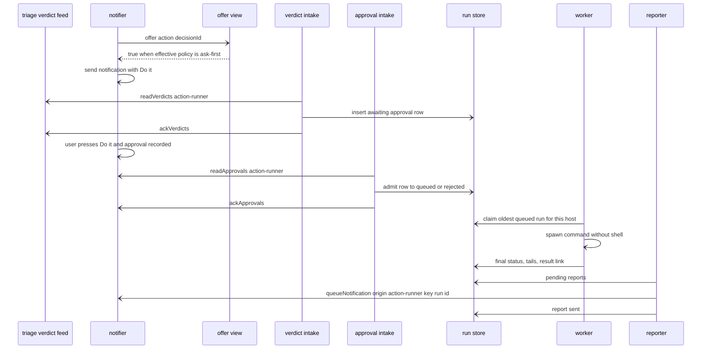
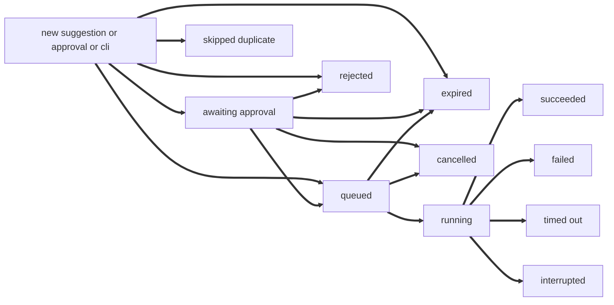
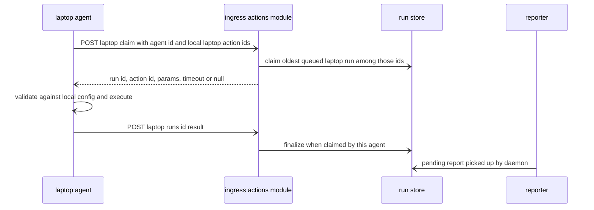

# Design Document: action-runner

## Overview
**Purpose**: This feature turns an allowlisted suggested action into a safely executed, logged, and reported run. It owns the operator's action registry (`khipu.actions.json`), implements the two seams that triage-agent and notifier reserved for it (the action catalog and the "Do it" offer) and exports them through one composition function (`composeActionSeams({ env })`) that message-events' shared daemon wiring (`composeSharedWiring(env)` in `src/daemon-wiring.ts`) places in `DaemonSharedWiring` for triage and notifier, consumes the verdict feed and the approval feed as the consumer `action-runner`, executes each run's preconfigured command without a shell under a timeout, records every run in `action_runs`, and reports results through `queueNotification`.

**Users**: The user (approves with "Do it" and receives results), the operator (writes `khipu.actions.json`, installs the commands, supervises with `khipu action`), and, for the optional laptop milestone, a small pull agent on the user's Mac.

**Impact**: Adds `src/actions/`, one table (`action_runs`, DDL in `src/actions/schema.ts` registered in `src/schema-registry.ts`), the `khipu action` command family, `docs/ACTIONS.md`, and an example config. Adds one import and one entry each to message-events' `src/schema-registry.ts` (`SCHEMA_MODULES`) and `src/daemon-services.ts` (`DAEMON_SERVICES`, its own entry only), two optional fields (`actionCatalog?`, `approvalOffer?`) plus their population inside `composeSharedWiring(env)` in message-events' `src/daemon-wiring.ts` (D12, D14), one router entry in `src/khipu.ts`, and (laptop milestone only) one entry in `src/ingress/modules.ts`. It edits no upstream seam body: `defaultActionCatalog()` (`src/triage/action-catalog.ts`) and `defaultApprovalOffer()` (`src/notify/approval-offer.ts`) stay the EMPTY defaults, and `src/watch.ts` is not touched (decision D7). With no config file, behavior is unchanged: triage sees no actions, the notifier offers no "Do it".

**Upstream dependencies**: triage-agent, notifier, cloud-deployment (`resolveDataFile`, `IngressContext.env`, ingress module types and list, deployment profile, secret names), message-events (`src/daemon-services.ts` `DAEMON_SERVICES` / `ServiceHandle` / `DaemonServiceContext` with `env`, `mode`, `shared`; `src/daemon-wiring.ts` `DaemonSharedWiring` / `composeSharedWiring(env)`; `src/schema-registry.ts` `SCHEMA_MODULES`), and, for the laptop milestone only, presence-context (`src/launchd-plist.ts`). All Phase 5 cross-spec decisions in `.kiro/specs/phase5-cross-spec-decisions.md` (D4, D5, D6, D7, D9, D12, D13, D14, D15, D16) are binding for this design.

### Goals
- Only operator-configured commands ever run; a model, a message, or a remote request can at most pick an id and fill validated scalar params.
- Ask-first by default; auto only per action, by default only for rule-sourced suggestions, with a global kill switch.
- Exactly one run record per handled verdict suggestion and per approval; exactly one result notification per reportable run.
- Restart safety: queued work resumes, half-finished runs are never silently repeated.

### Non-Goals
- The ADV report generator (OQ-1), any concrete tool, or its credentials.
- Multi-step workflows, retries of failed runs, run scheduling, or chained actions.
- Posting or replying on Slack or any platform; any Beeper use.
- OS-level sandboxing of commands (risk accepted for P3, see research.md).
- Changing presence-context's laptop reporter.

## Open Questions / Risks
- **OQ-1 (blocking for any ADV-specific work): what is ADV report generation concretely?** Tool or CLI name and install location, required inputs and their formats (which captures from the `#08-expedition` message), outputs (file path, link, upload), credentials it needs, and whether it can run inside the server container or only on the Mac. Until answered: the example config ships `adv-report` disabled with a placeholder command (`/app/data/actions/adv-report`) and a placeholder param `transaction_id` with pattern `^[A-Za-z0-9-]{1,32}$`; no task implements or configures a real ADV action; whether the laptop milestone (tasks group 9) is needed at all depends on the answer.
- Config reload between an offer and the verdict intake can make them disagree; the later approval is rejected as `already_handled` and reported, never executed twice.
- No OS sandbox: the operator's command runs with the daemon user's permissions (documented).
- Shutdown and single-pass semantics are fixed by D13 (message-events): on SIGINT/SIGTERM (`ctx.mode === 'watch'`) `stopDaemonServices` calls `drain` then `stop` per service in reverse registry order under one overall 25 s deadline; action-runner drains first and must finish inside its own 15 s limit (11.2). Per the D17 clarification of D13, a service MAY abort its in-flight work on signal shutdown within its own limit: action-runner aborts the running command, recorded as `interrupted`, within its 15 s, and because it drains first it may consume part of the 25 s total before triage's 10 s grace. In `ctx.mode === 'once'` services drain in forward order, so action-runner drains last, after triage and the notifier produced their work (11.3). The adapter never starts new work once `stop()` was called.

## Boundary Commitments

### This Spec Owns
- The action configuration format (`khipu.actions.json`, version 1), its parsing, validation, fingerprinting, and hot reload; `KHIPU_ACTIONS_*` settings.
- The parameter schema subset and parameter validation.
- The effective policy rule (`ask-first` or `auto`) and the safety limits (age limits, hourly limit, duplicate window, serial execution).
- The seam implementations `src/actions/catalog-view.ts` (an `ActionCatalog`) and `src/actions/offer-view.ts` (an `ApprovalOffer`), and the composition function `composeActionSeams({ env })` in `src/actions/seams.ts` that returns both. Outside `src/actions/` and `tests/` it is imported only by message-events' `src/daemon-wiring.ts` (D14), where this spec adds `actionCatalog?: ActionCatalog` and `approvalOffer?: ApprovalOffer` to `DaemonSharedWiring` (type-only imports) and sets them inside `composeSharedWiring(env)` from `composeActionSeams({ env })` (D12). The daemon reaches them through `src/daemon-services.ts` (which imports the wiring module), and the triage and notify CLIs through their entry scripts `src/cli-entries/triage-cli.ts` and `src/cli-entries/notify-cli.ts` (owned by triage-agent and notifier), which call `composeSharedWiring(process.env)`. Triage's and notifier's own `DAEMON_SERVICES` entries read `ctx.shared.actionCatalog` / `ctx.shared.approvalOffer` themselves; this spec does not edit them.
- The `action-runner` entry in `DAEMON_SERVICES` (`src/actions/service.ts`), last in order after event retention, triage-agent, and notifier, and its `mode`-dependent drain behavior (D13).
- The body of `composeSharedWiring(env)` that fills `DaemonSharedWiring.actionCatalog` and `.approvalOffer` (D12, D17); nothing else in `src/daemon-wiring.ts`. The fields themselves are not owned here: triage-agent declares `actionCatalog?` and notifier declares `approvalOffer?` (D17); only if a field is still absent when task 7.3 runs does this spec add it with its type-only import, as a fallback.
- The consumers `action-runner` on the verdict feed and on the approval feed.
- The `action_runs` table: DDL (`src/actions/schema.ts`, `applyActionsSchema`, one `SCHEMA_MODULES` entry), every write, retention.
- Command invocation building, execution, output capture, and the result line protocol (`KHIPU_RESULT_URL=`, `KHIPU_RESULT_SUMMARY=`).
- Result notification content and the `run:<id>` request keys under origin `action-runner`.
- The `khipu action` command family, `docs/ACTIONS.md`, `khipu.actions.example.json`.
- Laptop milestone: the `actions` ingress module and its routes, the laptop pull agent, and the LaunchAgent `com.khipuchat.action-agent`.

### Out of Boundary
- Deciding importance, choosing actions, rule mappings and their placeholders, the verdict feed tables (triage-agent; this spec only reads `readVerdicts`, `ackVerdicts`, `registerVerdictConsumer`, `getVerdictConsumerStatus`, `getDecision`).
- Notification delivery, buttons, callback links, recording approvals, the approval feed tables (notifier; this spec only calls `queueNotification`, `registerApprovalConsumer`, `readApprovals`, `ackApprovals`, `getApprovalConsumerStatus`).
- Ingress authentication, tokens, secret-file loading, deployment profile parsing, `IngressContext`, and the data file resolver `resolveDataFile` (cloud-deployment).
- The bodies of `defaultActionCatalog()` and `defaultApprovalOffer()` (they stay empty defaults owned by triage-agent and notifier), and `src/watch.ts`.
- The daemon services list, its `ServiceHandle` contract, start and shutdown ordering and deadline (D13), the service ctx, the `src/daemon-wiring.ts` module and `composeSharedWiring` signature, the triage-agent and notifier `DAEMON_SERVICES` entries, and the schema registry with `initDb` calling it (message-events).
- The CLI entry scripts `src/cli-entries/triage-cli.ts` and `src/cli-entries/notify-cli.ts` (triage-agent, notifier; D14).
- The presence laptop reporter and its LaunchAgent, and the shared plist builder and launchctl install helper `src/launchd-plist.ts` (presence-context).
- The tools that actions invoke, including the ADV report generator.

### Allowed Dependencies
- triage-agent: `src/triage/action-catalog.ts` (types `ActionDescriptor`, `ActionCatalog` only; the file is not edited), `src/triage/outbox.ts` (`registerVerdictConsumer`, `readVerdicts`, `ackVerdicts`, `getVerdictConsumerStatus`, types), `src/triage/decision-store.ts` (`getDecision`) from `offer-view.ts` only, `src/triage/types.ts` (types `SuggestedAction`, `JsonValue`, `Urgency`).
- notifier: `src/notify/requests.ts` (`queueNotification`, types), `src/notify/approvals.ts` (`registerApprovalConsumer`, `readApprovals`, `ackApprovals`, `getApprovalConsumerStatus`, types), `src/notify/approval-offer.ts` (type `ApprovalOffer` only; the file is not edited), `src/notify/types.ts` (type `CallbackVia`).
- cloud-deployment: `src/deployment.ts` (`readDeploymentProfile`), `src/secret-files.ts` (`SECRET_NAMES`), `src/db-path.ts` (`resolveDataFile` in settings, `resolveDbPath` in the CLI), `src/ingress/types.ts` (types, including `IngressContext` with `readonly env`), one entry in `src/ingress/modules.ts` (laptop milestone).
- message-events: `src/daemon-services.ts` (types `DaemonService`, `ServiceHandle`, `DaemonServiceContext`; one import of `actionRunnerService` and one entry added by this spec, nothing else), `src/daemon-wiring.ts` (this spec adds the type-only imports of `ActionCatalog` and `ApprovalOffer`, the two optional `DaemonSharedWiring` fields, one import of `composeActionSeams`, and the call `composeActionSeams({ env })` inside `composeSharedWiring(env)` that sets `actionCatalog` and `approvalOffer`; D12, D14), `src/schema-registry.ts` (one import and one `SCHEMA_MODULES` entry for `applyActionsSchema`), `src/event-types.ts` (`CONSUMER_NAME_PATTERN`) for consistency checks in tests only.
- presence-context (laptop milestone only): `src/launchd-plist.ts` (pure plist builder plus install and uninstall through `launchctl`), used by `agent-launchd.ts`.
- Existing: `src/db.ts` (`getDb`, `initDb`), Node 24 `node:child_process` (`spawn` with `shell: false`), `node:fs`, `node:os`, `node:path`, `node:crypto`, global `fetch`, `AbortSignal.timeout`, `express` 5 types.
- Dependency direction (imports point left only): `schema` is a DDL-only leaf (imports nothing but better-sqlite3 types); `types` => `settings` => `params-schema` => `config-parse` => `registry` => `policy` => (`catalog-view`, `offer-view`) => `seams` (=> `src/daemon-wiring.ts`, message-events) => `run-store` => pure domain (`invocation`, `output`, `admission`, `report-content`) => `executor` => `run-service` => (`intake-verdicts`, `intake-approvals`, `worker`, `sweeper`, `reporter`) => `runtime` => `service` => `src/daemon-services.ts` (wiring layer, message-events); CLI files sit after `runtime`; `laptop-routes` => `ingress-module` sit after `run-store`; `laptop-agent` and `agent-launchd` sit after `executor`. `src/schema-registry.ts` imports `schema` only.
- Isolation rules (enforced by `tests/actions-isolation.test.ts`; per D6 the DDL-only `src/*/schema.ts` modules and `src/schema-registry.ts` are always allowed):
  - `catalog-view.ts` and everything it imports must import only Node built-ins, `src/deployment.ts`, `src/secret-files.ts`, `src/db-path.ts`, and `src/actions/{types,settings,params-schema,config-parse,registry}.ts` (plus type-only imports). It reaches triage only through the daemon wiring, and it must never import triage runtime or data modules, so the wiring layer stays free of import cycles.
  - `offer-view.ts` additionally may import `src/actions/policy.ts`, `src/db.ts`, and `src/triage/decision-store.ts`; never channels, presence, LLM, or `src/notify/**` runtime modules.
  - `seams.ts` imports only `catalog-view.ts`, `offer-view.ts`, `registry.ts`, and type-only triage and notifier seam types, so `src/daemon-wiring.ts` stays free of service runtimes (D14). Outside `src/actions/` and `tests/`, only `src/daemon-wiring.ts` imports `src/actions/seams.ts` (the CLI entries reach it only through that module) and only `src/daemon-services.ts` imports `src/actions/service.ts`; no file under `src/triage/` or `src/notify/` imports anything under `src/actions/`, `src/daemon-wiring.ts`, or `src/daemon-services.ts`.
  - Composition code (`seams.ts`, `catalog-view.ts`, `offer-view.ts`, `registry.ts`, `settings.ts`) never reads `process.env`; it uses only the `env` passed in (D15).
  - Daemon types (D16): no file under `src/actions/` has a runtime import of `src/daemon-services.ts` or `src/daemon-wiring.ts`. Only the service-entry file `src/actions/service.ts` may use `import type` from `src/daemon-services.ts` (for `DaemonService`, `DaemonServiceContext`, `ServiceHandle`, `DaemonSharedWiring`); type imports are erased and load no service runtime. Every other `src/actions/` file imports neither module, not even type-only.
  - `ingress-module.ts` and `laptop-routes.ts` must import only `src/actions/{types,settings,run-store}.ts` (and what those import: `src/deployment.ts`, `src/db-path.ts`, better-sqlite3 types), `src/ingress/types.ts` (types), and Node built-ins: no executor, no `child_process`, no notifier, no triage, plus everything the cloud-deployment ingress isolation test forbids (which follows the transitive import closure, D4). They read settings from `IngressContext.env`, never `process.env`.
  - No file under `src/actions/` imports `src/platforms/**`, `@beeper/*`, or any messaging client. No `shell: true`, `exec(`, or `execSync(` appears under `src/actions/`. No `ensure*Schema` function exists under `src/actions/` (D6).
- No new npm dependency. No Beeper dependency.

### Revalidation Triggers
- Any change to the `khipu.actions.json` format version or the parameter schema subset: operators' config files and docs.
- Any change to `effectivePolicy` semantics: both seams and the verdict intake re-check together (same module).
- Any change to the result line protocol or the `KHIPU_PARAM_*` environment naming: operators' scripts.
- Any change to the laptop route paths, payloads, or the `actions` module id: the laptop agent version on the Mac must be updated together.
- Upstream: triage `ActionDescriptor` / `ActionCatalog`, `VerdictRecord`, `getDecision`, or verdict feed semantics; notifier `ApprovalRecord`, approval feed semantics, `ApprovalOffer`, or `queueNotification` input; cloud-deployment `IngressModule`, `IngressContext`, `resolveDataFile`, or deployment profile changes; message-events `DAEMON_SERVICES` entry shape, `ServiceHandle`, `DaemonServiceContext` (`env`, `mode`, `shared`), `DaemonSharedWiring` or `composeSharedWiring(env)` in `src/daemon-wiring.ts`, D13 drain and stop semantics or deadline, or `SCHEMA_MODULES` contract; the triage and notify CLI entry scripts (D14); triage `StartTriageOptions.actionCatalog` or notifier `StartNotifierOptions.offer`; presence-context `src/launchd-plist.ts` API all force an action-runner re-check.

## Architecture

### Existing Architecture Analysis
- One sync daemon (`src/watch.ts`) hosts the long-running consumers (triage, notifier) through message-events' `DAEMON_SERVICES` list (`startDaemonServices` at startup; on SIGINT/SIGTERM drain then stop per service in reverse order under one 25 s deadline; in single-pass mode forward-order drain, D13); this feature joins it as the last entry and does not edit `watch.ts`. The ingress is a separate process (cloud-deployment) used only for the laptop milestone. The CLI runs in its own process via `src/khipu.ts`.
- Both upstream feeds share the message-events cursor style, so the runner registers with `'now'`, reads, writes its rows, then acks.
- Triage calls its injected catalog (`StartTriageOptions.actionCatalog`, which triage's entry takes from `ctx.shared.actionCatalog`, set by `composeSharedWiring(env)` from `composeActionSeams({ env })`) synchronously per evaluation; the notifier calls its injected offer (read by notifier's entry from `ctx.shared.approvalOffer`) synchronously per verdict notification. Without the wiring (for example a test calling `startTriage()` bare) they fall back to the empty upstream defaults. Both run in the daemon process and must be cheap: the registry re-stats the config file and re-parses only on mtime change.

### Architecture Pattern & Boundary Map



**Architecture Integration**:
- Selected pattern: feed consumers plus a run table state machine with a single serial worker per host (mirrors triage and notifier; restart safe).
- Domain boundaries: intakes and the CLI create or transition rows only through `RunService`; only `Worker` (and the CLI foreground run, and the laptop routes for claimed laptop rows) move rows to `running` and to final statuses; only `Reporter` calls `queueNotification`; only `Sweeper` expires, interrupts, and prunes.
- Existing patterns preserved: JSON config file with hot reload and last-valid fallback (triage rules source), `KHIPU_*` settings with warnings on bad values, CLI router entry, ingress module registration, daemon service registration (`DAEMON_SERVICES`), schema registration (`SCHEMA_MODULES`), data file location next to the archive (`resolveDataFile`), LaunchAgent without secrets built with the shared plist helper (presence-context).
- Note on the mermaid map: `Wiring` is `src/daemon-wiring.ts` (`composeSharedWiring(env)`), the only importer of `composeActionSeams`; `Services ==> Catalog` and `Services ==> Offer` are the triage and notifier entries passing `ctx.shared.actionCatalog` and `ctx.shared.approvalOffer` (their own entries, not edited here); `Services ==> Service` means the daemon starts the runner through its `DAEMON_SERVICES` entry (`src/actions/service.ts`), which wraps the run service, intakes, worker, sweeper, and reporter.
- Steering compliance: strict TypeScript, no `any`, files under 200 lines, Vitest with `:memory:` SQLite, no new dependency.

### Technology Stack

| Layer | Choice / Version | Role in Feature | Notes |
|-------|------------------|-----------------|-------|
| CLI | `khipu action` via `src/khipu.ts` router | Operator commands | One `OPERATIONAL_SCRIPTS` entry |
| Backend / Services | Node 24, TypeScript 5 strict | Registry, intakes, worker | Runs inside the sync daemon as a `DAEMON_SERVICES` entry |
| Process execution | `node:child_process` `spawn` with `shell: false`, `detached: true` | execFile-equivalent, process group kill | No shell anywhere |
| Data / Storage | SQLite via `better-sqlite3-multiple-ciphers` (existing) | `action_runs` | Created by `initDb` through `SCHEMA_MODULES` (D6) |
| Messaging / Events | triage verdict feed, notifier approval feed, `queueNotification` | Inputs and result output | Upstream contracts unchanged |
| Infrastructure / Runtime | cloud-deployment ingress (laptop milestone), launchd user agent on the Mac via presence-context's `src/launchd-plist.ts` | Laptop pull channel | `INGRESS_TOKEN_ACTIONS` |

## File Structure Plan

### Directory Structure
```
src/actions/
├── types.ts             # ActionPolicy, RunsOn, AutoFrom, ReportLevel, ParamSpec, ParamsSchema, ActionDefinition, ActionsFileConfig, RunStatus, RunSource, ApprovedBy, RunReason, ActionRun, ConfigProblem
├── settings.ts          # resolveActionsSettings(env): KHIPU_ACTIONS_* with defaults and warnings (config path via resolveDataFile); laptop agent settings
├── params-schema.ts     # parseParamsSchema (subset check), toDescriptorSchema, validateParams, canonicalParams, paramsHash
├── config-parse.ts      # parseActionsFile(text, ctx): definitions with defaults or problems; env denylist
├── registry.ts          # loadActionsFile, createRegistrySource (mtime reload, last valid), getSharedRegistry(env)
├── policy.ts            # effectivePolicy(definition, settings, outcome)
├── catalog-view.ts      # createActionCatalog(source): ActionCatalog (triage seam implementation)
├── offer-view.ts        # createApprovalOffer(source, deps): ApprovalOffer (notifier seam implementation)
├── seams.ts             # composeActionSeams({ env, ... }): { catalog, offer } (imported only by src/daemon-wiring.ts)
├── schema.ts            # applyActionsSchema(db): DDL only, registered in src/schema-registry.ts
├── run-store.ts         # every SQL statement on action_runs
├── invocation.ts        # buildInvocation(definition, params, runId, ctx): file, args, env, cwd (pure)
├── output.ts            # TailBuffer, parseResultLines (pure)
├── admission.ts         # admit(input): queued or rejected or skipped with reason (pure)
├── report-content.ts    # isReportable(run, definition), buildResultRequest(run): NotificationRequest (pure)
├── executor.ts          # executeInvocation(invocation, options): ExecOutcome
├── run-service.ts       # createFromVerdict, createFromApproval, createFromCli, approveAwaiting, cancel, finalize
├── intake-verdicts.ts   # verdict feed batch processing with retry counting
├── intake-approvals.ts  # approval feed batch processing with retry counting
├── worker.ts            # serial execution of queued runs for this host
├── sweeper.ts           # startup interruption, offer expiry, laptop claim expiry, lost runs, retention
├── reporter.ts          # pending reports to queueNotification
├── runtime.ts           # startActionRunner(options): ActionRunnerHandle
├── service.ts           # actionRunnerService: DAEMON_SERVICES entry { name: 'action-runner', start(ctx) } with mode-aware ServiceHandle adapter
├── cli.ts               # khipu action entry and subcommand dispatch
├── cli-run.ts           # run, dry-run, approve, cancel subcommands
├── cli-format.ts        # list, log, show, check formatting
├── laptop-routes.ts     # laptop claim and result handlers (milestone)
├── ingress-module.ts    # actionsIngressModule: IngressModule { id: 'actions' } (milestone)
├── laptop-agent.ts      # runAgentOnce: claim, validate locally, execute, report (milestone)
└── agent-launchd.ts     # buildAgentPlist, installAgent, uninstallAgent, agentStatus over src/launchd-plist.ts (milestone)
tests/
├── actions-fixtures.ts          # temp config writer, fake clock, fake feeds, fake spawn, seeded runs
├── actions-settings.test.ts
├── actions-params-schema.test.ts
├── actions-config-parse.test.ts
├── actions-registry.test.ts
├── actions-policy.test.ts
├── actions-catalog-view.test.ts
├── actions-offer-view.test.ts
├── actions-seams.test.ts        # composeActionSeams({ env }) and composeSharedWiring(env) fields
├── actions-service.test.ts      # DAEMON_SERVICES entry, ServiceHandle drain per mode and stop
├── actions-run-store.test.ts
├── actions-invocation.test.ts
├── actions-output.test.ts
├── actions-admission.test.ts
├── actions-report-content.test.ts
├── actions-executor.test.ts     # real spawn against tests/fixtures/actions/*.sh scripts
├── actions-run-service.test.ts
├── actions-intakes.test.ts
├── actions-worker.test.ts
├── actions-sweeper.test.ts
├── actions-reporter.test.ts
├── actions-runtime.test.ts
├── actions-cli.test.ts
├── actions-isolation.test.ts
├── actions-e2e.test.ts
├── actions-laptop-routes.test.ts
├── actions-laptop-agent.test.ts
└── actions-agent-launchd.test.ts
tests/fixtures/actions/
├── ok.sh                # echoes args and env, prints KHIPU_RESULT_URL and KHIPU_RESULT_SUMMARY
├── fail.sh              # exits 3 with stderr
├── slow.sh              # sleeps, spawns a child that also sleeps
└── noisy.sh             # writes 1 MB to stdout
docs/
└── ACTIONS.md
khipu.actions.example.json
```

### Modified Files
- `src/schema-registry.ts` (message-events-owned): one import of `applyActionsSchema` and one `SCHEMA_MODULES` entry (after the triage and notifier entries); `initDb` then creates `action_runs` once for every process (daemon, CLI, ingress).
- `src/daemon-services.ts` (message-events-owned): one import of `actionRunnerService` and one `DAEMON_SERVICES` entry, last (after event retention, triage-agent, notifier). No other change: the triage-agent and notifier entries are not edited (they already read `ctx.shared.actionCatalog` / `ctx.shared.approvalOffer`, D12).
- `src/daemon-wiring.ts` (message-events-owned, D14, D17): the `actionCatalog?: ActionCatalog` and `approvalOffer?: ApprovalOffer` fields and their type-only imports are already declared by triage-agent and notifier (added here only as a fallback when a field is absent); this spec adds one import of `composeActionSeams` and, inside `composeSharedWiring(env)`, `const seams = composeActionSeams({ env })` and the result fields `actionCatalog: seams.catalog`, `approvalOffer: seams.offer`. No other change; the module keeps importing no service runtime.
- Not modified: `src/triage/action-catalog.ts` and `src/notify/approval-offer.ts` (`defaultActionCatalog()` and `defaultApprovalOffer()` stay empty defaults), `src/watch.ts` (D7), and the CLI entry scripts `src/cli-entries/triage-cli.ts` / `src/cli-entries/notify-cli.ts` (D14).
- `src/khipu.ts`: `OPERATIONAL_SCRIPTS['action'] = 'actions/cli.ts'`; help line for `khipu action`.
- `src/ingress/modules.ts` (laptop milestone only): one import and one array entry for `actionsIngressModule`.
- `.env.example`: commented `KHIPU_ACTIONS*` block and laptop agent settings.
- `README.md`: one paragraph "Actions" linking `docs/ACTIONS.md`.

## System Flows

### Ask-first: suggestion to result

- Auto-eligible suggestions skip the awaiting row: the verdict intake admits directly with `approved_by = 'auto'`.
- An approval may arrive before the verdict intake sees the verdict; the approval intake then creates the row (source `approval`), and the verdict intake later finds a row for that decision and action and records nothing.

### Run lifecycle

- Final statuses: `succeeded`, `failed`, `timed_out`, `interrupted`, `rejected`, `skipped`, `expired`, `cancelled`. Final rows never change status again.
- `queued` to `expired` happens only for laptop runs not claimed within the claim limit. `running` to `interrupted` happens on daemon restart (own rows), on shutdown, and for any running row past `started_at + timeout_s + 60` (crashed CLI run, lost laptop claim).

### Laptop pull (milestone)


## Requirements Traceability

| Requirement | Summary | Components | Interfaces | Flows |
|-------------|---------|------------|------------|-------|
| 1.1, 1.2, 1.3 | Config file, fields, default policy | ConfigParser, ActionsSettings | `parseActionsFile`, `resolveActionsSettings` | |
| 1.4, 1.5, 1.6, 1.7 | Strict validation | ConfigParser, ParamsSchema | `ConfigProblem` | |
| 1.8, 1.9 | Hot reload, last valid | RegistrySource | `createRegistrySource` | |
| 1.10 | Disabled actions | RegistrySource, CatalogView, OfferView, Admission | `RegistrySnapshot.enabled` | |
| 1.11 | Not started without config | ActionRunnerRuntime, ActionRunnerService | `startActionRunner`, `actionRunnerService.start` | |
| 2.1, 2.2, 2.3 | Schema subset | ParamsSchema | `parseParamsSchema` | |
| 2.4, 2.5, 2.6 | Param validation | ParamsSchema, Admission, RunService | `validateParams`, `admit` | Ask-first |
| 2.7 | Option-like values | InvocationBuilder | `buildInvocation` | |
| 3.1, 3.2 | Catalog for triage | CatalogView, SeamComposition | `createActionCatalog`, `composeActionSeams` | |
| 3.3, 3.4 | Offer for notifier | OfferView, Policy, SeamComposition | `createApprovalOffer`, `effectivePolicy`, `composeActionSeams` | Ask-first |
| 3.5 | Fail closed | CatalogView, OfferView, SeamComposition | try/catch | |
| 4.1, 4.2, 4.3 | Verdict consumer, awaiting rows | VerdictIntake, RunService | `createFromVerdict` | Ask-first |
| 4.4, 4.5, 4.6 | Approval consumer, admission | ApprovalIntake, RunService, Admission | `createFromApproval` | Ask-first |
| 4.7, 4.8, 4.9 | Age limits, unknown action | Admission, Sweeper | `admit`, `expireOffers` | Lifecycle |
| 4.10 | Once per approval | RunStore | `UNIQUE (approval_id)` | |
| 4.11 | No consent without approval | RunService, Worker | status machine | Lifecycle |
| 4.12 | Operator approval | ActionsCli, RunService | `approveAwaiting` | |
| 5.1, 5.2, 5.3, 5.4 | Auto policy | Policy, VerdictIntake | `effectivePolicy` | |
| 5.5 | Stale auto suggestion | RunService | `createFromVerdict` | |
| 5.6 | Once per verdict | RunStore | partial unique index | |
| 6.1, 6.2, 6.4 | Rate and duplicate limits | Admission, RunStore | `admit`, `countQueuedSince`, `findRecentSame` | |
| 6.3 | Serial execution | Worker, ActionsCli | `claimNextQueued`, `hasRunningOn` | |
| 7.1, 7.2, 7.3, 7.4, 7.9 | Invocation | InvocationBuilder | `buildInvocation` | |
| 7.5, 7.6, 7.8 | Execution, timeout, tails | Executor, OutputTail | `executeInvocation`, `TailBuffer` | |
| 7.7 | Result lines | OutputTail | `parseResultLines` | |
| 8.1, 8.2 | Run record | RunStore, RunsSchema | `ActionRun`, `applyActionsSchema` | |
| 8.3, 8.4 | Restart behavior | Sweeper, Intakes, Worker | `interruptOwnRunning` | Lifecycle |
| 8.5 | Retention | Sweeper, RunStore | `pruneRuns` | |
| 8.6 | Log lines | ActionRunnerRuntime, Worker | `formatRunLogLine` | |
| 9.1, 9.2, 9.6, 9.8 | Which runs report | ReportContent, RunService | `isReportable` | |
| 9.3, 9.4, 9.5 | Notification content | ReportContent | `buildResultRequest` | |
| 9.7 | Report retry, once | Reporter | `report_state`, key `run:<id>` | Ask-first |
| 10.1 to 10.7 | Operator commands | ActionsCli | `khipu action` | |
| 11.1, 11.2, 11.3 | Lifecycle | ActionRunnerRuntime, ActionRunnerService | `ActionRunnerHandle`, `ServiceHandle` adapter | |
| 11.4 | Per-record failure | VerdictIntake, ApprovalIntake | attempt counter | |
| 12.1, 12.2, 12.9 | Laptop routing and gating | ActionsSettings, ConfigParser, Worker | `executesHere` | |
| 12.3, 12.5 | Claim and result routes | LaptopRoutes, ActionsIngressModule | API contract | Laptop pull |
| 12.4, 12.8 | Laptop agent | LaptopAgent, AgentLaunchd | `runAgentOnce`, `buildAgentPlist` | Laptop pull |
| 12.6, 12.7 | Claim expiry, lost runs | Sweeper | `expireUnclaimedLaptop`, `interruptOverdue` | Lifecycle |
| 13.1, 13.2, 13.3 | Scope guards | IsolationTest, InvocationBuilder | static checks | |
| 13.4 | Data stays local | ReportContent, RunStore | | |
| 13.5 | Side-effect free seams | CatalogView, OfferView | | |
| 14.1, 14.2, 14.3 | Docs and example | ActionsDocs | | |

## Components and Interfaces

| Component | Domain/Layer | Intent | Req Coverage | Key Dependencies (P0/P1) | Contracts |
|-----------|--------------|--------|--------------|--------------------------|-----------|
| ActionsTypes | Types | Shared vocabulary | all | triage and notify types (P0) | State |
| ActionsSettings | Config | `KHIPU_ACTIONS_*` resolution | 1.1, 1.11, 5.4, 11.1, 12.1, 12.2, 12.6 | deployment profile (P1), `resolveDataFile` (P0) | Service |
| ParamsSchema | Config | Schema subset and validation | 2.1 to 2.6 | none | Service |
| ConfigParser | Config | Parse and validate the file | 1.2 to 1.7, 12.9 | ParamsSchema (P0), SECRET_NAMES (P1) | Service |
| RegistrySource | Config | Current definitions, hot reload | 1.8 to 1.10 | ConfigParser (P0) | Service, State |
| Policy | Domain | Effective policy | 3.3, 3.4, 5.1 to 5.4 | none | Service |
| CatalogView | Seam | Triage catalog | 3.1, 3.2, 3.5, 13.5 | RegistrySource (P0) | Service |
| OfferView | Seam | Notifier offer | 3.3 to 3.5, 13.5 | RegistrySource, Policy (P0), getDecision (P1) | Service |
| SeamComposition | Seam | `composeActionSeams({ env })` and the `composeSharedWiring` body that fills the two `DaemonSharedWiring` fields for the daemon and CLIs | 3.1 to 3.5, 13.5 | CatalogView, OfferView, RegistrySource (P0); `composeSharedWiring` in `src/daemon-wiring.ts` (P0, consumer) | Service |
| RunsSchema / RunStore | Data | `action_runs` DDL and SQL | 4.10, 5.6, 8.1, 8.2, 8.5 | schema registry (P0), db (P0) | Service, State |
| InvocationBuilder | Domain | argv and env | 2.7, 7.1 to 7.4, 7.9 | none | Service |
| OutputTail | Domain | Tails and result lines | 7.6, 7.7 | none | Service |
| Admission | Domain | Guards and limits | 2.4, 2.5, 4.7, 4.9, 6.1, 6.2, 6.4 | ParamsSchema (P0) | Service |
| ReportContent | Domain | Result notification content | 9.1 to 9.6, 9.8, 13.4 | notify types (P1) | Service |
| Executor | Execution | Spawn, timeout, kill | 7.5, 7.6, 7.8, 11.2 | child_process (P0) | Service |
| RunService | Orchestration | Row creation and transitions | 4.3, 4.5, 4.6, 4.11, 4.12, 5.5, 10.4, 10.6 | RunStore, Admission (P0) | Service |
| VerdictIntake | Orchestration | Verdict consumer | 4.1, 4.2, 5.1, 11.4 | verdict feed (P0) | Batch |
| ApprovalIntake | Orchestration | Approval consumer | 4.2, 4.4, 4.10, 11.4 | approval feed (P0) | Batch |
| Worker | Orchestration | Serial execution | 6.3, 7.x, 12.1, 12.2 | Executor, RunStore (P0) | Batch |
| Sweeper | Orchestration | Expiry, interruption, prune | 4.8, 8.3, 8.5, 12.6, 12.7 | RunStore (P0) | Batch |
| Reporter | Orchestration | Result notifications | 9.1, 9.7 | queueNotification (P0) | Batch |
| ActionRunnerRuntime | Orchestration | Daemon lifecycle | 1.11, 8.4, 8.6, 11.1 to 11.3 | all above | Service |
| ActionRunnerService | Orchestration | `DAEMON_SERVICES` entry and `ServiceHandle` adapter | 1.11, 11.1 to 11.3 | ActionRunnerRuntime (P0), daemon services contract (P0) | Service |
| ActionsCli | Surface | `khipu action` | 10.1 to 10.7, 4.12 | RunService, Executor (P0) | Service |
| LaptopRoutes / ActionsIngressModule | Surface (milestone) | Claim and result endpoints | 12.3, 12.5, 12.9 | RunStore (P0), ingress (P0) | API |
| LaptopAgent / AgentLaunchd | Mac (milestone) | Pull, execute, report; schedule | 12.4, 12.8 | Executor, fetch (P0), presence-context `src/launchd-plist.ts` (P0) | Service, Batch |
| ActionsIsolationTest | Tests | Static scope guards | 13.1 to 13.3 | none | |
| ActionsDocs | Docs | Guide, example, env template | 14.1 to 14.3 | none | |

### Types

#### ActionsTypes (`src/actions/types.ts`)

```typescript
import type { JsonValue } from '../triage/types'
import type { CallbackVia } from '../notify/types'

export type ActionPolicy = 'ask-first' | 'auto'
export type RunsOn = 'server' | 'laptop'
export type AutoFrom = 'rule' | 'any'
export type ReportLevel = 'all' | 'failures' | 'none'

export type ParamSpec =
  | { readonly type: 'string'; readonly description: string | null; readonly enum: readonly string[] | null; readonly pattern: string | null; readonly maxLength: number }
  | { readonly type: 'integer' | 'number'; readonly description: string | null; readonly minimum: number | null; readonly maximum: number | null }
  | { readonly type: 'boolean'; readonly description: string | null }
export interface ParamsSchema { readonly properties: Readonly<Record<string, ParamSpec>>; readonly order: readonly string[] }   // order = declaration order
export type ParamValue = string | number | boolean
export type Params = Readonly<Record<string, ParamValue>>

export interface ActionDefinition {
  readonly id: string                          // ^[a-z][a-z0-9-]{0,63}$
  readonly description: string                 // 1..300, single line
  readonly command: string                     // absolute path
  readonly args: readonly string[]             // 0..32 templates, each 0..1000 chars, ${name} placeholders
  readonly params: ParamsSchema
  readonly policy: ActionPolicy                // default 'ask-first'
  readonly timeoutS: number                    // 1..3600, default 300
  readonly runsOn: RunsOn                      // default 'server'
  readonly cwd: string | null                  // absolute when set
  readonly env: Readonly<Record<string, string>>
  readonly envPassthrough: readonly string[]
  readonly enabled: boolean                    // default true
  readonly maxRunsPerHour: number              // 1..1000, default 6
  readonly dedupeWindowS: number               // 0..86400, default 600 (0 disables)
  readonly approvalMaxAgeS: number             // 60..86400, default 3600
  readonly offerMaxAgeS: number                // 300..604800, default 86400
  readonly autoFrom: AutoFrom                  // default 'rule'
  readonly report: ReportLevel                 // default 'all'
}
export interface ActionsFileConfig { readonly version: 1; readonly actions: readonly ActionDefinition[] }
export interface ConfigProblem { readonly actionId: string | null; readonly field: string; readonly message: string }

export type RunStatus =
  | 'awaiting_approval' | 'queued' | 'running'
  | 'succeeded' | 'failed' | 'timed_out' | 'interrupted' | 'rejected' | 'skipped' | 'expired' | 'cancelled'
export const FINAL_STATUSES: readonly RunStatus[]
export type RunSource = 'verdict' | 'approval' | 'cli'
export type ApprovedBy = 'auto' | CallbackVia | 'cli'
export type DecisionOutcomeRef = 'rule' | 'llm' | 'fallback'
export type RunReason =
  | 'unknown_action' | 'disabled' | 'invalid_params' | 'option_like_value' | 'approval_expired' | 'offer_expired'
  | 'stale_suggestion' | 'rate_limited' | 'duplicate' | 'already_handled' | 'laptop_unavailable' | 'not_claimed'
  | 'lost' | 'shutdown' | 'daemon_restart' | 'internal_error' | 'command_not_found' | 'not_executable'
  | 'spawn_failed' | 'exit_nonzero' | 'timeout' | 'cancelled_by_operator' | 'laptop_rejected'
export type ReportState = 'none' | 'pending' | 'sent'

export interface ActionRun {
  readonly id: number
  readonly action_id: string
  readonly params: Readonly<Record<string, JsonValue>>   // as received; validated values when queued
  readonly params_hash: string                           // sha256 hex of canonical params, first 16
  readonly source: RunSource
  readonly decision_id: number | null
  readonly decision_outcome: DecisionOutcomeRef | null
  readonly approval_id: number | null
  readonly notification_id: number | null
  readonly policy: ActionPolicy | null
  readonly approved_by: ApprovedBy | null
  readonly approved_at: number | null
  readonly suggested_at: number | null                   // verdict created_at when known
  readonly target_host: RunsOn
  readonly executor: string | null                       // 'daemon' | 'cli' | 'laptop:<agent id>'
  readonly status: RunStatus
  readonly status_reason: RunReason | null
  readonly status_detail: string | null                  // 0..200, e.g. failing param names; never values
  readonly exit_code: number | null
  readonly timeout_s: number
  readonly queued_at: number | null
  readonly started_at: number | null
  readonly finished_at: number | null
  readonly duration_ms: number | null
  readonly stdout_tail: string | null                    // 0..2000
  readonly stderr_tail: string | null                    // 0..2000
  readonly result_url: string | null                     // https only, 0..500
  readonly result_summary: string | null                 // 0..200, single line
  readonly config_version: string                        // registry fingerprint
  readonly report_state: ReportState
  readonly report_notification_id: number | null
  readonly created_at: number
  readonly updated_at: number
}
```

### Config

#### ActionsSettings (`src/actions/settings.ts`)

| Setting | Default | Meaning |
|---------|---------|---------|
| `KHIPU_ACTIONS` | enabled | `0` disables the feature even when a config file exists (1.11) |
| `KHIPU_ACTIONS_CONFIG` | `resolveDataFile('khipu.actions.json', 'KHIPU_ACTIONS_CONFIG', { env })`: the env var wins, else `khipu.actions.json` next to the archive (so `/app/data/khipu.actions.json` on the server profile); cwd-independent (D5) | Config path (1.1) |
| `KHIPU_ACTIONS_AUTO` | enabled | `0` makes every auto action ask-first (5.4) |
| `KHIPU_ACTIONS_POLL_MS` | `5000` | Tick, 1000..60000 (11.1) |
| `KHIPU_ACTIONS_RETENTION_DAYS` | `90` | 1..3650 (8.5) |
| `KHIPU_ACTIONS_LAPTOP` | disabled | `1` enables the laptop milestone (12.1, 12.9) |
| `KHIPU_ACTIONS_LAPTOP_CLAIM_TTL_S` | `3600` | 60..86400 (12.6) |
| `KHIPU_ACTIONS_URL` | empty | Mac only: ingress base URL for the agent |
| `KHIPU_ACTIONS_TOKEN` | empty | Mac only: Bearer token (`INGRESS_TOKEN_ACTIONS` value recommended) |
| `KHIPU_ACTIONS_AGENT_INTERVAL_S` | `60` | Mac only: agent schedule, 15..3600 |

```typescript
import type { DeploymentProfile } from '../deployment'
export interface ActionsSettings {
  readonly disabled: boolean
  readonly configPath: string
  readonly autoEnabled: boolean
  readonly pollMs: number
  readonly retentionDays: number
  readonly profile: DeploymentProfile
  readonly laptopEnabled: boolean
  readonly laptopClaimTtlS: number
}
export interface AgentSettings { readonly url: string | null; readonly token: string | null; readonly intervalS: number }
export function resolveActionsSettings(env: Readonly<Record<string, string | undefined>>): { readonly settings: ActionsSettings; readonly warnings: readonly string[] }
export function resolveAgentSettings(env: Readonly<Record<string, string | undefined>>): { readonly settings: AgentSettings; readonly warnings: readonly string[] }
/** True when this process's daemon executes runs targeting `host`: always for server; for laptop only when profile is local. */
export function executesHere(host: RunsOn, settings: ActionsSettings): boolean
```
- Invalid numbers fall back to defaults with a warning naming the setting; warnings never include token values.
- `configPath` comes from cloud-deployment's `resolveDataFile('khipu.actions.json', 'KHIPU_ACTIONS_CONFIG', { env })` with the `env` argument passed through (D15); no own path logic and no `process.env` read in this module.

#### ParamsSchema (`src/actions/params-schema.ts`)

```typescript
export type SchemaParse = { readonly ok: true; readonly schema: ParamsSchema } | { readonly ok: false; readonly problems: readonly string[] }
export function parseParamsSchema(raw: unknown): SchemaParse
export function toDescriptorSchema(schema: ParamsSchema): Readonly<Record<string, unknown>>   // JsonSchemaObject for ActionDescriptor
export type ParamsCheck = { readonly ok: true; readonly params: Params } | { readonly ok: false; readonly reason: 'invalid_params'; readonly failing: readonly string[] }
export function validateParams(schema: ParamsSchema, value: unknown): ParamsCheck
export function canonicalParams(params: Params): string   // keys sorted, JSON
export function paramsHash(params: Params): string        // sha256 hex of canonicalParams, first 16
```
- Accepted raw shape (2.1 to 2.3): root `{ type: 'object', additionalProperties: false, required: [every property], properties: {...} }`, 0..10 properties, names `^[a-z][a-z0-9_]{0,31}$`. Property keywords: `type` (`string`, `integer`, `number`, `boolean`), `description` (0..300), `enum` (strings, 1..50 unique, each 1..256; string only), `pattern` (string only, must start with `^` and end with `$`, must compile, at most 200 chars), `maxLength` (string only, 1..256, default 256), `minimum` and `maximum` (numeric only). Any other keyword, nested object, array, `anyOf`, `allOf`, `oneOf`, `$ref` is a problem naming the keyword. A string property without `enum` and without `pattern` is a problem.
- `toDescriptorSchema` emits root `{ type, additionalProperties: false, required, properties }` with per-property `type`, `description`, `enum`, `pattern`, `minimum`, `maximum` only (no `maxLength`, enforced locally).
- `validateParams` (2.4 to 2.6): must be a plain object; missing, extra, wrong type (integers must be safe integers; numbers finite), out of range, not in enum, longer than `maxLength`, failing `pattern`, or containing a control character (U+0000 to U+001F, U+007F) each add the param name to `failing` (names only, sorted).

#### ConfigParser (`src/actions/config-parse.ts`)

```typescript
export interface ParseContext { readonly profile: DeploymentProfile; readonly laptopEnabled: boolean }
export type ActionsParse =
  | { readonly ok: true; readonly config: ActionsFileConfig; readonly fingerprint: string }   // sha256(bytes) first 12 hex
  | { readonly ok: false; readonly problems: readonly ConfigProblem[] }
export function parseActionsFile(text: string, ctx: ParseContext): ActionsParse
export const RESERVED_ENV_PREFIXES: readonly string[]     // 'KHIPU_', 'INGRESS_'
export function isForbiddenPassthrough(name: string): boolean
```
- File: `{ "version": 1, "actions": [ ... ] }`; unknown top-level or per-action keys are problems. Every problem carries the action id (when known) and the field (1.4).
- Checks (1.5 to 1.7): id pattern and uniqueness; description 1..300 single line; `command` absolute (`path.isAbsolute`) and without NUL; `args` array of strings, every `${...}` placeholder names a declared param (escaping not supported; a literal `${` that is not a declared param is a problem); `cwd` absolute when set; `env` names `^[A-Z_][A-Z0-9_]{0,63}$`, values strings 0..1000, names must not start with `KHIPU_PARAM_` or equal `KHIPU_RUN_ID` / `KHIPU_ACTION_ID`; `env_passthrough` names valid and not forbidden; numeric fields in the ranges listed in ActionsTypes.
- Forbidden pass-through (1.7): any name in `SECRET_NAMES`, any name with a reserved prefix, and any name starting with `SLACK_`, `TELEGRAM_`, `DISCORD_`, `EMAIL_`, `SIGNAL_`, `WHATSAPP_`, `ZALO_`, `BEEPER_`, `PUSHOVER_`, `NTFY_`, `MCP_`, `WEB_`, `DB_`, `OPENAI_`, `META_`, `OLLAMA_`. Other names (for example a tool's own `ADV_TOOL_TOKEN`) are allowed when named explicitly.
- Laptop gating (12.9): when `ctx.profile === 'server'` and `ctx.laptopEnabled` is false, an enabled action with `runs_on: 'laptop'` is a problem: "runs_on laptop needs the laptop milestone (KHIPU_ACTIONS_LAPTOP=1 and the Mac agent)".
- JSON keys use snake_case in the file (`timeout_s`, `runs_on`, `env_passthrough`, `max_runs_per_hour`, `dedupe_window_s`, `approval_max_age_s`, `offer_max_age_s`, `auto_from`, `params`); the parser maps them to `ActionDefinition`.

#### RegistrySource (`src/actions/registry.ts`)

```typescript
export interface RegistrySnapshot {
  readonly fingerprint: string | null          // null when no valid config was ever loaded
  readonly actions: readonly ActionDefinition[]   // all, including disabled
  get(id: string): ActionDefinition | null      // enabled or disabled
  readonly settings: ActionsSettings
}
export interface RegistryDeps {
  readonly readFile?: (path: string) => string
  readonly statMtimeMs?: (path: string) => number | null
  readonly log?: (line: string) => void
  readonly env?: Readonly<Record<string, string | undefined>>
}
export type RegistryLoad = { readonly ok: true; readonly snapshot: RegistrySnapshot } | { readonly ok: false; readonly missing: boolean; readonly problems: readonly ConfigProblem[] }
export function loadActionsFile(settings: ActionsSettings, deps?: RegistryDeps): RegistryLoad
export interface RegistrySource { current(): RegistrySnapshot }   // re-stat each call; re-parse on mtime change
export function createRegistrySource(settings: ActionsSettings, deps?: RegistryDeps): RegistrySource
/** One source per process, created lazily on the first call from the `env` given (settings via resolveActionsSettings(env)); later calls return the same source. Never reads process.env (D15). Used by composeActionSeams (both seams) and the runtime. */
export function getSharedRegistry(env: Readonly<Record<string, string | undefined>>): RegistrySource
export function resetSharedRegistryForTests(): void
```
- Initial load failure yields an empty snapshot (`fingerprint: null`) and logs each problem once (1.4). Changed but invalid or missing file keeps the last valid snapshot and logs `[actions] config reload failed (<n> problems); keeping version <fp>` once per mtime (1.9). `KHIPU_ACTIONS=0` yields an empty snapshot.
- `current()` is synchronous; stat errors keep the current snapshot.

#### Policy (`src/actions/policy.ts`)

```typescript
export function effectivePolicy(
  definition: ActionDefinition,
  settings: Pick<ActionsSettings, 'autoEnabled'>,
  outcome: DecisionOutcomeRef | null,           // null when the decision is unknown or pruned
): ActionPolicy
```
- `auto` only when `definition.policy === 'auto'`, `settings.autoEnabled`, and (`autoFrom === 'any'` or `outcome` is `'rule'` or `'fallback'`). Everything else is `ask-first` (5.1 to 5.4). A null outcome is ask-first.

### Seams

#### CatalogView (`src/actions/catalog-view.ts`)

```typescript
import type { ActionCatalog } from '../triage/action-catalog'   // type-only
export function createActionCatalog(source: RegistrySource): ActionCatalog
```
- `listActions()`: enabled definitions of `source.current()` mapped to `{ id, description, params_schema: toDescriptorSchema(params) }` (3.1, 3.2); any throw returns `[]` and logs `[actions] catalog error` once per process (3.5). No DB access, no writes (13.5).

#### OfferView (`src/actions/offer-view.ts`)

```typescript
import type { ApprovalOffer } from '../notify/approval-offer'    // type-only
export interface OfferDeps { readonly decisionOutcome?: (decisionId: number) => DecisionOutcomeRef | null }   // default: getDecision(getDb(), id)?.outcome when it is rule, llm, or fallback
export function createApprovalOffer(source: RegistrySource, deps?: OfferDeps): ApprovalOffer
```
- `offer(action, decisionId)`: true only when the snapshot has an enabled definition for `action.id`, the snapshot is not disabled, and `effectivePolicy(definition, settings, decisionOutcome(decisionId)) === 'ask-first'` (3.3, 3.4). Any throw returns false (3.5). Read-only (13.5).

#### SeamComposition (`src/actions/seams.ts`)

```typescript
import type { ActionCatalog } from '../triage/action-catalog'    // type-only
import type { ApprovalOffer } from '../notify/approval-offer'    // type-only
export interface ActionSeams { readonly catalog: ActionCatalog; readonly offer: ApprovalOffer }
export interface ComposeSeamsOptions {
  readonly env: Readonly<Record<string, string | undefined>>   // required; the only env source (D15)
  readonly registry?: RegistrySource                            // default getSharedRegistry(env)
  readonly offerDeps?: OfferDeps
}
export function composeActionSeams(options: ComposeSeamsOptions): ActionSeams
```
- Returns `{ catalog: createActionCatalog(registry), offer: createApprovalOffer(registry, offerDeps) }` over one shared registry, so the catalog, the offer, and the runtime see the same snapshot (3.1 to 3.4). Cheap and side-effect free: no DB access at composition, no file read until the first call (13.5); any construction throw yields the empty catalog and the never-offer value (3.5). No `process.env` read: settings and the config path come only from `options.env` (via `resolveActionsSettings(env)` and `resolveDataFile(..., { env })`, D15).
- Wiring (D12, D14, D17): this spec fills the body of `composeSharedWiring(env)` in message-events' `src/daemon-wiring.ts`, setting `actionCatalog` and `approvalOffer` from `composeActionSeams({ env })`. It does not own those fields: triage-agent declares `actionCatalog?: ActionCatalog` and notifier declares `approvalOffer?: ApprovalOffer` (each with its type-only import); only if a field is absent does this spec add it, exactly as message-events' design shows, as a fallback. That module is the only importer outside `src/actions/` and `tests/`; `src/daemon-services.ts` imports the wiring module and builds `ctx.shared` once, before any service starts, so triage and the notifier get the seams even though the runner starts after them. Triage's entry calls `startTriage({ env: ctx.env, actionCatalog: ctx.shared.actionCatalog })` and notifier's entry calls `notifierService({ env: ctx.env, mode: ctx.mode, shared: ctx.shared })` (D17); both entries belong to their specs and are not edited here.
- CLIs (D14): `src/cli-entries/triage-cli.ts` and `src/cli-entries/notify-cli.ts` call `composeSharedWiring(process.env)` and pass `shared.actionCatalog` / `shared.approvalOffer` to `runTriageCli` / `runNotifyCli`; they never import `src/actions/` directly. The upstream `defaultActionCatalog()` and `defaultApprovalOffer()` stay empty, so any start path outside the wiring keeps today's behavior.

### Data

#### RunsSchema (`src/actions/schema.ts`) and RunStore (`src/actions/run-store.ts`)

```typescript
// src/actions/schema.ts: DDL only (imports nothing but better-sqlite3 types), registered in src/schema-registry.ts SCHEMA_MODULES (D6)
export function applyActionsSchema(db: Database.Database): void   // idempotent, IF NOT EXISTS; called once by initDb via the schema registry

// src/actions/run-store.ts

export interface NewRun {
  readonly action_id: string; readonly params: Readonly<Record<string, JsonValue>>; readonly params_hash: string
  readonly source: RunSource; readonly decision_id: number | null; readonly decision_outcome: DecisionOutcomeRef | null
  readonly approval_id: number | null; readonly notification_id: number | null; readonly suggested_at: number | null
  readonly target_host: RunsOn; readonly timeout_s: number; readonly config_version: string
}
export interface Transition {
  readonly status: RunStatus; readonly reason?: RunReason | null; readonly detail?: string | null
  readonly policy?: ActionPolicy; readonly approved_by?: ApprovedBy; readonly approved_at?: number
  readonly approval_id?: number; readonly params?: Params; readonly queued_at?: number
  readonly report_state?: ReportState
}
export interface Completion {
  readonly status: 'succeeded' | 'failed' | 'timed_out' | 'interrupted'; readonly reason: RunReason | null; readonly detail: string | null
  readonly exit_code: number | null; readonly duration_ms: number | null; readonly stdout_tail: string | null; readonly stderr_tail: string | null
  readonly result_url: string | null; readonly result_summary: string | null; readonly report_state: ReportState
}
export function insertRun(db: Database.Database, run: NewRun, initial: Transition, nowS: number): number | null   // null on unique conflict
export function getRun(db: Database.Database, id: number): ActionRun | null
export function findVerdictRun(db: Database.Database, decisionId: number, actionId: string): ActionRun | null   // any source
export function transition(db: Database.Database, id: number, from: readonly RunStatus[], to: Transition, nowS: number): boolean   // false when status not in from
export function claimNextQueued(db: Database.Database, host: RunsOn, executor: string, actionIds: readonly string[] | null, nowS: number): ActionRun | null
export function complete(db: Database.Database, id: number, executor: string, done: Completion, nowS: number): boolean   // only from running with same executor
export function countQueuedSince(db: Database.Database, actionId: string, sinceS: number): number
export function findRecentSame(db: Database.Database, actionId: string, paramsHash: string, sinceS: number, excludeId: number | null): ActionRun | null
export function hasRunningOn(db: Database.Database, host: RunsOn, executors: readonly string[]): boolean
export function listRuns(db: Database.Database, filter: { readonly actionId?: string; readonly status?: RunStatus; readonly limit: number }): ActionRun[]   // newest first
export function listByStatus(db: Database.Database, status: RunStatus, limit: number): ActionRun[]                     // oldest first
export function listPendingReports(db: Database.Database, limit: number): ActionRun[]
export function markReported(db: Database.Database, id: number, notificationId: number | null, nowS: number): void
export function pruneRuns(db: Database.Database, cutoffS: number): number   // final statuses only and report_state != 'pending'
```
- `claimNextQueued`: one statement, `UPDATE action_runs SET status = 'running', executor = @executor, started_at = @now, updated_at = @now WHERE id = (SELECT id FROM action_runs WHERE status = 'queued' AND target_host = @host [AND action_id IN (...)] ORDER BY queued_at, id LIMIT 1) AND status = 'queued' RETURNING *` (6.3, 12.3). Safe across the daemon, CLI, and ingress processes (WAL, busy timeout from cloud-deployment).
- `transition` and `complete` guard on the current status, so final rows never change (Run lifecycle).
- Params JSON truncated to 4000 characters when stored for rejected rows; tails truncated to their last 2000 characters; summary single line 200; url 500.

### Domain (pure)

#### InvocationBuilder (`src/actions/invocation.ts`)

```typescript
export interface Invocation { readonly file: string; readonly args: readonly string[]; readonly env: Readonly<Record<string, string>>; readonly cwd: string | null }   // cwd null = executor creates a private temp dir
export interface InvocationContext { readonly runId: number; readonly processEnv: Readonly<Record<string, string | undefined>>; readonly platform: NodeJS.Platform }
export type InvocationResult = { readonly ok: true; readonly invocation: Invocation } | { readonly ok: false; readonly reason: 'option_like_value'; readonly failing: readonly string[] }
export function buildInvocation(definition: ActionDefinition, params: Params, ctx: InvocationContext): InvocationResult
export function paramEnvName(name: string): string   // 'KHIPU_PARAM_' + name.toUpperCase()
```
- `file = definition.command` only (7.1). Each template becomes exactly one argument: every `${name}` is replaced by the string form of the value (`String(n)` for numbers, `'true'`/`'false'` for booleans); no splitting, quoting, globbing, or re-parsing (7.2). A template that is exactly `${name}` with a string value starting with `-` fails with `option_like_value` (2.7).
- Env (7.3, 7.4): `PATH` (`/usr/local/bin:/usr/bin:/bin`, plus `/opt/homebrew/bin` first on darwin), `HOME`, `LANG` (process value or `C.UTF-8`), `TZ` when set; then `definition.env`; then pass-through names present in `processEnv`; then `KHIPU_RUN_ID`, `KHIPU_ACTION_ID`, and `KHIPU_PARAM_<NAME>` per param. `TMPDIR` is set by the executor to the run's temp dir. Nothing else from the process environment is copied.

#### OutputTail (`src/actions/output.ts`)

```typescript
export class TailBuffer { constructor(maxChars: number); push(chunk: Buffer): void; text(): string; readonly totalBytes: number }   // keeps the last maxChars characters
export interface ResultLines { readonly url: string | null; readonly summary: string | null }
export function parseResultLines(stdoutTail: string): ResultLines
```
- `parseResultLines` (7.7): the last line matching `^KHIPU_RESULT_URL=(https://\S{1,500})$` and the last matching `^KHIPU_RESULT_SUMMARY=(.{1,200})$` (trimmed, control characters removed). Lines are only recognized inside the stdout tail, so a run should print them last (documented).

#### Admission (`src/actions/admission.ts`)

```typescript
export interface AdmissionInput {
  readonly definition: ActionDefinition | null
  readonly rawParams: unknown
  readonly nowS: number
  readonly approvedAt: number | null              // approval time, null for auto and cli
  readonly suggestedAt: number | null             // verdict time for auto checks
  readonly checkApprovalAge: boolean               // approvals: true
  readonly recentQueuedCount: (actionId: string, sinceS: number) => number
  readonly recentSame: (actionId: string, paramsHash: string, sinceS: number) => boolean
}
export type AdmissionResult =
  | { readonly status: 'queued'; readonly params: Params; readonly paramsHash: string }
  | { readonly status: 'rejected' | 'skipped' | 'expired'; readonly reason: RunReason; readonly detail: string | null }
export function admit(input: AdmissionInput): AdmissionResult
```
- Order: no definition (`unknown_action`) or disabled (`disabled`) (4.9); approval older than `approvalMaxAgeS` (`approval_expired`, 4.7); auto suggestion older than `approvalMaxAgeS` (`expired` with `stale_suggestion`, 5.5); `validateParams` (`invalid_params`, detail lists names, 2.5); duplicate within `dedupeWindowS` (`skipped` with `duplicate`, 6.2); `recentQueuedCount(id, now - 3600) >= maxRunsPerHour` (`rate_limited`, 6.1). Identical for every source (6.4).

#### ReportContent (`src/actions/report-content.ts`)

```typescript
import type { NotificationRequest } from '../notify/requests'
export function isReportable(run: ActionRun, definition: ActionDefinition | null): boolean
export function buildResultRequest(run: ActionRun): NotificationRequest
export const REPORT_ORIGIN = 'action-runner'
```
- `isReportable` (9.1, 9.2, 9.6, 9.8): status final and not `cancelled`; `approved_by` not null (auto, a channel, or cli; verdict rows that were only awaiting, expired offers, and pre-approval verdict rejections have null); then report level: `none` false, `failures` only when status is not `succeeded`; a missing definition reports with level `all`.
- `buildResultRequest` (9.3 to 9.5): `origin 'action-runner'`, `key 'run:<id>'`, `urgency` `normal` for succeeded else `high`; `title` `<action id> run <id>: <succeeded|failed|timed out|interrupted|not run>` (the run id keeps titles distinct for the notifier's dedupe); `body` lines from fixed phrases: duration and host (`Ran 12.3 s on server`), exit code for failures, a reason phrase for rejections and expiries (for example `Approval expired: approved 2 h ago, limit 1 h`), and `result_summary` when present; `open_url = result_url`. Never includes tails, params, or detail text other than param names (9.4, 13.4).

### Execution

#### Executor (`src/actions/executor.ts`)

```typescript
export type ExecOutcome =
  | { readonly kind: 'exited'; readonly exitCode: number; readonly signal: string | null; readonly durationMs: number; readonly stdoutTail: string; readonly stderrTail: string; readonly result: ResultLines }
  | { readonly kind: 'timed_out'; readonly durationMs: number; readonly stdoutTail: string; readonly stderrTail: string }
  | { readonly kind: 'aborted'; readonly durationMs: number; readonly stdoutTail: string; readonly stderrTail: string }
  | { readonly kind: 'spawn_failed'; readonly reason: 'command_not_found' | 'not_executable' | 'spawn_failed'; readonly detail: string }
export interface ExecOptions {
  readonly timeoutS: number
  readonly signal?: AbortSignal                    // shutdown
  readonly killGraceMs?: number                    // default 5000
  readonly spawnImpl?: typeof import('node:child_process').spawn
  readonly nowMs?: () => number
}
export function executeInvocation(invocation: Invocation, options: ExecOptions): Promise<ExecOutcome>
export function toCompletion(outcome: ExecOutcome): Omit<Completion, 'report_state'>
```
- `spawn(file, args, { shell: false, detached: true, cwd, env: { ...env, TMPDIR }, stdio: ['ignore', 'pipe', 'pipe'], windowsHide: true })` (7.2). No `shell`, `exec`, or string commands anywhere.
- Before spawn: `fs.accessSync(file, X_OK)` distinguishes `command_not_found` (ENOENT) and `not_executable` (EACCES) (7.8). Without `cwd`: `fs.mkdtempSync(os.tmpdir() + '/khipu-action-<runId>-')` mode 0700, removed recursively after exit (7.9).
- Output: two `TailBuffer(2000)`; data beyond is discarded, the process continues (7.6).
- Timeout and abort (7.5, 11.2): `process.kill(-pid, 'SIGTERM')`, then `SIGKILL` to the group after `killGraceMs`; outcome `timed_out` or `aborted`.
- `toCompletion`: exit 0 => `succeeded`; non-zero => `failed` `exit_nonzero`; `timed_out` => `timed_out` `timeout`; `aborted` => `interrupted` `shutdown`; `spawn_failed` => `failed` with its reason (7.8).

### Orchestration

#### RunService (`src/actions/run-service.ts`)

```typescript
export interface RunServiceDeps { readonly db: Database.Database; readonly registry: RegistrySource; readonly nowS: () => number; readonly log: (line: string) => void }
export interface RunService {
  createFromVerdict(record: VerdictRecord): ActionRun | null                       // null when the verdict has no action or a row exists
  createFromApproval(record: ApprovalRecord): ActionRun                            // always one row for the approval (existing or new)
  createFromCli(actionId: string, rawParams: unknown, mode: 'foreground' | 'queue'): ActionRun
  approveAwaiting(runId: number): ActionRun                                        // throws RunServiceError
  cancel(runId: number): ActionRun                                                 // throws RunServiceError
  finalize(runId: number, executor: string, outcome: ExecOutcome): ActionRun | null
}
export type RunServiceErrorCode = 'unknown_run' | 'not_awaiting' | 'not_cancellable' | 'unknown_action' | 'busy'
export class RunServiceError extends Error { constructor(readonly code: RunServiceErrorCode, message: string) }
export function createRunService(deps: RunServiceDeps): RunService
```
- `createFromVerdict` (4.1, 4.3, 5.1, 5.5, 5.6): skip when `verdict.suggested_action` is null or `findVerdictRun(decision_id, id)` exists. Definition missing or disabled: insert `rejected` with reason, `report_state 'none'`. Policy ask-first: validate params; invalid => `rejected invalid_params` (no report); valid => `awaiting_approval` with `policy 'ask-first'`, `suggested_at = record.created_at`. Policy auto: `admit` with `suggestedAt`; queued => `approved_by 'auto'`, `approved_at now`, `queued_at now`; rejected or skipped => `approved_by 'auto'`, `report_state` from `isReportable`; expired stale => no `approved_by`, no report.
- `createFromApproval` (4.5 to 4.10): when `decision_id` is set, `findVerdictRun`: an `awaiting_approval` row is admitted in place (`transition` from `['awaiting_approval']`) with `approval_id`, `approved_by = approved_via`, `approved_at`; a non-awaiting row yields a new `approval` row `rejected` (`offer_expired` when the found row is `expired`, else `already_handled`). Without a match, a new `approval` row is inserted and admitted. Insert conflicts on `approval_id` return the existing row (4.10). Every rejection on this path is `report_state 'pending'` subject to `isReportable`.
- `createFromCli` (10.4): admission with `approvedBy 'cli'`; `foreground` inserts directly as `running` with executor `cli` only when `hasRunningOn(host, ['daemon', 'cli'])` is false (else `RunServiceError('busy')` telling the operator to use `--queue`); laptop target on a server profile always queues.
- `approveAwaiting` (4.12, 10.6): admission as an approval with `approved_by 'cli'`, `approved_at now`. `cancel`: from `awaiting_approval` or `queued` to `cancelled` `cancelled_by_operator`.
- `finalize`: `complete` with `toCompletion(outcome)` and `report_state` from `isReportable`; logs the run line (8.6).

#### VerdictIntake (`src/actions/intake-verdicts.ts`) and ApprovalIntake (`src/actions/intake-approvals.ts`)

**Batch / Job Contract**
- Trigger: each runtime tick, or `runPending()` in single-pass mode (never on signal shutdown, D13).
- Input: `readVerdicts('action-runner', { limit: 50 })` and `readApprovals('action-runner', { limit: 50 })` after `registerVerdictConsumer` and `registerApprovalConsumer` with `'now'` on first start (4.2).
- Output: one row per record through `RunService`; ack per processed record (`ackVerdicts` / `ackApprovals` with the record id), then ack the batch `ackId` when every record in the batch is done.
- Idempotency and recovery (4.10, 5.6, 11.4): unique indexes make reprocessing a no-op; per-record attempts are counted in memory; attempts 1 and 2 stop the batch without acking and retry next tick; attempt 3 records a `rejected internal_error` row (approval rows keep the `approval_id`) and acks past it.

```typescript
export interface FeedPort<R> { register(): number; read(limit: number): { readonly records: readonly R[]; readonly ackId: number | null }; ack(id: number): number }
export function createVerdictIntake(deps: { readonly feed: FeedPort<VerdictRecord>; readonly service: RunService; readonly log: (line: string) => void }): { processBatch(): number }
export function createApprovalIntake(deps: { readonly feed: FeedPort<ApprovalRecord>; readonly service: RunService; readonly log: (line: string) => void }): { processBatch(): number }
```

#### Worker (`src/actions/worker.ts`)

```typescript
export interface WorkerDeps {
  readonly db: Database.Database; readonly registry: RegistrySource; readonly service: RunService
  readonly settings: ActionsSettings; readonly execute: typeof executeInvocation; readonly processEnv: NodeJS.ProcessEnv
  readonly log: (line: string) => void
}
export interface Worker { tick(): void; idle(): boolean; drain(): Promise<number>; abort(): Promise<void> }
export function createWorker(deps: WorkerDeps): Worker
```
- At most one run in flight (6.3). `tick()` when idle: `claimNextQueued(host, 'daemon')` for each host where `executesHere(host)` (server first, then laptop on local profile) (12.1, 12.2). The claimed run is re-checked: definition still enabled and `validateParams` passes, else `complete` as `failed` with `disabled` or `invalid_params` (no execution). `buildInvocation` failure completes as `failed option_like_value`. Then `executeInvocation` and `service.finalize`.
- `abort()`: aborts the in-flight run (outcome `aborted` => `interrupted shutdown`).

#### Sweeper (`src/actions/sweeper.ts`)

```typescript
export interface Sweeper {
  interruptOwnRunning(): number            // startup: running rows with executor 'daemon' => interrupted daemon_restart (8.3)
  expireOffers(): number                   // awaiting rows with suggested_at + offerMaxAgeS < now => expired offer_expired (4.8)
  expireUnclaimedLaptop(): number          // queued laptop rows with queued_at + laptopClaimTtlS < now (server profile) => expired not_claimed (12.6)
  interruptOverdue(): number               // running rows with started_at + timeout_s + 60 < now, executor not 'daemon' => interrupted lost (12.7)
  prune(): number                          // retention (8.5), at most hourly
}
export function createSweeper(deps: { readonly db: Database.Database; readonly registry: RegistrySource; readonly settings: ActionsSettings; readonly nowS: () => number; readonly log: (line: string) => void }): Sweeper
```
- `report_state` set by `isReportable` on each transition (expired offers have no `approved_by`, so they never report; unclaimed laptop runs and lost runs do).

#### Reporter (`src/actions/reporter.ts`)

```typescript
export function createReporter(deps: { readonly db: Database.Database; readonly registry: RegistrySource; readonly queue: (request: NotificationRequest) => RequestResult; readonly nowS: () => number; readonly log: (line: string) => void }): { tick(): number }
```
- `listPendingReports(20)`; for each row the reporter re-checks `isReportable(run, registry.current().get(run.action_id))` (this applies the current report level, including to laptop results finalized by the ingress) and marks an unreportable row sent without a notification; otherwise `buildResultRequest`, `queueNotification`; ok (created or existing) => `markReported(id, notification_id)` (9.1, 9.6, 9.7); validation error => log `[actions] report for run <id> rejected: <code>` and `markReported(id, null)` (no infinite retry); a throw leaves the row pending for the next tick. Notifier idempotency on `(origin, key)` guarantees at most one notification per run.

#### ActionRunnerRuntime (`src/actions/runtime.ts`)

```typescript
export interface StartActionRunnerOptions {
  readonly env: NodeJS.ProcessEnv                 // ctx.env from the daemon; never process.env inside the runtime
  readonly registry?: RegistrySource              // default getSharedRegistry(env)
  readonly verdictFeed?: FeedPort<VerdictRecord>  // default triage outbox
  readonly approvalFeed?: FeedPort<ApprovalRecord> // default notifier approvals
  readonly queue?: (request: NotificationRequest) => RequestResult   // default queueNotification
  readonly execute?: typeof executeInvocation
  readonly log?: (line: string) => void
  readonly nowMs?: () => number
}
export interface ActionRunnerHandle {
  readonly configPath: string
  runPending(deadlineMs: number): Promise<number>   // single pass (mode 'once'); returns runs executed
  stop(): Promise<void>                             // shutdown sequence (mode 'watch' drain and stop); idempotent
}
export const ACTIONS_STOP_GRACE_MS = 15_000
export function startActionRunner(options: StartActionRunnerOptions): ActionRunnerHandle | null
export function formatRunLogLine(run: ActionRun): string
```
- Start (1.11): resolve settings (log warnings); `KHIPU_ACTIONS=0` => log `[actions] disabled (KHIPU_ACTIONS=0)`, return null; config missing => `[actions] disabled (no config at <path>)`, null; invalid => each problem plus `[actions] disabled (invalid config)`, null (feeds untouched). Else (the `action_runs` table already exists because `initDb` applied the schema registry; no lazy schema creation) register both consumers, `sweeper.interruptOwnRunning()`, schedule ticks.
- Tick every `pollMs` (11.1): sweeper (expiry and overdue), verdict intake, approval intake, worker tick, reporter tick; prune at most hourly. A tick never overlaps the previous tick; the worker's run continues across ticks (8.4).
- `stop()` (11.2): stop scheduling and start no new work (no intake reads, no claims), `worker.abort()` on the in-flight run, await its `interrupted shutdown` record, final reporter tick for rows already finalized, resolve within `ACTIONS_STOP_GRACE_MS`. Repeated calls return the same promise.
- `runPending(deadlineMs)` (11.3, single pass only): loop intakes, worker (awaiting each run), and reporter until a full pass does nothing on this host or `deadlineMs` is reached (then the in-flight run is left to `stop()`). It is never used on signal shutdown, so a signal never causes intakes to be looped.
- Log line (8.6): `[actions] run <id> <action id> <status> reason=<reason or none> source=<source> host=<host> duration=<ms or none>`. Never params, output, or secrets.

#### ActionRunnerService (`src/actions/service.ts`)

```typescript
import type { DaemonService, DaemonServiceContext, ServiceHandle } from '../daemon-services'   // type-only (D16): the only daemon-services import under src/actions/
export const actionRunnerService: DaemonService   // { name: 'action-runner', start(ctx): ServiceHandle | null }
```
- Registered by one import and one entry in `DAEMON_SERVICES`, last in order (event retention, triage-agent, notifier, action-runner; D7). `watch.ts` is not edited. This spec adds only its own entry; the triage-agent and notifier entries are not touched (D12).
- `start(ctx)`: `startActionRunner({ env: ctx.env, registry: getSharedRegistry(ctx.env) })`, which is the same registry `composeActionSeams({ env })` used while `ctx.shared` was built, so the seams and the runtime see one snapshot; reads no `ctx.actionCatalog`, `ctx.approvalOffer`, or `ctx.log` and uses its own `[actions]` logger. Returns null when the runtime returns null (1.11), so the daemon skips it.
- `ServiceHandle` adapter over `ActionRunnerHandle`, branching on `ctx.mode` (D13):
  - `ctx.mode === 'watch'` (signal shutdown, reverse order, action-runner first): `drain(timeoutMs)` starts no new work and only awaits the in-flight run through the same path as `stop()`: it calls the runtime `stop()` (stop scheduling, abort the running command with the process group signal and the kill escalation timer kept referenced, record it `interrupted` reason `shutdown`, final reporter pass) and resolves within `min(timeoutMs, ACTIONS_STOP_GRACE_MS)` (11.2). It never loops the intakes.
  - `ctx.mode === 'once'` (single pass, forward order, action-runner last after triage and the notifier): `drain(timeoutMs)` calls `runPending(now + timeoutMs)`, processing verdicts, approvals, queued runs, and reports on this host until none remain or the bound is reached (11.3); `timeoutMs` is the finite `SINGLE_PASS_SERVICE_BOUND_MS` (120 s) given by `runSinglePass` (D17).
  - `stop()` (both modes, synchronous per `ServiceHandle`): begins the runtime `stop()` sequence if not yet begun; no new work after it. The sequence completes within `ACTIONS_STOP_GRACE_MS`, inside the daemon's overall `SERVICE_SHUTDOWN_DEADLINE_MS` (25 s). Calling either method twice is harmless.

### Surface

#### ActionsCli (`src/actions/cli.ts`, `cli-run.ts`, `cli-format.ts`)

| Command | Behavior | Req |
|---------|----------|-----|
| `khipu action check` | Parse config with the current profile; print problems; for enabled actions whose host executes here, report command `ok`, `missing`, or `not executable`; exit 1 on any problem | 10.1 |
| `khipu action list` | id, description, policy, effective auto (`auto`, `auto (rule only)`, `ask-first (auto switch off)`), host, enabled, params with type and constraint | 10.2 |
| `khipu action log [--action <id>] [--status <s>] [--limit <n>]` | Newest first: id, time, action, source, status, reason, duration | 10.3 |
| `khipu action show <run id>` | Full record including tails, result url and summary, approval and decision ids | 10.3 |
| `khipu action run <id> [--param k=v ...] [--queue] [--dry-run]` | Values parsed by the param type; admission; foreground execution with live outcome line, or queue; dry run prints file, args (one per line, JSON-quoted), and `KHIPU_*` env only | 10.4, 10.5 |
| `khipu action approve <run id>` / `cancel <run id>` | `approveAwaiting` / `cancel` | 10.6, 4.12 |
| `khipu action agent run [--once]` / `install` / `uninstall` / `status` | Laptop agent (milestone) | 12.4, 12.8 |

- Entry opens the archive with `initDb(resolveDbPath())` (which applies `SCHEMA_MODULES`, so `action_runs` exists; no separate schema call). Unknown run or action ids, bad `--param` syntax, and invalid params print one actionable line and exit 1 (10.7). A foreground run reports through the notifier like any other run (the daemon's reporter sends it; the CLI also attempts one reporter pass before exit).

### Laptop milestone

#### ActionsIngressModule (`src/actions/ingress-module.ts`) and LaptopRoutes (`src/actions/laptop-routes.ts`)

```typescript
export const actionsIngressModule: IngressModule   // { id: 'actions', bodyLimitBytes: 65536, mount }
```
- `mount` registers routes only when `resolveActionsSettings(ctx.env).laptopEnabled` is true, reading env only from `IngressContext.env` and never from `process.env` (D4); otherwise it registers nothing and logs `laptop routes disabled` once (12.9). Token: master `INGRESS_TOKEN` or per-module `INGRESS_TOKEN_ACTIONS`, Bearer (cloud-deployment auth; no own auth). No schema call on mount: the ingress opens its archive through `initDb`, which applies `SCHEMA_MODULES` (D6).

| Method | Endpoint | Request | Response | Errors |
|--------|----------|---------|----------|--------|
| POST | /v1/actions/laptop/claim | `{ agent_id, actions: string[] }` | 200 `{ run: null }` or `{ run: { run_id, action_id, params, timeout_s } }` | 400 `{"error":"invalid_request","field":"<name>"}`; 401, 413 from ingress |
| POST | /v1/actions/laptop/runs/:id/result | `{ agent_id, outcome, exit_code, duration_ms, stdout_tail, stderr_tail, result_url, result_summary, reason }` | 200 `{ ok: true }` | 400 invalid; 404 unknown run; 409 `{"error":"not_claimed"}` when not running with executor `laptop:<agent_id>` |

- `agent_id` `^[A-Za-z0-9._-]{1,64}$`; `actions` 0..100 valid ids; `outcome` `succeeded | failed | timed_out | rejected`; `exit_code` integer or null; tails 0..2000; `result_url` https 0..500 or null; `result_summary` 0..200 or null; `reason` one of `laptop_rejected`, `command_not_found`, `not_executable`, `spawn_failed`, `exit_nonzero`, `timeout` or null.
- Claim (12.3): `claimNextQueued(db, 'laptop', 'laptop:' + agent_id, actions, now)`; response contains only id, action id, stored validated params, timeout. Result (12.5): `complete` guarded by executor; `rejected` maps to `failed laptop_rejected`; `report_state` is set to `pending` (the ingress has no registry); the daemon reporter applies the action's report level before sending.
- Logs: `[ingress:actions] claim agent=<id> run=<id|none>` and `result run=<id> outcome=<o>`; never params or output.

#### LaptopAgent (`src/actions/laptop-agent.ts`) and AgentLaunchd (`src/actions/agent-launchd.ts`)

```typescript
export type AgentError =
  | { readonly kind: 'config'; readonly problems: readonly string[] }
  | { readonly kind: 'insecure-url'; readonly host: string }
  | { readonly kind: 'unreachable'; readonly message: string }
  | { readonly kind: 'rejected'; readonly status: number }
export interface AgentDeps { readonly env?: NodeJS.ProcessEnv; readonly fetch?: typeof fetch; readonly registry?: RegistrySource; readonly execute?: typeof executeInvocation; readonly log?: (line: string) => void }
export function runAgentOnce(deps?: AgentDeps): Promise<{ readonly ok: true; readonly ran: number } | { readonly ok: false; readonly error: AgentError }>
export function describeAgentError(e: AgentError): string   // never contains the token

// src/actions/agent-launchd.ts
import type { LaunchdJob, LaunchdDeps, LaunchdInstallResult, LaunchdUninstallResult } from '../launchd-plist'   // presence-context (D9, D15)
export const AGENT_LABEL = 'com.khipuchat.action-agent'
export interface AgentJobInput { readonly nodeBin: string; readonly tsxBin: string; readonly cliPath: string; readonly workingDirectory: string; readonly intervalS: number; readonly logPath: string }
export function agentJob(input: AgentJobInput): LaunchdJob                      // pure
export function buildAgentPlist(input: AgentJobInput): string                   // buildLaunchdPlist(agentJob(input))
export function installAgent(input: AgentJobInput, deps?: LaunchdDeps): LaunchdInstallResult     // installLaunchAgent(agentJob(input), deps)
export function uninstallAgent(deps?: LaunchdDeps): LaunchdUninstallResult                       // uninstallLaunchAgent(AGENT_LABEL, deps)
export function agentStatus(deps?: LaunchdDeps): { readonly installed: boolean; readonly plistPath: string }   // launchAgentStatus(AGENT_LABEL, deps)
```
- `runAgentOnce` (12.4): resolves agent settings (URL and token required; `http:` only for loopback hosts, 12.8); loads the Mac's own registry (local `khipu.actions.json`, located with the same `resolveDataFile('khipu.actions.json', 'KHIPU_ACTIONS_CONFIG', { env })` rule over the agent's `env`, so next to the Mac's archive unless `KHIPU_ACTIONS_CONFIG` is set) and sends the ids of enabled `runs_on: 'laptop'` actions; loops claim, execute, report until `{ run: null }` (max 20 per invocation). For each claimed run: definition must exist locally with laptop host and `validateParams` must pass, else report `rejected` with reason `laptop_rejected` without executing; then `buildInvocation` and `executeInvocation` with the claimed `timeout_s` capped by the local definition. Request timeout 15 s. The Mac records nothing locally; the server's run log is authoritative.
- Plist (12.8): `Label`, `ProgramArguments` `[node, tsx, src/actions/cli.ts, 'agent', 'run', '--once']`, `WorkingDirectory` project root, `StartInterval` interval, `RunAtLoad` true, `LimitLoadToSessionType` `Aqua`, `ProcessType` `Background`, log paths under `~/Library/Logs/khipuchat/`. No `EnvironmentVariables` (`LaunchdJob.environment` omitted), no secrets; the token lives in the project `.env`. In `LaunchdJob` terms: `label: AGENT_LABEL`, `programArguments`, `workingDirectory`, `startInterval: intervalS`, `runAtLoad: true`, `sessionType: 'Aqua'`, `processType: 'Background'`, `stdoutPath` / `stderrPath`.
- Shared helper (D9, D15): `agent-launchd.ts` uses presence-context's `src/launchd-plist.ts` exactly: types `LaunchdJob`, `LaunchdDeps`, `LaunchdInstallResult`, `LaunchdUninstallResult`, and functions `buildLaunchdPlist`, `installLaunchAgent`, `uninstallLaunchAgent`, `launchAgentStatus`. It does not hand-write plist XML or call `launchctl` itself. Install refusal on non-darwin is the helper's `{ ok: false, reason: 'not-macos' }`; reinstall (helper bootout then write then bootstrap `gui/<uid>`) is `action: 'replaced'`; uninstall with nothing installed is `action: 'absent'`; `launchctl-failed` and `invalid-job` results are printed by the `khipu action agent` subcommands as one line and exit 1. Tests inject a fake `LaunchdDeps` (`platform`, `uid`, `home`, `fs`, `launchctl`).

### Static and documentation components
- **ActionsIsolationTest** (`tests/actions-isolation.test.ts`): import scan implementing every isolation rule in Allowed Dependencies, plus "no `shell: true`, `exec(`, `execSync(`, `@beeper`, `src/platforms/` imports under `src/actions/`" (13.1 to 13.3), `src/actions/schema.ts` being DDL-only, no `ensure*Schema` under `src/actions/`, no `process.env` in the ingress module chain or in the composition chain (`seams`, `catalog-view`, `offer-view`, `registry`, `settings`; D15), `src/actions/seams.ts` imported outside `src/actions/` and `tests/` only by `src/daemon-wiring.ts`, and `src/actions/service.ts` only by `src/daemon-services.ts` (D14); no runtime import of `src/daemon-services.ts` or `src/daemon-wiring.ts` under `src/actions/`, with exactly one allowance: `import type` from `src/daemon-services.ts` in `src/actions/service.ts` (D16; an injected value import there, or a type import in any other actions file, fails the test).
- **ActionsDocs** (`docs/ACTIONS.md`, `khipu.actions.example.json`, `.env.example`): example with `adv-report` `enabled: false`, placeholder command `/app/data/actions/adv-report`, placeholder `transaction_id` param, comment pointing at OQ-1 (14.1); sections for 14.2 including the triage rule example mapping `#08-expedition` captures to `adv-report` params, the container note (server commands must exist in the image or under `/app/data/actions`, executable by the `node` user), and the security model; every setting with default (14.3).

## Data Models

### Domain Model
- Aggregate: `ActionRun`, one per handled suggestion, approval, or CLI invocation. A verdict suggestion has at most one `verdict` row per `(decision_id, action_id)`; an approval has at most one row (`approval_id` unique).
- Invariants: `queued`, `running`, and success statuses imply `approved_by` set; `awaiting_approval` implies `policy 'ask-first'` and `source 'verdict'`; final statuses never change; `report_state 'pending'` only on final rows; `executor` set from `running` on.

### Physical Data Model
```sql
CREATE TABLE IF NOT EXISTS action_runs (
  id                     INTEGER PRIMARY KEY AUTOINCREMENT,
  action_id              TEXT    NOT NULL,
  params_json            TEXT    NOT NULL,
  params_hash            TEXT    NOT NULL,
  source                 TEXT    NOT NULL CHECK (source IN ('verdict', 'approval', 'cli')),
  decision_id            INTEGER,
  decision_outcome       TEXT    CHECK (decision_outcome IN ('rule', 'llm', 'fallback')),
  approval_id            INTEGER UNIQUE,
  notification_id        INTEGER,
  policy                 TEXT    CHECK (policy IN ('ask-first', 'auto')),
  approved_by            TEXT    CHECK (approved_by IN ('auto', 'ntfy', 'page', 'telegram', 'cli')),
  approved_at            INTEGER,
  suggested_at           INTEGER,
  target_host            TEXT    NOT NULL CHECK (target_host IN ('server', 'laptop')),
  executor               TEXT,
  status                 TEXT    NOT NULL CHECK (status IN ('awaiting_approval', 'queued', 'running', 'succeeded', 'failed', 'timed_out', 'interrupted', 'rejected', 'skipped', 'expired', 'cancelled')),
  status_reason          TEXT,
  status_detail          TEXT,
  exit_code              INTEGER,
  timeout_s              INTEGER NOT NULL,
  queued_at              INTEGER,
  started_at             INTEGER,
  finished_at            INTEGER,
  duration_ms            INTEGER,
  stdout_tail            TEXT,
  stderr_tail            TEXT,
  result_url             TEXT,
  result_summary         TEXT,
  config_version         TEXT    NOT NULL,
  report_state           TEXT    NOT NULL DEFAULT 'none' CHECK (report_state IN ('none', 'pending', 'sent')),
  report_notification_id INTEGER,
  created_at             INTEGER NOT NULL,
  updated_at             INTEGER NOT NULL
);
CREATE UNIQUE INDEX IF NOT EXISTS idx_action_runs_verdict ON action_runs(decision_id, action_id) WHERE source = 'verdict';
CREATE INDEX IF NOT EXISTS idx_action_runs_status ON action_runs(status, target_host, queued_at);
CREATE INDEX IF NOT EXISTS idx_action_runs_action ON action_runs(action_id, queued_at);
CREATE INDEX IF NOT EXISTS idx_action_runs_report ON action_runs(report_state) WHERE report_state = 'pending';
CREATE INDEX IF NOT EXISTS idx_action_runs_created ON action_runs(created_at);
```
- No foreign keys to triage or notifier tables (independent retention). Unix seconds. `config_version` is the registry fingerprint (or `none`).

### Migration Strategy
- Additive; `applyActionsSchema` runs once per process from `initDb` through the `SCHEMA_MODULES` entry (D6), so the daemon, the CLI, and the ingress all see the table without any lazy `ensure*Schema` call. No change to existing tables, no backfill.

## Error Handling

### Error Strategy
- **Config**: invalid at start => feature off with problems logged; invalid on reload => last valid kept (1.4, 1.9).
- **Seams**: any throw => no actions, no offer (3.5).
- **Feeds**: per-record retry then `internal_error` row (11.4); feed API errors (`VerdictFeedError`, `ApprovalFeedError`) log once per tick and retry next tick.
- **Execution**: spawn errors, non-zero exits, timeouts map to final statuses; the worker never throws to the runtime; the temp dir is always removed.
- **Reporting**: validation errors are logged and the row is marked to stop retries; throws retry next tick (9.7).
- **CLI**: `RunServiceError` codes map to one-line messages and exit 1 (10.7).
- **Laptop**: agent failures print one actionable line and exit non-zero; launchd runs again next interval. Server-side, unclaimed and lost runs are expired or interrupted and reported (12.6, 12.7).

### Monitoring
- Log lines per run (8.6), `[actions] disabled (...)` at start, reload failures, report rejections. `khipu action log` and `show` are the audit surface; verdict and approval consumer lag is visible in `khipu triage` and `khipu notify status` through the upstream status functions.

## Testing Strategy

### Unit Tests
- `actions-params-schema.test.ts`: accepted subset; each rejected keyword, nested object, array, unanchored pattern, string without enum or pattern, more than 10 properties (2.1 to 2.3); `validateParams` reports missing, extra, wrong type, range, enum, length, pattern, control characters by name only (2.5, 2.6); descriptor schema has `additionalProperties: false`, all required, no `maxLength` (3.1).
- `actions-config-parse.test.ts`: defaults (1.3); every problem names id and field (1.4); bad id, duplicate, relative command, unknown placeholder, forbidden pass-through for `DB_KEY`, `INGRESS_TOKEN_X`, `SLACK_USER_TOKEN`, `KHIPU_LLM_API_KEY` and allowed `ADV_TOOL_TOKEN` (1.5 to 1.7); laptop host rejected on server without milestone (12.9).
- `actions-policy.test.ts`: truth table over policy, auto switch, auto_from, outcome including null (5.1 to 5.4).
- `actions-invocation.test.ts`: one argument per template, embedded placeholders not split, spaces and quotes preserved, leading hyphen rejected only for whole-argument string placeholders, env contains only the allowlist plus action env plus pass-through plus `KHIPU_*`, no `DB_KEY` even when present in the process env (2.7, 7.1 to 7.4).
- `actions-output.test.ts` and `actions-admission.test.ts`: tail keeps last 2000 characters, result lines https only and last wins (7.6, 7.7); admission order and every reason, age limits at the boundary, duplicate window, hourly limit (4.7, 4.9, 5.5, 6.1, 6.2, 6.4).
- `actions-report-content.test.ts`: reportability table including verdict-only rows and report levels; title contains run id; body never contains tails or param values; urgency mapping (9.1 to 9.6, 9.8, 13.4).

### Integration Tests
- `actions-registry.test.ts`, `actions-catalog-view.test.ts`, and `actions-offer-view.test.ts`: hot reload within one call after mtime change, last valid kept with one log line, disabled excluded, empty on missing file (1.8 to 1.10, 3.2); catalog lists only enabled; offer true for ask-first, false for auto rule-sourced, true for auto with `llm` outcome and `auto_from: 'rule'`, true when the auto switch is off, false on throw; neither seam writes to the DB (3.1 to 3.5, 13.5).
- `actions-executor.test.ts` (real spawn with fixture scripts): success with result lines, failure exit code, missing and non-executable command, timeout kills the script and its child (no orphan left after the grace period), noisy output keeps the tail and finishes, temp dir removed, abort yields interrupted (7.5 to 7.9, 11.2).
- `actions-run-service.test.ts` and `actions-intakes.test.ts` (`:memory:`): verdict without action ignored; ask-first creates awaiting; auto queues with `approved_by 'auto'`; stale auto expired; duplicate verdict delivery one row; approval admits awaiting row; approval before verdict creates the row and the later verdict adds none; approval for expired offer rejected `offer_expired`; repeated approval delivery one row; three failures produce `internal_error` and ack (4.1 to 4.12, 5.5, 5.6, 11.4).
- `actions-worker.test.ts`, `actions-sweeper.test.ts`, `actions-reporter.test.ts`: serial claim order, re-validation at claim, laptop rows untouched on server profile and executed on local profile (6.3, 12.1, 12.2); restart interrupts own running rows without re-execution; offer expiry; laptop claim expiry and lost runs reported; retention keeps non-final rows (8.3, 8.5, 12.6, 12.7); one `queueNotification` per run with key `run:<id>`, retry after throw, no duplicate after restart (9.7).
- `actions-runtime.test.ts`: disabled reasons leave feeds unregistered (1.11); tick interval; `runPending(deadline)` processes all pending work or stops at the deadline; `stop()` starts no new work and finishes within grace and marks the running run interrupted; log lines contain no params (8.6, 11.1 to 11.3).
- `actions-seams.test.ts`: `composeActionSeams({ env })` with `env.KHIPU_ACTIONS_CONFIG` pointing at a temp config returns a catalog listing the enabled action and an offer answering yes for it, while a different `process.env.KHIPU_ACTIONS_CONFIG` is ignored (D15); empty catalog and no offer without config; `composeSharedWiring(env)` returns `actionCatalog` and `approvalOffer` backed by those seams (D12); `defaultActionCatalog()` and `defaultApprovalOffer()` still return the empty defaults (3.1 to 3.5, 13.5).
- `actions-service.test.ts`: the `action-runner` entry is last in `DAEMON_SERVICES` after the notifier and the triage-agent and notifier entries are unchanged; `start(ctx)` returns null without config (1.11); with `ctx.mode === 'once'`, `drain(timeoutMs)` processes pending verdicts, approvals, and a queued run, and stops at the bound (11.3); with `ctx.mode === 'watch'`, `drain(timeoutMs)` reads no feed and claims no queued run, interrupts the in-flight run, and resolves within 15 s, and the following `stop()` is harmless (11.2); `stop()` alone also interrupts the running run within the grace.
- Schema: `actions-run-store.test.ts` opens `:memory:` through `initDb` (or the schema registry) and asserts `action_runs` exists without any action-runner call (D6).
- `actions-cli.test.ts`: check exit codes and command existence report; list, log filters, show; run foreground, `--queue`, refusal while another run is in progress, `--dry-run` writes nothing; approve and cancel; unknown ids exit 1 (10.1 to 10.7).
- `actions-laptop-routes.test.ts` (supertest on a mounted module with a test `IngressContext.env`): routes absent when disabled, and enabling through `ctx.env` works while `process.env` is ignored; claim hands out only id, action, params, timeout and only matching actions; second claim gets the next run; result accepted only for the claiming agent; invalid bodies 400 (12.3, 12.5, 12.9).
- `actions-laptop-agent.test.ts` and `actions-agent-launchd.test.ts`: http to non-loopback refused; unknown local action reported `rejected` without executing; local param re-validation; token absent from errors and plist; `agentJob` has `startInterval`, `runAtLoad`, `sessionType 'Aqua'`, `processType 'Background'`, and no `environment`; install on linux returns `not-macos`; reinstall returns `replaced` after bootout; uninstall with nothing installed returns `absent`; plist built with `buildLaunchdPlist` and installed with `installLaunchAgent` through a fake `LaunchdDeps` (12.4, 12.8).

### E2E Tests
- `actions-e2e.test.ts` (temp-file archive, fake feeds backed by real triage and notifier tables when available, fixture script): the expedition scenario with a stand-in action: a verdict suggesting `example-report { transaction_id: 'T-123' }` (ask-first) creates an awaiting row; the offer returns true; an approval record for that decision queues the run; the worker executes the fixture script with `T-123` as one argument and `KHIPU_PARAM_TRANSACTION_ID`; the run succeeds with result url and summary; one notification request `run:<id>` exists with the url as open link; a second delivery of the same approval changes nothing; an expired approval is rejected and reported.

### Static Tests
- `actions-isolation.test.ts` (13.1 to 13.3) as described above.

## Security Considerations
- Command authority lives only in the operator's file on the executing host; the laptop executes only its own file. No route, feed, or model output can carry a command (13.1).
- Parameters: flat scalars, strings constrained by enum or anchored pattern, control characters and leading hyphens rejected, no shell, one argument per template element (2.x, 7.2).
- Environment: no inheritance; khipuchat secret names cannot be passed through (7.4, 1.7).
- Consent: ask-first default, approvals re-checked for id, params, policy, age, limits; auto opt-in per action and by default rule-sourced only; global auto kill switch (4.x, 5.x).
- Containment: timeout with process-group kill, output caps, serial execution, hourly limit, duplicate window (6.x, 7.5, 7.6). No OS sandbox (risk accepted and documented).
- Data: tails and params stay in the local archive; notifications carry only fixed phrases, the command's own summary, and its https link (9.4, 13.4).
- Laptop route: per-module token through the ingress, results only from the claiming agent, payload size limit, no output or params in logs (12.x).

## Performance & Scalability
- Seams: one `stat` per call and a parse only on change; the offer adds one indexed decision lookup per verdict notification.
- Ticks touch indexed queries only; expected volume is a handful of runs per day. Serial execution is intentional; long runs delay later runs on the same host but never block feed processing.
