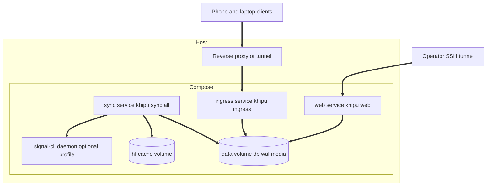
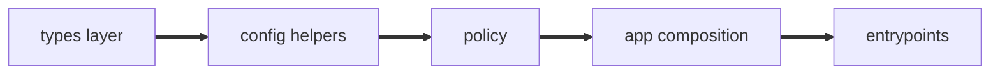
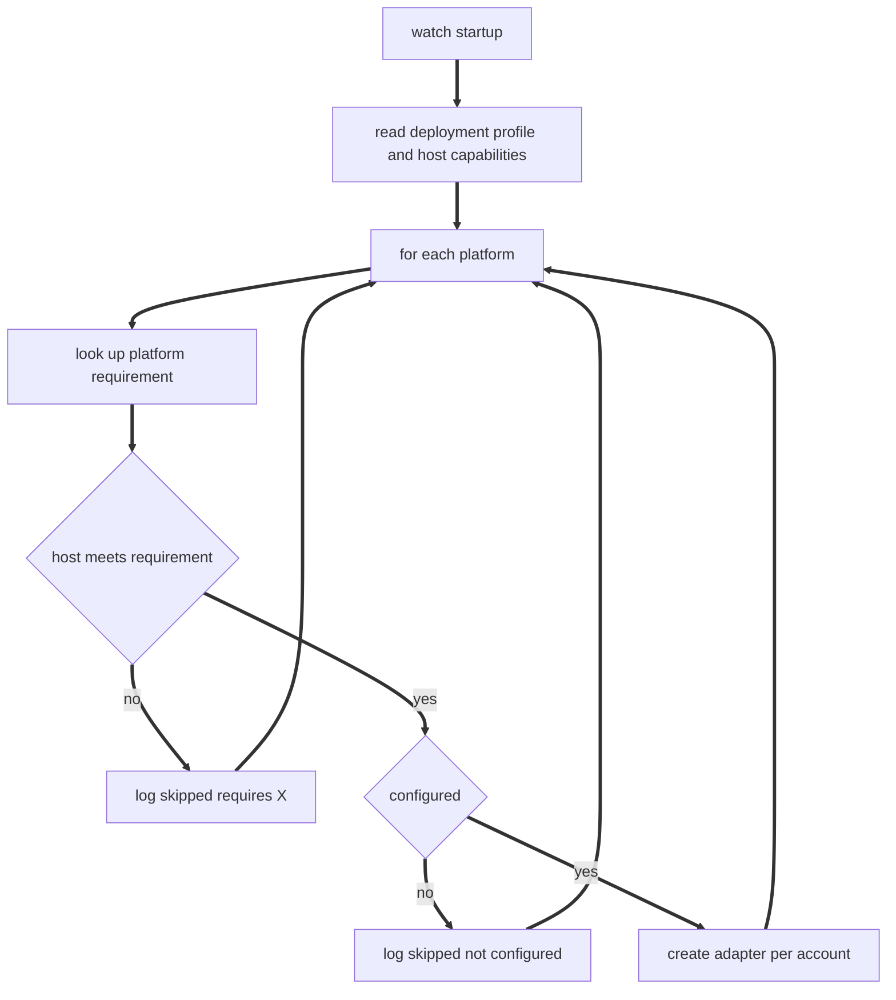
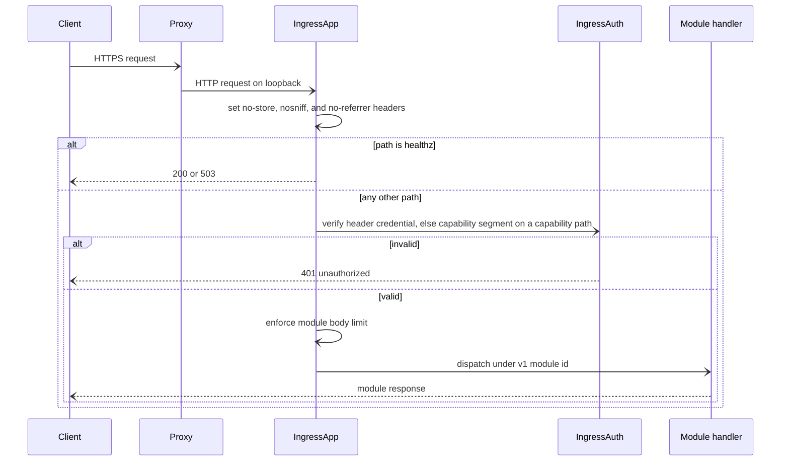
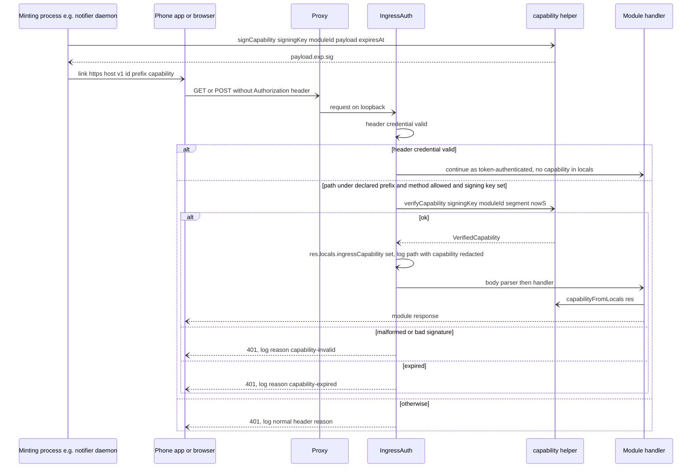
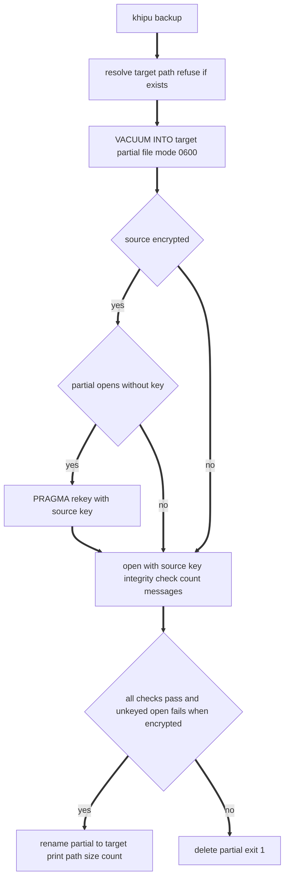

# Design Document: cloud-deployment

## Overview
**Purpose**: This feature lets the user run khipuchat unattended on a Linux server they control, so new messages on network-reachable platforms reach the archive within minutes while the laptop is closed, and gives later Phase 5 specs one authenticated HTTP entry point.

**Users**: The operator (the user) deploys and maintains the server with `docker compose`. Downstream spec developers (presence-context, notifier, action-runner) mount routes on the ingress; triage-agent, notifier, and action-runner locate their data files through the data file resolver.

**Cross-spec decisions**: Phase 5 decisions D2 (full secret allowlist), D3 (signed capability paths, formerly notifier UC-1 and UC-2), D4 (`IngressContext.env`, transitive isolation), D5 (`resolveDataFile`), D6 (isolation allowances for DDL-only schema modules), D10 (guide documents `KHIPU_LLM_LOCAL_HOSTS`), and D13 and D17 (compose stop grace period of 45 s exceeds the 15 s sync-cycle wait plus the 25 s daemon shutdown deadline, 40 s) in `.kiro/specs/phase5-cross-spec-decisions.md` are binding and are folded into this design.

**Impact**: Replaces the broken Alpine/Node 20 image and compose loop, replaces 18 divergent DB path literals with one resolver, replaces the hardcoded `LOCAL_ONLY_PLATFORMS` set with per-platform host requirements, and adds a new `khipu ingress` process (with signed capability paths for header-less links), a `khipu backup` command, secret-file loading, and one data file resolver. The web UI and MCP server keep their current behavior on a Mac.

### Goals
- `docker compose up -d` on Linux runs sync daemon, web UI, and ingress unattended with persistent data.
- Every entrypoint opens the same DB through `KHIPU_DB_PATH` or the unchanged default.
- The server only starts platforms whose host requirement it meets.
- A stable, documented ingress route-registration contract with authentication owned by the ingress, including signed capability paths.
- One cwd-independent location rule for feature data files.
- Verifiable online backups that never leave an encrypted archive unencrypted.

### Non-Goals
- Cloud vendor provisioning, Kubernetes, multi-tenant use.
- Running iMessage, WhatsApp, Zalo, Beeper-backed Signal or Facebook on the server.
- In-process TLS, rate limiting, backup scheduling or retention.
- Any actual presence or notifier route (owned by those specs).
- Fixing `watch.ts` not advancing `last_synced_at` (folded into message-events by decision D1).
- Single-use redemption, one action per notification, and nonce-hash storage for capability links (notifier, DB side).
- Creating any table: this spec defines no table, so the D6 schema-module convention does not apply to it beyond the isolation allowances.

## Boundary Commitments

### This Spec Owns
- The container image (`Dockerfile`, `.dockerignore`) and compose stack (`docker-compose.yml`).
- `KHIPU_DB_PATH` semantics and the `resolveDbPath` helper; every DB open call site in `src/` uses it.
- `resolveDataFile` in `src/db-path.ts` and the data file location rule (D5); the list of recognized data file names and settings.
- `initDb` lock-wait behavior (`busy_timeout`), nothing else in `db.ts`.
- The deployment profile (`KHIPU_DEPLOYMENT`) and host capability detection.
- Platform host requirements (`PlatformRequirement`) and the gating decision used by the watch daemon, the serial sync orchestrator, and one-shot sync routing.
- `<NAME>_FILE` secret loading and its full Phase 5 allowlist (D2); other specs only verify their names are present.
- The ingress process: config, authentication, health and ping endpoints, request limits, error envelope, security headers, module registration list, and the `IngressModule` / `IngressContext` contract (including `IngressContext.env`, D4).
- Signed capability paths (D3): `IngressModule.capabilityPaths`, `src/ingress/capability.ts` (token format, key derivation, `signCapability`, `verifyCapability`, `capabilityFromLocals`), `INGRESS_SIGNING_KEY`, capability verification in the auth step, `res.locals.ingressCapability`, and log redaction.
- The ingress isolation test, including its transitive import closure and the D6 allowances.
- Web UI bind host/port settings and the non-loopback auth guard.
- The `khipu backup` command.
- CI workflow alignment, the deployment guide, the environment template, and the README Docker section.

### Out of Boundary
- Presence routes, OwnTracks payload handling, `device_locations` (presence-context).
- Notification callbacks and delivery, capability nonce minting policy, single-use redemption, and nonce-hash storage (notifier).
- Feature data file contents and parsing (triage-agent, notifier, action-runner); `KHIPU_LLM_LOCAL_HOSTS` semantics (llm-provider); `src/schema-registry.ts` and schema modules (message-events and each table-owning spec).
- Slack session-token backend, expiry detection, re-auth (slack-all-workspaces).
- `message_events`, `pollCycle` internals, `insertMessage` (message-events).
- LLM provider config (llm-provider).
- Platform adapter internals beyond replacing the DB open literal.
- Web UI routes, UI, and basic-auth middleware (unchanged; web-ui spec).
- MCP transport: stdio by default; the opt-in remote Streamable HTTP endpoint (`khipu mcp --http`) is owned by remote-mcp and never mounted on the ingress (D18).

### Allowed Dependencies
- Node 24 built-ins (`node:path`, `node:fs`, `node:crypto`, `node:http`, `node:os`).
- Existing dependencies: `express` 5, `better-sqlite3-multiple-ciphers`, `dotenv`, `supertest` (tests).
- `src/db.ts` (`initDb`, `getDb`), `src/account-registry.ts` (`loadRegistry`), `src/platforms/types.ts`, `src/platforms/signal/backend.ts` (`selectedSignalBackend`), `src/sync-all.ts` (`PLATFORMS`).
- `src/ingress/**` and every registered module must NOT import, directly or transitively, `src/mcp.ts`, `src/remote-mcp/**`, `src/tool-registry.ts`, `src/query-handlers.ts`, `src/web/**`, `src/ask.ts`, `src/cli.ts`. Enforced by test. DDL-only schema modules (`src/<area>/schema.ts`, `src/<name>-schema.ts`) and `src/schema-registry.ts` are allowed in the closure (D6).
- No new runtime npm dependency. No Beeper dependency.

### Revalidation Triggers
- Any change to `IngressModule`, `IngressContext` (including `env`), the `/v1/<id>` base-path rule, credential sources, or `INGRESS_TOKEN_<ID>` naming: presence-context, notifier, and action-runner must re-check.
- Any change to the capability token format, the key derivation label `khipu-ingress-capability:v1:<id>`, `CapabilityPathSpec` validation, `res.locals.ingressCapability`, `AuthFailureReason` capability values, or `INGRESS_SIGNING_KEY` rules: notifier must re-check; presence-context re-runs its ingress tests.
- Any change to `resolveDataFile` semantics or the recognized data file list: triage-agent, notifier, action-runner, and the deployment guide.
- Any change to the isolation test's closure rules or D6 allowances: triage-agent, notifier, action-runner, presence-context, and message-events.
- Any change to `resolveDbPath` default or `KHIPU_DB_PATH` semantics: every entrypoint and the compose file.
- Adding a platform to the `Platform` union: it must get a `PlatformRequirement` entry (compile-time enforced by `Record<Platform, ...>`).
- Changing the secret allowlist: the environment template and guide, and every spec that verifies its names (slack-all-workspaces, llm-provider, notifier, action-runner).
- Changing published ports or volume layout: deployment guide and backup instructions.

## Architecture

### Existing Architecture Analysis
- One process per role (sync daemon `watch.ts`, `web/server.ts`, `mcp.ts`), all sharing one SQLite file in WAL mode. `bin/khipu` spawns `tsx src/khipu.ts`, which resolves a subcommand to a script and spawns it with the inherited environment.
- `watch.ts` decides which adapters to start with `isConfigured()` plus `registry.listAccounts()`; `LOCAL_ONLY_PLATFORMS` short-circuits to "configured".
- Web basic auth lives in `src/web/routes.ts`; MCP bearer secret in `src/mcp.ts`. Both are unchanged.
- Technical debt worked around: `khipu.ts` (currently 303 lines) and `db.ts` (315 lines) already exceed 200 lines; this design adds at most a few lines to each and puts new logic in new modules.

### Architecture Pattern & Boundary Map





**Dependency direction** (imports only point leftward; violations are errors):
1. Types: `src/platforms/types.ts`, `src/ingress/types.ts`
2. Config helpers: `src/db-path.ts`, `src/deployment.ts`, `src/secret-files.ts`, `src/ingress/capability.ts`, `src/ingress/config.ts`, `src/web/bind.ts`
3. Policy: `src/platform-capabilities.ts`, `src/ingress/auth.ts`
4. App composition: `src/ingress/app.ts`, `src/ingress/modules.ts`, `src/backup.ts`
5. Entrypoints: `src/watch.ts`, `src/sync-all.ts`, `src/khipu.ts`, `src/ingress/server.ts`, `src/web/server.ts`, all other `initDb` callers

**Architecture Integration**:
- Selected pattern: separate process per surface, shared DB file, explicit static module registration for the ingress.
- Existing patterns preserved: tsx runtime, Express 5, sync DB, `khipu` subcommand routing via spawned scripts, env-driven config, `:memory:` real-DB tests, dependency injection of env and OS for testability.
- New components rationale: each new module owns one setting family or one policy so entrypoints stay thin and under 200 lines.
- Steering compliance: MCP is never reachable through the ingress (stdio by default, remote HTTP only via the separate remote-mcp process), no `any`, no new dependency, no Beeper dependency, files under 200 lines.

### Technology Stack

| Layer | Choice / Version | Role in Feature | Notes |
|-------|------------------|-----------------|-------|
| Runtime | Node.js 24 via `node:24-bookworm-slim` | Container base for builder and runtime | Replaces `node:20-alpine`; glibc needed by onnxruntime-node and sqlite-vec |
| Backend | Express 5 (existing) | Ingress HTTP app | `express.json({ limit })` for body limits |
| Data | better-sqlite3-multiple-ciphers (existing) | `busy_timeout`, `VACUUM INTO`, `PRAGMA rekey` | No schema change |
| Infrastructure | Docker Compose v2 | Services, restart policy, healthcheck, secrets, profiles | `restart: unless-stopped` |
| CI | GitHub Actions `setup-node@v4` Node 24, `docker/build-push-action` or plain `docker build` | Test and image smoke | Extends existing `ci.yml` |

## File Structure Plan

### Directory Structure
```
src/
├── db-path.ts                 # resolveDbPath + directory guard + resolveDataFile; the only place the default DB location is defined
├── deployment.ts              # KHIPU_DEPLOYMENT parsing, host capabilities, startup warnings
├── secret-files.ts            # <NAME>_FILE allowlist resolution (full Phase 5 allowlist, D2)
├── platform-capabilities.ts   # PLATFORM_REQUIREMENTS, gate decision, isConfigured (moved from watch.ts)
├── backup.ts                  # khipu backup entrypoint + runBackup()
├── web/
│   └── bind.ts                # resolveWebBind: WEB_HOST/WEB_PORT + non-loopback auth guard
└── ingress/
    ├── types.ts               # IngressModule, IngressContext, IngressLogger, IngressConfig, CapabilityPathSpec, VerifiedCapability types
    ├── capability.ts          # signCapability, verifyCapability, capabilityFromLocals, readSigningKey, redactCapabilityPath (node:crypto only)
    ├── config.ts              # loadIngressConfig(env): Result (tokens, signing key)
    ├── auth.ts                # token extraction, capability path verification, constant-time compare middleware
    ├── app.ts                 # createIngressApp: validation, headers, /healthz, /v1/ping, mounts, 404, errors
    ├── modules.ts             # INGRESS_MODULES: the single registration list (empty at this spec)
    └── server.ts              # khipu ingress entrypoint: secrets, config, db, listen, shutdown
tests/
├── db-path.test.ts
├── deployment.test.ts
├── secret-files.test.ts
├── platform-capabilities.test.ts
├── backup.test.ts
├── web-bind.test.ts
├── ingress-config.test.ts
├── ingress-capability.test.ts # sign/verify, key derivation per module, reasons, locals reader, redaction
├── ingress-auth.test.ts
├── ingress-app.test.ts
├── ingress-isolation.test.ts  # transitive static import scan from src/ingress and modules.ts, D6 allowances
└── deploy-config.test.ts      # compose/env-template/Dockerfile consistency checks
docs/
└── DEPLOYMENT.md              # operator guide
```

### Modified Files
- `Dockerfile`: Node 24 bookworm-slim two-stage build, toolchain in builder, non-root `node` user, `/app/data` owned by `node`, env `KHIPU_DEPLOYMENT=server`, `KHIPU_DB_PATH=/app/data/khipuchat.db`, `MEDIA_DIR=/app/data/media`, `HF_HOME=/app/.cache/huggingface`, `WEB_HOST=0.0.0.0`, `INGRESS_HOST=0.0.0.0`.
- `.dockerignore`: also exclude `.zalo_session.json`, `.wwebjs_auth`, `backups/`, `*.db-wal`, `*.db-shm`.
- `docker-compose.yml`: services `sync`, `web`, `ingress`, optional `signal-cli` (profile `signal`); volumes `khipu-data` at `/app/data`, `hf-cache`, `signal-cli-data`, `signal-cli-socket`; loopback-only ports; restart policy; ingress healthcheck; commented compose `secrets` example.
- `.env.example`: add `KHIPU_DB_PATH`, `KHIPU_DEPLOYMENT`, `INGRESS_TOKEN`, `INGRESS_SIGNING_KEY`, `INGRESS_HOST`, `INGRESS_PORT`, `INGRESS_TRUST_PROXY`, `WEB_HOST`, `WEB_PORT`, `MEDIA_DIR`, `SIGNAL_BACKEND`, `SIGNAL_CLI_SOCKET`, `MCP_HTTP_HOST`, `MCP_HTTP_PORT`, `MCP_ALLOWED_ORIGINS` (remote-mcp, D18), every secret name of the allowlist without values (13.11), and a `_FILE` note.
- `README.md`: Docker Quickstart points at `docs/DEPLOYMENT.md`, Node 24 prerequisite, corrected `docker run` volume.
- `.github/workflows/ci.yml`: Node 24, branches `[master, main]`, `docker-image` job.
- `src/db.ts`: `initDb` adds `busy_timeout = 5000` immediately after the key pragma. No other change.
- `src/platforms/types.ts`: add `PlatformRequirement` type.
- `src/watch.ts`: open DB via `resolveDbPath()`; remove `LOCAL_ONLY_PLATFORMS`, `REQUIRED_ENV_VARS`, `isConfigured` (re-export `isConfigured` from `platform-capabilities.ts` for existing tests); startup loop calls `gatePlatform()` and logs skip reasons; calls `logStartupWarnings()`. `pollCycle` untouched.
- `src/sync-all.ts`: skip platforms whose gate decision is `unsupported`, log the reason, not counted as failure.
- `src/khipu.ts`: apply `resolveSecretFiles()` to the child env before spawn (exit 1 on error); add `ingress` and `backup` subcommands and help lines; for `sync <platform>` and `sync <platform>@<account>`, return an error result when the gate says `unsupported`. Gate injected through `ResolveDeps.hostSupports` for tests.
- `src/web/server.ts`: `main()` uses `resolveDbPath()`, `resolveWebBind()`, and `logStartupWarnings()`.
- `src/mcp.ts`, `src/cli.ts`, `src/ask.ts`, `src/khipu-list.ts`, `src/khipu-sync-status.ts`, `src/index-embeddings.ts` (default branch only; `--db` keeps precedence), and the 9 `src/platforms/*/sync.ts` files: replace the DB path literal with `resolveDbPath()`.
- `tests/watch.test.ts`: update the two `LOCAL_ONLY` expectations to be host-aware (inject env and OS).

## System Flows

### Sync daemon startup gating

Key decisions: the requirement check precedes the credential check, so on the server macOS and desktop-session platforms are never "configured by default". On a local deployment on macOS every requirement is met, preserving today's behavior.

### Ingress request handling

Key decisions: authentication runs before routing, so unknown paths also return 401 to unauthenticated callers (no route enumeration). Body parsing runs after authentication, so unauthenticated large bodies are never parsed.

### Capability path authentication

Key decisions: a valid header credential always wins, so operator tools keep working on capability paths. The signature is checked before the expiry, so `capability-expired` is only logged for authentic tokens. The ingress knows nothing about single use; the module (notifier) enforces single use and one action per notification on the DB side, keyed by the verified payload.

### Backup


## Requirements Traceability

| Requirement | Summary | Components | Interfaces | Flows |
|-------------|---------|------------|------------|-------|
| 1.1, 1.2, 1.3, 1.4, 1.5 | Node 24 image, multi-arch, native modules load, non-root, server profile | ContainerImage, CiWorkflow | Dockerfile env | |
| 2.1, 2.2, 2.3, 2.4, 2.5 | One DB location | DbPathResolver, all entrypoints | `resolveDbPath` | |
| 3.1, 3.2, 3.4 | Persistent directory volume, caches separate | ComposeStack | volumes | |
| 3.3 | Concurrent access waits on locks | DbBusyTimeout in `initDb` | `initDb` | |
| 4.1, 4.2, 4.4 | Daemon as service command, restart, no TTY | ComposeStack | compose services | |
| 4.5 | Optional `remote-mcp` profile service `mcp-http`, loopback publish, healthcheck | ComposeStack | compose services | |
| 4.3 | Graceful stop | ComposeStack (`stop_grace_period`), existing watch shutdown | | |
| 5.1, 5.4, 5.5 | Requirement classification incl. Signal backend | PlatformCapabilityGate | `PLATFORM_REQUIREMENTS`, `requirementFor` | Sync startup gating |
| 5.2, 5.3 | Server skips, Mac unchanged | PlatformCapabilityGate, DeploymentProfile, WatchStartup | `gatePlatform` | Sync startup gating |
| 5.6 | One-shot sync refuses | CommandRouter | `ResolveDeps.hostSupports` | |
| 5.7 | Serial sync skips | SyncAllGate | `gatePlatform` | |
| 6.1, 6.2, 6.3, 6.4 | Env or `_FILE` secrets | SecretFileLoader, CommandRouter, IngressServer | `resolveSecretFiles` | |
| 6.7 | Full Phase 5 allowlist, including `MCP_TOKEN_*` (D18) | SecretFileLoader | `SECRET_NAMES`, `SECRET_NAME_PATTERNS` | |
| 6.5 | Unencrypted warning | DeploymentProfile | `startupWarnings` | |
| 6.6 | No secrets in logs or responses | IngressAuth, IngressApp, SecretFileLoader | error envelope | Ingress request |
| 7.1, 7.2, 7.3 | Separate port, loopback default, token validation | IngressConfig, IngressServer | `loadIngressConfig` | |
| 7.4, 7.5 | `/healthz`, `/v1/ping` | IngressApp | API contract | Ingress request |
| 7.6, 7.7 | Startup log, graceful stop | IngressServer | | |
| 7.8 | Loopback publish, healthcheck | ComposeStack | | |
| 8.1, 8.2, 8.3, 8.4, 8.5, 8.6, 8.7, 8.8 | Token auth (8.6 defers to Requirement 15 on capability paths) | IngressAuth | `createAuthMiddleware` | Ingress request |
| 9.1, 9.2, 9.5, 9.6 | Registration list, validation (incl. capability path declarations), context incl. env | IngressModuleRegistry, IngressApp | `IngressModule`, `IngressContext`, `validateModules` | |
| 9.8 | Modules read env from context | IngressApp, IngressIsolationTest | `IngressContext.env` | |
| 9.3, 9.4, 9.7 | Body limit, error envelope, headers | IngressApp | API contract | Ingress request |
| 10.1, 10.2, 10.3 | No query surfaces or MCP (stdio or remote) on ingress, transitive closure | IngressIsolationTest, IngressApp | | |
| 10.4 | D6 allowances for DDL-only schema modules | IngressIsolationTest | | |
| 11.1, 11.2, 11.3 | Web bind and guard | WebBind, ComposeStack | `resolveWebBind` | |
| 12.1, 12.2, 12.3, 12.4, 12.5, 12.6 | Online verified backup | BackupCommand | `runBackup` | Backup |
| 13.1, 13.2, 13.3, 13.4, 13.5, 13.6, 13.7 | Guide and template | DeploymentDocs | | |
| 13.9, 13.10, 13.11, 13.12 | Guide: Ollama and `KHIPU_LLM_LOCAL_HOSTS`, signing key and link exposure, secret list, data file locations | DeploymentDocs | | |
| 13.8 | Template completeness test | DeployConfigTest | | |
| 14.1, 14.2, 14.3, 14.4 | CI | CiWorkflow | | |
| 15.1 | Capability path declaration and validation | IngressApp, IngressContracts | `CapabilityPathSpec`, `validateModules` | |
| 15.2, 15.3, 15.5, 15.6, 15.9 | Capability verification in the auth step, header wins, 401 reasons, before body parsing, locals | IngressAuth, CapabilityTokens | `createAuthMiddleware`, `verifyCapability`, `capabilityFromLocals` | Capability path authentication |
| 15.4, 15.10, 15.11 | Token format, per-module key, constant-time compare, signing function | CapabilityTokens | `signCapability`, `verifyCapability` | Capability path authentication |
| 15.7, 15.8 | Optional signing key, warning, minimum length | IngressConfig, IngressServer, CapabilityTokens | `readSigningKey`, `loadIngressConfig` | |
| 15.10 | Log redaction | IngressAuth, IngressApp, CapabilityTokens | `redactCapabilityPath` | Capability path authentication |
| 15.12 | No-referrer header | IngressApp | API contract | Ingress request |
| 16.1, 16.2, 16.3, 16.4, 16.5, 16.6 | Data file locations | DataFileResolver | `resolveDataFile` | |

## Components and Interfaces

| Component | Domain/Layer | Intent | Req Coverage | Key Dependencies | Contracts |
|-----------|--------------|--------|--------------|------------------|-----------|
| DbPathResolver | Config | Resolve the one DB path | 2.1 to 2.5 | node:path, node:fs (P0) | Service |
| DataFileResolver | Config | Resolve feature data file locations next to the DB | 16.1 to 16.6 | DbPathResolver (P0) | Service |
| DbBusyTimeout | Data | Wait on locks instead of failing | 3.3 | db.ts (P0) | State |
| DeploymentProfile | Config | Profile, host capabilities, warnings | 1.5, 5.2, 5.3, 6.5 | none | Service |
| SecretFileLoader | Config | `<NAME>_FILE` resolution | 6.1 to 6.4, 6.6, 6.7 | node:fs (P0) | Service |
| CapabilityTokens | Config | Sign, verify, read, and redact capabilities | 15.4, 15.7, 15.8, 15.10, 15.11 | node:crypto (P0) | Service |
| PlatformCapabilityGate | Policy | Requirement table and gate decision | 5.1 to 5.5 | DeploymentProfile (P0), account-registry (P0), signal backend (P1) | Service |
| WatchStartup | Entrypoint | Use gate in daemon startup | 5.2, 5.3, 6.5 | PlatformCapabilityGate (P0) | |
| SyncAllGate | Entrypoint | Use gate in serial sync | 5.7 | PlatformCapabilityGate (P0) | |
| CommandRouter | Entrypoint | Secrets, new subcommands, one-shot gate | 5.6, 6.2, 6.3, 6.4 | SecretFileLoader (P0), PlatformCapabilityGate (P0) | Service |
| IngressConfig | Config | Parse ingress settings | 7.2, 7.3, 8.5, 15.7, 15.8 | IngressModuleRegistry ids (P1), CapabilityTokens (P0) | Service |
| IngressAuth | Policy | Token and capability check | 8.1 to 8.8, 6.6, 15.2, 15.3, 15.5, 15.6, 15.9, 15.10 | node:crypto (P0), CapabilityTokens (P0) | Service |
| IngressApp | Composition | Build Express app | 7.4, 7.5, 9.1 to 9.8, 10.1, 15.1, 15.6, 15.12 | IngressAuth (P0), express (P0) | API, Service |
| IngressModuleRegistry | Composition | Single module list | 9.1, 9.6 | downstream modules | State |
| IngressServer | Entrypoint | Process lifecycle | 7.1, 7.6, 7.7, 6.5, 15.7 | all ingress parts (P0) | |
| IngressIsolationTest | Test | Enforce no query-surface imports, transitively | 9.8, 10.2, 10.4 | | |
| WebBind | Config | Web host/port and guard | 11.1, 11.2 | none | Service |
| BackupCommand | Composition | Verified online backup | 12.1 to 12.6 | DbPathResolver (P0), better-sqlite3-multiple-ciphers (P0) | Service, Batch |
| ContainerImage | Infra | Dockerfile, dockerignore | 1.1 to 1.5 | | |
| ComposeStack | Infra | Services, volumes, ports | 3.1, 3.2, 3.4, 4.1 to 4.5, 7.8, 11.3 | ContainerImage (P0) | |
| CiWorkflow | Infra | Node 24 tests, image smoke | 14.1 to 14.4, 1.2 | ContainerImage (P0) | |
| DeploymentDocs | Docs | Guide, template, README | 13.1 to 13.7, 13.9 to 13.12 | | |
| DeployConfigTest | Test | Template and compose consistency | 13.8, 3.1, 7.8, 11.3 | | |

### Config Layer

#### DbPathResolver

| Field | Detail |
|-------|--------|
| Intent | Single source of the archive file location |
| Requirements | 2.1, 2.2, 2.3, 2.4, 2.5 |

**Responsibilities & Constraints**
- Owns the default location: `path.join(PROJECT_ROOT, 'khipuchat.db')` where `PROJECT_ROOT` is the parent of `src/`.
- Relative `KHIPU_DB_PATH` values resolve against `process.cwd()`; absolute values are used as is. `:memory:` passes through unchanged (tests).
- Before returning a file path: if it is an existing directory, throw `DbPathError`; otherwise create the parent directory recursively.
- Callers that accept an explicit path (`index-embeddings --db`) pass it as `explicit`, which wins.

**Contracts**: Service [x]

##### Service Interface
```typescript
export class DbPathError extends Error {
  readonly dbPath: string
}

export interface ResolveDbPathOptions {
  readonly env?: NodeJS.ProcessEnv          // default process.env
  readonly explicit?: string                // e.g. --db argument
  readonly cwd?: string                     // default process.cwd()
}

/** Returns the absolute DB file path (or ':memory:'). Throws DbPathError. */
export function resolveDbPath(opts?: ResolveDbPathOptions): string

export const DEFAULT_DB_PATH: string
```
- Preconditions: none.
- Postconditions: returned path's parent directory exists; the path is not a directory.
- Invariants: `DEFAULT_DB_PATH` is independent of cwd.

**Implementation Notes**
- Integration: entrypoints call `initDb(resolveDbPath())`. A `DbPathError` at top level prints `KHIPU_DB_PATH "<path>" is a directory; set it to a file path such as <path>/khipuchat.db` and exits 1.
- Risks: users who ran syncs from a cwd other than the repo root had a DB elsewhere; the guide notes `KHIPU_DB_PATH` to point at it.

#### DataFileResolver

| Field | Detail |
|-------|--------|
| Intent | One location rule for feature data files (D5) |
| Requirements | 16.1, 16.2, 16.3, 16.4, 16.5, 16.6 |

**Responsibilities & Constraints**
- Lives in `src/db-path.ts` next to `resolveDbPath` so the archive directory rule has one owner.
- `env[envVar]` non-empty wins (absolute as is, relative against `cwd`); otherwise `join(dirname(resolveDbPath({ env, cwd })), name)`. When `resolveDbPath` returns `:memory:`, the directory is `dirname(DEFAULT_DB_PATH)` (16.3).
- Never creates, reads, or stats the data file (16.4). Propagates `DbPathError` from `resolveDbPath`.
- `name` must be a bare file name (no `/` or a backslash, not `.` or `..`), else `TypeError` (16.5).
- On the server the default places the files in `/app/data`, the persistent `khipu-data` volume, next to the archive.

**Contracts**: Service [x]

##### Service Interface
```typescript
export interface ResolveDataFileOptions {
  readonly env?: NodeJS.ProcessEnv          // default process.env
  readonly cwd?: string                     // default process.cwd()
}

/** e.g. resolveDataFile('khipu.triage.json', 'KHIPU_TRIAGE_CONFIG'). Throws DbPathError or TypeError. */
export function resolveDataFile(name: string, envVar: string, opts?: ResolveDataFileOptions): string

/** Recognized data files (16.6); owners call resolveDataFile with their own pair. Used by the guide check. */
export const KNOWN_DATA_FILES: readonly { readonly name: string; readonly envVar: string; readonly owner: string }[]
// [{ name: 'khipu.triage.json', envVar: 'KHIPU_TRIAGE_CONFIG', owner: 'triage-agent' },
//  { name: 'khipu.notify.json', envVar: 'KHIPU_NOTIFY_CONFIG', owner: 'notifier' },
//  { name: 'khipu.actions.json', envVar: 'KHIPU_ACTIONS_CONFIG', owner: 'action-runner' }]
```
- Invariants: `khipu.config.json` (account registry) is not in the list and keeps its existing location rules.

#### DeploymentProfile

| Field | Detail |
|-------|--------|
| Intent | Decide local vs server and which host capabilities exist |
| Requirements | 1.5, 5.2, 5.3, 6.5 |

**Contracts**: Service [x]

##### Service Interface
```typescript
export type DeploymentProfile = 'local' | 'server'

export interface HostCapabilities {
  readonly profile: DeploymentProfile
  readonly macos: boolean          // os === 'darwin'
  readonly localSession: boolean   // profile !== 'server'
}

export class DeploymentConfigError extends Error {}

/** Reads KHIPU_DEPLOYMENT; empty means 'local'. Unknown values throw DeploymentConfigError. */
export function readDeploymentProfile(env?: NodeJS.ProcessEnv): DeploymentProfile

export function detectHostCapabilities(
  env?: NodeJS.ProcessEnv,
  os?: NodeJS.Platform,            // default process.platform
): HostCapabilities

/** Human-readable warnings; currently: server profile without DB_KEY. */
export function startupWarnings(env?: NodeJS.ProcessEnv): readonly string[]

/** Logs each warning with console.warn, prefixed by the service name. */
export function logStartupWarnings(service: string, env?: NodeJS.ProcessEnv): void
```
- Invariants: warnings never include secret values.

#### SecretFileLoader

| Field | Detail |
|-------|--------|
| Intent | Load allowlisted secrets from files |
| Requirements | 6.1, 6.2, 6.3, 6.4, 6.6, 6.7 |

**Responsibilities & Constraints**
- Allowlist (`SECRET_NAMES`), the full Phase 5 set (D2): `DB_KEY`, `INGRESS_TOKEN`, `INGRESS_SIGNING_KEY`, `WEB_USER`, `WEB_PASS`, `MCP_SECRET`, `KHIPU_LLM_API_KEY`, `TELEGRAM_API_HASH`, `TELEGRAM_SESSION_STRING`, `DISCORD_TOKEN`, `SLACK_USER_TOKEN`, `SLACK_COOKIE`, `EMAIL_IMAP_PASS`, `NTFY_TOKEN`, `PUSHOVER_APP_TOKEN`, `PUSHOVER_USER_KEY`, `TELEGRAM_NOTIFY_BOT_TOKEN`.
- Name patterns (`SECRET_NAME_PATTERNS`): `^INGRESS_TOKEN_[A-Z0-9_]+$` (per-module ingress tokens), `^SLACK_(TOKEN|COOKIE)_[A-Z0-9_]+$` (per-workspace Slack credentials, slack-all-workspaces), and `^MCP_TOKEN_[A-Z0-9_]+$` (per-client remote MCP bearer tokens, remote-mcp, D18). Pattern names are discovered from env keys ending in `_FILE`: an env key `<X>_FILE` is always the companion of `<X>`, so a secret name itself never ends in `_FILE`.
- Other specs (slack-all-workspaces, llm-provider, notifier, action-runner) do not edit the allowlist; their allowlist tasks only verify their names resolve.
- For each allowlisted name with `<NAME>_FILE` set: conflict if `<NAME>` is non-empty; read file; strip one trailing `\n` (and preceding `\r`); return as an addition.
- Pure function with injected reader; never mutates the input env.

**Contracts**: Service [x]

##### Service Interface
```typescript
export type SecretFileError =
  | { readonly kind: 'conflict'; readonly name: string }
  | { readonly kind: 'unreadable'; readonly name: string; readonly path: string }

export type SecretFileResult =
  | { readonly ok: true; readonly env: NodeJS.ProcessEnv }   // input env plus resolved values
  | { readonly ok: false; readonly error: SecretFileError }

export function resolveSecretFiles(
  env: NodeJS.ProcessEnv,
  readFile?: (path: string) => string,
): SecretFileResult

export function formatSecretFileError(error: SecretFileError): string  // never includes file contents

export const SECRET_NAMES: readonly string[]
export const SECRET_NAME_PATTERNS: readonly RegExp[]
export function isSecretName(name: string): boolean
```

**Implementation Notes**
- Integration: `khipu.ts` main resolves once, prints `formatSecretFileError` and exits 1 on failure, and spawns the child with the resolved env. `ingress/server.ts` and `backup.ts` also call it so `npm run`/`tsx` direct starts behave the same (idempotent: once `<NAME>` is populated, the `_FILE` entry is still present, so the router passes the resolved env with `<NAME>_FILE` removed to avoid a false conflict in children).

#### WebBind

| Field | Detail |
|-------|--------|
| Intent | Web UI listen address and safety guard |
| Requirements | 11.1, 11.2 |

**Contracts**: Service [x]

```typescript
export type WebBindResult =
  | { readonly ok: true; readonly host: string; readonly port: number }
  | { readonly ok: false; readonly message: string }

/** WEB_HOST default 127.0.0.1, WEB_PORT default 3333. Non-loopback requires WEB_USER and WEB_PASS. */
export function resolveWebBind(env?: NodeJS.ProcessEnv): WebBindResult

export function isLoopbackHost(host: string): boolean  // 127.0.0.0/8, ::1, localhost
```
- Implementation note: `web/server.ts` `main()` exits 1 with `message` on `ok: false`; `startServer` signature unchanged.

### Policy Layer

#### PlatformCapabilityGate

| Field | Detail |
|-------|--------|
| Intent | Decide whether a platform may run on this host |
| Requirements | 5.1, 5.2, 5.3, 5.4, 5.5 |

**Responsibilities & Constraints**
- Static table typed `Record<Platform, PlatformRequirement | 'signal-backend'>`:
  - `telegram`, `discord`, `slack`, `email`: `network`
  - `imessage`: `macos`
  - `whatsapp`, `zalo`, `facebook`: `local-session`
  - `signal`: resolved through `selectedSignalBackend(env)`: `cli` gives `network`, `beeper` gives `local-session`
- `isConfigured` moves here unchanged in behavior: only `imessage`, `whatsapp`, and `zalo` are configured by default (today's local-only set), and only after the requirement check passes; `facebook` and Beeper-backed `signal` keep today's `BEEPER_ACCESS_TOKEN`-or-registry check after their `local-session` requirement passes (preserves Mac behavior, 5.3).
- Signal with `cli` backend is configured through the registry's synthesized `default` account (existing `loadRegistry` behavior), never through `BEEPER_ACCESS_TOKEN` (5.4).

**Dependencies**
- Inbound: WatchStartup, SyncAllGate, CommandRouter (P0)
- Outbound: DeploymentProfile (P0), `loadRegistry` (P0), `selectedSignalBackend` (P1)

**Contracts**: Service [x]

##### Service Interface
```typescript
// src/platforms/types.ts
export type PlatformRequirement = 'macos' | 'local-session' | 'network'

// src/platform-capabilities.ts
export function requirementFor(platform: Platform, env?: NodeJS.ProcessEnv): PlatformRequirement

export function hostMeets(requirement: PlatformRequirement, host: HostCapabilities): boolean

export type GateDecision =
  | { readonly kind: 'run' }
  | { readonly kind: 'unsupported'; readonly requirement: PlatformRequirement; readonly profile: DeploymentProfile }
  | { readonly kind: 'not-configured' }

export interface GateDeps {
  readonly env?: NodeJS.ProcessEnv
  readonly host?: HostCapabilities
  readonly registry?: AccountRegistry
}

/** Requirement first, then configuration. */
export function gatePlatform(platform: Platform, deps?: GateDeps): GateDecision

export function isConfigured(platform: Platform, registry?: AccountRegistry, env?: NodeJS.ProcessEnv): boolean

/** e.g. "[imessage] skipped: requires macos (host: linux, deployment: server)" */
export function describeSkip(platform: Platform, decision: GateDecision, os?: NodeJS.Platform): string
```
- Postconditions: on `local` + `darwin` hosts, `gatePlatform` returns `run` for exactly the platforms today's `isConfigured` returns true for.

#### IngressAuth

| Field | Detail |
|-------|--------|
| Intent | Authenticate every non-health ingress request by header token or signed capability |
| Requirements | 8.1 to 8.8, 6.6, 15.2, 15.3, 15.5, 15.6, 15.9, 15.10 |

**Responsibilities & Constraints**
- Credential sources, checked in order, first present wins: `Authorization: Bearer <t>`; `Authorization: Basic <b64(user:pass)>` using `pass`; the module's declared `tokenHeader` when the path is under that module.
- A token in the query string (`token`, `access_token`, `key` params) is ignored for auth; the request fails as `query-token` reason if no header credential is valid and the request is not a capability path request.
- Accepted set for a path under `/v1/<id>`: master token plus `INGRESS_TOKEN_<ID>` if configured; for any other path: master only.
- Compare: SHA-256 both sides, `crypto.timingSafeEqual` on digests; iterate over every accepted token without early exit.
- Capability path match (15.2): path `/v1/<id><prefix>/<segment>` or deeper, where module `<id>` declares `capabilityPaths` with that `prefix` and `req.method` is in `methods` (HEAD is not treated as GET). Matching uses the raw path without query string.
- Order for a capability path request: (1) a valid header credential authenticates as today and leaves `res.locals.ingressCapability` unset (15.3); (2) otherwise, if `signingKey` is null, reject with the normal header reason (15.7); (3) otherwise `verifyCapability({ signingKey, moduleId: id, token: segment, nowS })` with `nowS = Math.floor(now().getTime() / 1000)`; `ok` sets `res.locals.ingressCapability` and calls `next()`; `malformed` or `invalid` rejects with `capability-invalid`, `expired` with `capability-expired` (15.5). This runs before the body parser and router (15.6).
- Query strings never carry a capability (15.9); a capability path whose segment is empty is not a capability path request.
- On failure: respond 401, `WWW-Authenticate: Bearer realm="khipuchat"`, body `{"error":"unauthorized"}`; log `[ingress] auth rejected <METHOD> <path> from <ip> reason=<missing|invalid|query-token|malformed|capability-invalid|capability-expired>`, where `<path>` passes through `redactCapabilityPath` so the segment prints as `<capability>` (15.10).

**Contracts**: Service [x]

##### Service Interface
```typescript
// TokenSet and ModuleAuthInfo are defined in src/ingress/types.ts (types layer) and imported here.
export type AuthFailureReason =
  | 'missing' | 'invalid' | 'query-token' | 'malformed'
  | 'capability-invalid' | 'capability-expired'

export function extractCredential(req: Request, module?: ModuleAuthInfo):
  | { readonly ok: true; readonly token: string }
  | { readonly ok: false; readonly reason: AuthFailureReason }

export function tokenMatches(presented: string, accepted: readonly string[]): boolean

/** Returns the module and capability segment when the request targets a declared capability path with an allowed method. */
export function matchCapabilityPath(method: string, path: string, modules: readonly ModuleAuthInfo[]):
  | { readonly moduleId: string; readonly segment: string }
  | null

export interface AuthMiddlewareOptions {
  readonly signingKey: string | null      // IngressConfig.signingKey
  readonly now: () => Date                // clock seam; same clock as IngressContext.now
}

export function createAuthMiddleware(
  tokens: TokenSet,
  modules: readonly ModuleAuthInfo[],
  log: IngressLogger,
  options: AuthMiddlewareOptions,
): RequestHandler
```
- Postcondition: after `next()`, `res.locals.ingressCapability` is either unset or a `VerifiedCapability` whose `moduleId` equals the target module.

### Ingress Composition

#### Ingress Contracts (`src/ingress/types.ts`): the downstream contract

This is the interface presence-context, notifier, and action-runner implement. It is stable within Phase 5; changes are revalidation triggers. `CapabilityPathSpec` and `VerifiedCapability` live here (types layer) so `IngressModule` can reference them without importing the config-helper layer; `src/ingress/capability.ts` re-exports both, so imports from either file (as written in the notifier design) are valid.

```typescript
import type { Router } from 'express'
import type Database from 'better-sqlite3-multiple-ciphers'

export interface IngressLogger {
  info(message: string): void
  warn(message: string): void
  error(message: string, err?: unknown): void
}

export interface IngressContext {
  /** The shared archive handle opened by the ingress process. Write via src/db.ts exports or module-owned statements. */
  readonly db: Database.Database
  /** Logger whose entries are prefixed with "[ingress:<module id>]". */
  readonly log: IngressLogger
  /** Clock seam for tests. */
  readonly now: () => Date
  /** Process environment after secret-file resolution (D4). Modules read settings here, never from process.env. */
  readonly env: NodeJS.ProcessEnv
}

/** Capability path declaration (D3). prefix /^\/[a-z][a-z0-9-]{0,15}$/; methods non-empty, no duplicates, only GET and POST. */
export interface CapabilityPathSpec {
  readonly prefix: string
  readonly methods: readonly ('GET' | 'POST')[]
}

/** Stored in res.locals.ingressCapability after a capability authenticated the request. */
export interface VerifiedCapability {
  readonly moduleId: string
  readonly payload: string
  readonly expiresAt: number          // unix seconds
}

export interface IngressModule {
  /** Lowercase id, /^[a-z][a-z0-9-]{1,31}$/. Mounted at /v1/<id>. Also selects INGRESS_TOKEN_<ID> (uppercased, '-' to '_'). */
  readonly id: string
  /** Optional extra header carrying the token (e.g. 'x-telegram-bot-api-secret-token'). RFC 7230 token chars, lowercase, not 'authorization'. */
  readonly tokenHeader?: string
  /** Max JSON or urlencoded body size in bytes; default 65536, max 1048576. */
  readonly bodyLimitBytes?: number
  /** Optional signed capability paths, e.g. { prefix: '/a', methods: ['GET', 'POST'] } for /v1/<id>/a/<capability>[/...]. */
  readonly capabilityPaths?: CapabilityPathSpec
  /** Register handlers on a router already mounted at /v1/<id> and already authenticated. Paths are relative ('/owntracks'). */
  mount(router: Router, ctx: IngressContext): void
}

export interface TokenSet {
  readonly master: string
  readonly perModule: ReadonlyMap<string, string>   // module id to token
}

export interface ModuleAuthInfo {
  readonly id: string
  readonly tokenHeader?: string                    // lowercase header name
  readonly capabilityPaths?: CapabilityPathSpec
}

export interface IngressConfig {
  readonly host: string            // INGRESS_HOST, default '127.0.0.1'
  readonly port: number            // INGRESS_PORT, default 3334
  readonly trustProxy: boolean     // INGRESS_TRUST_PROXY ('1' or 'true'); enables X-Forwarded-For client ip
  readonly tokens: TokenSet
  readonly signingKey: string | null   // INGRESS_SIGNING_KEY; null when unset or empty; at least 32 chars when set
}

/** Key in res.locals under which the verified capability is stored. */
export const INGRESS_CAPABILITY_LOCAL = 'ingressCapability'
```

Obligations for module authors:
- Modules never implement their own authentication, and never register paths outside their router.
- Modules must not import, directly or transitively, `src/mcp.ts`, `src/remote-mcp/**`, `src/tool-registry.ts`, `src/query-handlers.ts`, `src/web/**`, `src/ask.ts`, `src/cli.ts` (enforced by IngressIsolationTest, which follows the full transitive import closure from `modules.ts`). DDL-only schema modules and `src/schema-registry.ts` may appear in the closure (D6).
- Modules read settings from `ctx.env`, not `process.env` (D4, 9.8); the isolation test rejects `process.env` in files of the module closure outside `src/ingress/server.ts`, `src/db-path.ts`, `src/deployment.ts`, `src/secret-files.ts`, and `src/db.ts` (whose functions take an injected env with a `process.env` default).
- Modules declaring `capabilityPaths` read the verified capability only through `capabilityFromLocals(res)`; a `null` result means the request was header-token authenticated. Modules never log `req.path`, `req.url`, or `req.originalUrl` raw on capability paths; they log `redactCapabilityPath(path, [module])` or nothing (15.10).
- Single use, one action per notification, and nonce storage are module (DB side) concerns; the ingress verifies only signature, module, and expiry.
- Modules register by adding one import and one array entry to `src/ingress/modules.ts`.
- Request bodies arrive parsed (`application/json` and `application/x-www-form-urlencoded`) on `req.body`; modules validate their own payload shape and return 400 on invalid input.
- Handlers may be async; rejected promises are caught by the ingress error handler (Express 5 behavior).

#### CapabilityTokens (`src/ingress/capability.ts`)

| Field | Detail |
|-------|--------|
| Intent | Pure capability token helper shared by the ingress (verify) and minting processes (sign) |
| Requirements | 15.4, 15.7, 15.8, 15.10, 15.11 |

**Responsibilities & Constraints**
- Config-helper layer; imports only `node:crypto` and types from `src/ingress/types.ts`. No Express, no DB, no `process.env` access (callers pass the key).
- Token: `<payload>.<exp>.<sig>`. `payload` matches `^[A-Za-z0-9_-]{16,64}$`; `exp` matches `^(0|[1-9][0-9]{0,11})$` (unix seconds, decimal); `sig` is unpadded base64url of 32 bytes (43 chars).
- Module key: `moduleKey = HMAC-SHA256(key = INGRESS_SIGNING_KEY as UTF-8, message = 'khipu-ingress-capability:v1:' + moduleId)`. Signature: `sig = base64url(HMAC-SHA256(key = moduleKey, message = payload + '.' + exp))`.
- `verifyCapability` order: parse (fail `malformed`), recompute and compare decoded signature bytes with `crypto.timingSafeEqual` on equal-length buffers (fail `invalid`), then require `exp > nowS` (fail `expired`). A token signed for another module fails `invalid`.
- `signCapability` throws `RangeError` when `payload` does not match the pattern or `expiresAt` is not a non-negative safe integer; it does not check that `expiresAt` is in the future (callers choose lifetime).
- `readSigningKey(env)`: empty or unset gives `null`; set and shorter than 32 characters gives an error naming `INGRESS_SIGNING_KEY`. Used by `loadIngressConfig` and by minting processes (notifier daemon) so both apply the same rule.
- `redactCapabilityPath(path, modules)`: if `path` matches a declared capability path of any listed module (any method), replace the segment with `<capability>`; otherwise return `path` unchanged.
- Key rotation: changing `INGRESS_SIGNING_KEY` invalidates every outstanding link; no key list or key id in v1 (the `v1` label reserves room for one).

**Contracts**: Service [x]

##### Service Interface
```typescript
// src/ingress/capability.ts (owned by cloud-deployment; originally specified in notifier design; now owned here (D3))
export type { CapabilityPathSpec, VerifiedCapability } from './types.js'
export type CapabilityFailure = 'malformed' | 'invalid' | 'expired'

export const CAPABILITY_KEY_LABEL = 'khipu-ingress-capability:v1:'
export const SIGNING_KEY_MIN_LENGTH = 32

export function signCapability(input: {
  readonly signingKey: string
  readonly moduleId: string
  readonly payload: string
  readonly expiresAt: number
}): string

export function verifyCapability(input: {
  readonly signingKey: string
  readonly moduleId: string
  readonly token: string
  readonly nowS: number
}):
  | { readonly ok: true; readonly capability: VerifiedCapability }
  | { readonly ok: false; readonly reason: CapabilityFailure }

/** Reads res.locals.ingressCapability; returns null when absent or not a VerifiedCapability shape. */
export function capabilityFromLocals(res: { readonly locals: Record<string, unknown> }): VerifiedCapability | null

export function readSigningKey(env: NodeJS.ProcessEnv):
  | { readonly ok: true; readonly signingKey: string | null }
  | { readonly ok: false; readonly name: 'INGRESS_SIGNING_KEY'; readonly minLength: 32 }

export function redactCapabilityPath(path: string, modules: readonly ModuleAuthInfo[]): string
```
- Invariants: `verifyCapability({ ..., token: signCapability({ signingKey, moduleId, payload, expiresAt }), nowS })` is `ok` with the same `payload` and `expiresAt` exactly when `nowS < expiresAt`.

#### IngressConfig

| Field | Detail |
|-------|--------|
| Intent | Parse and validate ingress settings |
| Requirements | 7.2, 7.3, 8.5, 15.7, 15.8 |

```typescript
export type IngressConfigError =
  | { readonly kind: 'token-missing' }
  | { readonly kind: 'token-too-short'; readonly name: string; readonly minLength: 32 }   // name may be 'INGRESS_SIGNING_KEY'
  | { readonly kind: 'invalid-port'; readonly value: string }

export function loadIngressConfig(
  env: NodeJS.ProcessEnv,
  moduleIds: readonly string[],
): { readonly ok: true; readonly config: IngressConfig } | { readonly ok: false; readonly error: IngressConfigError }
```
- Per-module tokens are read only for registered module ids and must also be at least 32 characters.
- `signingKey` comes from `readSigningKey(env)`; a short key yields `token-too-short` with `name: 'INGRESS_SIGNING_KEY'` (15.8). The signing key is independent of `INGRESS_TOKEN`; the guide recommends a distinct random value.

#### IngressApp

| Field | Detail |
|-------|--------|
| Intent | Assemble the Express app from config and modules |
| Requirements | 7.4, 7.5, 9.1, 9.2, 9.3, 9.4, 9.5, 9.6, 9.7, 9.8, 10.1, 15.1, 15.6, 15.12 |

**Responsibilities & Constraints**
- Order: disable `x-powered-by`; set `trust proxy` from config; headers middleware (`Cache-Control: no-store`, `X-Content-Type-Options: nosniff`, `Referrer-Policy: no-referrer`); `GET /healthz`; auth middleware (`createAuthMiddleware(config.tokens, modules, log, { signingKey: config.signingKey, now })`); `GET /v1/ping`; per module `/v1/<id>` router with `express.json` and `express.urlencoded` limited to the module limit; JSON 404; error handler.
- Validates modules before building: id pattern, unique ids, `ping` reserved as an id, header name rules, body limit bounds, and `capabilityPaths` (prefix pattern `^/[a-z][a-z0-9-]{0,15}$`, methods a non-empty duplicate-free subset of `GET` and `POST`). Throws `IngressModuleError` naming the module.
- Builds each module's `IngressContext` with `db`, the module-prefixed logger, `now`, and `env` from the input (9.5, 9.8).
- The error handler and any ingress-written log line pass paths through `redactCapabilityPath` (15.10).
- Health check runs `SELECT 1` against `ctx.db`; any exception yields 503.

**Contracts**: Service [x] / API [x]

##### Service Interface
```typescript
export class IngressModuleError extends Error {
  readonly moduleId: string
}

export interface CreateIngressAppInput {
  readonly config: IngressConfig
  readonly modules: readonly IngressModule[]
  readonly db: Database.Database
  readonly log: IngressLogger
  readonly env: NodeJS.ProcessEnv      // resolved env passed to every IngressContext
  readonly now?: () => Date            // default () => new Date(); shared by auth and contexts
}

export function createIngressApp(input: CreateIngressAppInput): Application
export function validateModules(modules: readonly IngressModule[]): void   // throws IngressModuleError
```

##### API Contract
| Method | Endpoint | Auth | Request | Response | Errors |
|--------|----------|------|---------|----------|--------|
| GET | /healthz | none | none | 200 `{"status":"ok"}` | 503 `{"status":"unavailable"}` |
| GET | /v1/ping | token | none | 200 `{"ok":true}` | 401 |
| any | /v1/<id>/... | token (module rules) | module-defined, parsed body within limit | module-defined | 401, 413 `{"error":"payload_too_large"}`, 400 `{"error":"invalid_body"}` for unparsable JSON, 500 `{"error":"internal_error"}` |
| GET, POST (as declared) | /v1/<id><prefix>/<capability>[/...] | token (module rules) or signed capability for module `<id>` | module-defined; body parsed only after authentication | module-defined; `res.locals.ingressCapability` set when capability-authenticated | 401 `{"error":"unauthorized"}` (log reason `capability-invalid` or `capability-expired`), then as the row above |
| any | anything else | token | | | 401 unauthenticated, 404 `{"error":"not_found"}` authenticated |

#### IngressModuleRegistry

| Field | Detail |
|-------|--------|
| Intent | The single, auditable list of internet-facing modules |
| Requirements | 9.1, 9.6 |

```typescript
// src/ingress/modules.ts
export const INGRESS_MODULES: readonly IngressModule[] = []
```
- State: empty at this spec. Downstream specs each add one import and one entry: presence-context (`presence`), notifier (`notify`, declares capability paths `/a`), and action-runner (`actions`, laptop milestone).

#### IngressServer

| Field | Detail |
|-------|--------|
| Intent | `khipu ingress` process lifecycle |
| Requirements | 7.1, 7.6, 7.7, 6.5, 15.7 |

**Responsibilities & Constraints**
- Sequence: `dotenv`; `resolveSecretFiles`; `validateModules(INGRESS_MODULES)`; `loadIngressConfig`; `initDb(resolveDbPath())`; `logStartupWarnings('ingress')`; when `config.signingKey` is null and any module declares `capabilityPaths`, log exactly one warning `signed links disabled: INGRESS_SIGNING_KEY not set (modules: <ids>)` (15.7); `createIngressApp` with the resolved env; `listen(port, host)`; log `KhipuChat ingress listening on http://<host>:<port>` and one line per module `module <id> at /v1/<id>`, or `no route modules registered`.
- Any startup error: print a message without secret values, exit 1.
- SIGTERM/SIGINT: `server.close()`, force-close remaining connections after 10 s (`server.closeAllConnections()`), close DB, exit 0.
- EADDRINUSE: same message style as the web UI, exit 1.

### Data Layer

#### DbBusyTimeout
- `initDb` sets `PRAGMA busy_timeout = 5000` after the key pragma and before `journal_mode`, so every process waits up to 5 s on a lock (3.3). `:memory:` unaffected. Requirement 3.3's 5 second figure is this value.

### Operations

#### BackupCommand

| Field | Detail |
|-------|--------|
| Intent | Consistent, verified online backup |
| Requirements | 12.1, 12.2, 12.3, 12.4, 12.5, 12.6 |

**Contracts**: Service [x] / Batch [x]

##### Service Interface
```typescript
export interface BackupOptions {
  readonly sourcePath: string           // resolveDbPath()
  readonly outPath?: string             // --out; default <dirname(source)>/backups/khipuchat-<UTC yyyyMMdd-HHmmss>.db
  readonly dbKey?: string               // env DB_KEY
  readonly now?: () => Date
}

export type BackupFailure =
  | { readonly kind: 'exists'; readonly path: string }
  | { readonly kind: 'snapshot-failed'; readonly message: string }
  | { readonly kind: 'verify-failed'; readonly check: 'integrity' | 'count' | 'unencrypted' | 'open'; readonly message: string }

export type BackupResult =
  | { readonly ok: true; readonly path: string; readonly bytes: number; readonly messageCount: number }
  | { readonly ok: false; readonly failure: BackupFailure }

export function runBackup(opts: BackupOptions): BackupResult
```

##### Batch / Job Contract
- Trigger: `khipu backup [--out <path>]`, run by the operator or host cron (`docker compose exec sync khipu backup` or `docker compose run --rm sync khipu backup`).
- Input / validation: refuse if `outPath` exists (12.5); create the `backups` directory.
- Output: `<out>.partial` written with `VACUUM INTO` through a dedicated read connection opened with the source key; file mode set to 0600; renamed to `<out>` only after verification.
- Verification: if `dbKey` set and the partial opens without a key, apply `PRAGMA rekey` with `dbKey`; then open with `dbKey`, `PRAGMA integrity_check` must return `ok`, `SELECT COUNT(*) FROM messages` must succeed; if `dbKey` set, opening without a key and reading `sqlite_master` must fail (12.3).
- Idempotency & recovery: on any failure delete the partial and exit 1 (12.4); never touch the source.
- Opens the source without running `createSchema`, migrations, or the FTS rebuild (does not use `initDb`), so a backup never writes to the source.

### Infrastructure

#### ContainerImage
- Builder: `FROM node:24-bookworm-slim AS builder`, `apt-get install python3 make g++`, `ENV PUPPETEER_SKIP_DOWNLOAD=true PUPPETEER_SKIP_CHROMIUM_DOWNLOAD=true`, `npm ci`.
- Runtime: `FROM node:24-bookworm-slim`, copy `node_modules`, `bin`, `src`, `package.json`, `tsconfig.json`; `npm link`; `mkdir -p /app/data /app/.cache/huggingface && chown -R node:node /app/data /app/.cache`; env listed in Modified Files; `USER node`; `CMD ["khipu", "mcp"]` kept.
- `.npmrc` copied so `engine-strict` applies in the builder (1.1).

#### ComposeStack
- `x-khipu` anchor: `image: khipuchat:local`, `build: .`, `env_file: .env`, `restart: unless-stopped`, `volumes: [khipu-data:/app/data, hf-cache:/app/.cache/huggingface]`.
- `sync`: `command: ["khipu", "sync", "all"]`, `stop_grace_period: 45s` (4.1 to 4.3). It must exceed message-events' worst-case shutdown: the in-flight sync-cycle wait `CYCLE_DRAIN_TIMEOUT_MS` (15 s) plus the total daemon shutdown deadline `SERVICE_SHUTDOWN_DEADLINE_MS` (25 s, one deadline across all services, not per service), that is 15 s cycle wait + 25 s services deadline = 40 s < 45s, so the runtime never kills the daemon mid-drain (D13, D17).
- `web`: `command: ["khipu", "web"]`, `ports: ["127.0.0.1:3333:3333"]` (11.3).
- `ingress`: `command: ["khipu", "ingress"]`, `ports: ["127.0.0.1:3334:3334"]`, `healthcheck` using `node -e` fetch of `http://127.0.0.1:3334/healthz` (7.8).
- `mcp-http` (profile `remote-mcp`, D18): `command: ["khipu", "mcp", "--http"]`, `environment: MCP_HTTP_HOST=0.0.0.0` inside the container, `ports: ["127.0.0.1:3335:3335"]`, `healthcheck` using `node -e` fetch of `http://127.0.0.1:3335/healthz` (4.5). Runtime behavior (tokens, allowlists, Origin checks) is owned by remote-mcp.
- `signal-cli` (profile `signal`): signal-cli daemon on a UNIX socket in volume `signal-cli-socket`, account data in `signal-cli-data`; `sync` mounts the socket volume and the guide sets `SIGNAL_BACKEND=cli`, `SIGNAL_CLI_SOCKET=/run/signal-cli/socket`. Image to verify during implementation (research.md).
- No `tty`/`stdin_open` (4.4). Commented `secrets:` example mapping files to `/run/secrets/*` with `<NAME>_FILE`.
- MCP over stdio via `docker compose run --rm -T sync khipu mcp` documented; the stdio server is never a published port, and the only published MCP port is the opt-in `mcp-http` service under profile `remote-mcp`, bound to host loopback and separate from the ingress (4.5, 10.3).

#### CiWorkflow
- `on.push.branches` and `on.pull_request.branches`: `[master, main]` (14.2).
- `test` job: `node-version: '24'` (14.1).
- `docker-image` job: `docker build -t khipuchat:ci .` (14.3), plus a QEMU + Buildx `--platform linux/arm64` build without push to cover the second release architecture (1.2); then `docker run -d -p 3334:3334 -e INGRESS_TOKEN=<32+ char test value> -e KHIPU_DB_PATH=/app/data/ci.db khipuchat:ci khipu ingress`, poll `curl -fsS http://127.0.0.1:3334/healthz` up to 30 s, then `docker run --rm khipuchat:ci node -e "require('better-sqlite3-multiple-ciphers');require('sqlite-vec');require('onnxruntime-node')"` to prove native modules load (1.3, 14.4).

#### DeploymentDocs
- `docs/DEPLOYMENT.md` sections: Prerequisites; First start; What runs where (table of platforms by requirement); Ingress behind a proxy (Caddy snippet, Cloudflare Tunnel, Tailscale Serve/Funnel), verifying with `/v1/ping`; Web UI via SSH tunnel; Secrets (`.env` vs compose secrets with `_FILE`, `openssl rand -hex 32` for `INGRESS_TOKEN` and, separately, `INGRESS_SIGNING_KEY`; table of every allowlisted secret name and pattern from 6.7); Signed links (what they are, lifetime chosen by the module, links act as credentials until expiry, they appear in proxy or tunnel access logs and browser history, Caddy `log` filter or skip for `/v1/*/a/*` and the equivalent tunnel setting, rotating the signing key invalidates all links); Data files (table from `KNOWN_DATA_FILES`: default `/app/data/<name>` on the server, override setting, owning spec); Local LLM with Ollama (optional compose service `ollama` snippet on the internal network, `KHIPU_LLM_LOCAL_HOSTS=ollama` so llm-provider treats it as local and triage `local-only` routing works without `KHIPU_LLM_ALLOW_CLOUD`; semantics owned by llm-provider); Database key; Backups and restore; Interactive-login platforms (Telegram session string generated on the laptop); Signal via signal-cli profile; Slack datacenter IP note; Stopping and restarts (the sync service `stop_grace_period` of 45 s must exceed the 15 s sync-cycle wait plus the 25 s `SERVICE_SHUTDOWN_DEADLINE_MS`, 40 s in total; raise it if either grows, D13, D17); Upgrading. Covers 13.1 to 13.6 and 13.9 to 13.12.
- `.env.example` additions (13.7, 13.11), including `INGRESS_SIGNING_KEY` and every allowlisted secret name without values. Settings owned by other specs (`KHIPU_LLM_LOCAL_HOSTS`, `KHIPU_*_CONFIG`) are named in the guide with their owning spec; they are added to the template by that spec. README Docker section links the guide.
- The compose file is unchanged by D10: the Ollama service is a documented snippet, not a default service.

#### DeployConfigTest
- Parses `docker-compose.yml` text for `${VAR}` references and `environment` keys, plus the `INGRESS_*` names read by `loadIngressConfig` (including `INGRESS_SIGNING_KEY`), plus `KHIPU_DB_PATH`/`KHIPU_DEPLOYMENT`/`WEB_HOST`/`WEB_PORT`, plus every name in `SECRET_NAMES`; asserts each appears in `.env.example` (13.8, 13.11).
- Asserts compose mounts `khipu-data` at a directory (`/app/data`), never at a `.db` path (3.1); every published port starts with `127.0.0.1:` (7.8, 11.3); the `sync` command has no shell loop (4.1); `Dockerfile` `FROM` lines use `node:24` (1.1). Line-oriented string checks; no YAML dependency.

## Data Models
No schema change and no table: this spec owns no table, so the D6 convention (`src/<area>/schema.ts` registered in `src/schema-registry.ts`) does not apply to it; it only permits those modules in the ingress isolation closure. Capability state (nonces, single use) is stored by the notifier. Physical data layout on the server:

| Path in container | Volume | Content | In backup scope |
|-------------------|--------|---------|-----------------|
| `/app/data/khipuchat.db`, `-wal`, `-shm` | `khipu-data` | archive | yes (via `khipu backup`) |
| `/app/data/media/` | `khipu-data` | stored images | yes (file copy) |
| `/app/data/backups/` | `khipu-data` or host bind mount | backups | ship off-host |
| `/app/data/khipu.triage.json`, `khipu.notify.json`, `khipu.actions.json` | `khipu-data` | feature data files (default `resolveDataFile` location) | yes (file copy) |
| `/app/.cache/huggingface` | `hf-cache` | embedding model | no |

## Error Handling

### Error Strategy
Fail fast at startup with one actionable line and exit 1 for configuration errors (DB path is a directory, unknown deployment profile, secret file conflict or unreadable, ingress token or signing key missing or short (signing key only when set), invalid module (including an invalid capability path declaration), web non-loopback without auth, port in use). Runtime request errors in the ingress return a fixed JSON envelope without details. Platform requirement mismatches are skips (daemon, serial sync) or a refusal with exit 1 (explicit one-shot sync).

### Error Categories and Responses
- 401 `unauthorized`: no detail; reason only in server log (`capability-invalid` and `capability-expired` included, path redacted).
- 404 `not_found`: authenticated only.
- 400 `invalid_body`, 413 `payload_too_large`: from body parser, before handler.
- 500 `internal_error`: logged with module id and stack; process keeps serving.
- 503 on `/healthz`: DB unreachable.

### Monitoring
- Container healthcheck on ingress; `restart: unless-stopped` for all services.
- Logs to stdout/stderr (`docker compose logs`). Auth rejections and module errors are single-line, greppable, secret-free.

## Testing Strategy

### Unit Tests
- `db-path.test.ts`: env override absolute and relative; default independent of cwd; `--db` precedence; existing directory throws `DbPathError`; missing parent created; `:memory:` passthrough (2.1 to 2.5).
- `deployment.test.ts` and `platform-capabilities.test.ts`: profile parsing incl. unknown value; requirement table covers all platforms; Signal cli vs beeper; server profile on linux skips imessage, whatsapp, zalo, facebook, beeper-signal and runs network platforms; local darwin matches today's `isConfigured`; `describeSkip` text; DB_KEY warning only in server profile (5.1 to 5.5, 6.5).
- `secret-files.test.ts`: file value used, trailing newline stripped, conflict error, unreadable error message omits contents, non-allowlisted `_FILE` ignored, `INGRESS_TOKEN_<ID>` and `SLACK_(TOKEN|COOKIE)_<X>` patterns, each fixed name from 6.7 resolves from `_FILE` (6.1 to 6.4, 6.6, 6.7).
- `db-path.test.ts` additions for `resolveDataFile`: env wins (absolute and relative), default next to `KHIPU_DB_PATH`, default next to the project-root DB from another cwd, `:memory:` fallback, name with separator rejected, no file created, `KNOWN_DATA_FILES` lists the three pairs (16.1 to 16.6).
- `ingress-capability.test.ts`: sign then verify round trip; fails `invalid` for another module, tampered payload, tampered exp, tampered signature, wrong key; `expired` at `nowS == exp` and after; `malformed` for wrong part count, short payload, bad characters, padded or wrong-length signature, leading-zero exp; `signCapability` throws on bad payload or non-integer expiry; key derivation matches a fixed vector computed with `node:crypto` in the test; `capabilityFromLocals` returns null for absent and malformed values; `readSigningKey` null, ok, and too short; `redactCapabilityPath` (15.4, 15.8, 15.10, 15.11).
- `ingress-auth.test.ts`: Bearer, Basic password with any username, module header only on its module, per-module token scope, query token rejected, malformed Basic, `tokenMatches` checks all candidates (8.2 to 8.6, 8.8); capability cases: valid capability authenticates and sets `res.locals.ingressCapability`; header token on a capability path authenticates with locals unset; tampered, expired, other-module, wrong-method (e.g. DELETE, HEAD), no signing key, and capability in the query string all give 401 with the right reason; logged paths show `<capability>` (15.2, 15.3, 15.5, 15.7, 15.9, 15.10).
- `web-bind.test.ts`: defaults; non-loopback without creds refused; with creds allowed; loopback detection (11.1, 11.2).

### Integration Tests
- `ingress-app.test.ts` (supertest, `:memory:` DB, fake modules): `/healthz` 200 without auth and 503 with a closed DB; `/v1/ping` 401 then 200; unknown path 401 unauthenticated, 404 authenticated; module mounted at `/v1/<id>` receives parsed body; 413 above limit; handler throw gives 500 with no details and next request still served; duplicate and invalid ids rejected; invalid capability declarations (bad prefix, empty methods, `PUT`) rejected naming the module; headers present incl. `Referrer-Policy: no-referrer`; `ctx.env` is the injected env; no secret or capability in captured logs (7.4, 7.5, 8.1, 8.6, 8.7, 9.1 to 9.8, 15.1, 15.12); a capability-path module handler receives `capabilityFromLocals(res)` and its body parser never runs for a rejected capability (oversized body with a bad capability gives 401, not 413) (15.6).
- `ingress-config.test.ts`: missing and short tokens, port parsing, per-module token read only for registered ids, signing key absent gives null, short signing key gives `token-too-short` naming `INGRESS_SIGNING_KEY` (7.2, 7.3, 8.5, 15.7, 15.8).
- `ingress-server` entrypoint test: with a capability-declaring fake module registered and no signing key, exactly one startup warning line (15.7).
- `backup.test.ts` (temp dir, real files): plain DB backup succeeds and counts messages; encrypted DB backup opens with key and fails without; refuses existing `--out`; corrupted partial leads to deletion and failure; source unchanged; snapshot while a second connection writes (12.1 to 12.6, 3.3).
- `khipu.test.ts` additions: `sync imessage` with injected unsupported gate returns an error result naming the requirement; `ingress` and `backup` resolve to their scripts; secret-file error yields exit 1 (5.6, 6.3).
- `sync-all.test.ts` and `watch.test.ts` updates: unsupported platforms skipped and not counted as failures; startup logs one skip line per platform (5.2, 5.7).

### Static and Configuration Tests
- `ingress-isolation.test.ts`: starts from `src/ingress/*.ts` and `src/ingress/modules.ts`, follows every relative static `import`/`export ... from` and string-literal dynamic `import()` (type-only imports are skipped because they are erased) to build the transitive closure, and fails on any forbidden module in it; permits DDL-only schema modules (`src/**/schema.ts`, `src/*-schema.ts`) and `src/schema-registry.ts`, and fails if a schema module imports anything but types or `better-sqlite3-multiple-ciphers` types, or if the registry imports anything but schema modules (10.4); fails if a file in the closure outside the listed config helpers reads `process.env` (9.8); asserts the ingress closure contains neither `src/mcp.ts` nor any file under `src/remote-mcp/**` (10.1 to 10.3).
- `deploy-config.test.ts`: as described under DeployConfigTest (1.1, 3.1, 4.1, 7.8, 11.3, 13.8).

### E2E / CI
- CI `docker-image` job: image builds, native modules load, ingress `/healthz` returns 200 (1.2, 1.3, 14.3, 14.4).
- Manual operator check in the guide: `docker compose up -d`, `curl -H "Authorization: Bearer $INGRESS_TOKEN" https://<host>/v1/ping`, restart services, message count unchanged (3.2).

## Security Considerations
- Threat: internet-exposed ingress. Controls: token required on all but `/healthz`; `/healthz` reveals only up/down; auth before routing and before body parsing; no query surfaces; loopback-only published ports so only the operator's proxy or tunnel reaches it; TLS at the proxy.
- Token strength: minimum 32 characters, guide recommends 64 hex characters. Per-module tokens allow revoking one device.
- Signed capability paths: only modules that declare them accept capabilities, only on the declared prefix and methods, and only when `INGRESS_SIGNING_KEY` is set. Per-module key derivation stops a link minted for one module from authenticating another. The signing key is distinct from every bearer token, so leaking a link never leaks a token, and leaking `INGRESS_TOKEN` does not let anyone mint links without the signing key.
- Link lifetime: a capability is a bearer credential until `exp`; the module chooses the lifetime (notifier: its callback TTL) and enforces single use on the DB side. Expired or used links fail closed. Rotating `INGRESS_SIGNING_KEY` revokes all outstanding links at once.
- Exposure in logs and history: the capability travels in the path, so it is visible to the reverse proxy or tunnel (access logs), the phone app, and browser history. The ingress itself redacts it as `<capability>` in every log line it writes and sends `Referrer-Policy: no-referrer` and `Cache-Control: no-store`; the guide shows how to filter or disable proxy access logging for capability paths. Query strings are never accepted, so links cannot be smuggled through query parameters that proxies often log in full.
- GET on capability paths: modules must keep GET handlers free of side effects (link previews and prefetchers may fetch them); state changes require POST (notifier response pages).
- Secrets never logged; compose secrets keep values out of `docker inspect` env.
- Web UI on server requires basic auth when bound beyond loopback inside the container, and is still only published on host loopback.
- DB at rest: SQLCipher via `DB_KEY`; backups preserve encryption or fail.
- Non-root container user.

## Performance & Scalability
- Ingress target: under 50 ms server time for `/healthz` and `/v1/ping` on a small VPS; body limit default 64 KiB.
- `busy_timeout` 5 s bounds lock waits; the per-open FTS rebuild cost is pre-existing.
- Single-user scale; no horizontal scaling.

## Migration Strategy
- Local Mac installs: no action; default DB path unchanged, gating unchanged on `local` + `darwin`.
- Existing compose users: the old `db-data` volume (mounted at the file path) contains a directory, not a usable DB; the guide describes copying an existing local `khipuchat.db` into the new `khipu-data` volume with `docker compose cp` before first start, or starting fresh.
- Rollback: previous image and compose file remain in git history; the data volume is untouched by rollback.
