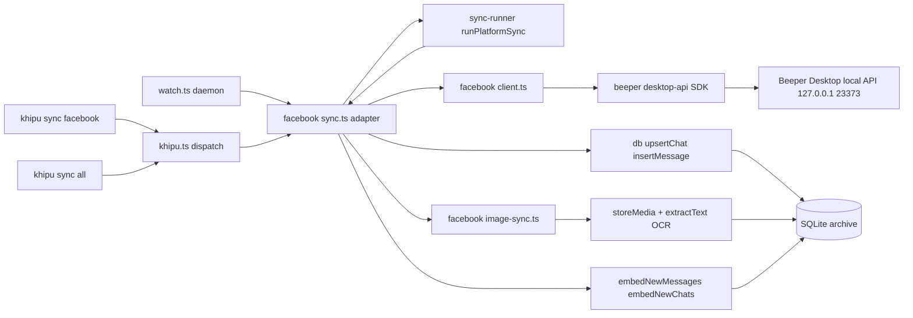
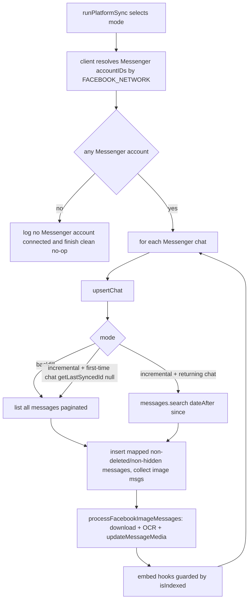
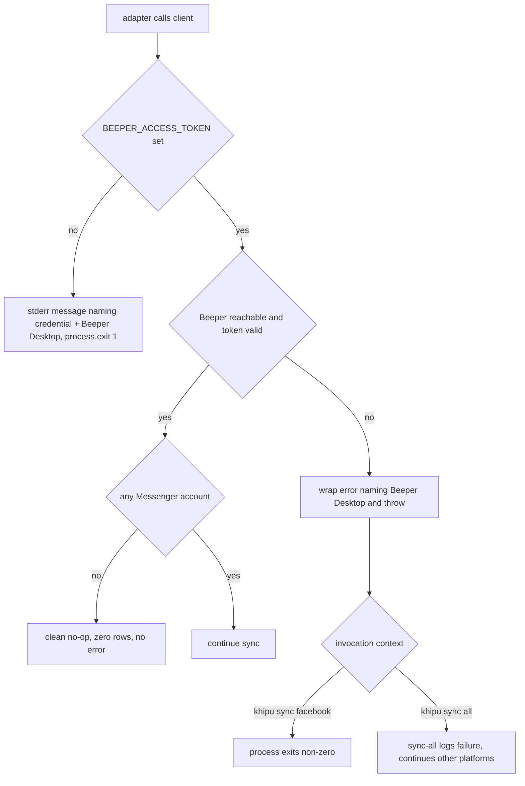

# Technical Design

## Overview

**Purpose**: This feature makes Facebook Messenger a first-class KhipuChat platform, ingesting Messenger chats and messages (text and images) into the local SQLite archive so they are queryable through the same MCP, CLI, and Web UI surfaces as every other platform, at parity with Signal.

**Users**: The operator (self-hosting user) runs `khipu sync facebook` (or `khipu sync`) to backfill and incrementally refresh Messenger history; agents and the operator then query that history through existing surfaces with no Messenger-specific handling.

**Impact**: A new `facebook` platform value is added to the `Platform` union and registered in every platform-enumeration point (`PLATFORMS`, `ADAPTER_FACTORIES`, `REQUIRED_ENV_VARS`, `LEGACY_ENV_VARS`, the Web icon map, and a `sync:facebook` npm script). A new `src/platforms/facebook/` adapter (`client.ts` + `sync.ts` + `image-sync.ts`) is introduced, structurally cloning `src/platforms/signal/`. Messenger data is sourced through **Beeper Desktop's local HTTP API** (via the official `@beeper/desktop-api` SDK, already a dependency) rather than any Facebook cloud API. No shared interface, sync runner, MCP tool, CLI, or Web UI query code changes.

### Goals

- Register `facebook` as a recognized platform in every enumeration point so single-platform, per-account, all-platform, and daemon sync all cover it (R1).
- Ingest Messenger chats and text + image messages through Beeper Desktop, scoped strictly to Messenger by network filter (R2, R3, R5).
- Download and OCR Messenger image attachments through the shared media pipeline (R5.6, R5.7).
- Support idempotent full backfill and efficient incremental sync (R3, R4).
- Achieve query parity in existing MCP/CLI/Web surfaces with zero changes to their query paths (R6).
- Degrade gracefully when Beeper Desktop, the credential, or a connected Messenger account is absent (R2.3, R2.4, R7).
- Keep single-account env configuration consistent across both Beeper-backed platforms (R8).

### Non-Goals

- Sending Messenger messages; Instagram DMs; Facebook Groups/Pages/Marketplace (out of scope).
- Ingesting any non-Messenger platform through Beeper — network scoping prevents dual-sourcing (R2.2).
- Real-time listener support — `startListener` is a no-op.
- Any modification to `PlatformAdapter`, `sync-runner`, `db.ts` write/read APIs, the shared media/OCR pipeline, MCP tools, CLI query commands, or Web UI query logic.
- Any change to Beeper Desktop itself, or any new npm dependency (`@beeper/desktop-api` is already installed).

## Boundary Commitments

### This Spec Owns

- The `src/platforms/facebook/` adapter: `client.ts` (Beeper access, Messenger-scoped), `sync.ts` (`PlatformAdapter` implementation + mapping + backfill/incremental loops + CLI entrypoint), and `image-sync.ts` (attachment fetch + OCR reuse).
- The mapping from Beeper `Account`/`Chat`/`Message` shapes to KhipuChat `Chat`/`Message` rows for `platform='facebook'`.
- Messenger-only query scoping via the Beeper account `network` filter, centralized in one `FACEBOOK_NETWORK` constant.
- Backfill, incremental, image-sync, and graceful-degradation behavior for the Facebook adapter.
- Registration of `facebook` in every platform-enumeration point, plus the `sync:facebook` npm script and the Messenger Web icon.
- The consistency fix adding `signal` and `facebook` to `LEGACY_ENV_VARS` in `account-registry.ts`.

### Out of Boundary

- The shared image-storage + OCR pipeline (`storeMedia`, `extractText`, `media_*`/`ocr_text` columns) — used as-is; owned by `telegram-image-sync` / `image-support`.
- The `PlatformAdapter` interface, `sync-runner.ts`, `db.ts` write/read functions, MCP tools, CLI query commands, and Web UI query logic — used as-is, never modified.
- `sync_state` / the incremental engine — consumed via `runPlatformSync`; owned by `incremental-sync`.
- The Beeper access-token acquisition flow — a one-time operator setup step; owned by `setup-wizard`.
- The `signal-platform` adapter's own files — this spec touches `account-registry.ts` for the shared legacy-registry fix only, not `signal/*`.

### Allowed Dependencies

- `PlatformAdapter` / `AdapterFactory` from `src/platforms/types.ts` (implement, do not modify).
- `runPlatformSync` from `src/sync-runner.ts` (call, do not modify).
- `db.ts` public API: `initDb`, `upsertChat`, `insertMessage`, `getLastSyncedId`, `getMessageIdByExternalId`, `updateMessageMedia`, `getDb`; embedding hooks `embedNewMessages`/`embedNewChats`; `isIndexed`.
- `media-storage` `storeMedia`; `ocr` `extractText`.
- `account-registry` `AccountCredentials` for the `BEEPER_ACCESS_TOKEN` field.
- Existing npm dependency `@beeper/desktop-api` (^5.0.0) and `simple-icons` (`siMessenger`). No new dependency.

### Revalidation Triggers

- A change to the `PlatformAdapter` interface or `runPlatformSync` contract.
- A change to the `Message`/`Chat` row shapes or `db.ts` write/read signatures.
- A change to the shared media pipeline (`storeMedia`/`extractText`/`updateMessageMedia`) signatures.
- A change to how Beeper exposes Messenger — **especially the `network` identifier string** — or to the `@beeper/desktop-api` REST/SDK contract.
- A change to the `Platform` union that other enumeration points must mirror.

## Architecture

### Existing Architecture Analysis

Every platform lives under `src/platforms/<name>/` with an optional `client.ts` (data-source wrapper) and a `sync.ts` that exports a default adapter, a `create<Name>Adapter(account, credentials)` factory, and a `main()` calling `runPlatformSync`. The runner (`sync-runner.ts`) selects backfill vs. incremental from the recorded platform+account sync point and persists the new sync point after success. `khipu.ts` dispatches `khipu sync <platform>[@account]` by convention, gated on membership in `PLATFORM_SET` (derived from `PLATFORMS`). `sync-all.ts` spawns each platform in `PLATFORMS` serially and continues past per-platform failures. The `watch.ts` daemon builds one adapter per configured account from `ADAPTER_FACTORIES`, skipping platforms whose `REQUIRED_ENV_VARS` are unset.

The **Signal** adapter is the exact analog: it sources data through Beeper (`@beeper/desktop-api`), scopes by account `network`, upserts each chat, streams messages per chat, downloads + OCRs image attachments, and runs embedding hooks after each chat loop. Facebook Messenger follows this pattern verbatim, substituting the Messenger network filter for Signal's.

### Architecture Pattern & Boundary Map



**Architecture Integration**:
- **Selected pattern**: Adapter + thin client + image-sync helper, identical to Signal. `client.ts` isolates the Beeper SDK behind a narrow, Messenger-scoped, mockable interface; `sync.ts` owns mapping and the backfill/incremental loops; `image-sync.ts` owns attachment fetch + OCR.
- **Domain boundaries**: the client layer knows Beeper shapes only; the adapter layer knows KhipuChat `Chat`/`Message` only; the image-sync layer knows the media pipeline only. None reach into MCP/CLI/Web query code.
- **Existing patterns preserved**: default-adapter export, factory, `main()`+`runPlatformSync`, per-chat embedding hooks, no-op `startListener`, credential-missing fatal error, per-chat try/catch isolation.
- **New components rationale**: three new files because no existing code speaks to Beeper for Messenger; all stay well under 200 lines (Signal counterparts: 110/181/135).
- **Steering compliance**: all data stays local (Beeper API is `127.0.0.1`, `remote_access:false`); no external cloud API; parity achieved by writing to the shared tables so MCP/CLI/Web see Messenger with zero query-code changes.

### Dependency Direction

`types (Platform) → client.ts (Beeper access, FACEBOOK_NETWORK) → sync.ts (adapter + mapping) → image-sync.ts / sync-runner / db (shared runtime)`. `sync.ts` imports `client.ts` and `image-sync.ts`; neither imports `sync.ts`. Mapping functions in `sync.ts` depend only on client output types and `db.ts` `Chat`/`Message` types.

### Technology Stack

| Layer | Choice / Version | Role in Feature | Notes |
|-------|------------------|-----------------|-------|
| CLI / Daemon | existing `khipu.ts` dispatch, `watch.ts` | Routes `sync facebook[@account]` and daemon polling to the adapter | Registration edits only |
| Backend / Adapter | new `src/platforms/facebook/{client,sync,image-sync}.ts` (TypeScript) | Beeper access + mapping + sync loops + image OCR | Mirrors Signal |
| External data source | `@beeper/desktop-api` ^5.0.0 | Typed client for Beeper local REST API | **Already installed**; static `accessToken` auth |
| Media / OCR | existing `media-storage` + `ocr` (`tesseract.js`) | Image storage + OCR text | No changes |
| Data / Storage | existing SQLite via `db.ts` | Idempotent chat/message/media persistence | No schema or write-API changes |
| Web icon | `simple-icons` `siMessenger` | Messenger platform badge | Add to `KNOWN` map |

## File Structure Plan

### Directory Structure
```
src/platforms/facebook/
├── client.ts       # BeeperFacebookClient: wraps @beeper/desktop-api, exports FACEBOOK_NETWORK,
│                   # resolves Messenger accountIDs via network filter, exposes listChats /
│                   # listChatMessages / listNewChatMessages scoped to Messenger. No DB, no KhipuChat types.
├── sync.ts         # FacebookAdapter: mapChat / mapMessage, runBackfillImpl / runIncrementalImpl,
│                   # createFacebookAdapter factory, default adapter export, main() → runPlatformSync.
└── image-sync.ts   # createFacebookAttachmentFetcher + processFacebookImageMessages (storeMedia + OCR).
tests/
├── facebook.test.ts                    # mapChat/mapMessage unit + backfill/incremental against a mock client.
└── facebook-image-sync.test.ts         # image-sync: attachment pick, fetch fallback, OCR, media persistence.
```

### Modified Files
- `src/platforms/types.ts` — add `| 'facebook'` to the `Platform` union (line 4).
- `src/sync-all.ts` — add `'facebook'` to the `PLATFORMS` array (line 4); transitively registers it in `khipu.ts`'s `PLATFORM_SET`.
- `src/watch.ts` — add `facebook: createFacebookAdapter` to `ADAPTER_FACTORIES` (**compile-required** once the union grows) and `facebook: ['BEEPER_ACCESS_TOKEN']` to `REQUIRED_ENV_VARS`.
- `src/account-registry.ts` — add `signal: ['BEEPER_ACCESS_TOKEN']` and `facebook: ['BEEPER_ACCESS_TOKEN']` to `LEGACY_ENV_VARS` (R8 consistency fix).
- `src/web/icons.ts` — import `siMessenger` and add `facebook: siMessenger` to `KNOWN`.
- `package.json` — add `"sync:facebook": "tsx src/platforms/facebook/sync.ts"` to `scripts`.

> No MCP tool, CLI query command, Web UI query, `sync-runner.ts`, `db.ts`, or media-pipeline file changes.

## System Flows

### Backfill vs. Incremental dispatch (per chat)



**Key decisions**: Messenger scoping happens once by resolving `network` matches to `FACEBOOK_NETWORK` account IDs and passing them to every query. A per-chat try/catch isolates a failing chat so the sync continues (R2.5). A brand-new chat in incremental mode (`getLastSyncedId` returns `null`) is fetched in full (R4.3). Image download/OCR failures are counted and skipped, never aborting (R5.8).

### Beeper-unavailable / no-account degradation



## Requirements Traceability

| Requirement | Summary | Components | Interfaces | Flows |
|-------------|---------|------------|------------|-------|
| 1.1, 1.2, 1.3, 1.4 | Register `facebook`; dispatch single/per-account/all sync | `types.ts`, `sync-all.ts`, `sync.ts` | `PlatformAdapter`, `runPlatformSync` | Dispatch |
| 1.5 | Daemon polls + skips when unconfigured | `watch.ts` edits | `ADAPTER_FACTORIES`, `REQUIRED_ENV_VARS` | Dispatch |
| 1.6 | Messenger badge in Web UI | `web/icons.ts` edit | `KNOWN` icon map | — |
| 2.1 | Retrieve chats/messages via Beeper | `client.ts` | `BeeperFacebookClient` | Backfill |
| 2.2 | Scope to Messenger only | `client.ts` | `FACEBOOK_NETWORK` account filter | Dispatch |
| 2.3 | Clean no-op when no Messenger account | `client.ts`, `sync.ts` | empty-accountIDs guard | Degradation |
| 2.4, 7.1, 7.3, 7.4 | Clear error + non-zero exit when Beeper down / token missing | `sync.ts`, `client.ts` | fatal error path | Degradation |
| 2.5 | Per-chat error isolation | `sync.ts` | backfill/incremental loop | Backfill |
| 3.1, 3.2 | Backfill chats + text/image messages | `sync.ts` | `runBackfillImpl` | Backfill |
| 3.3, 3.4 | No duplicate chats/messages | `db.ts` (existing) | `upsertChat`/`insertMessage` idempotency | — |
| 4.1, 4.2, 4.4 | Incremental only new; record sync point; `--force` | `sync.ts`, `sync-runner` (existing) | `syncIncremental` | Incremental |
| 4.3 | New chat treated as first-time | `sync.ts` | `getLastSyncedId` guard | Incremental |
| 5.1–5.5 | Sender, timestamp, ownership, reply, chat assoc, type classify | `sync.ts` | `mapMessage` | — |
| 5.6, 5.7, 5.8 | Image download + OCR + failure isolation | `image-sync.ts` | `processFacebookImageMessages` | Backfill |
| 6.1–6.5 | Query parity via existing surfaces | shared tables (existing) | none (writes `platform='facebook'` rows) | — |
| 7.2 | All-platform sync continues past facebook failure | `sync-all.ts` (existing) | `runAllPlatforms` | Degradation |
| 8.1, 8.2, 8.3 | Legacy env-var registry for both Beeper platforms | `account-registry.ts` edit | `LEGACY_ENV_VARS` | — |

## Components and Interfaces

| Component | Domain/Layer | Intent | Req Coverage | Key Dependencies (P0/P1) | Contracts |
|-----------|--------------|--------|--------------|--------------------------|-----------|
| `BeeperFacebookClient` | External integration | Messenger-scoped access to Beeper data | 2.1, 2.2, 2.3, 4.1 | `@beeper/desktop-api` (P0) | Service |
| `FacebookAdapter` | Platform adapter | Map Beeper data to rows; run backfill/incremental | 1, 3, 4, 5 | `BeeperFacebookClient` (P0), `db.ts` (P0), `sync-runner` (P0), `image-sync` (P1) | Service, Batch |
| `processFacebookImageMessages` | Media integration | Download + OCR Messenger images | 5.6, 5.7, 5.8 | `storeMedia`/`extractText`/`updateMessageMedia` (P0), `@beeper/desktop-api` (P1) | Batch |
| Registration edits | Registration | Recognize `facebook` across enumerations | 1.1, 1.4, 1.5, 1.6, 8 | none | State |

### External Integration

#### BeeperFacebookClient

| Field | Detail |
|-------|--------|
| Intent | Wrap the Beeper SDK and expose only Messenger-scoped chat/message reads |
| Requirements | 2.1, 2.2, 2.3, 4.1 |

**Responsibilities & Constraints**
- Export `FACEBOOK_NETWORK` (default candidate `'facebookgo'`) plus the accepted candidate set, and resolve Messenger `accountID`s once via `accounts.list()` matching `account.network` (case-insensitive) against the candidates. Memoize the result.
- Scope every `chats.search` / `messages.search` call with those `accountID`s (R2.2). Never expose non-Messenger data.
- Own pagination (cursor + `direction:'before'`) and yield typed Beeper shapes; do not touch the DB or KhipuChat types.
- When the resolved account list is empty, yield nothing so the adapter records a clean no-op (R2.3).
- Surface Beeper unreachable / invalid-token / missing-token as a typed fatal condition (R2.4, R7.1); do not swallow it.

**Dependencies**
- Outbound: `@beeper/desktop-api` `BeeperDesktop` client — Beeper local REST API (External, P0).
- Inbound: `FacebookAdapter` — the only consumer (P0).

**Contracts**: Service [x] / API [ ] / Event [ ] / Batch [ ] / State [ ]

##### Service Interface
```typescript
import type { BeeperDesktop } from '@beeper/desktop-api'

export type Account = BeeperDesktop.Accounts.Account
export type BeeperChat = BeeperDesktop.Chats.Chat
export type BeeperMessage = BeeperDesktop.Message

/** Beeper's network identifier for Facebook Messenger. VERIFY AT RUNTIME (see task 0). */
export const FACEBOOK_NETWORK = 'facebookgo'
/** Candidate networks accepted case-insensitively until runtime verification pins one. */
export const FACEBOOK_NETWORK_CANDIDATES = ['facebook', 'facebookgo', 'meta'] as const

export interface BeeperFacebookClient {
  /** Messenger account IDs resolved from the network filter. Empty ⇒ no Messenger connected. */
  facebookAccountIds(): Promise<readonly string[]>
  listChats(): AsyncGenerator<BeeperChat>
  listChatMessages(chatId: string): AsyncGenerator<BeeperMessage>
  listNewChatMessages(chatId: string, since: Date): AsyncGenerator<BeeperMessage>
}

export function createBeeperFacebookClient(accessToken: string): BeeperFacebookClient
```
- **Preconditions**: `accessToken` non-empty; Beeper Desktop running and reachable at its local API.
- **Postconditions**: every yielded chat/message belongs to a Messenger account; generators complete when Beeper reports no more pages; empty account list ⇒ generators yield nothing.
- **Invariants**: no query is issued without the Messenger `accountIDs` filter; the client never writes to the DB.

**Implementation Notes**
- Integration: mirror `signal/client.ts` exactly. `facebookAccountIds()` memoizes; `listChatMessages` → `messages.search({ chatIDs:[chatId], accountIDs, direction:'before' })`; `listNewChatMessages` → `messages.search({ chatIDs:[chatId], accountIDs, dateAfter: since.toISOString() })`; `listChats` → `chats.search({ accountIDs })`.
- Validation: missing/empty token → throw a fatal error before any network call; `APIConnectionError` (ECONNREFUSED) / `AuthenticationError` (401) → wrap with a message naming Beeper Desktop (reuse the Signal `wrapBeeperError` pattern).
- Risks: the `network` string is the one unverified value — kept in the single `FACEBOOK_NETWORK` constant; task 0 pins it against a live Messenger account (Revalidation Trigger).

### Platform Adapter

#### FacebookAdapter

| Field | Detail |
|-------|--------|
| Intent | Implement `PlatformAdapter`; map Beeper shapes to rows; drive backfill/incremental + image sync |
| Requirements | 1.2, 2.5, 3.1–3.4, 4.1–4.4, 5.1–5.8 |

**Responsibilities & Constraints**
- Implement `runBackfill`, `syncIncremental`, and no-op `startListener`; expose `createFacebookAdapter` + default export + `main()`.
- Map each Beeper chat/message via pure `mapChat`/`mapMessage` functions (unit-testable, no I/O), setting `platform: 'facebook'`.
- Classify `type` as `image` (Beeper `IMAGE`), `text` (Beeper `TEXT` with non-empty text), else `other` (R5.5).
- Collect image messages per chat and hand them to `processFacebookImageMessages` for download + OCR (R5.6, R5.7).
- Per-chat try/catch: log and continue on a single chat's failure (R2.5); a client-level fatal (Beeper down) propagates to the runner (R7).
- Skip messages where `m.isDeleted` or `m.isHidden` is true (checked by the caller before `mapMessage`).
- Run `embedNewMessages`/`embedNewChats` per chat, guarded by `isIndexed`.

**Dependencies**
- Outbound: `BeeperFacebookClient` (P0); `db.ts` `upsertChat`/`insertMessage`/`getLastSyncedId` (P0); `runPlatformSync` (P0); `processFacebookImageMessages` (P1); `embedNew*`/`isIndexed` (P1).

**Contracts**: Service [x] / API [ ] / Event [ ] / Batch [x] / State [ ]

##### Batch / Job Contract
- **Trigger**: `khipu sync facebook[@account]` / `khipu sync` / daemon → `main()`/factory → `runPlatformSync(facebookAdapter, db, argv)`.
- **Input / validation**: `BEEPER_ACCESS_TOKEN` credential; `--force` selects backfill, else the runner picks incremental when a prior sync point exists.
- **Output / destination**: `chats` and `messages` rows with `platform='facebook'`; image `media_*`/`ocr_text` populated by the image pass; sync point persisted by the runner.
- **Idempotency & recovery**: `upsertChat` (unique `platform,account,external_id`) and `insertMessage` (conflict on `external_id, chat_id`) make re-runs duplicate-free (R3.3, R3.4). Image pass skips messages that already have `media_file_path`. Per-chat isolation bounds the blast radius of a transient error.

##### Mapping contract
```typescript
export function mapChat(c: BeeperChat, account: string): Chat        // id→external_id, title→name, single→private else group, platform 'facebook'
export function mapMessage(m: BeeperMessage, chatId: number): Message // see Data Models; media_* null until image pass
```
- `mapMessage`: `type = m.type === 'IMAGE' ? 'image' : (m.type === 'TEXT' && m.text ? 'text' : 'other')`; `is_sender = m.isSender ? 1 : 0`; `timestamp = Math.floor(Date.parse(m.timestamp)/1000)`; `reply_to_external_id = m.linkedMessageID ?? null`; `text = m.text ?? null`; all `media_*`/`ocr_text` `null` at insert time.

**Implementation Notes**
- Integration: factory reads `credentials.fields['BEEPER_ACCESS_TOKEN']`; empty → `stderr` message naming the credential + Beeper Desktop and `process.exit(1)` (R7.1, R7.3). Default adapter uses `process.env['BEEPER_ACCESS_TOKEN']` fallback. Mirror `signal/sync.ts`.
- Validation: when `facebookAccountIds()` is empty, log "no Facebook Messenger account connected in Beeper" and finish without error (clean no-op).

### Media Integration

#### processFacebookImageMessages

| Field | Detail |
|-------|--------|
| Intent | Download Messenger image attachments and OCR them into the shared media store |
| Requirements | 5.6, 5.7, 5.8 |

**Responsibilities & Constraints**
- Mirror `signal/image-sync.ts`: `createFacebookAttachmentFetcher(accessToken)` builds a `BeeperDesktop` and fetches attachment buffers via `assets.serve({ url })`, with a `file://` local-read fallback.
- For each image message: resolve the DB row via `getMessageIdByExternalId`, skip if `media_file_path` already set, pick the image attachment, fetch the buffer, `storeMedia({ platform: 'facebook', ... })`, OCR via `extractText`, and `updateMessageMedia`.
- Count `stored`/`failed`; a per-message try/catch ensures one failure never aborts the pass (R5.8). Never throw to the sync loop.

**Contracts**: Service [ ] / API [ ] / Event [ ] / Batch [x] / State [ ]

**Implementation Notes**
- Integration: `storeMedia` is called with `platform: 'facebook'` so media files are namespaced correctly. `extractText` is the shared OCR singleton (never throws to caller).
- Risks: attachment URL shape is identical to Signal's (same Beeper SDK); no new risk beyond the network-identifier one.

### Registration edits

`Platform` union gains `'facebook'`; `PLATFORMS` gains `'facebook'` (enabling `khipu.ts` dispatch + `sync-all` coverage). `ADAPTER_FACTORIES` gains `facebook: createFacebookAdapter` — **the total `Record<Platform, AdapterFactory>` type makes this compile-required**, a built-in safety net. `REQUIRED_ENV_VARS` gains `facebook: ['BEEPER_ACCESS_TOKEN']` so the daemon treats a bare token as "configured". `web/icons.ts` `KNOWN` gains `facebook: siMessenger`. `package.json` gains `sync:facebook`. `account-registry.ts` `LEGACY_ENV_VARS` gains both `signal` and `facebook` mapped to `['BEEPER_ACCESS_TOKEN']` (R8).

## Data Models

No schema changes. Messenger reuses the existing `chats` and `messages` tables.

- **`chats`**: identity `(platform='facebook', account, external_id=BeeperChat.id)`; `name=title`, `type ∈ {private, group}`, `username=null`.
- **`messages`**: identity `(external_id=BeeperMessage.id, chat_id)`; `platform='facebook'`; `sender_name`, `text`, `type ∈ {text,image,other}`, `timestamp` (unix s), `is_sender` (0/1), `reply_to_external_id`. `media_file_path/media_width/media_height/ocr_text` are `null` at insert and populated by `processFacebookImageMessages` for image messages.
- **Referential integrity**: `messages.chat_id` references the row returned by `upsertChat`; a message is only inserted after its chat is upserted in the same loop iteration; the image pass resolves rows by `(chatId, external_id)`.

## Error Handling

### Error Strategy
- **Missing token** (user setup error): write a human-readable line to `stderr` naming the credential + Beeper Desktop and `process.exit(1)` in the factory before any network call (R7.1, R7.3).
- **Beeper unreachable / 401** (system dependency error): the client throws an error naming Beeper Desktop; the adapter lets it propagate so `runPlatformSync` records failure and the process exits non-zero for explicit `khipu sync facebook` (R2.4, R7.4).
- **No Messenger account connected**: clean no-op — zero rows, a clear log line, no error (R2.3).
- **Per-chat query failure** (partial degradation): caught inside the chat loop, logged, and skipped so remaining chats still sync (R2.5).
- **Image download / OCR failure**: counted as `failed` inside `processFacebookImageMessages`; never aborts the sync (R5.8).
- **All-platform run**: unchanged `runAllPlatforms` logs the facebook child's non-zero exit and continues other platforms (R7.2).

### Monitoring
- Console progress line per sync (`[facebook] Sync complete: N chats, M messages, images: S stored, F failed`), matching Signal, plus per-chat error logs for skipped chats.

## Testing Strategy

### Unit Tests
- `mapMessage` maps `senderName/timestamp/isSender/linkedMessageID/text` correctly and sets `type='image'` for `IMAGE`, `type='text'` only for `TEXT` with non-empty text, `'other'` otherwise; verifies `media_*`/`ocr_text` are `null` at insert (5.1, 5.2, 5.4, 5.5).
- `mapChat` maps `single→private`, `group→group`, uses `title` as name, and sets `platform='facebook'` (3.1).
- The client's account filter matches a Messenger account whose `network` equals `FACEBOOK_NETWORK` (and each candidate) case-insensitively and excludes non-Messenger networks (2.2).

### Integration Tests (adapter against a mock `BeeperFacebookClient`)
- `runBackfillImpl` upserts each Messenger chat and inserts its messages; a second run inserts zero duplicates (3.1–3.4).
- `runIncrementalImpl` fetches only messages after `since` for existing chats and full history where `getLastSyncedId` returns `null` (4.1, 4.3).
- A client that throws on one chat's message fetch still processes remaining chats (2.5); a client whose `facebookAccountIds()` is empty completes as a clean no-op (2.3).
- `createFacebookAdapter` with empty `BEEPER_ACCESS_TOKEN` calls `process.exit(1)` and writes a Beeper-naming message to stderr (7.1, 7.3).
- `processFacebookImageMessages` stores media + OCR text for an image message, skips an already-stored message, and counts a fetch failure without throwing (5.6, 5.7, 5.8).

### Parity Tests
- After a mocked Messenger sync into an in-memory DB, existing MCP/CLI/Web query paths (`list_chats`, `find_chat_by_name`, `list_messages`, `search_messages`, FTS, web routes) return the Messenger rows with no Messenger-specific arguments (6.1–6.5).
- Registry test: with no `khipu.config.json` and `BEEPER_ACCESS_TOKEN` set, `loadRegistry` lists a `default` account for both `facebook` and `signal` (8.1, 8.2).

## Security Considerations

- All Beeper access is over `127.0.0.1` (`remote_access:false`); no Messenger data leaves the machine, consistent with steering.
- `BEEPER_ACCESS_TOKEN` is a secret: supplied via env/`khipu.config.json` `$VAR` resolution (existing registry mechanism), never logged. The client sends it only as the SDK `accessToken`.
- Scoping to Messenger `network` accounts is a hard privacy boundary preventing accidental ingestion of other Beeper-bridged conversations.

## Supporting References

- `research.md` — full evidence for the Signal template adoption, transport/auth inheritance, the network-identifier open question + live Beeper probe, message/image field mapping, the enumeration-point audit, and the `LEGACY_ENV_VARS` consistency finding.
