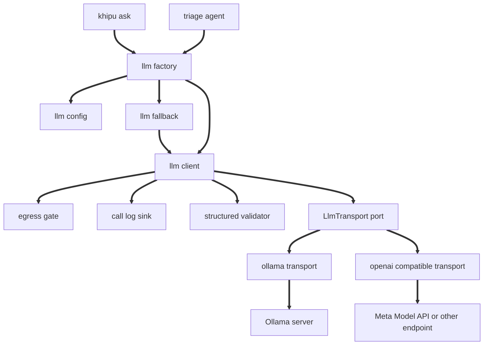
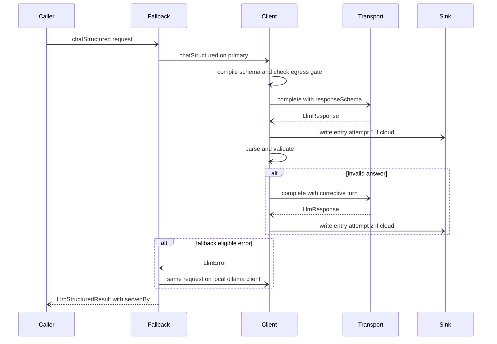

# Design Document: llm-provider

## Overview
**Purpose**: This feature gives every khipuchat LLM caller one provider-neutral client (`LlmClient`) with free-text chat, tool calling, and schema-validated structured output, served either by a local Ollama server (default) or by any OpenAI-compatible endpoint, with Muse Spark on the Meta Model API as the first documented target.

**Users**: The khipuchat user (through `khipu ask` and, next, the triage agent) and khipuchat developers building LLM features (triage-agent calls `chatStructured` to obtain a typed verdict).

**Impact**: `src/ask.ts` stops importing Ollama types and runs its tool loop over `LlmClient`. A non-loopback LLM endpoint not listed in `KHIPU_LLM_LOCAL_HOSTS` now requires `KHIPU_LLM_ALLOW_CLOUD=1`, and every call to such an endpoint emits a content-free JSON call-log line. Default behavior with no LLM settings is unchanged.

### Goals
- One neutral message, tool, response, and error vocabulary; no caller imports a provider SDK type.
- `chatStructured<T>` returns a value validated against the caller's JSON Schema, with exactly one corrective retry.
- Content leaves the machine only after an explicit opt-in, and every such call is logged without content.
- `khipu ask` default behavior and `ask-parity` tests unchanged.

### Non-Goals
- Streaming, model pull/management, fine-tuning, an Anthropic-native transport.
- Tools during structured calls (`chatStructured` takes no tools).
- Triage prompts, verdict schema, and per-source local-only rules (triage-agent).
- Secret storage, Docker wiring, and ingress (cloud-deployment). Secrets follow Phase 5 decision D2: cloud-deployment's `_FILE` allowlist includes `KHIPU_LLM_API_KEY`, so `KHIPU_LLM_API_KEY_FILE` works; its loader fills `process.env` before `createLlmClientFromEnv` runs, and this spec only reads `KHIPU_LLM_API_KEY` from the env it is given.
- Database tables (Phase 5 decision D6): none; the call log is a JSON-lines file.

## Boundary Commitments

### This Spec Owns
- The neutral types and interfaces: `LlmMessage`, `LlmTool`, `LlmToolCall`, `LlmResponse`, `LlmUsage`, `LlmProviderInfo`, `LlmResponseSchema`, `LlmStructuredResult`, `LlmClient`, `LlmTransport`, `LlmError` and `LlmErrorKind`.
- Configuration resolution for all `KHIPU_LLM_*` settings and legacy `OLLAMA_HOST` / `OLLAMA_MODEL`.
- The cloud egress gate (destination classification + opt-in check), including the operator-declared local hosts setting `KHIPU_LLM_LOCAL_HOSTS` (Phase 5 decision D10).
- The cloud call log (entry schema, sinks, content redaction).
- The two transports (Ollama, OpenAI-compatible), HTTP error mapping, transient retry, timeout.
- Structured-output validation and the single corrective retry.
- Local fallback composition.
- Migration of `src/ask.ts` and `tests/ask.test.ts` to the neutral interface; `khipu ask` help text; LLM sections of `.env.example` and `README.md`.

### Out of Boundary
- What content a caller sends to a cloud model and when (triage-agent rules decide; this spec only enforces the global gate).
- Verdict schema, prompts, decision storage (triage-agent).
- Deployment, secrets management (the `_FILE` allowlist and loader, decision D2), server region choice, and the deployment-guide text for `KHIPU_LLM_LOCAL_HOSTS` in compose (cloud-deployment).
- `src/tool-registry.ts` and `src/mcp.ts` contracts (read-only use of `TOOL_DEFINITIONS` and `dispatchTool`).
- Any database table or migration: this spec adds none, so under decision D6 it adds no `schema.ts` module and no `SCHEMA_MODULES` entry.

### Allowed Dependencies
- `ollama` ^0.6.3, imported only by `src/llm-ollama.ts`.
- `ajv` ^8 (promoted from transitive to direct dependency), imported only by `src/llm-structured.ts`.
- Node 24 built-ins: global `fetch`, `AbortSignal.timeout`, `AbortSignal.any`, `fs.appendFileSync`, `net.isIP`.
- `src/tool-registry.ts` (read-only) from `src/ask.ts` only.
- Must not import `src/config.ts` (it eagerly requires Telegram env), must not depend on Beeper, must not add an OpenAI or Meta SDK.

### Revalidation Triggers
- Any change to `LlmClient`, `LlmResponse`, `LlmStructuredRequest`, `LlmStructuredResult`, or `LlmErrorKind` members: triage-agent must re-check.
- Allowing tools in `chatStructured` or changing the retry count: triage-agent latency and cost budget.
- Renaming or adding `KHIPU_LLM_*` settings: cloud-deployment docs and compose env.
- Changing destination classification (what counts as local), including the `KHIPU_LLM_LOCAL_HOSTS` format or matching rules: security review and triage-agent local-only guarantees.
- Changing call-log line schema: any operator tooling parsing the log.

## Architecture

### Existing Architecture Analysis
- `src/ask.ts` mixes config, Ollama tool mapping, prompt, loop, error classification, and CLI; its `AskClient` seam is the extension point, but it leaks Ollama `Message` / `Tool` types into tests.
- `TOOL_DEFINITIONS[].inputSchema` is plain JSON Schema shared with MCP; it maps 1:1 to `LlmTool.parameters`.
- Steering: flat `src/`, no feature directories outside `src/platforms/`, files under 200 lines, strict TS, no `any`. New modules therefore live in `src/` with an `llm-` prefix.

### Architecture Pattern & Boundary Map
Selected pattern: ports and adapters. `LlmTransport` is the port (wire mapping only); `createLlmClient` is the single policy owner (gate, call log, structured validation); `withFallback` composes two clients; `createLlmClientFromEnv` is the only constructor callers use.



**Dependency direction** (imports only point left): `llm-types` => `llm-errors` => `llm-config` => (`llm-structured`, `llm-call-log`, `llm-ollama`, `llm-openai-wire` => `llm-openai-compatible`) => `llm-client` => `llm-fallback` => `llm-factory` => consumers (`ask.ts`, triage-agent). Transports never import `llm-client`; `llm-client` never imports a transport.

### Technology Stack

| Layer | Choice / Version | Role in Feature | Notes |
|-------|------------------|-----------------|-------|
| Runtime | Node.js 24, TypeScript 5 strict | All modules | Global `fetch`, `AbortSignal.any` available |
| LLM local | `ollama` ^0.6.3 (existing) | Ollama transport | `format` accepts a JSON schema object |
| LLM cloud | Meta Model API, Chat Completions, `https://api.meta.ai/v1` | OpenAI-compatible transport | Plain `fetch`, bearer auth, no SDK |
| Validation | `ajv` ^8 (new direct dep, already in tree at 8.20.0) | Structured output validation | MIT |
| Logging | JSON lines to stderr or append file | Cloud call log | No DB table |
| Testing | Vitest (existing) | Fake transport, fake fetch | No network in tests |

## File Structure Plan

### Directory Structure
```
src/
├── llm-types.ts               # Neutral types + LlmClient and LlmTransport interfaces (types only)
├── llm-errors.ts              # LlmErrorKind, LlmError, describeLlmError, isFallbackEligible
├── llm-config.ts              # resolveLlmConfig(env), classifyDestination(url), endpointHost(url)
├── llm-structured.ts          # Ajv compile, parse + validate answer, corrective turn builder
├── llm-call-log.ts            # CallLogEntry, CallLogSink, createCallLogSink (stderr or file)
├── llm-ollama.ts              # createOllamaTransport: neutral <=> ollama ChatRequest/ChatResponse
├── llm-openai-wire.ts         # Chat Completions wire types, request/response mapping, HTTP error mapping
├── llm-openai-compatible.ts   # createOpenAiCompatibleTransport: fetch, timeout, bounded retry
├── llm-client.ts              # createLlmClient: gate, call log, chat, chatStructured
├── llm-fallback.ts            # withFallback(primary, fallback): LlmClient
└── llm-factory.ts             # createLlmClientFromEnv(env, deps): the only public constructor
tests/
├── fixtures/fake-llm-transport.ts  # Scripted LlmTransport recording requests (reusable by triage-agent)
├── llm-errors.test.ts
├── llm-config.test.ts
├── llm-structured.test.ts
├── llm-call-log.test.ts
├── llm-client.test.ts
├── llm-ollama.test.ts
├── llm-openai-wire.test.ts
├── llm-openai-compatible.test.ts
├── llm-fallback.test.ts
└── llm-factory.test.ts
```

### Modified Files
- `src/ask.ts`: drop `ollama` import, `resolveOllamaConfig`, `toOllamaTools`, `classifyOllamaError`; add `toLlmTools()`; `runAskLoop(client: AskClient, question)` where `AskClient = Pick<LlmClient, 'chat'>`; `main` uses `createLlmClientFromEnv` and `describeLlmError`; usage text lists all settings.
- `tests/ask.test.ts`: mock implements `AskClient` with neutral types; config and error-classification tests move to `llm-config.test.ts` / `llm-ollama.test.ts`. `tests/ask-parity.test.ts` unchanged.
- `src/khipu.ts`: `ask` help summary and usage text mention the configurable provider (no routing change).
- `package.json`: add `"ajv": "^8.17.0"` to `dependencies` (lockfile already resolves 8.20.0).
- `.env.example`: commented LLM block with local-only defaults.
- `README.md`: "LLM provider and cloud opt-in" section.

## System Flows

### Structured call with gate, log, retry, fallback


Key decisions: the schema is compiled before the gate so a bad schema fails without any network (3.5); the gate runs before every transport call (4.2); HTTP-level transient retries happen inside the OpenAI-compatible transport and do not produce extra log entries; each `transport.complete` produces at most one log entry.

## Requirements Traceability

| Requirement | Summary | Components | Interfaces | Flows |
|-------------|---------|------------|------------|-------|
| 1.1, 1.2, 1.3, 1.4, 1.5, 1.6 | Provider selection, defaults, legacy env, missing settings | LlmConfig, LlmFactory | `resolveLlmConfig`, `createLlmClientFromEnv` | none |
| 1.7 | API key never surfaced | LlmConfig, LlmErrors, CallLog, OpenAiCompatibleTransport | `describeLlmError`, `CallLogEntry` | none |
| 2.1, 2.2, 2.3, 2.4, 2.6 | Neutral conversation, tool calls, usage | LlmTypes, OllamaTransport, OpenAiWire | `LlmMessage`, `LlmResponse`, `LlmToolCall`, `LlmUsage` | none |
| 2.5 | Malformed tool arguments rejected | OpenAiWire, OllamaTransport | `LlmError` `invalid_response` | none |
| 3.1, 3.2, 3.3, 3.4, 3.5, 3.6 | Structured output, validation, one retry, schema error | StructuredValidator, LlmClient, transports | `chatStructured`, `LlmStructuredResult` | Structured call |
| 4.1, 4.2, 4.3, 4.4, 4.5 | Destination classification and opt-in gate | LlmConfig, LlmClient | `classifyDestination`, gate check | Structured call |
| 4.6, 4.7 | Operator-declared local hosts: matching and validation | LlmConfig | `parseLocalHosts`, `classifyDestination` | none |
| 4.8 | Local-hosts notice | LlmFactory | `createLlmClientFromEnv`, `LlmEndpointConfig.localByOperator` | none |
| 5.1, 5.2, 5.3, 5.4, 5.5, 5.6 | Cloud call log | CallLog, LlmClient | `CallLogEntry`, `CallLogSink` | Structured call |
| 6.1, 6.5 | Error categories and messages | LlmErrors | `LlmErrorKind`, `describeLlmError` | none |
| 6.2, 6.3, 6.4 | Bounded retry and timeout | OpenAiCompatibleTransport, OllamaTransport | transport options | none |
| 7.1, 7.2, 7.3, 7.4, 7.5 | Local fallback | LlmFallback, LlmFactory, LlmErrors | `withFallback`, `isFallbackEligible` | Structured call |
| 8.1, 8.2, 8.3, 8.4, 8.5 | `khipu ask` on neutral client | AskModule | `runAskLoop`, `toLlmTools` | none |
| 9.1, 9.2, 9.3, 9.4, 9.5, 9.6 | Operator documentation, local-hosts security note, API key file | Docs | `.env.example`, `README.md` | none |

## Components and Interfaces

| Component | Domain/Layer | Intent | Req Coverage | Key Dependencies | Contracts |
|-----------|--------------|--------|--------------|------------------|-----------|
| LlmTypes | Types | Neutral vocabulary and ports | 2.1, 2.2, 2.3, 2.4, 2.6, 3.2 | none | Service |
| LlmErrors | Types | Error kinds, messages, fallback eligibility | 1.7, 6.1, 6.5, 7.2 | LlmTypes (P0) | Service |
| LlmConfig | Config | Env resolution and destination classification | 1.1 to 1.7, 4.1, 4.5, 4.6, 4.7, 7.5 | LlmErrors (P0) | Service |
| StructuredValidator | Policy | Compile schema, validate answer, corrective turn | 3.3, 3.4, 3.5 | ajv (P0) | Service |
| CallLog | Policy | Content-free cloud call records | 5.1 to 5.6, 1.7 | fs (P1) | Service |
| OllamaTransport | Adapter | Neutral to Ollama mapping | 2.1 to 2.6, 3.1, 6.4 | ollama (P0) | Service |
| OpenAiWire | Adapter | Chat Completions wire mapping and HTTP error mapping | 2.1 to 2.6, 3.1, 6.1 | none | Service |
| OpenAiCompatibleTransport | Adapter | fetch, timeout, transient retry | 1.4, 6.2, 6.3, 6.4 | fetch (P0), OpenAiWire (P0) | Service, API |
| LlmClient | Policy | Gate, log, chat, chatStructured | 3.1 to 3.6, 4.2 to 4.4, 5.1, 5.6 | LlmTransport (P0), CallLog (P0), StructuredValidator (P0) | Service |
| LlmFallback | Policy | Retry eligible failures on local Ollama | 7.1 to 7.4 | LlmClient (P0) | Service |
| LlmFactory | Composition | Build the configured client | 1.1 to 1.6, 4.8, 7.5 | all above (P0) | Service |
| AskModule | Consumer | `khipu ask` loop on neutral client | 8.1 to 8.5 | LlmFactory (P0), tool-registry (P0) | Service |
| Docs | Docs | Operator documentation | 9.1 to 9.6 | none | none |

### Types

#### LlmTypes (`src/llm-types.ts`)

| Field | Detail |
|-------|--------|
| Intent | Provider-neutral message, tool, response, structured-output, and port types |
| Requirements | 2.1, 2.2, 2.3, 2.4, 2.6, 3.2 |

**Contracts**: Service [x]

```typescript
export type LlmProviderKind = 'ollama' | 'openai-compatible'
export type LlmDestination = 'local' | 'cloud'

export interface LlmProviderInfo {
  readonly provider: LlmProviderKind
  readonly model: string
  readonly endpointHost: string        // hostname[:port] only, never path, query, or credentials
  readonly destination: LlmDestination
}

export type JsonSchemaObject = Readonly<Record<string, unknown>>

export interface LlmTool {
  readonly name: string
  readonly description: string
  readonly parameters: JsonSchemaObject  // JSON Schema object, e.g. ToolDefinition.inputSchema
}

export interface LlmToolCall {
  readonly id: string                    // provider id, or synthesized `call_<index>` for Ollama
  readonly name: string
  readonly arguments: Readonly<Record<string, unknown>>
}

export interface LlmSystemMessage { readonly role: 'system'; readonly content: string }
export interface LlmUserMessage { readonly role: 'user'; readonly content: string }
export interface LlmAssistantMessage {
  readonly role: 'assistant'
  readonly content: string               // '' when the provider returned null
  readonly toolCalls?: readonly LlmToolCall[]
}
export interface LlmToolResultMessage {
  readonly role: 'tool'
  readonly toolCallId: string
  readonly toolName: string
  readonly content: string
}
export type LlmMessage = LlmSystemMessage | LlmUserMessage | LlmAssistantMessage | LlmToolResultMessage

export type LlmFinishReason = 'stop' | 'tool_calls' | 'length' | 'content_filter' | 'other'

export interface LlmUsage {
  readonly promptTokens: number | null   // null = provider did not report
  readonly completionTokens: number | null
}

export interface LlmChatRequest {
  readonly messages: readonly LlmMessage[]
  readonly tools?: readonly LlmTool[]
  readonly temperature?: number
  readonly maxOutputTokens?: number
  readonly purpose?: string              // caller tag for the call log, e.g. 'ask', 'triage'
}

export interface LlmResponse {
  readonly message: LlmAssistantMessage
  readonly finishReason: LlmFinishReason
  readonly usage: LlmUsage
  readonly servedBy: LlmProviderInfo
}

/** T is the caller's static view of the schema; runtime conformance is enforced by validation. */
export interface LlmResponseSchema<T> {
  readonly name: string                  // ^[A-Za-z0-9_-]{1,64}$
  readonly schema: JsonSchemaObject      // root must be type 'object'
  readonly strict?: boolean              // default true: schema must satisfy the strict subset
  readonly __type?: T                    // phantom, never set at runtime
}

export interface LlmStructuredRequest<T> {
  readonly messages: readonly LlmMessage[]
  readonly schema: LlmResponseSchema<T>
  readonly temperature?: number
  readonly maxOutputTokens?: number
  readonly purpose?: string
}

export interface LlmStructuredResult<T> {
  readonly value: T
  readonly raw: string                   // the accepted answer text
  readonly attempts: 1 | 2
  readonly usage: LlmUsage               // summed over attempts; a field is null if any attempt reported null
  readonly servedBy: LlmProviderInfo
}

export interface LlmClient {
  readonly info: LlmProviderInfo
  chat(request: LlmChatRequest): Promise<LlmResponse>
  chatStructured<T>(request: LlmStructuredRequest<T>): Promise<LlmStructuredResult<T>>
}

/** Port implemented by provider adapters. Wire mapping only: no gate, no log, no validation. */
export interface LlmCompletionRequest {
  readonly messages: readonly LlmMessage[]
  readonly tools?: readonly LlmTool[]
  readonly responseSchema?: LlmResponseSchema<unknown>
  readonly temperature?: number
  readonly maxOutputTokens?: number
}
export interface LlmTransport {
  readonly info: LlmProviderInfo
  complete(request: LlmCompletionRequest): Promise<LlmResponse>   // rejects only with LlmError
}
```
- Invariants: every `LlmToolResultMessage.toolCallId` must equal an `id` from a preceding assistant turn; transports pass `toolName` for providers that key results by name (Ollama) and `toolCallId` for those that key by id (OpenAI-compatible).
- `chatStructured` never accepts tools (Non-Goal); `responseSchema` and `tools` are never both set by `LlmClient`.

#### LlmErrors (`src/llm-errors.ts`)

| Field | Detail |
|-------|--------|
| Intent | Single error class with a closed set of kinds; human messages; fallback eligibility |
| Requirements | 1.7, 6.1, 6.5, 7.2 |

```typescript
export type LlmErrorKind =
  | 'config' | 'cloud_not_allowed' | 'unreachable' | 'auth' | 'permission_denied'
  | 'model_not_found' | 'rate_limited' | 'bad_request' | 'server' | 'timeout'
  | 'invalid_response' | 'schema_invalid' | 'structured_output_invalid'

export interface LlmErrorDetails {
  readonly status?: number                 // HTTP status when applicable
  readonly problems?: readonly string[]    // config problems or schema validation messages
  readonly attempts?: number               // structured attempts made
  readonly primaryKind?: LlmErrorKind      // set on a fallback failure
  readonly info?: LlmProviderInfo
}

export class LlmError extends Error {
  readonly kind: LlmErrorKind
  readonly details: LlmErrorDetails
  constructor(kind: LlmErrorKind, message: string, details?: LlmErrorDetails)
}

export function isLlmError(err: unknown): err is LlmError
export function isFallbackEligible(kind: LlmErrorKind): boolean
// true for: unreachable, timeout, server, rate_limited, auth, permission_denied

export function describeLlmError(err: unknown, info: LlmProviderInfo): string
```
- `describeLlmError` output always contains provider kind, `endpointHost`, and model (6.5), never the API key (1.7). Next steps per kind:

| Kind | Next step in message |
|------|----------------------|
| config | List of `problems`, each naming the setting |
| cloud_not_allowed | "Set KHIPU_LLM_ALLOW_CLOUD=1 to allow sending content to <host>"; for Ollama adds that remote OLLAMA_HOST now requires the opt-in (4.5) |
| unreachable | Ollama: "start 'ollama serve' or fix OLLAMA_HOST / KHIPU_LLM_BASE_URL"; other: "check KHIPU_LLM_BASE_URL and network" |
| auth | "check KHIPU_LLM_API_KEY (missing, invalid, revoked, or billing)" |
| permission_denied | "the key lacks access or the model is not available in this region; see Meta geographic use policy or set KHIPU_LLM_FALLBACK=ollama" |
| model_not_found | Ollama: "ollama pull <model>"; other: "check KHIPU_LLM_MODEL" |
| others | Category name plus provider message |

- Non-`LlmError` inputs are wrapped as `server` with the original message.

### Config

#### LlmConfig (`src/llm-config.ts`)

| Field | Detail |
|-------|--------|
| Intent | Resolve settings into a typed config; classify destinations |
| Requirements | 1.1, 1.2, 1.3, 1.4, 1.5, 1.6, 1.7, 4.1, 4.5, 4.6, 4.7, 7.5 |

```typescript
export type LlmEnv = Readonly<Record<string, string | undefined>>

export interface LlmEndpointConfig {
  readonly provider: LlmProviderKind
  readonly baseUrl: string               // normalized, no trailing slash
  readonly model: string
  readonly apiKey: string | null
  readonly timeoutMs: number
  readonly info: LlmProviderInfo
  readonly localByOperator: boolean     // true only when local solely because the host is in KHIPU_LLM_LOCAL_HOSTS
}

export interface LlmConfig {
  readonly primary: LlmEndpointConfig
  readonly fallback: LlmEndpointConfig | null
  readonly allowCloud: boolean
  readonly localHosts: readonly string[]  // lowercased, deduplicated KHIPU_LLM_LOCAL_HOSTS entries
  readonly callLog: { readonly filePath: string | null; readonly includeContent: boolean }
}

export function resolveLlmConfig(env: LlmEnv): LlmConfig    // throws LlmError('config', ..., { problems })
export function parseLocalHosts(raw: string | undefined): { hosts: readonly string[]; problems: readonly string[] }
export function classifyDestination(baseUrl: string, localHosts?: readonly string[]): LlmDestination   // localHosts defaults to []
export function endpointHost(baseUrl: string): string
```

**Settings table**

| Setting | Values | Default | Notes |
|---------|--------|---------|-------|
| `KHIPU_LLM_PROVIDER` | `ollama`, `openai-compatible` | `ollama` | Other values: config error listing accepted values (1.6) |
| `KHIPU_LLM_BASE_URL` | absolute http(s) URL | ollama: `OLLAMA_HOST` ?? `http://127.0.0.1:11434`; openai-compatible: required | Muse Spark: `https://api.meta.ai/v1` |
| `KHIPU_LLM_MODEL` | string | ollama: `OLLAMA_MODEL` ?? `qwen2.5`; openai-compatible: required | Muse Spark recommended: `muse-spark-1.3` |
| `KHIPU_LLM_API_KEY` | string | none | Sent as `Authorization: Bearer`; ignored by Ollama |
| `KHIPU_LLM_ALLOW_CLOUD` | `1` enables | disabled | Any other value means disabled |
| `KHIPU_LLM_TIMEOUT_MS` | positive integer | `60000` | Applies per provider request |
| `KHIPU_LLM_FALLBACK` | `ollama` | none | Only valid with `openai-compatible`; fallback endpoint uses `OLLAMA_HOST` / `OLLAMA_MODEL` defaults |
| `KHIPU_LLM_CALL_LOG` | file path | none (stderr) | Append, one JSON line per entry |
| `KHIPU_LLM_LOG_CONTENT` | `1` enables | disabled | Adds request turns and answer to entries |
| `KHIPU_LLM_LOCAL_HOSTS` | comma-separated hostnames, e.g. `ollama` | none (empty list) | Exact, case-insensitive hostname matches classified `local` (4.6); applies to primary and fallback; operator asserts these hosts are private (decision D10) |

`KHIPU_LLM_API_KEY_FILE` is not read by this module: cloud-deployment's secret loader (decision D2) reads the file into `KHIPU_LLM_API_KEY` before the factory runs, so both forms work and the key still never appears in messages or logs.

- Precedence (1.3): `KHIPU_LLM_BASE_URL` > `OLLAMA_HOST` > default; `KHIPU_LLM_MODEL` > `OLLAMA_MODEL` > default, for the Ollama primary only. The fallback endpoint ignores `KHIPU_LLM_*` endpoint settings.
- Validation collects every problem before throwing (1.5): missing base URL, missing model, unparseable URL, non-http(s) scheme, invalid timeout, invalid fallback value, fallback with `ollama` primary, invalid `KHIPU_LLM_LOCAL_HOSTS` entries (4.7). Problem strings name the setting, never echo `KHIPU_LLM_API_KEY`.
- `parseLocalHosts` (4.6, 4.7): split on `,`, trim each entry, drop empty entries (so unset, empty, or `" , "` yields `[]`), lowercase. An entry is valid only when it is a hostname: total length 1 to 253, dot-separated labels of 1 to 63 chars from `[a-z0-9-]` not starting or ending with `-`, and `net.isIP(entry) === 0`. Anything else (contains `*`, `:`, `/`, `@`, whitespace, a scheme, a port, a trailing dot, an IP literal, or an empty label) yields the problem `KHIPU_LLM_LOCAL_HOSTS: invalid entry '<entry>' (hostnames only, no wildcards, IPs, ports, or schemes)`, one per invalid entry. Duplicates are removed. Loopback IPs need no entry because they are already local.
- `classifyDestination` (4.1, 4.6): parse with `URL`; hostname `localhost`, any IPv4 in `127.0.0.0/8`, or `::1` / `[::1]` => `local`; else hostname (lowercased by `URL`) exactly equal to an entry of `localHosts` => `local` (no suffix or subdomain matching: `ollama` does not match `ollama.example.com`); everything else, including private ranges and single-label hosts not listed, => `cloud`. `resolveLlmConfig` passes `config.localHosts` when building both the primary and the fallback `info`, and sets `localByOperator` when the second rule decided.
- `endpointHost` returns `url.host` (hostname plus port); credentials in a URL are rejected as a config problem.
- The module never reads `process.env` directly; callers pass `env`.

### Policy

#### StructuredValidator (`src/llm-structured.ts`)

| Field | Detail |
|-------|--------|
| Intent | Compile caller schemas, validate answers, build the corrective turn |
| Requirements | 3.3, 3.4, 3.5 |

```typescript
export interface CompiledSchema<T> {
  readonly name: string
  validate(raw: string): { ok: true; value: T } | { ok: false; problems: readonly string[] }
}
export function compileResponseSchema<T>(schema: LlmResponseSchema<T>): CompiledSchema<T>  // throws LlmError('schema_invalid')
export function correctiveTurn(name: string, problems: readonly string[]): LlmUserMessage
```
- One shared `Ajv` instance (`allErrors: true`, `strict: false`), compiled validators cached by schema object identity.
- `schema_invalid` when: name fails `^[A-Za-z0-9_-]{1,64}$`, root `type` is not `'object'`, or Ajv rejects the schema. Strict-subset conformance is left to the provider (Meta returns 400 => `bad_request`).
- `validate`: strips one surrounding Markdown code fence if present, `JSON.parse`, then Ajv; problems formatted as `<instancePath or /> <message>`, at most 10.
- `correctiveTurn` text: "Your previous answer did not match the JSON schema '<name>': <problems joined by '; '>. Reply again with only a JSON value that matches the schema, no prose."

#### CallLog (`src/llm-call-log.ts`)

| Field | Detail |
|-------|--------|
| Intent | Write one content-free JSON line per cloud provider request |
| Requirements | 1.7, 5.1, 5.2, 5.3, 5.4, 5.5, 5.6 |

```typescript
export interface CallLogEntry {
  readonly ts: string                    // ISO 8601
  readonly event: 'llm_call'
  readonly provider: LlmProviderKind
  readonly endpointHost: string
  readonly model: string
  readonly operation: 'chat' | 'structured'
  readonly purpose: string | null
  readonly outcome: 'ok' | 'error'
  readonly errorKind: LlmErrorKind | null
  readonly durationMs: number
  readonly attempt: number               // 1 for chat; 1 or 2 for structured
  readonly promptTokens: number | null
  readonly completionTokens: number | null
  readonly content?: {                   // only when KHIPU_LLM_LOG_CONTENT=1
    readonly request: readonly LlmMessage[]
    readonly answer: string | null
  }
}
export interface CallLogSink { write(entry: CallLogEntry): void }   // never throws
export function createCallLogSink(
  opts: { filePath: string | null },
  deps?: { appendLine?: (path: string, line: string) => void; writeStderr?: (line: string) => void },
): CallLogSink
```
- File sink uses `fs.appendFileSync(path, line + '\n', { mode: 0o600 })`; stderr sink writes `line + '\n'`.
- On write failure: one stderr line `khipu: llm call log write failed: <message>`; the call result is unaffected (5.5).
- No field ever holds the API key or base URL path/query (1.7, 5.2). Tool arguments and results appear only inside `content.request` when content logging is on.

#### LlmClient (`src/llm-client.ts`)

| Field | Detail |
|-------|--------|
| Intent | The only policy owner: gate, call log, free-text chat, structured chat |
| Requirements | 3.1, 3.2, 3.3, 3.4, 3.5, 3.6, 4.2, 4.3, 4.4, 5.1, 5.6 |

```typescript
export interface LlmClientOptions {
  readonly allowCloud: boolean
  readonly sink: CallLogSink
  readonly includeContent: boolean
  readonly now?: () => number            // ms clock, injectable for tests
}
export function createLlmClient(transport: LlmTransport, options: LlmClientOptions): LlmClient
```
- Gate (4.2 to 4.4): before every `transport.complete`, if `transport.info.destination === 'cloud' && !allowCloud`, throw `LlmError('cloud_not_allowed', ..., { info })`. No network occurs.
- `chat`: one `complete` call with `tools` passed through; log if cloud; rethrow `LlmError` unchanged.
- `chatStructured`: `compileResponseSchema` first (3.5), then attempt 1 with `responseSchema`; on validation failure append the assistant answer and `correctiveTurn`, attempt 2 (3.3); on second failure throw `structured_output_invalid` with `problems` and `attempts: 2` (3.4). Provider errors at either attempt propagate (no extra retry here).
- Logging (5.1, 5.6): one entry per `complete` call when destination is `cloud`, with `outcome`, `errorKind`, `durationMs`, `attempt`, usage; `content` only when `includeContent`.
- The client does not interpret schema meaning or prompts (3.6).

#### LlmFallback (`src/llm-fallback.ts`)

| Field | Detail |
|-------|--------|
| Intent | Retry fallback-eligible failures once on the local Ollama client |
| Requirements | 7.1, 7.2, 7.3, 7.4 |

```typescript
export function withFallback(primary: LlmClient, fallback: LlmClient, deps?: { writeStderr?: (line: string) => void }): LlmClient
```
- `info` is `primary.info`. On `LlmError` with `isFallbackEligible(kind)` (7.1), the same request is sent to `fallback` once; a stderr notice `khipu: llm primary <kind>, using fallback <host> <model>` is written. Non-eligible kinds rethrow (7.2).
- Results carry `servedBy` of the client that produced them (7.3).
- If fallback fails: throw `LlmError(fallbackErr.kind, 'fallback failed: <msg>; primary failed: <primary kind>', { primaryKind })` (7.4).
- The fallback client is built by `createLlmClient` so the same gate and log apply (7.5).

### Adapters

#### OllamaTransport (`src/llm-ollama.ts`)

| Field | Detail |
|-------|--------|
| Intent | Map neutral requests to the `ollama` package and back |
| Requirements | 2.1, 2.2, 2.3, 2.4, 2.5, 2.6, 3.1, 6.1, 6.4 |

```typescript
export interface OllamaChatPort {
  chat(request: import('ollama').ChatRequest & { stream?: false }): Promise<import('ollama').ChatResponse>
}
export function createOllamaTransport(
  config: LlmEndpointConfig,
  deps?: { client?: OllamaChatPort; fetch?: typeof fetch },
): LlmTransport
```
- Default client: `new Ollama({ host: baseUrl, fetch: timeoutFetch })` (`Config.fetch` verified in installed 0.6.3 typings) where `timeoutFetch` adds `AbortSignal.any([init.signal, AbortSignal.timeout(timeoutMs)])` (6.4).
- Request mapping: system/user unchanged; assistant => `{ role, content, tool_calls: [{ function: { name, arguments } }] }`; tool => `{ role: 'tool', content, tool_name: toolName }`; tools => `{ type: 'function', function: { name, description, parameters } }`; `responseSchema.schema` => `format`; `temperature` / `maxOutputTokens` => `options.temperature` / `options.num_predict`; `stream: false`.
- Response mapping: tool calls get ids `call_<index>`; `finishReason` = `tool_calls` if any calls, else `length` when `done_reason === 'length'`, else `stop`; usage from `prompt_eval_count` / `eval_count` when numbers, else null (2.6). Non-object arguments => `invalid_response` naming the tool (2.5).
- Error mapping (generalizes the current `classifyOllamaError`): abort/timeout => `timeout`; connection markers (`econnrefused`, `fetch failed`, `enotfound`, `econnreset`, `unable to connect`) => `unreachable`; `ResponseError` status 404 or missing-model markers (`not found`, `try pulling`, `no such model`) => `model_not_found`; other `ResponseError` => `server`; anything else => `server`.
- No transient retry for Ollama (local; 6.2 applies to provider-reported rate limiting, which Ollama does not emit).

#### OpenAiWire (`src/llm-openai-wire.ts`)

| Field | Detail |
|-------|--------|
| Intent | Chat Completions request/response types and pure mapping functions |
| Requirements | 2.1, 2.2, 2.3, 2.4, 2.5, 2.6, 3.1, 6.1 |

```typescript
export interface WireToolCall { id: string; type: 'function'; function: { name: string; arguments: string } }
export type WireMessage =
  | { role: 'system' | 'user'; content: string }
  | { role: 'assistant'; content: string | null; tool_calls?: WireToolCall[] }
  | { role: 'tool'; tool_call_id: string; content: string }
export interface WireRequest {
  model: string
  messages: WireMessage[]
  tools?: { type: 'function'; function: { name: string; description: string; parameters: JsonSchemaObject } }[]
  response_format?: { type: 'json_schema'; json_schema: { name: string; schema: JsonSchemaObject; strict: boolean } }
  temperature?: number
  max_tokens?: number
  stream: false
}
export function toWireRequest(model: string, request: LlmCompletionRequest): WireRequest
export function fromWireResponse(body: unknown, info: LlmProviderInfo): LlmResponse          // throws invalid_response
export function mapHttpError(status: number, bodyText: string, info: LlmProviderInfo): LlmError
```
- Never emits `tool_choice` (Meta accepts only `auto`, the default) or `stream: true`. Assistant turns with tool calls are replayed in full (Meta returns 400 otherwise). `strict` defaults to `true`.
- `fromWireResponse` validates shape with type guards on `unknown` (no casts to `any`): requires `choices[0].message`; `content` null => `''`; `tool_calls[].function.arguments` parsed with `JSON.parse` and must be a non-array object, else `invalid_response` naming the tool (2.5); `finish_reason` mapped `stop|tool_calls|length|content_filter`, other => `other`; usage from `usage.prompt_tokens` / `usage.completion_tokens` when numbers, else null.

**HTTP status mapping** (`mapHttpError`, 6.1): 400, 413, 422 => `bad_request`; 401, 402 => `auth`; 403 => `permission_denied`; 404 with JSON `error` body => `model_not_found`; 404 with empty or non-JSON body => `config` ("endpoint path not found, check that KHIPU_LLM_BASE_URL ends with /v1"); 408 => `timeout`; 429 => `rate_limited`; 500, 502, 503, 504 and other 5xx => `server`; any other => `bad_request`. Message uses `error.message` from the body when present, truncated to 300 chars.

#### OpenAiCompatibleTransport (`src/llm-openai-compatible.ts`)

| Field | Detail |
|-------|--------|
| Intent | POST Chat Completions with timeout and bounded transient retry |
| Requirements | 1.4, 1.7, 6.2, 6.3, 6.4 |

**Contracts**: Service [x] / API [x]

```typescript
export interface OpenAiTransportDeps {
  readonly fetch?: typeof fetch
  readonly sleep?: (ms: number) => Promise<void>
  readonly random?: () => number         // jitter source
}
export function createOpenAiCompatibleTransport(config: LlmEndpointConfig, deps?: OpenAiTransportDeps): LlmTransport
```

| Method | Endpoint | Request | Response | Errors |
|--------|----------|---------|----------|--------|
| POST | `<baseUrl>/chat/completions` | `WireRequest` JSON; headers `Content-Type: application/json`, `Authorization: Bearer <apiKey>` when key set | Chat Completions JSON | per `mapHttpError`; network => `unreachable`; abort => `timeout` |

- Timeout (6.4): each HTTP attempt uses `AbortSignal.timeout(timeoutMs)`.
- Retry (6.2, 6.3): kinds `rate_limited` and `server` only; at most 2 retries (3 HTTP attempts). Delay = `Retry-After` (seconds or HTTP date) capped at 30000 ms, else `1000 * 2^(n-1) + random() * 250` ms. Timeouts, `unreachable`, and all 4xx other than 429 are not retried here (fallback handles unreachable).
- The API key is held only in the header; error and log paths receive `info` (host only) (1.7).

### Composition and Consumers

#### LlmFactory (`src/llm-factory.ts`)

| Field | Detail |
|-------|--------|
| Intent | The single public constructor for a configured client |
| Requirements | 1.1, 1.2, 1.3, 1.4, 1.5, 1.6, 7.5 |

```typescript
export interface LlmFactoryDeps {
  readonly fetch?: typeof fetch
  readonly sleep?: (ms: number) => Promise<void>
  readonly ollamaClient?: OllamaChatPort
  readonly sink?: CallLogSink
  readonly writeStderr?: (line: string) => void
}
export function createLlmClientFromEnv(env?: LlmEnv, deps?: LlmFactoryDeps): LlmClient   // env defaults to process.env
```
- `resolveLlmConfig(env)` => transport per `primary.provider` => `createLlmClient` with `allowCloud`, sink, `includeContent`; if `fallback` is set, wrap with `withFallback(primaryClient, createLlmClient(ollamaTransport(fallback), sameOptions))`.
- Configuration errors throw at construction; gate errors throw at call time (so `info` is still available for messages).
- Local-hosts notice (4.8): for each of primary and fallback whose `localByOperator` is true, the factory writes one line through `writeStderr` (default `process.stderr`) at construction: `khipu: llm endpoint <host> treated as local via KHIPU_LLM_LOCAL_HOSTS (no cloud opt-in, no call log)`. Host only, never path, query, or key. No notice when the list is empty or no endpoint matches.
- Downstream contract for triage-agent: obtain a client with `createLlmClientFromEnv()`, call `chatStructured<Verdict>({ messages, schema: { name: 'triage_verdict', schema }, purpose: 'triage' })`, branch on `LlmError.kind` (for example `cloud_not_allowed`, `structured_output_invalid`, fallback failures) to degrade safely. A per-source local-only rule is implemented by triage-agent constructing a second client from an env override with `KHIPU_LLM_PROVIDER=ollama`. On the server that Ollama is a sibling compose container (`OLLAMA_HOST=http://ollama:11434`); with `KHIPU_LLM_LOCAL_HOSTS=ollama` it classifies as `local`, so local-only routing works without `KHIPU_LLM_ALLOW_CLOUD` (decision D10). Without the setting it is `cloud` and the gate applies.

#### AskModule (`src/ask.ts`, modified)

| Field | Detail |
|-------|--------|
| Intent | `khipu ask` tool loop over the neutral client |
| Requirements | 8.1, 8.2, 8.3, 8.4, 8.5 |

```typescript
export type AskClient = Pick<LlmClient, 'chat'>
export function toLlmTools(): LlmTool[]                 // TOOL_DEFINITIONS mapped 1:1 (8.5)
export function buildSystemPrompt(): string              // unchanged text
export async function runAskLoop(client: AskClient, question: string): Promise<string>
export interface AskMainDeps { readonly createClient?: () => LlmClient }   // test seam; defaults to createLlmClientFromEnv
export async function main(argv: readonly string[], deps?: AskMainDeps): Promise<number>
```
- Loop semantics preserved (8.1): seed system + user; up to 8 iterations; on tool calls, push the assistant message, then one `{ role: 'tool', toolCallId, toolName, content }` per call with `boundResult` (8000-char cap) or `{ error }` JSON on dispatch failure; return final content or the existing iteration-limit text. `purpose: 'ask'`.
- `main`: usage printed for empty question or `--help` (8.4) listing all settings from the table above; `initDb` path unchanged; `createLlmClientFromEnv()` and `runAskLoop`; on any error print `describeLlmError(err, client.info)` (or the config error problems when construction failed) to stderr and return 1 (8.3).

#### Docs (`README.md`, `.env.example`, modified)
- Requirements 9.1 to 9.6. README section lists each setting and default, Muse Spark values (`https://api.meta.ai/v1`, `muse-spark-1.3`), the statement that opt-in sends caller-selected message content to the provider, the Contributor-mode training warning (`-contributor` ids), the geographic-availability caveat with `KHIPU_LLM_FALLBACK=ollama` as mitigation, the call-log format, the migration note for remote `OLLAMA_HOST`, the `KHIPU_LLM_LOCAL_HOSTS` format with the compose example and the operator-assertion security note (9.5), and that `KHIPU_LLM_API_KEY_FILE` works through cloud-deployment's secret loader (9.6). `.env.example` gains a commented block with all ten settings.

## Error Handling

### Error Strategy
All failures surface as `LlmError` with one `kind` (6.1). Policy per layer: transports map wire failures and retry transient HTTP errors; `LlmClient` adds `cloud_not_allowed`, `schema_invalid`, `structured_output_invalid`; `withFallback` reroutes eligible kinds; consumers format with `describeLlmError`.

### Error Categories and Responses
- **Caller/config errors** (`config`, `schema_invalid`, `bad_request`, `cloud_not_allowed`): no retry, no fallback; actionable message naming the setting.
- **Provider availability** (`unreachable`, `timeout`, `server`, `rate_limited`, `auth`, `permission_denied`): HTTP transient kinds retried in transport; all fallback-eligible.
- **Content errors** (`invalid_response`, `structured_output_invalid`, `model_not_found`): no fallback; `structured_output_invalid` carries `problems` so triage can log and degrade.

### Monitoring
Cloud call log lines (`event: 'llm_call'`) are the audit and cost record; fallback notices go to stderr. No metrics backend.

## Testing Strategy

### Unit Tests
- `llm-config`: defaults with empty env (1.2); `OLLAMA_*` honored and overridden by `KHIPU_LLM_*` (1.3); openai-compatible missing base URL and model reports both problems (1.5); unknown provider lists accepted values (1.6); `classifyDestination` table: `localhost`, `127.0.0.5`, `[::1]` local, `10.0.0.2`, `ollama`, `api.meta.ai` cloud with no local hosts (4.1); with `KHIPU_LLM_LOCAL_HOSTS=Ollama, gpu-box` the hosts `ollama` and `GPU-BOX` are local, `ollama.example.com` and `api.meta.ai` stay cloud, and `localByOperator` is set only for the listed hosts (4.6); entries `*.local`, `10.0.0.2`, `ollama:11434`, `http://ollama`, and `a..b` each produce one problem naming the setting while empty entries are ignored (4.7); the fallback endpoint honors the list (7.5); API key absent from every problem string (1.7).
- `llm-structured`: invalid schema name and non-object root => `schema_invalid` (3.5); fenced JSON accepted; non-JSON and schema-violating answers produce bounded problem lists.
- `llm-openai-wire`: assistant tool-call turn replay and tool result `tool_call_id` (2.4); arguments string parsed, non-object => `invalid_response` naming tool (2.5); missing usage => nulls (2.6); status mapping table including 404 empty-body => `config` (6.1); no `tool_choice` emitted.
- `llm-ollama`: synthesized ids and `tool_name` mapping (2.3, 2.4); `format` carries schema (3.1); error mapping for refused connection, missing model, abort (6.1, 6.4).
- `llm-errors`: `describeLlmError` includes provider, host, model and next step for each actionable kind (6.5); `isFallbackEligible` table (7.1, 7.2).

### Integration Tests (fake transport / fake fetch, no network)
- `llm-client`: cloud destination without opt-in rejects with zero transport calls (4.2); opt-in allows (4.3); local destination never needs opt-in and writes no log (4.4, 5.6); one log entry per attempt with no content fields by default (5.1, 5.2) and with content when enabled (5.3); throwing sink does not change the result (5.5); structured invalid then valid => `attempts: 2` and corrective turn present (3.3); invalid twice => `structured_output_invalid` with `attempts: 2` (3.4).
- `llm-openai-compatible`: 429 with `Retry-After: 2` sleeps 2000 ms then succeeds; 503 three times => `server` after 3 attempts (6.2); 400 and 401 single attempt (6.3); hanging fetch aborted => `timeout` (6.4); bearer header present, key absent from thrown messages (1.7).
- `llm-fallback`: primary `unreachable` => fallback result with fallback `servedBy` (7.1, 7.3); primary `bad_request` => no fallback (7.2); both fail => fallback kind with `primaryKind` (7.4); remote fallback host without opt-in => `cloud_not_allowed` (7.5).
- `llm-factory`: env combinations build the right transport kind and `info` (1.1, 1.4); call-log file setting appends JSON lines to a temp file (5.4); `KHIPU_LLM_PROVIDER=ollama`, `OLLAMA_HOST=http://ollama:11434`, `KHIPU_LLM_LOCAL_HOSTS=ollama`, no opt-in => call succeeds, no call-log entry, exactly one local-hosts notice; same env without the local-hosts setting => `cloud_not_allowed` and no notice (4.6, 4.8).

### E2E / CLI Tests
- `ask.test.ts` (migrated): one tool call then answer; iteration cap; dispatch failure fed back; immediate answer; tool list equals `TOOL_DEFINITIONS` (8.1, 8.5).
- `main` with a fake client factory path: provider error prints categorized message and returns 1 (8.3); `--help` usage lists every setting (8.4); configured provider used (8.2).
- `ask-parity.test.ts` runs unchanged and stays green.

## Security Considerations
- Default is local-only; content leaves the machine only when the destination is non-loopback and `KHIPU_LLM_ALLOW_CLOUD=1` is set (Phase 5 rewritten constraint), except for hosts the operator lists in `KHIPU_LLM_LOCAL_HOSTS`.
- `KHIPU_LLM_LOCAL_HOSTS` is an operator assertion that the listed hosts are private destinations under the operator's control (for example a compose service on an internal network). Content sent to them bypasses the opt-in and the call log, so the setting accepts exact hostnames only (no wildcards, suffixes, IPs, or ports), defaults to empty, and every match is announced on stderr at client construction. Its safety rests on name resolution: a listed name that resolves to a third-party host would send content off-box unlogged, which the README states. Misconfiguration risk is bounded by exact matching.
- API key: read once from env (populated from `KHIPU_LLM_API_KEY_FILE` by cloud-deployment's loader when used, decision D2), held only in the request header, never logged, never in error text, never in `info`.
- Call log file created with mode 0600; content logging is opt-in and documented as sensitive.
- Contributor-mode Meta models allow training on content; documented, and the model id is in every log line for audit.
- Region and terms: Meta's Geographic Use Policy binds on the user's location; availability is an open item (see research.md).

## Open Items (unverified against primary sources)
- Muse Spark country availability and the HTTP status for a disallowed region (assumed 403 => `permission_denied`).
- Exact usage field names in Meta responses (assumed `usage.prompt_tokens` / `usage.completion_tokens`, null-safe).
- Whether Meta honors `max_tokens` or requires `max_completion_tokens` (only sent when the caller sets `maxOutputTokens`; verify live).
