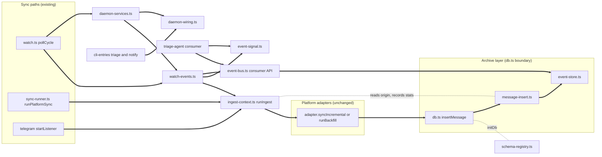
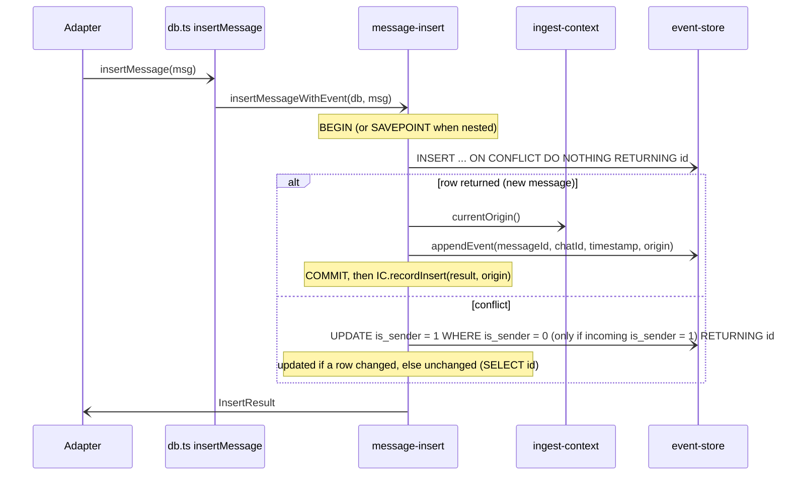

# Design Document: message-events

## Overview
**Purpose**: This feature delivers a durable "new message" event stream to khipuchat's in-process consumers. Every newly stored message, on any platform and any account, produces exactly one event row written in the same SQLite transaction as the message. Consumers keep a named, persistent position, read events after it, and acknowledge what they processed, giving at-least-once delivery that survives crashes and restarts.

**Users**: the triage-agent (first consumer, Phase 5) and any later consumer (for example an embedding indexer). The operator benefits indirectly: important messages can be acted on within seconds of a sync cycle, and first syncs, `--force` re-reads, and history imports are tagged `backfill` so they never flood consumers.

**Impact**: `insertMessage` keeps its exact storage semantics but now reports `inserted | updated | unchanged`. Two tables (`message_events`, `consumer_cursors`) are added automatically to every archive. `pollCycle` and `runPlatformSync` run each adapter call inside an origin scope and, in the daemon, signal in-process listeners after a cycle that recorded events. A successful daemon cycle now records the platform account sync time (decision D1, absorbs roadmap candidate `watch-lastsync`), so later daemon cycles take the incremental path and tag their events `live`. The feature also owns two shared Phase 5 registries: `src/schema-registry.ts` (decision D6: every feature's DDL applied once by `initDb`) and `src/daemon-services.ts` (decision D7: every in-daemon service started, drained, and stopped by `watch.ts`, with one overall shutdown deadline and a forward-order single-pass drain, decision D13), plus the light composition module `src/daemon-wiring.ts` (decisions D12, D14: `DaemonSharedWiring` and `composeSharedWiring`, shared by the daemon and the triage and notify CLI entries). No adapter signature changes.

### Goals
- Exactly one durable event per newly inserted message, atomic with the message (Req 2).
- Correct `live` / `backfill` origin under concurrent syncs (Req 3).
- A small, stable consumer API (`registerConsumer`, `readEvents`, `ack`, `waitForEvents`) that triage-agent can depend on (Req 4, 5, 6).
- Bounded growth through retention (Req 8) and zero behavior change on existing surfaces (Req 9).
- Daemon cycles advance the platform account sync time so daemon events are `live` after the first cycle (Req 7.6, 7.7).
- One schema registry and one daemon service registry that every Phase 5 spec extends with one entry (Req 10, 11).
- A bounded, predictable shutdown (one 25 s deadline for all services) and a single-pass run that lets producers finish before consumers (Req 11.5, 11.6, 11.9).
- One light wiring module that both the daemon and the CLI entries use to obtain shared collaborators, without importing any service runtime (Req 11.7, 11.10, 11.11).

### Non-Goals
- What consumers do with events (triage, notifications, actions).
- Cross-process wake-up, brokers, webhooks.
- Events for message updates, deletions, or chat changes.
- A CLI, MCP, or web surface for browsing events (later spec may call `getConsumerStatus`).
- Moving embedding indexing onto the event stream (it stays on `embedNewMessages` and `rebuildEmbeddings`).

## Boundary Commitments

### This Spec Owns
- The insert outcome contract of `insertMessage` (`InsertResult`) and the new `getMessageById` lookup in `src/db.ts`.
- The `message_events` and `consumer_cursors` schema, their creation on archive open, and every write to them.
- The origin scope primitive (`runIngest`) and the rule for deriving an event's origin.
- The public event bus API: consumer registration and removal, read, ack, status, wake-up signal (subscribe, notify, wait), retention.
- The daemon and sync-runner wiring that opens origin scopes, logs event counts, signals listeners, and schedules retention.
- The daemon's write of the platform account sync time after a cycle whose adapter call resolved (`runAdapterCycle` calls `setPlatformLastSyncedAt`); no other Phase 5 spec writes it from the daemon (slack-all-workspaces relies on this).
- `src/schema-registry.ts` (`SCHEMA_MODULES`, `applySchemaRegistry`) and the DDL-only module convention; `src/event-schema.ts` is its first entry.
- `src/daemon-services.ts` (`DAEMON_SERVICES`, `ServiceHandle`, `DaemonServiceContext`, `startDaemonServices`, `stopDaemonServices`, `runSinglePass`, `SERVICE_SHUTDOWN_DEADLINE_MS`); the event retention service is its first entry.
- `src/daemon-wiring.ts` (`DaemonSharedWiring`, created empty, and `composeSharedWiring`, returning `{}`), decisions D12, D14, D17. This spec owns the module and the rule that it imports only composition functions and types; triage-agent adds the `actionCatalog?` field and notifier adds the `approvalOffer?` field (each with its type-only import), and action-runner fills the body of `composeSharedWiring`.
- The `live` scope around the Telegram standalone listener's per-message handler.

### Out of Boundary
- Importance rules, LLM calls, verdict storage, `khipu triage` CLI (triage-agent).
- Notification delivery, routing, dedupe (notifier); action execution (action-runner).
- The bodies of other specs' daemon services and schema modules: triage-agent, notifier, and action-runner each add one `DAEMON_SERVICES` entry (in that order, after event retention) and one `SCHEMA_MODULES` entry; none edits `watch.ts` or `initDb`.
- The action catalog and approval offer themselves (action-runner), and their contracts (`ActionCatalog` in triage-agent's `src/triage/action-catalog.ts`, `ApprovalOffer` in notifier's `src/notify/approval-offer.ts`); the `DaemonSharedWiring` fields through which they reach triage-agent and notifier are added by triage-agent (`actionCatalog?`) and notifier (`approvalOffer?`), decision D17.
- The CLI entry scripts `src/cli-entries/triage-cli.ts` (triage-agent) and `src/cli-entries/notify-cli.ts` (notifier) and the `khipu.ts` `OPERATIONAL_SCRIPTS` entries that point at them (decision D14); this spec only defines `composeSharedWiring` as the function they call.
- The container `stop_grace_period` (cloud-deployment, 45s, decisions D13, D17); it must exceed `CYCLE_DRAIN_TIMEOUT_MS` plus `SERVICE_SHUTDOWN_DEADLINE_MS` (15 s + 25 s = 40 s < 45 s).
- Per-service drain bounds inside the overall deadline (triage-agent 10 s grace, action-runner 15 s), owned by those specs.
- Docker, compose, env documentation for the cloud server (cloud-deployment); this spec only defines the `EVENT_RETENTION_DAYS` variable.
- Any change to platform adapters other than the Telegram listener scope; adapters keep calling `insertMessage` exactly as today.
- `rebuildEmbeddings`, `embedNewMessages`, FTS behavior.

### Allowed Dependencies
- `better-sqlite3-multiple-ciphers` (existing), SQLite `RETURNING` and `AUTOINCREMENT`.
- `node:async_hooks` `AsyncLocalStorage` (Node 24 built-in).
- `src/db.ts` singleton (`getDb`) and `Platform` type from `src/platforms/types.ts`.
- Dependency direction: `db.ts` imports `message-insert.ts`, `event-store.ts`, and `schema-registry.ts`; `schema-registry.ts` imports only DDL-only schema modules (`event-schema.ts` and later specs' `*/schema.ts`); `event-bus.ts` imports `db.ts`; `watch.ts` imports `watch-events.ts` and `daemon-services.ts`; `daemon-services.ts` imports `watch-events.ts`, `daemon-wiring.ts`, and later specs' service start functions; `daemon-wiring.ts` imports only types (`import type` from `src/triage/action-catalog.ts` and `src/notify/approval-offer.ts`) and composition functions (action-runner's `composeActionSeams` from `src/actions/seams.ts`), never a service runtime, `daemon-services.ts`, `watch-events.ts`, or `db.ts`; the CLI entries in `src/cli-entries/` import `daemon-wiring.ts`, while `src/triage/**` and `src/notify/**` never import `daemon-wiring.ts`, `daemon-services.ts`, or `src/actions/`; `sync-runner.ts` and the Telegram adapter import `ingest-context.ts`. Adapters never import `event-store.ts`, `event-bus.ts`, `schema-registry.ts`, or `daemon-services.ts`.
- No new npm dependency, no network call, no Beeper dependency.

### Revalidation Triggers
Changes that force triage-agent (and any other consumer) to re-check integration:
- Any change to the `MessageEvent` field set, names, types, or units.
- Any change to origin derivation rules or the `backfill` default.
- Any change to `readEvents` ordering, `limit` semantics, `ackId` semantics, or `ack` validation.
- Any change to consumer naming rules or registration defaults (`startFrom`).
- Any change to the `EventsRecordedSignal` payload or the moment it fires.
- Any change to retention eligibility (could delete events a consumer expects).
- Moving the stream out of the archive DB or across processes.
- Any change to the `SchemaModule`, `SCHEMA_MODULES` ordering, `DaemonService`, `ServiceHandle`, `DaemonServiceContext`, or `DaemonSharedWiring` contracts, to `composeSharedWiring` or the import rule of `src/daemon-wiring.ts` (affects the CLI entries of triage-agent and notifier), or to the start, drain, and stop order, the watch versus once drain semantics, `CYCLE_DRAIN_TIMEOUT_MS`, `SINGLE_PASS_SERVICE_BOUND_MS`, or `SERVICE_SHUTDOWN_DEADLINE_MS` (affects every spec with a registry entry and cloud-deployment's `stop_grace_period`).
- Any change to when the daemon writes the sync time (affects slack-all-workspaces and every consumer that skips `backfill`).

## Architecture

### Existing Architecture Analysis
- Adapters call `insertMessage(msg)` from `src/db.ts` (about 25 call sites across 10 adapters); it uses the module singleton DB, not the `Database` passed to adapters.
- `pollCycle(adapter, database)` in `src/watch.ts` chooses `syncIncremental(since)` or `runBackfill()`, then compares message counts to decide on `rebuildEmbeddings` and logging. Cycles for different accounts run concurrently.
- `runPlatformSync(adapter, db, argv)` in `src/sync-runner.ts` chooses incremental, backfill, or forced mode for one-shot syncs.
- `src/db.ts` (315 lines) and `src/watch.ts` (195 lines) are at or above the 200-line target, so new logic lives in new modules and those files only gain thin delegations.

### Architecture Pattern & Boundary Map
Selected pattern: **transactional outbox with consumer high-water marks**, plus an in-process latency hint.



- **Domain boundaries**: the archive layer owns all SQL; `ingest-context` owns origin scoping and per-scope stats with no DB access; `event-bus` owns the consumer-facing API; `event-signal` owns the in-memory wake-up hint; `watch-events` owns daemon-side wiring (cycle wrapping, sync time write, logging, signalling, the retention service); `schema-registry` owns schema creation order; `daemon-services` owns in-daemon service start, drain, and stop order and the shutdown deadline; `daemon-wiring` owns the composition of shared collaborators and nothing else.
- **Existing patterns preserved**: adapters only call `db.ts` exports; synchronous DB; `:memory:` DB tests; files under 200 lines; COUNT-based daemon logging and embedding trigger.
- **Steering compliance**: no external service, no cloud dependency, no new library, strict TypeScript without `any`.

### Technology Stack

| Layer | Choice / Version | Role in Feature | Notes |
|-------|------------------|-----------------|-------|
| Data / Storage | SQLite via `better-sqlite3-multiple-ciphers` (existing) | `message_events`, `consumer_cursors` tables, atomic append | `RETURNING` already used by `upsertChat`; SQLCipher encryption applies unchanged |
| Messaging / Events | In-process listener set (no library) | Wake-up hint after a daemon cycle | Not durable by design; reads are authoritative |
| Runtime | Node.js 24 `AsyncLocalStorage` | Per-cycle origin scope across async adapter code | Built in |
| Backend | TypeScript 5 strict, `tsx` | All new modules | No `any` |

## File Structure Plan

### Directory Structure
```
src/
├── event-types.ts      # Shared types: EventOrigin, InsertOutcome, InsertResult, MessageEvent, EventBatch, options, status, signal, IngestStats, EventBusError
├── ingest-context.ts   # AsyncLocalStorage origin scope: runIngest, currentOrigin, recordInsert (no DB access)
├── event-schema.ts     # DDL-only: applyEventSchema(db) creates message_events, consumer_cursors, index (imports only better-sqlite3 types)
├── schema-registry.ts  # Ordered SCHEMA_MODULES list + applySchemaRegistry(db), called once by initDb
├── daemon-services.ts  # Ordered DAEMON_SERVICES list, ServiceHandle, context, startDaemonServices, stopDaemonServices, runSinglePass, SERVICE_SHUTDOWN_DEADLINE_MS
├── daemon-wiring.ts    # Light: DaemonSharedWiring (empty here; triage-agent and notifier add one field each) + composeSharedWiring(env); type-only and composition imports only
├── event-store.ts      # All DML for the stream on a Database handle: append, select-after, cursors, prune, status, highest assigned id
├── message-insert.ts   # insertMessageWithEvent(database, msg): outcome detection + event append in one transaction
├── event-bus.ts        # Public consumer API over getDb(): registerConsumer, removeConsumer, readEvents, ack, getConsumerStatus, pruneEvents, resolveRetentionDays; re-exports event-signal API and types
├── event-signal.ts     # In-process wake-up hint: subscribeEvents, notifyEventsRecorded, waitForEvents
└── watch-events.ts     # Daemon wiring: runAdapterCycle (since lookup + origin choice + scope + sync time write + report), reportCycleEvents, runRetention, eventRetentionService
tests/
├── message-insert.test.ts   # Req 1, 2, 7.5 on :memory:
├── ingest-context.test.ts   # Req 3.3, 3.4, 3.5
├── event-bus.test.ts        # Req 4, 5, 8.1-8.5
├── event-signal.test.ts     # Req 6
├── watch-events.test.ts     # Req 3.1, 3.2, 6.1, 6.2, 7.1, 7.4, 7.6, 7.7, 8.6, 8.7 on :memory:
├── schema-registry.test.ts  # Req 10 (order, idempotence, failure naming, DDL-only import closure)
├── daemon-services.test.ts  # Req 11 (order, skip, start failure, reverse drain and stop under one deadline, forward single pass, shared wiring, daemon-wiring import closure)
├── event-migration.test.ts  # Req 9.1-9.3, 10.1 on a temp-file legacy archive
├── telegram-listener.test.ts # Req 3.6: captured handler, mocked image/embedding modules
└── message-events-e2e.test.ts # End-to-end consumer flow on a temp-file archive (restart simulation)
```

### Modified Files
- `src/db.ts`: `insertMessage(msg): InsertResult` delegates to `insertMessageWithEvent(db(), msg)`; new `getMessageById(id): MessageRow | null`; `initDb` calls `applySchemaRegistry(_db)` exactly once, right after `runMigrations(_db)`; re-exports `InsertResult`, `InsertOutcome` types. Net growth about 15 lines.
- `src/watch.ts`: `pollCycle` replaces its inline `since` lookup and incremental/backfill branch with `await runAdapterCycle(adapter, database)` (the `getPlatformLastSyncedAt` import moves to `watch-events.ts`); `main()` calls `startDaemonServices({ db, env: process.env, mode })` once after adapters are built; `shutdown()` clears poll timers, waits at most `CYCLE_DRAIN_TIMEOUT_MS = 15_000` for in-flight cycles (replaces today's 30 s cycle wait), then awaits `stopDaemonServices(started)` (one overall `SERVICE_SHUTDOWN_DEADLINE_MS` deadline), so the worst case is 15 s + 25 s = 40 s, below cloud-deployment's `stop_grace_period: 45s` (decision D17); `--once` mode awaits `runSinglePass(started)` after the sync pass before `process.exit(0)`. COUNT logic and log lines untouched. This is the last edit any Phase 5 spec makes to `watch.ts` for service start and stop.
- `src/sync-runner.ts`: `runPlatformSync` wraps the chosen adapter call in `runIngest('live' | 'backfill', ...)` and rethrows a failed outcome's error.
- `src/platforms/telegram/sync.ts`: the `startListener(client)` event handler body runs inside `runIngest('live', ...)`.
- `tests/watch.test.ts`: adds `vi.mock('../src/event-bus', ...)` and `vi.mock('../src/daemon-services', ...)` (exposing `startDaemonServices`, `stopDaemonServices`, `runSinglePass`), and adds `setPlatformLastSyncedAt` to the existing db mock, so the new imports resolve; existing assertions unchanged.
- `tests/sync-runner.test.ts`: adds origin assertions for incremental, backfill, and forced modes.

## System Flows

### Insert and event append (one transaction)

Any thrown error rolls back both the message and the event; the error propagates to the adapter exactly as a storage failure does today (Req 2.3, 7.5).

### Daemon cycle with origin, signal, and consumer wake-up
```mermaid
sequenceDiagram
  participant W as pollCycle
  participant WE as watch-events
  participant IC as ingest-context
  participant AD as Adapter
  participant SG as event-signal
  participant C as Consumer (triage-agent)
  W-)WE: runAdapterCycle(adapter, db)
  Note over WE: since = getPlatformLastSyncedAt(platform, account), startedAt = now in unix seconds
  WE-)IC: runIngest(origin, adapter call)
  IC-)AD: syncIncremental(since) when since known, else runBackfill()
  AD-)IC: inserts recorded in scope stats
  IC-)WE: IngestOutcome (ok or error, plus stats); scope closed
  Note over WE: only when the adapter call resolved (ok outcome), setPlatformLastSyncedAt(platform, account, startedAt)
  WE-)SG: notifyEventsRecorded(signal) when live + backfill > 0
  SG-)C: waitForEvents resolves "signalled"
  C-)C: readEvents, process, ack(ackId)
  WE-)W: rethrow error if the adapter failed
```
Decisions: origin is `live` only when the incremental path is taken (`adapter.syncIncremental` defined and `since !== null`); otherwise `backfill`. Signals fire even when the adapter failed mid-cycle, because events already committed are real. The signal never replaces reading. The sync time is written only when the adapter call resolves (ok outcome) and is the cycle start time (same rule as `runPlatformSync`'s `runStartedAt`), so messages arriving during the cycle are re-read next cycle rather than skipped; a cycle whose adapter call rejects leaves it unchanged and the next cycle repeats the same path. "Resolves" is the whole rule (decision D15): an adapter that reports a problem without rejecting, such as Slack's auth-failed cycle, still advances the sync time; this is safe for Slack because it ignores `since` and resumes from its per-conversation cursors. Consequence: on a fresh archive the first daemon cycle is `backfill` and every later ok cycle for an adapter with `syncIncremental` is `live` (Req 7.6, 7.7).

### Consumer loop contract (for triage-agent)
```typescript
registerConsumer('triage-agent')                 // idempotent; default startFrom 'now'
while (!stopping) {
  const batch = readEvents('triage-agent', { limit: 100 })
  if (batch.ackId === null) {                     // nothing examined: caught up
    await waitForEvents({ timeoutMs: 60_000, signal: abort.signal })
    continue
  }
  for (const ev of batch.events) await handle(ev) // idempotent per ev.id (at-least-once)
  ack('triage-agent', batch.ackId)                // also passes skipped backfill events
}
```
A batch may hold zero events with a non-null `ackId` (only backfill examined); the loop acks and continues immediately. A consumer may also ack per event (`ack(name, ev.id)`) for finer-grained progress.

## Requirements Traceability

| Requirement | Summary | Components | Interfaces | Flows |
|-------------|---------|------------|------------|-------|
| 1.1, 1.2, 1.3 | Insert outcome reporting | MessageInsert, MessageArchive | `insertMessage(): InsertResult` | Insert and event append |
| 1.4 | Same stored data and conflict rules | MessageInsert | DO NOTHING + conditional `is_sender` update | Insert and event append |
| 1.5 | Lookup by archive id | MessageArchive | `getMessageById` | |
| 2.1, 2.2, 2.6 | One event per inserted message only | MessageInsert, EventStore | `appendEvent`, `UNIQUE(message_id)` | Insert and event append |
| 2.3 | Atomic with message | MessageInsert | `database.transaction` | Insert and event append |
| 2.4 | Monotonic, never reused ids | EventStore | `AUTOINCREMENT` | |
| 2.5 | Event fields | EventTypes, EventStore | `MessageEvent` | |
| 2.7 | No direct event writes by adapters | EventStore, EventBus | No append export from `db.ts` or `event-bus.ts` | |
| 3.1, 3.2 | Live vs backfill by sync path | WatchEvents, SyncRunner wiring | `runAdapterCycle`, `runIngest` | Daemon cycle |
| 3.3 | Default backfill | IngestContext | `currentOrigin()` | |
| 3.4 | Concurrent isolation | IngestContext | `AsyncLocalStorage` | |
| 3.5 | Closed scope yields backfill | IngestContext | `IngestScope.open` | |
| 3.6 | Telegram listener live | Telegram listener wiring | `runIngest('live', ...)` | |
| 3.7 | Nested scopes roll up | IngestContext | `IngestScope.parent`, `recordInsert` | |
| 4.1, 4.2 | Register with start position, idempotent | EventBus, EventStore | `registerConsumer` | |
| 4.3 | Name validation | EventBus | `CONSUMER_NAME_PATTERN`, `EventBusError` | |
| 4.4 | Unknown consumer rejected | EventBus | `EventBusError('unknown_consumer')` | |
| 4.5 | Removal | EventBus, EventStore | `removeConsumer` | |
| 4.6 | Persistent positions | EventStore | `consumer_cursors` table | |
| 5.1, 5.2, 5.3, 5.4, 5.8 | Read ordering, filtering, ackId, no side effect | EventBus, EventStore | `readEvents`, `EventBatch` | Consumer loop |
| 5.5, 5.6 | Ack monotonic, upper bound | EventBus, EventStore | `ack`, `highestAssignedId` | Consumer loop |
| 5.7 | Redelivery without ack | EventBus | Position unchanged until `ack` | Consumer loop |
| 5.9 | Consumer status | EventBus, EventStore | `getConsumerStatus` | |
| 6.1, 6.2 | Signal after cycle with events only | WatchEvents, EventSignal | `reportCycleEvents`, `notifyEventsRecorded` | Daemon cycle |
| 6.3, 6.4 | Listener isolation, unsubscribe | EventSignal | `subscribeEvents` | |
| 6.5 | Wait with timeout | EventSignal | `waitForEvents` | Consumer loop |
| 6.6 | Hint only | EventSignal, EventBus | Reads independent of signals | Consumer loop |
| 7.1 | Daemon origin | WatchEvents, watch.ts | `runAdapterCycle` | Daemon cycle |
| 7.2 | One-shot origin | SyncRunner wiring | `runIngest` in `runPlatformSync` | |
| 7.3 | Daemon behavior unchanged | watch.ts | COUNT logic untouched | Daemon cycle |
| 7.4 | Event count log | WatchEvents | `reportCycleEvents` | Daemon cycle |
| 7.5 | Event failure fails the store | MessageInsert | Transaction rollback, rethrow | Insert and event append |
| 7.6, 7.7 | Daemon sync time when the adapter call resolves, unchanged when it rejects | WatchEvents | `runAdapterCycle`, `setPlatformLastSyncedAt` | Daemon cycle |
| 8.1, 8.2, 8.3 | Retention eligibility | EventStore, EventBus | `pruneEvents` | |
| 8.4, 8.5 | Retention config | EventBus | `resolveRetentionDays`, `EVENT_RETENTION_DAYS` | |
| 8.6, 8.7 | Retention schedule and log | WatchEvents, DaemonServices | `runRetention`, `eventRetentionService` | Daemon services lifecycle |
| 9.1, 9.2, 9.3 | Automatic, idempotent, no back-events | EventSchema, SchemaRegistry, MessageArchive | `applyEventSchema` via `applySchemaRegistry` in `initDb` | |
| 9.4 | Surfaces unchanged | All | Existing parity tests | |
| 9.5 | Local only, no new deps | All | | |
| 9.6 | Unix seconds everywhere | EventStore, WatchEvents, EventBus | `created_at`, `updated_at`, cutoff, sync time | |
| 10.1, 10.2, 10.3 | Ordered, once, DDL-only, event schema first | SchemaRegistry, EventSchema, MessageArchive | `SCHEMA_MODULES`, `applySchemaRegistry` | |
| 10.4 | Failure names the module | SchemaRegistry | `applySchemaRegistry` | |
| 10.5 | One import plus one entry | SchemaRegistry | Registry convention | |
| 11.1, 11.2, 11.3, 11.4 | Ordered start, retention first, skip, start failure | DaemonServices, WatchEvents | `DAEMON_SERVICES`, `startDaemonServices`, `eventRetentionService` | Daemon services lifecycle |
| 11.5 | Signal shutdown: 15 s cycle wait, then reverse drain then stop, in-flight only, one 25 s deadline | DaemonServices, watch.ts | `CYCLE_DRAIN_TIMEOUT_MS`, `stopDaemonServices`, `SERVICE_SHUTDOWN_DEADLINE_MS` | Daemon services lifecycle |
| 11.6 | Single pass: forward drain of pending work, then reverse stop | DaemonServices, watch.ts, WatchEvents | `runSinglePass`, `eventRetentionService` | Daemon services lifecycle |
| 11.7 | Shared context and wiring | DaemonServices, DaemonWiring | `DaemonServiceContext`, `DaemonSharedWiring`, `composeSharedWiring` | Daemon services lifecycle |
| 11.8 | One entry per service | DaemonServices | Registry convention | |
| 11.9 | Run mode decides drain behavior | DaemonServices, WatchEvents | `DaemonServiceContext.mode`, `ServiceHandle.drain` | Daemon services lifecycle |
| 11.10 | Light wiring module usable by CLI entries | DaemonWiring | `composeSharedWiring`, import closure rule | |
| 11.11 | Services read shared wiring themselves; providers only fill it | DaemonWiring, DaemonServices | `ctx.shared.*`, registry convention | |

## Components and Interfaces

| Component | Domain/Layer | Intent | Req Coverage | Key Dependencies | Contracts |
|-----------|--------------|--------|--------------|------------------|-----------|
| EventTypes | Shared | Type contracts for the stream | 2.5, 4.3, 5 | Platform type (P0) | State |
| IngestContext | Runtime | Origin scope and per-scope stats | 3.3, 3.4, 3.5 | AsyncLocalStorage (P0) | Service, State |
| EventSchema | Archive | DDL-only creation of the stream tables | 2.4, 2.6, 4.6, 9.1-9.3, 10.2 | better-sqlite3 types (P0) | State |
| SchemaRegistry | Archive | Ordered, once-only application of every feature's DDL | 10 | EventSchema (P0) | Service |
| EventStore | Archive | All stream DML on a handle | 2, 4.6, 5, 8.1-8.3, 9.6 | better-sqlite3 (P0) | Service, State |
| MessageInsert | Archive | Outcome detection + atomic append | 1.1-1.4, 2.1-2.3, 2.6, 7.5 | EventStore (P0), IngestContext (P0) | Service |
| MessageArchive (db.ts changes) | Archive | Public insert contract and lookup | 1, 2.7, 9.1 | MessageInsert (P0), EventStore (P0) | Service |
| EventBus | Consumer API | Register, read, ack, status, prune | 4, 5, 8.1-8.5 | db.ts getDb (P0), EventStore (P0) | Service |
| EventSignal | Consumer API | In-process wake-up hint | 6 | none | Event |
| WatchEvents | Daemon wiring | Cycle origin, sync time, report, retention service | 3.1, 3.2, 6.1, 6.2, 7.1, 7.4, 7.6, 7.7, 8.6, 8.7, 11.2, 11.6, 11.9 | IngestContext, EventSignal, EventBus, db.ts (P0) | Batch |
| DaemonServices | Daemon wiring | Ordered start, reverse drain and stop under one deadline, forward single-pass drain | 11.1-11.9 | WatchEvents (P0), DaemonWiring (P0) | Service |
| DaemonWiring | Daemon wiring | Light composition of shared collaborators for the daemon and CLI entries | 11.7, 11.10, 11.11 | type-only triage and notify contracts (P0), action-runner composition (P1) | State, Service |
| SyncRunner wiring | Sync wiring | One-shot origin | 7.2 | IngestContext (P0) | Service |
| Telegram listener wiring | Adapter wiring | Live scope for standalone listener | 3.6 | IngestContext (P0) | Service |

### Shared

#### EventTypes (`src/event-types.ts`)

```typescript
import type { Platform } from './platforms/types'

export type EventOrigin = 'live' | 'backfill'
export type InsertOutcome = 'inserted' | 'updated' | 'unchanged'

export interface InsertResult {
  outcome: InsertOutcome
  messageId: number          // messages.id of the stored or existing row
  eventId: number | null     // message_events.id when outcome === 'inserted', else null
}

/** One row of message_events, exactly as returned to consumers. All times are unix seconds. */
export interface MessageEvent {
  id: number                 // strictly increasing, never reused
  message_id: number         // messages.id; resolve with getMessageById
  platform: Platform         // from the chat row (falls back to the message's platform)
  account: string            // from the chat row (falls back to 'default')
  chat_id: number            // chats.id
  message_timestamp: number  // copy of messages.timestamp
  origin: EventOrigin
  created_at: number         // when the event was recorded
}

export interface ReadEventsOptions {
  limit?: number             // rows examined; default 100, clamped to 1..1000
  includeBackfill?: boolean  // default false
}

export interface EventBatch {
  events: MessageEvent[]     // ascending id, filtered by origin option
  ackId: number | null       // id of the last examined row (including skipped backfill), null when none examined
}

export interface RegisterConsumerOptions {
  startFrom?: 'now' | 'beginning'   // default 'now'
}

export interface ConsumerStatus {
  consumer: string
  last_event_id: number
  pending_live: number       // retained live events with id > last_event_id
  updated_at: number         // last ack (or registration) time
}

export interface EventsRecordedSignal {
  platform: Platform
  account: string
  live: number
  backfill: number
  maxEventId: number
}

export interface IngestStats {
  inserted: number
  updated: number
  unchanged: number
  liveEvents: number
  backfillEvents: number
  maxEventId: number | null
}

export type IngestOutcome<T> =
  | { ok: true; result: T; stats: IngestStats }
  | { ok: false; error: unknown; stats: IngestStats }

export type EventBusErrorCode = 'invalid_consumer_name' | 'unknown_consumer' | 'invalid_ack' | 'ack_out_of_range'

export class EventBusError extends Error {
  constructor(readonly code: EventBusErrorCode, message: string) { super(message); this.name = 'EventBusError' }
}

export const CONSUMER_NAME_PATTERN = /^[a-z][a-z0-9-]{0,63}$/
```

**Consumer naming convention**: a consumer is named after the owning module or spec in lowercase kebab case, 1 to 64 characters, starting with a letter: `triage-agent` (first consumer), later for example `embeddings-indexer`. Names are stable identifiers; renaming a consumer means registering a new one (with its own start position) and removing the old one.

### Runtime

#### IngestContext (`src/ingest-context.ts`)

| Field | Detail |
|-------|--------|
| Intent | Carry the origin of the current sync scope through async adapter code and collect per-scope stats |
| Requirements | 3.3, 3.4, 3.5, 3.7 |

**Responsibilities & Constraints**
- Holds `AsyncLocalStorage<IngestScope>` where `IngestScope = { origin: EventOrigin; open: boolean; stats: IngestStats; parent: IngestScope | null }`.
- No DB access, no logging. Pure runtime state, safe to import from adapters.

##### Service Interface
```typescript
export function runIngest<T>(origin: EventOrigin, fn: () => Promise<T>): Promise<IngestOutcome<T>>
export function currentOrigin(): EventOrigin
export function recordInsert(result: InsertResult, origin: EventOrigin): void
```
- `runIngest`: creates a fresh open scope with zeroed stats, runs `fn` inside it, sets `open = false` in `finally`, and resolves with `{ ok, result | error, stats }`. It never rejects; callers decide whether to rethrow.
- `currentOrigin`: returns the active scope's origin when a scope exists and is open; otherwise `'backfill'`.
- `recordInsert`: when a scope exists and is open, increments `inserted | updated | unchanged`, and for inserted results increments `liveEvents` or `backfillEvents` (by the event's own origin) and raises `maxEventId`; it applies the same increments to every still-open ancestor scope through `parent`. No-op when no scope is open.
- Invariant (nesting, Req 3.7): a `runIngest` call made inside an open scope creates an inner scope whose `parent` is the outer scope. The inner origin applies to inserts made inside it until it closes, then the outer origin applies again. Inner stats roll up into the outer scope, so the outer cycle's `IngestOutcome.stats` counts every event recorded during it and the daemon signal (`reportCycleEvents`) covers them. Named nesting callers: slack-all-workspaces (a per-workspace or per-channel `backfill` scope inside a daemon cycle's `live` or `backfill` scope) and the Telegram listener (normally top level). An inner scope never changes the outer scope's origin, and a failure inside an inner scope resolves the inner `runIngest` with `ok: false` without closing the outer scope.

### Archive Layer

#### EventStore (`src/event-store.ts`)

| Field | Detail |
|-------|--------|
| Intent | Own every data statement (DML) that touches `message_events` and `consumer_cursors`; table creation lives in EventSchema |
| Requirements | 2.1, 2.4, 2.5, 2.6, 4.1, 4.2, 4.5, 4.6, 5.1, 5.5, 5.9, 8.1, 8.2, 8.3, 9.6 |

**Responsibilities & Constraints**
- Every function takes `database: Database.Database` as its first argument; no singleton access, so it is testable and usable by both `db.ts` and `event-bus.ts`.
- Not imported by adapters. Not re-exported from `db.ts` (Req 2.7).

##### Service Interface
```typescript
export function appendEvent(database: Database.Database, input: {
  messageId: number; chatId: number; platform: Platform; messageTimestamp: number; origin: EventOrigin; now: number
}): number                                             // returns event id
export function selectEventsAfter(database: Database.Database, afterId: number, limit: number): MessageEvent[]
export function highestAssignedId(database: Database.Database): number   // sqlite_sequence.seq or 0
export function getCursor(database: Database.Database, consumer: string): number | null
export function insertCursorIfAbsent(database: Database.Database, consumer: string, startId: number, now: number): void
export function advanceCursor(database: Database.Database, consumer: string, id: number, now: number): number  // returns new position
export function deleteCursor(database: Database.Database, consumer: string): boolean
export function listConsumerStatus(database: Database.Database): ConsumerStatus[]
export function deleteEligibleEvents(database: Database.Database, cutoff: number): number  // returns deleted count
```
- `appendEvent` resolves platform and account with `COALESCE((SELECT platform FROM chats WHERE id = @chatId), @platform)` and `COALESCE((SELECT account FROM chats WHERE id = @chatId), 'default')`, so a missing chat row never fails an insert that succeeds today.
- `advanceCursor` runs `UPDATE consumer_cursors SET last_event_id = MAX(last_event_id, @id), updated_at = @now WHERE consumer = @consumer` and returns the stored value.
- `deleteEligibleEvents` runs `DELETE FROM message_events WHERE created_at < @cutoff AND id <= COALESCE((SELECT MIN(last_event_id) FROM consumer_cursors), 9223372036854775807)`.
- Every `now`, `cutoff`, `created_at`, and `updated_at` value is unix seconds (`Math.floor(Date.now() / 1000)`), Req 9.6 and decision D8.

#### EventSchema (`src/event-schema.ts`)

| Field | Detail |
|-------|--------|
| Intent | DDL-only creation of the event stream tables, registered first in SchemaRegistry |
| Requirements | 2.4, 2.6, 4.6, 9.1, 9.2, 9.3, 10.2, 10.3 |

```typescript
import type Database from 'better-sqlite3-multiple-ciphers'
export function applyEventSchema(db: Database.Database): void
```
- Executes exactly the Physical Data Model DDL below with `IF NOT EXISTS`. Imports nothing but the better-sqlite3 type. Never inserts, updates, or deletes rows.

#### SchemaRegistry (`src/schema-registry.ts`)

| Field | Detail |
|-------|--------|
| Intent | The one ordered place where every Phase 5 feature's tables are created on archive open (decision D6) |
| Requirements | 10.1, 10.2, 10.3, 10.4, 10.5 |

```typescript
import type Database from 'better-sqlite3-multiple-ciphers'
import { applyEventSchema } from './event-schema'

export interface SchemaModule {
  readonly name: string                              // '<spec>[:<module>]', e.g. 'message-events', 'slack-all-workspaces:slack'
  readonly apply: (db: Database.Database) => void    // a DDL-only apply<Name>Schema function
}

export const SCHEMA_MODULES: readonly SchemaModule[] = [
  { name: 'message-events', apply: applyEventSchema },
  // later specs insert one entry each at their canonical position (see below)
]

export function applySchemaRegistry(db: Database.Database, modules?: readonly SchemaModule[]): void   // default SCHEMA_MODULES
```
- `applySchemaRegistry` applies each module in list order; a thrown error is rethrown as `Error('schema module "<name>" failed: <message>', { cause })`, which fails `initDb` (Req 10.4). `initDb` calls it exactly once, right after `runMigrations`, so every registered table exists before any caller gets the handle.
- The `modules` parameter exists only for tests; production always uses `SCHEMA_MODULES`.

**Convention for other specs (one import + one entry)**
- Each spec puts its tables in a DDL-only module: `src/<area>/schema.ts` for a spec with its own directory, or `src/<name>-schema.ts` for flat modules, exporting `apply<Name>Schema(db: Database.Database): void`.
- DDL-only means: only `CREATE TABLE IF NOT EXISTS`, `CREATE INDEX IF NOT EXISTS`, and other idempotent schema statements; it imports nothing but types and the better-sqlite3 type, so `schema-registry.ts`'s import closure stays DDL-only and isolation rules in triage-agent, notifier, action-runner, and ingress can allow `*/schema.ts` modules and `src/schema-registry.ts` explicitly.
- Canonical `SCHEMA_MODULES` order (decision D15; this spec owns the list, every spec inserts at its position regardless of implementation order):
  1. `message-events` (`applyEventSchema`, this spec)
  2. account-health (`slack-all-workspaces:account-health`)
  3. slack (`slack-all-workspaces:slack`)
  4. presence (`presence-context`)
  5. triage (`triage-agent`)
  6. notifier (`notifier`)
  7. action-runner (`action-runner`)
- Entry `name` rule: `<spec>[:<module>]`. A spec with one schema module uses its spec name alone (`message-events`, `triage-agent`); a spec with several schema modules adds one entry per module named `<spec>:<module>` (`slack-all-workspaces:account-health`, `slack-all-workspaces:slack`). Names are unique, lowercase kebab case on both sides of the colon, and appear in the `schema module "<name>" failed` error.
- The order is also a dependency order: a module only references (by foreign key) tables of modules earlier in the list.
- The spec adds one `import { apply<Name>Schema } from '...'` line and one `{ name: '<spec>[:<module>]', apply: apply<Name>Schema }` entry per module at its canonical position. It never edits `initDb`, never adds a lazy `ensure*Schema` on first use, and never alters another spec's tables from its module (column changes on existing tables stay in `db-migrations.ts`).
- Shared tables use unix seconds for every time column (decision D8).

#### MessageInsert (`src/message-insert.ts`)

| Field | Detail |
|-------|--------|
| Intent | Store a message with today's exact semantics, report the outcome, and append the event atomically |
| Requirements | 1.1, 1.2, 1.3, 1.4, 2.1, 2.2, 2.3, 2.6, 7.5 |

##### Service Interface
```typescript
export function insertMessageWithEvent(database: Database.Database, msg: Message): InsertResult
```
- Inside `database.transaction(...)`:
  1. `INSERT INTO messages (...same 15 columns...) VALUES (...) ON CONFLICT(external_id, chat_id) DO NOTHING RETURNING id`.
  2. Row returned: `origin = currentOrigin()`, `eventId = appendEvent(...)`, result `inserted`.
  3. No row and `msg.is_sender === 1`: `UPDATE messages SET is_sender = 1 WHERE external_id = ? AND chat_id = ? AND is_sender = 0 RETURNING id`; row returned means `updated`.
  4. Otherwise `SELECT id FROM messages WHERE external_id = ? AND chat_id = ?`, result `unchanged`.
- After the transaction returns, `recordInsert(result, origin)`.
- Postconditions: stored row identical to the pre-feature upsert for every input; exactly one event per inserted row; any error (including from `appendEvent`) rolls back the message and propagates unchanged.
- Parameter mapping (`?? null` for optional media fields) is identical to today's `insertMessage`.

#### MessageArchive changes (`src/db.ts`)

| Field | Detail |
|-------|--------|
| Intent | Keep `db.ts` the only adapter-facing entry point |
| Requirements | 1.1, 1.2, 1.3, 1.5, 2.7, 9.1, 9.2, 10.1 |

```typescript
export type { InsertResult, InsertOutcome } from './event-types'
export function insertMessage(msg: Message): InsertResult      // was: void
export function getMessageById(id: number): MessageRow | null
```
- `initDb` calls `applySchemaRegistry(_db)` exactly once, right after `runMigrations(_db)`; it no longer names any feature's schema function.
- Existing callers that ignore the return value compile and behave unchanged.

### Consumer API

#### EventBus (`src/event-bus.ts`)

| Field | Detail |
|-------|--------|
| Intent | The single module consumers import |
| Requirements | 4.1, 4.2, 4.3, 4.4, 4.5, 5.1 to 5.9, 8.1 to 8.5 |

##### Service Interface
```typescript
export function registerConsumer(name: string, options?: RegisterConsumerOptions): number   // returns current position
export function removeConsumer(name: string): boolean
export function readEvents(name: string, options?: ReadEventsOptions): EventBatch
export function ack(name: string, eventId: number): number                                  // returns new position
export function getConsumerStatus(): ConsumerStatus[]
export function pruneEvents(options: { retentionDays: number; now?: number }): number       // deleted count
export function resolveRetentionDays(raw: string | undefined): { days: number; warning: string | null }
export const DEFAULT_RETENTION_DAYS = 7
export { subscribeEvents, notifyEventsRecorded, waitForEvents } from './event-signal'
export type { EventsListener, WaitForEventsOptions, WaitResult } from './event-signal'
export type { MessageEvent, EventBatch, EventOrigin, ReadEventsOptions, RegisterConsumerOptions,
  ConsumerStatus, EventsRecordedSignal } from './event-types'
export { EventBusError } from './event-types'
```
- `registerConsumer`: validates the name (`invalid_consumer_name`); if absent, inserts a cursor at `highestAssignedId()` for `'now'` or `0` for `'beginning'`; if present, leaves it untouched. Returns the stored position.
- `readEvents`: validates the name, loads the cursor (`unknown_consumer` if absent), clamps `limit` to 1..1000 (default 100), calls `selectEventsAfter(cursor, limit)`, sets `ackId` to the last examined id (or `null`), filters out `backfill` unless `includeBackfill`. Never writes.
- `ack`: validates the name and cursor; rejects non-integer or negative ids (`invalid_ack`) and ids greater than `highestAssignedId()` (`ack_out_of_range`) without writing; otherwise `advanceCursor`. Acking at or below the current position is a no-op that returns the current position.
- `pruneEvents`: `cutoff = now - retentionDays * 86400`; delegates to `deleteEligibleEvents`.
- `resolveRetentionDays`: accepts a decimal integer string >= 1; returns the default with `warning = null` when `raw` is undefined or empty, and with a descriptive warning when present but invalid.
- Reads `getDb()` on each call (no handle caching), matching `db.ts` usage in tests.

#### EventSignal (`src/event-signal.ts`)

| Field | Detail |
|-------|--------|
| Intent | In-process latency hint after a daemon cycle recorded events |
| Requirements | 6.1, 6.3, 6.4, 6.5, 6.6 |

##### Event Contract
```typescript
export type EventsListener = (signal: EventsRecordedSignal) => void
export function subscribeEvents(listener: EventsListener): () => void     // returns unsubscribe
export function notifyEventsRecorded(signal: EventsRecordedSignal): void
export interface WaitForEventsOptions { timeoutMs: number; signal?: AbortSignal }
export type WaitResult = 'signalled' | 'timeout' | 'aborted'
export function waitForEvents(options: WaitForEventsOptions): Promise<WaitResult>
```
- Published event: `EventsRecordedSignal`, fired once per daemon cycle that recorded at least one event, after the adapter call finished (success or failure).
- Delivery: synchronous fan-out to a `Set` of listeners; each listener call is wrapped in `try/catch`, failures logged as `[event-signal] listener error: <message>` and skipped.
- `waitForEvents`: subscribes once, resolves `'signalled'` on the first signal, `'timeout'` after `timeoutMs`, `'aborted'` when the abort signal fires (immediately if already aborted); always unsubscribes and clears its timer.
- Ordering and guarantees: none beyond "after commit". Not durable, not cross-process. Consumers must always read after waking and must keep a fallback timeout.

### Daemon and Sync Wiring

#### WatchEvents (`src/watch-events.ts`)

| Field | Detail |
|-------|--------|
| Intent | Keep `watch.ts` thin while adding origin scope, reporting, and retention |
| Requirements | 3.1, 3.2, 6.1, 6.2, 7.1, 7.4, 7.6, 7.7, 8.4, 8.5, 8.6, 8.7, 11.2, 11.6, 11.9 |

##### Batch / Job Contract
```typescript
export const RETENTION_INTERVAL_MS = 3_600_000
export async function runAdapterCycle(
  adapter: PlatformAdapter,
  database: Database.Database,
  options?: { nowSeconds?: () => number }      // default () => Math.floor(Date.now() / 1000)
): Promise<IngestStats>
export function reportCycleEvents(adapter: PlatformAdapter, stats: IngestStats): void
export function runRetention(env?: NodeJS.ProcessEnv, now?: number): number   // env default process.env
export const eventRetentionService: DaemonService                             // name 'event-retention'
```
- `runAdapterCycle`: reads `since = getPlatformLastSyncedAt(adapter.platform, adapter.account)` and `startedAt = nowSeconds()` before the adapter call; `useIncremental = adapter.syncIncremental !== undefined && since !== null`; origin `live` when incremental else `backfill`; runs the same adapter call `pollCycle` makes today inside `runIngest`; when the adapter call resolved (ok outcome) calls `setPlatformLastSyncedAt(adapter.platform, adapter.account, startedAt)` (Req 7.6, decisions D1, D15); when it rejected (failed outcome) leaves the sync time unchanged (Req 7.7); then calls `reportCycleEvents`; finally rethrows the error of a failed outcome so `pollCycle`'s existing catch logs it. This is the only daemon-side writer of the platform account sync time.
- `reportCycleEvents`: when `liveEvents + backfillEvents > 0`, logs `[<platform>/<account>] recorded <L> live, <B> backfill events` and calls `notifyEventsRecorded`; otherwise does nothing.
- `runRetention`: resolves days from `env['EVENT_RETENTION_DAYS']` of the passed env (the service passes `ctx.env`; decision D17), logs the warning once per call when present, calls `pruneEvents`, logs `[events] pruned <N> events older than <D> days` when `N > 0`; catches and logs any error (`[events] retention error: <message>`) and returns 0, so retention never crashes the daemon.
- `eventRetentionService` (first `DAEMON_SERVICES` entry, Req 11.2): `start(ctx)` calls `runRetention(ctx.env)` once; in `watch` mode it starts `setInterval(() => runRetention(ctx.env), RETENTION_INTERVAL_MS)`; it returns a handle whose `stop` clears the interval and whose `drain` branches on `ctx.mode` (Req 11.9, decision D13):
  - `watch` (signal shutdown, inside the 25 s deadline): starts no new retention run and resolves immediately, because `runRetention` is synchronous and so never has work in flight when `drain` is called.
  - `once` (`runSinglePass`, forward order, so it drains first): runs `runRetention(ctx.env)` once, which is its whole pending work, then resolves. Because it drains before the consumers, this run prunes only events every consumer had already passed before the pass's drain; events consumers ack during their own drain are pruned by a later run. This is safe (retention only ever deletes passed events) and keeps the producer-before-consumer order.
  - It never returns `null` (retention is always on).
- Trigger points (Req 8.6): service start (daemon startup, both modes), hourly via the service's interval in `watch` mode, and the service's `once`-mode drain at the end of a `--once` pass. No retention run happens during signal shutdown.

#### DaemonWiring (`src/daemon-wiring.ts`)

| Field | Detail |
|-------|--------|
| Intent | The light composition module that builds the collaborators one feature hands to others, used by the daemon and by the CLI entries (decisions D12, D14) |
| Requirements | 11.7, 11.10, 11.11 |

##### Service Interface
```typescript
// Created EMPTY by this spec (decision D17). Later specs each add one line plus its type-only import:
//   triage-agent, in the task that creates src/triage/action-catalog.ts:
//     import type { ActionCatalog } from './triage/action-catalog'   and   readonly actionCatalog?: ActionCatalog
//   notifier, in the task that creates src/notify/approval-offer.ts:
//     import type { ApprovalOffer } from './notify/approval-offer'    and   readonly approvalOffer?: ApprovalOffer

/** Collaborators one feature hands to others. Every field is optional: absent means "use your own empty default". */
export interface DaemonSharedWiring {
  // actionCatalog?: added by triage-agent; read by triage-agent (daemon entry and CLI entry)
  // approvalOffer?: added by notifier; read by notifier (daemon entry and CLI entry)
}

export function composeSharedWiring(env: NodeJS.ProcessEnv): DaemonSharedWiring
```
- In this spec `DaemonSharedWiring` is empty and `composeSharedWiring` returns `{}`; once triage-agent and notifier have added their fields, both stay `undefined` until action-runner fills the body, and triage-agent and notifier use their EMPTY `defaultActionCatalog()` / `defaultApprovalOffer()` seams.
- action-runner (decision D12) is the only spec that edits the body: it adds `import { composeActionSeams } from './actions/seams'` and sets `const seams = composeActionSeams({ env })`, returning `{ actionCatalog: seams.catalog, approvalOffer: seams.offer }`. It reads configuration only from `env`, never from `process.env`. It does not own the fields: only if a field is still absent when its wiring task runs does it add that field and its type-only import, exactly as shown above, as a fallback (decision D17).
- Import rule (Req 11.10, decision D14): the module imports only types (`import type`) and composition functions (today only `composeActionSeams`). It never imports a service runtime, a `start*` function, `daemon-services.ts`, `watch-events.ts`, `event-bus.ts`, or `db.ts`, so a CLI entry can load it without pulling in the daemon. A test checks its static import closure.
- Field ownership (decision D17, amends D12): this spec creates the module with an empty `DaemonSharedWiring`. triage-agent adds `actionCatalog?: ActionCatalog` and its type-only import in the same task that creates `src/triage/action-catalog.ts`; notifier adds `approvalOffer?: ApprovalOffer` and its type-only import in the task that creates `src/notify/approval-offer.ts`. These one-line field declarations are the only sanctioned edits of `daemon-wiring.ts` by those specs; action-runner edits only the `composeSharedWiring` body (plus the absent-field fallback above). Type-only imports are erased at runtime, so the module never depends on the target files at load time.
- Sanctioned consumers: `src/daemon-services.ts` (builds `ctx.shared` once) and the CLI entry scripts owned by other specs (decision D14):
  - `src/cli-entries/triage-cli.ts` (triage-agent): `const shared = composeSharedWiring(process.env)` then `runTriageCli(argv, { catalog: shared.actionCatalog })`.
  - `src/cli-entries/notify-cli.ts` (notifier): `const shared = composeSharedWiring(process.env)` then `runNotifyCli(argv, { offer: shared.approvalOffer })`.
  - `khipu.ts` `OPERATIONAL_SCRIPTS` point at these entries. The entries live outside the feature directories so that `src/triage/**` and `src/notify/**` still never import `daemon-wiring.ts`, `daemon-services.ts`, or `src/actions/`. Reading `process.env` is allowed in an entry script (it is the process boundary), not in composition code.

#### DaemonServices (`src/daemon-services.ts`)

| Field | Detail |
|-------|--------|
| Intent | The one ordered registry of in-daemon services that `watch.ts` starts once, drains and stops in reverse order under one deadline on shutdown, and drains forward then stops after a single pass (decisions D7, D13) |
| Requirements | 11.1, 11.2, 11.3, 11.4, 11.5, 11.6, 11.7, 11.8, 11.9, 11.11 |

##### Service Interface
```typescript
import type Database from 'better-sqlite3-multiple-ciphers'
import { composeSharedWiring, type DaemonSharedWiring } from './daemon-wiring'

export type { DaemonSharedWiring } from './daemon-wiring'

export type DaemonMode = 'watch' | 'once'

export interface ServiceHandle {
  /**
   * Behavior depends on ctx.mode (Req 11.9):
   * - 'watch' (signal shutdown): start NO new work, only await work already in flight; resolve when it settles.
   *   timeoutMs is the time left under the overall SERVICE_SHUTDOWN_DEADLINE_MS; a service may apply a
   *   tighter own limit (triage-agent 10 s grace, action-runner 15 s) but never a longer one.
   * - 'once' (runSinglePass): process pending work until none remains or the service's own bound is
   *   reached, then resolve. timeoutMs is SINGLE_PASS_SERVICE_BOUND_MS (120 s); the service treats it as its bound.
   * Must not reject for ordinary work errors; a rejection is logged by the registry.
   */
  drain(timeoutMs: number): Promise<void>
  stop(): void                               // release timers, listeners, sockets; synchronous
}

export interface DaemonServiceContext {
  readonly db: Database.Database
  readonly env: NodeJS.ProcessEnv
  readonly mode: DaemonMode
  readonly shared: DaemonSharedWiring        // built once by composeSharedWiring(env); read by each service body itself
}

export interface DaemonService {
  readonly name: string                                         // owning spec, kebab case
  start(ctx: DaemonServiceContext): ServiceHandle | null        // null = not configured, skipped
}

export interface StartedService { readonly name: string; readonly handle: ServiceHandle }

export const SERVICE_SHUTDOWN_DEADLINE_MS = 25_000             // ONE overall deadline for all services together
export const SINGLE_PASS_SERVICE_BOUND_MS = 120_000            // per-service timeoutMs passed by runSinglePass (decision D17)
export const DAEMON_SERVICES: readonly DaemonService[]          // [eventRetentionService, ...later specs]
export function startDaemonServices(
  base: { db: Database.Database; env: NodeJS.ProcessEnv; mode: DaemonMode },
  services?: readonly DaemonService[]                           // default DAEMON_SERVICES; tests only
): StartedService[]
export function stopDaemonServices(
  started: readonly StartedService[],
  options?: { deadlineMs?: number; now?: () => number }         // defaults SERVICE_SHUTDOWN_DEADLINE_MS, Date.now; tests only
): Promise<void>
export function runSinglePass(started: readonly StartedService[]): Promise<void>
```
- The context carries exactly `db`, `env`, `mode`, and `shared`. There is no `log` on it (services use their own logger) and no top-level `actionCatalog` or `approvalOffer`; services read `ctx.shared.actionCatalog` and `ctx.shared.approvalOffer` (decision D12).
- `startDaemonServices`: builds `ctx = { ...base, shared: composeSharedWiring(base.env) }` once, then calls each service's `start(ctx)` in list order. `null` is logged as `[services] <name> not started (not configured)` and skipped (Req 11.3); a thrown error is logged as `[services] <name> failed to start: <message>` and skipped (Req 11.4); every other handle is returned in start order. Called exactly once by `watch.ts`. Because `composeSharedWiring` runs before any `start`, triage-agent and notifier receive action-runner's collaborators even though action-runner's service starts after them.
- `stopDaemonServices` (signal shutdown, Req 11.5): computes `deadline = now() + deadlineMs` once, then walks `started` in REVERSE order. For each service: `remaining = deadline - now()`; when `remaining > 0` it awaits `Promise.race([handle.drain(remaining), timer(remaining)])`, otherwise it logs `[services] <name> drain skipped: shutdown deadline reached` and does not call `drain`; then it always calls `handle.stop()`. A rejection, a race lost to the timer, or a throw is logged as `[services] <name> drain|stop error: <message>` and the walk continues. The whole walk is bounded by the one 25 s deadline (plus synchronous `stop` calls), not 25 s per service. Resolves after every service was stopped; never rejects.
- `runSinglePass` (end of a `--once` pass, Req 11.6): walks `started` in FORWARD registry order (producers before consumers: event-retention, triage-agent, notifier, action-runner) and awaits `handle.drain(SINGLE_PASS_SERVICE_BOUND_MS)` (120 s, per service) for each, so a consumer drains only after the producers before it have finished their pending work in this pass; a rejection or throw is logged as `[services] <name> drain error: <message>` and the walk continues. It then calls `handle.stop()` for every started service in REVERSE order, logging `[services] <name> stop error: <message>` and continuing. No overall registry deadline applies; each service treats the finite `timeoutMs` as the bound of its `once` drain (decision D17); never rejects.
- The mode is fixed per process: `watch.ts` passes `mode: 'once'` with `--once` and `'watch'` otherwise. A signal received during a `--once` run still goes through `stopDaemonServices`.

**Order and convention for other specs (one entry each)**
- `DAEMON_SERVICES` order is fixed: `event-retention` (this spec), `triage-agent`, `notifier`, `action-runner`. Signal shutdown and the final stop walk the reverse, so action-runner drains first and event retention last; `runSinglePass` drains forward, so event retention drains first and action-runner last.
- Each spec adds exactly one import and one `{ name, start }` entry at its position; it never edits `watch.ts` for start or stop (Req 11.8). `start` must not block: it launches its own loops and returns a handle. Each `drain` branches on `ctx.mode` exactly as documented on `ServiceHandle` (Req 11.9).
- Shared wiring (decisions D12, D14, Req 11.11): each service body reads what it needs from `ctx.shared` itself. triage-agent's entry calls `startTriage({ env: ctx.env, actionCatalog: ctx.shared.actionCatalog })`; notifier's entry calls `notifierService({ env: ctx.env, mode: ctx.mode, shared: ctx.shared })` (decision D17) and reads `ctx.shared.approvalOffer`. action-runner never edits those entries or any other spec's entry: it only fills `composeSharedWiring` in `src/daemon-wiring.ts` and adds its own `DAEMON_SERVICES` entry. Until action-runner exists the fields are `undefined` and triage-agent and notifier fall back to their EMPTY `defaultActionCatalog()` / `defaultApprovalOffer()` seams.
- Services read configuration from `ctx.env`, not `process.env`, and use `ctx.db` (the same handle `initDb` returned).
- Deployment (cloud-deployment, decision D13): the compose `stop_grace_period` (45s) must exceed `SERVICE_SHUTDOWN_DEADLINE_MS` plus the time `watch.ts` waits for in-flight sync cycles before it calls `stopDaemonServices` (`CYCLE_DRAIN_TIMEOUT_MS`): worst case 15 s + 25 s = 40 s < 45 s (decision D17).

### Daemon services lifecycle
```mermaid
sequenceDiagram
  participant W as watch.ts
  participant DS as daemon-services
  participant DW as daemon-wiring
  participant S as Service (registry order)
  W-)DS: startDaemonServices(db, env, mode)
  DS-)DW: composeSharedWiring(env)
  DW-)DS: shared (empty here; actionCatalog?, approvalOffer? once added)
  loop event-retention, triage-agent, notifier, action-runner
    DS-)S: start(ctx with db, env, mode, shared)
    S-)DS: ServiceHandle, or null (skipped)
  end
  alt SIGINT or SIGTERM (mode watch)
    Note over W: clear poll timers, await in-flight cycles (at most 15 s)
    W-)DS: stopDaemonServices(started)
    Note over DS: deadline = now + 25 s, one budget for all services
    loop reverse order: action-runner, notifier, triage-agent, event-retention
      DS-)S: drain(remaining), no new work, in-flight only, skipped when budget spent
      DS-)S: stop()
    end
  else end of --once pass (mode once)
    W-)DS: runSinglePass(started)
    loop forward order: event-retention, triage-agent, notifier, action-runner
      DS-)S: drain(120 s bound), pending work until none remain or bound reached
    end
    loop reverse order
      DS-)S: stop()
    end
  end
```

#### SyncRunner wiring (`src/sync-runner.ts`)
- Requirement 7.2. In `runPlatformSync`, after `mode` is chosen: `origin = mode === 'incremental' ? 'live' : 'backfill'`; `const out = await runIngest(origin, () => <existing adapter call>)`; `if (!out.ok) throw out.error`. `setPlatformLastSyncedAt` and the forced rebuild stay where they are. No signal is sent (one-shot processes host no consumers). The one-shot runner keeps its own existing sync time write; the daemon's write lives in `runAdapterCycle`.

#### Telegram listener wiring (`src/platforms/telegram/sync.ts`)
- Requirement 3.6. The `client.addEventHandler(async (event) => { ... })` body becomes `await runIngest('live', async () => { ...existing body... })`, rethrowing a failed outcome's error so behavior on error is unchanged. The adapter object's no-op `startListener` is untouched.

## Data Models

### Logical Data Model
- `message_events` 0..1 per `messages` row (`UNIQUE(message_id)`); many per chat.
- `consumer_cursors` independent; `last_event_id` refers to an event id that may already be pruned.
- Invariants: `message_events.id` strictly increasing and never reused; a consumer position never decreases; position never exceeds the highest assigned event id.

### Physical Data Model
```sql
CREATE TABLE IF NOT EXISTS message_events (
  id                INTEGER PRIMARY KEY AUTOINCREMENT,
  message_id        INTEGER NOT NULL UNIQUE REFERENCES messages(id) ON DELETE CASCADE,
  platform          TEXT    NOT NULL,
  account           TEXT    NOT NULL,
  chat_id           INTEGER NOT NULL,
  message_timestamp INTEGER NOT NULL,
  origin            TEXT    NOT NULL CHECK (origin IN ('live', 'backfill')),
  created_at        INTEGER NOT NULL
);
CREATE INDEX IF NOT EXISTS idx_message_events_created_at ON message_events(created_at);

CREATE TABLE IF NOT EXISTS consumer_cursors (
  consumer      TEXT    NOT NULL PRIMARY KEY,
  last_event_id INTEGER NOT NULL DEFAULT 0,
  created_at    INTEGER NOT NULL,
  updated_at    INTEGER NOT NULL
);
```
- Reads use the primary key range (`id > ?`), so no origin index is needed; retention uses `idx_message_events_created_at`.
- `ON DELETE CASCADE` keeps the stream consistent if a message row is ever deleted (`foreign_keys = ON` is already set in `initDb`).
- All times are unix seconds, matching `messages.timestamp` and `sync_state.last_synced_at`; this includes `message_events.created_at`, `message_timestamp`, `consumer_cursors.created_at` and `updated_at`, the retention cutoff, and the daemon sync time written by `runAdapterCycle` (Req 9.6, decision D8).
- This DDL lives in `src/event-schema.ts` and runs through `SCHEMA_MODULES` (Req 10.2).

### Migration Strategy
- `applyEventSchema` runs on every `initDb` with `IF NOT EXISTS` as the first `SCHEMA_MODULES` entry, via `applySchemaRegistry` right after the existing migrations, so legacy archives gain the tables on first open and re-opens are no-ops (Req 9.1, 9.2).
- No events are synthesized for existing messages (Req 9.3). A consumer registered with `startFrom: 'beginning'` sees only events recorded after the upgrade.
- Rollback: the tables are additive; an older build simply ignores them.

## Error Handling

### Error Strategy
- **Consumer API misuse** (`EventBusError`): invalid name, unknown consumer, invalid or out-of-range ack. Thrown synchronously with a message naming the consumer and value; no state change.
- **Storage failure during insert**: transaction rollback; the original error propagates to the adapter exactly as today (per-message or per-cycle handling unchanged) (Req 7.5).
- **Adapter failure mid-cycle**: `runIngest` returns `ok: false` with partial stats; committed events are still signalled; the error is rethrown to `pollCycle`'s existing catch.
- **Listener failure**: logged, isolated, never propagates to the cycle (Req 6.3).
- **Retention failure or invalid config**: logged; default used for invalid config; retention errors never crash the daemon (Req 8.5).
- **Schema module failure**: `applySchemaRegistry` rethrows with the module name; `initDb` fails, as a migration failure does today (Req 10.4).
- **Daemon service failure**: a start failure skips that service; a drain that outlives the remaining shutdown budget, or a drain or stop failure, is logged and the next service is still drained (while budget remains) and stopped; no service failure crashes the daemon or extends signal shutdown beyond the one `SERVICE_SHUTDOWN_DEADLINE_MS` deadline (Req 11.4, 11.5). In a single pass a failing drain is logged and the forward walk continues (Req 11.6).
- **Failed daemon cycle** (adapter call rejected): sync time unchanged, so the next cycle retries the same path (Req 7.7). An adapter call that resolves while reporting a problem (Slack's auth-failed cycle) counts as resolved (Req 7.6, decision D15).

### Monitoring
- Per cycle: `[<platform>/<account>] recorded <L> live, <B> backfill events` (only when non-zero).
- Retention: `[events] pruned <N> events older than <D> days`, `[events] retention error: ...`, and a warning for invalid `EVENT_RETENTION_DAYS`.
- Services: `[services] <name> not started (not configured)`, `[services] <name> failed to start: ...`, `[services] <name> drain|stop error: ...`, `[services] <name> drain skipped: shutdown deadline reached`.
- `getConsumerStatus()` gives per-consumer position, live lag, and last ack time for any later surface (triage-agent CLI or a status command).

## Testing Strategy

### Unit Tests
- `tests/message-insert.test.ts` (`:memory:` via `initDb`): new message returns `inserted` with ids and one event row; re-insert returns `unchanged` with no event; re-insert with `is_sender` 0 then 1 returns `updated` and stores `is_sender = 1`, and 1 then 0 returns `unchanged`; stored rows match the pre-feature upsert for a table of inputs; event fields (platform and account from chat, `message_timestamp`) are correct; a forced `appendEvent` failure (for example by dropping `message_events` in the test) rolls back the message (Req 1.1-1.5, 2.1-2.3, 2.5, 2.6, 7.5).
- `tests/ingest-context.test.ts`: no scope gives `backfill`; `runIngest('live')` gives `live` across awaits and timers; two concurrent scopes with different origins never cross; a callback scheduled inside a scope that fires after the scope closed sees `backfill`; stats count outcomes and `maxEventId`; `runIngest` resolves `ok: false` with stats when `fn` throws; a `backfill` scope nested in a `live` scope tags inner inserts `backfill`, restores `live` after it closes, and the outer stats include the inner counts and `maxEventId`; a failing inner scope leaves the outer scope open (Req 3.3, 3.4, 3.5, 3.7).
- `tests/schema-registry.test.ts`: `SCHEMA_MODULES[0].name === 'message-events'`; modules apply in order exactly once per call; applying twice changes nothing; a throwing module fails with its name in the message; the static import closure of `src/schema-registry.ts` and `src/event-schema.ts` contains only schema modules and type or better-sqlite3 imports (Req 10.1-10.5).
- `tests/daemon-services.test.ts`: `DAEMON_SERVICES[0].name === 'event-retention'`; fake services start in order with the same `ctx` (exactly db, env, mode, shared; `shared` equals `composeSharedWiring(env)`, which is `{}` in this spec); a `null` start is skipped and logged; a throwing start is logged and later services still start; `stopDaemonServices` drains then stops in reverse order; with fake timers, two never-resolving drains together end within one `SERVICE_SHUTDOWN_DEADLINE_MS` (not twice it), the second receives only the remaining budget, a service reached after the budget is spent is not drained but is still stopped and the skip is logged; a throwing drain or stop is logged and does not reject; `runSinglePass` drains in forward order, starts a service's drain only after the previous drain settled, passes `SINGLE_PASS_SERVICE_BOUND_MS` (120 000) as each drain's timeout, then stops all in reverse order, and logs and continues past a throwing drain; the static import closure of `src/daemon-wiring.ts` contains only type-only imports and composition modules (no `daemon-services`, `watch-events`, `event-bus`, `db`, or service runtime) (Req 11.1-11.11).
- `tests/event-bus.test.ts`: name validation table; register `now` vs `beginning`; idempotent register keeps position; unknown consumer errors; read order and limit clamping; backfill skipped by default and included on request; all-backfill batch returns `events: []` with non-null `ackId`; ack is monotonic and rejects out-of-range and negative values; unacked events are returned again; reading never changes the position; status lag counts live only; ids are not reused after pruning (Req 2.4, 4.1-4.6, 5.1-5.9).
- `tests/event-bus.test.ts` retention block: prune respects cutoff and minimum consumer position; with no consumers prunes all old events; never prunes recent or unpassed events; `resolveRetentionDays` default, valid, and invalid inputs with warnings (Req 8.1-8.5).
- `tests/event-signal.test.ts`: fan-out to all listeners; throwing listener is isolated; unsubscribe stops delivery; `waitForEvents` resolves `signalled`, `timeout` (fake timers), and `aborted` (Req 6.1, 6.3-6.5).

### Integration Tests
- `tests/watch-events.test.ts` (`:memory:`, fake adapter calling `insertMessage`): incremental path tags `live`, backfill path tags `backfill`; listener receives exactly one signal with correct counts and `maxEventId`; no signal when nothing inserted; adapter that inserts then throws (call rejects) still signals and rethrows and leaves the sync time unchanged; an adapter whose call resolves after logging a problem advances the sync time; log line emitted; on a fresh archive two consecutive `runAdapterCycle` calls with an adapter that defines both paths tag the first cycle's events `backfill` and the second cycle's events `live`, and the stored sync time equals the first cycle's start time (Req 7.6, decision D1); `runRetention` logs prunes and survives a forced error; `eventRetentionService` runs retention on start, fires hourly in `watch` mode, runs once on drain in `once` mode, resolves its `watch`-mode drain immediately without running retention, and `stop` clears the interval (Req 3.1, 3.2, 6.1, 6.2, 6.6, 7.1, 7.4, 7.6, 7.7, 8.6, 8.7, 11.2, 11.9).
- `tests/sync-runner.test.ts` additions: incremental mode produces `live` events, first sync and `--force` produce `backfill` (Req 7.2).
- `tests/watch.test.ts`: existing COUNT, embedding, and log assertions still pass with the event bus and daemon services mocked; `--once` calls `runSinglePass` and signal shutdown calls `stopDaemonServices` after a cycle wait bounded by `CYCLE_DRAIN_TIMEOUT_MS` (15 000) (Req 7.3, 11.5, 11.6).
- `tests/event-migration.test.ts`: create a temp-file archive with the pre-feature schema and messages, open with `initDb`: tables exist, existing rows and FTS search unchanged, zero events; open again: no error, no change (Req 9.1-9.3).

### Regression
- Full `npm test` under Node 24, including `surface-e2e.test.ts`, `query-parity.test.ts`, `db.test.ts`, and every adapter test, passes unchanged (Req 9.4).
- `package.json` dependencies unchanged (Req 9.5).

## Performance & Scalability
- Per inserted message: one extra `INSERT` plus two indexed chat lookups in the same transaction; commits per message unchanged. Re-reads (conflict path) cost one extra indexed `UPDATE` or `SELECT`, comparable to today's upsert.
- A large first sync writes one `backfill` event per message (about 100 bytes per row with indexes); retention removes them after the retention period because consumers that skip backfill still advance past them via `ackId`.
- Reads are primary-key range scans bounded by `limit` (max 1000).

## Security Considerations
- Event rows hold only ids, routing fields, and timestamps, never message text; message content stays in `messages` and is encrypted at rest whenever `DB_KEY` is set (same SQLCipher file).
- No new ingress, no network I/O, no outbound flow. Any outbound use of message content is a consumer's responsibility under the Phase 5 opt-in rules.
