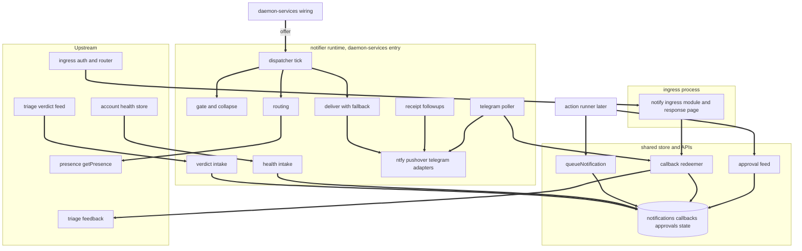
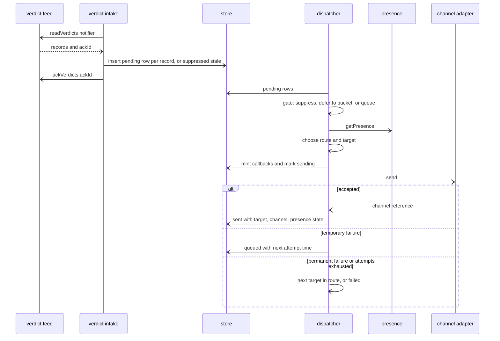
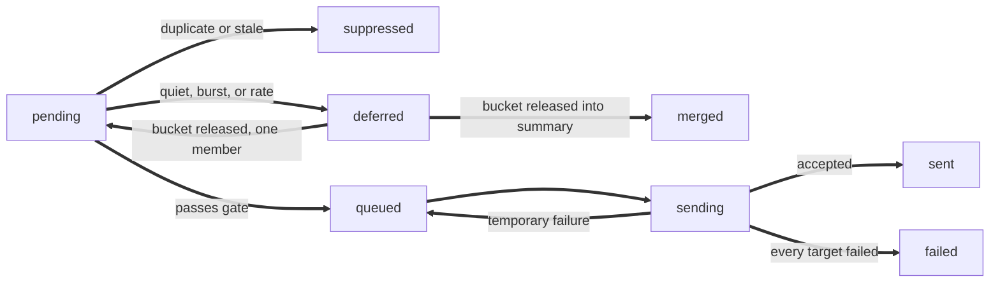
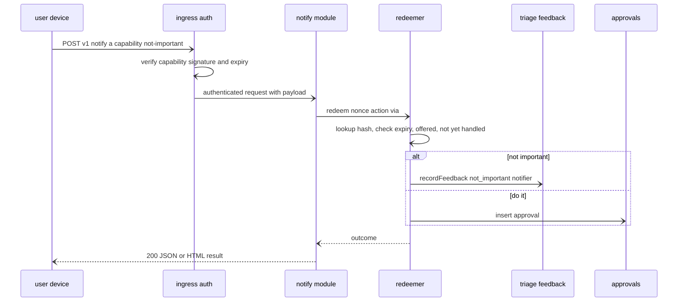

# Design Document: notifier

## Overview
**Purpose**: This feature delivers important triage verdicts and system alerts to the user as one short notification on the device they are near, with Open, Do it, and Not important buttons, without spamming them. It is the only outbound delivery path in khipuchat.

**Users**: The user receives and answers notifications (ntfy on laptop and phone, Pushover for critical alerts, a Telegram bot as fallback). The operator writes `khipu.notify.json`, sets channel secrets, and checks delivery with `khipu notify status|log|test`. The action-runner developer (later spec) queues notifications and reads approvals.

**Impact**: Adds the `src/notify/` module tree, five module-owned tables defined in the DDL-only `src/notify/schema.ts` and registered in `src/schema-registry.ts`, a notifier runtime started as one entry in `src/daemon-services.ts` when a configuration exists, one ingress module (`notify`, mounted at `/v1/notify`), and the `khipu notify` command family. Signed capability paths and the secret `_FILE` allowlist are upstream contracts owned by cloud-deployment (referenced, not defined, here). With no configuration file nothing changes.

### Goals
- One durable notification row per verdict, alert, or request; at-least-once intake, at-most-once user-visible send per row under normal operation.
- Presence-aware routing (together, apart, unknown, critical) with fallback targets and retries.
- Quiet hours, dedupe, burst collapse, and an hourly limit through one deferral mechanism.
- Signed, single-use button callbacks that feed triage feedback and a generic approval feed.
- No SDKs, no new npm dependency, no Beeper, nothing posted on source platforms.

### Non-Goals
- Deciding importance (triage-agent); executing or authorizing actions (action-runner).
- Native iOS app, APNs, email, SMS, multi-user delivery.
- Telegram webhook mode, Pushover `callback` mode, ntfy `sequence_id` message replacement.
- Editing or extending the triage rules, presence thresholds, or Slack health detection.

## Boundary Commitments

### This Spec Owns
- The notifier configuration file format (`khipu.notify.json`), its validation, and `KHIPU_NOTIFY_*` settings.
- The tables `notifications`, `notify_callbacks`, `notify_approvals`, `notify_approval_cursors`, `notify_state`: schema, every write, retention.
- Content rendering, redaction levels and patterns, per-channel limits, and urgency to priority mapping.
- Routing, quiet hours, dedupe, burst collapse, hourly limit, summaries.
- The ntfy, Pushover, and Telegram bot adapters, retries and fallback, Pushover receipt tracking, Telegram update polling.
- Callback token minting, the response page, callback redemption, mutual exclusivity per notification.
- The public APIs `queueNotification` (requests) and the approval feed (`registerApprovalConsumer`, `readApprovals`, `ackApprovals`, `getApprovalConsumerStatus`, `removeApprovalConsumer`), the `ApprovalOffer` injection point (`StartNotifierOptions.offer`), and `defaultApprovalOffer()`, which stays the empty (never-offer) default permanently.
- The DB-side callback guarantees: only a hash of each nonce is stored, each callback is single use, and at most one action is accepted per notification.
- The `notify` ingress module and its routes; the `khipu notify` command family; `docs/NOTIFY.md`.

### Out of Boundary
- Verdict production, the verdict feed tables, feedback columns (triage-agent; notifier only calls `readVerdicts`, `ackVerdicts`, `registerVerdictConsumer`, `getVerdictConsumerStatus`, `recordFeedback`).
- Presence computation (presence-context; notifier only calls `getPresence`).
- Account health detection and storage (slack-all-workspaces; notifier only calls `listAccountHealth` and reads Slack identity for permalinks).
- Ingress authentication, signed capability paths (token format, signing, verification, `INGRESS_SIGNING_KEY` handling, log redaction), the secret-file loader and its allowlist (cloud-deployment; see "Upstream contract (cloud-deployment: Signed capability paths)" below).
- The schema registry (`src/schema-registry.ts`, `SCHEMA_MODULES`), the daemon services list (`src/daemon-services.ts`, `DAEMON_SERVICES`, `DaemonServiceContext`, `startDaemonServices`, `stopDaemonServices`, `runSinglePass`), and the shared wiring (`src/daemon-wiring.ts`, `DaemonSharedWiring`, `composeSharedWiring`) (message-events, cross-spec decisions D7, D12, D13, D14; notifier adds one entry to each list and does not edit `watch.ts`; its only edit of `src/daemon-wiring.ts` is the one-line `approvalOffer?: ApprovalOffer` field on `DaemonSharedWiring` plus its type-only import, added in the task that creates `src/notify/approval-offer.ts`, D17).
- Which actions may be offered and anything about executing them (action-runner; it builds its own `ApprovalOffer` in `src/actions/` via `composeActionSeams({ env })`, which `composeSharedWiring(env)` stores as `DaemonSharedWiring.approvalOffer` (D12); the notifier reads it from `shared.approvalOffer` and passes it into `StartNotifierOptions.offer`; action-runner consumes approvals and does not edit any notifier file, including `defaultApprovalOffer()` or the notifier's `DAEMON_SERVICES` entry).

### Upstream Dependencies (implemented before this spec)
- triage-agent: verdict feed, feedback, triage types.
- presence-context: `getPresence` and presence types.
- message-events: `CONSUMER_NAME_PATTERN`, the schema registry `src/schema-registry.ts` (D6), the daemon services list `src/daemon-services.ts` (D7, with `ctx.mode` and shutdown / single-pass semantics per D13), and the light wiring module `src/daemon-wiring.ts` (`DaemonSharedWiring`, `composeSharedWiring`; D12, D14).
- cloud-deployment: ingress module and context contract including `IngressContext.env` (D4), signed capability paths with `readSigningKey(env)` (D3, D15), the secret `_FILE` allowlist with the notifier secrets (D2), and `resolveDataFile(name, envVar, { env })` (D5, D15).
- slack-all-workspaces: account health store `src/account-health.ts` (unix seconds, D8) and the Slack state store; both are compile-time imports, so this spec cannot build without them.

### Allowed Dependencies
- triage-agent: `src/triage/outbox.ts`, `src/triage/feedback.ts`, `src/triage/types.ts` (types: `Urgency`, `URGENCIES`, `SuggestedAction`, `JsonValue`, `VerdictRecord`).
- presence-context: `src/presence/snapshot.ts` (`getPresence`), `src/presence/types.ts` (types). Daemon and CLI only, never from the ingress module chain.
- slack-all-workspaces (upstream, compile-time import): `src/account-health.ts` (`listAccountHealth`, types; `changed_at` and `checked_at` in unix seconds per cross-spec decision D8), `src/platforms/slack/state-store.ts` (`createSlackStateStore(db).getIdentity`) from `src/notify/open-links.ts` only.
- cloud-deployment (upstream): `src/ingress/types.ts` (types, including `IngressModule.capabilityPaths?` and `IngressContext.env`), `src/ingress/capability.ts` (`signCapability`, `capabilityFromLocals`, `readSigningKey`; owned by cloud-deployment), one entry in `src/ingress/modules.ts`, `src/db-path.ts` (`resolveDbPath`, `resolveDataFile`), the secret `_FILE` allowlist in `src/secret-files.ts` (already lists the notifier secrets).
- message-events (upstream): `src/event-types.ts` (`CONSUMER_NAME_PATTERN`), one entry in `src/schema-registry.ts` (`SCHEMA_MODULES`), one entry in `src/daemon-services.ts` (`DAEMON_SERVICES`), and the daemon types (`DaemonServiceContext`, `ServiceHandle`, `DaemonSharedWiring`) from `src/daemon-services.ts`, referenced only by the service-entry file `src/notify/service.ts` through `import type` (erased at compile time, no runtime edge; D16). `src/cli-entries/notify-cli.ts` (owned by this spec, outside `src/notify/`) imports `composeSharedWiring` from `src/daemon-wiring.ts` at runtime.
- Existing: `src/db.ts` (`getDb`, `initDb`, `getMessageById`), `src/platforms/types.ts` (`Platform`), Node 24 `node:crypto`, global `fetch`, `AbortSignal.timeout`, `Intl`, `express` 5 types.
- Dependency direction (imports point left only): `types` => `config-parse` => `config` => `schema` (DDL only) => (`store`, `callback-store`, `state`) => (`requests`, `approvals`, `approval-offer`) => pure domain (`redact`, `content`, `routing`, `quiet-hours`, `gate`, `collapse`, `open-links`) => `callback-tokens`, `callbacks` => `channels/*` => (`intake-verdicts`, `intake-health`, `deliver`, `followups`, `telegram-poller`) => `dispatcher` => `runtime` => the `notifier` entry in `src/daemon-services.ts`; `ingress-module` and `response-page` sit after `callbacks`; CLI files sit after `runtime`; `src/cli-entries/notify-cli.ts` sits after `cli` and `src/daemon-wiring.ts`. No file under `src/notify/` has a runtime import of `src/actions/**`, `src/daemon-services.ts`, or `src/daemon-wiring.ts` (D14, D16); the only permitted reference is `import type` from `src/daemon-services.ts` in the service-entry file `src/notify/service.ts`, which emits no runtime import. `service.ts` sits after `runtime`.
- Files reachable from `src/notify/ingress-module.ts` must not import `src/notify/channels/**`, `runtime`, `dispatcher`, `deliver`, `src/presence/**` runtime modules, or anything forbidden by the cloud-deployment ingress isolation test (no network calls and no channel secrets in the ingress process; the test follows the transitive import closure). The DDL-only `src/notify/schema.ts` (and other DDL-only `*/schema.ts` modules) and `src/schema-registry.ts` are explicitly allowed. Enforced by test.
- `src/notify/requests.ts`, `src/notify/approvals.ts`, and their imports must not import channels, presence, triage runtime, or LLM modules, so any khipuchat process (including action-runner and the ingress) can import them; DDL-only `*/schema.ts` modules and `src/schema-registry.ts` are allowed. Enforced by the same test.
- No new npm dependency. No Beeper dependency. Network calls only to configured ntfy, Pushover, and Telegram hosts.

### Revalidation Triggers
- Any change to `queueNotification` input or result, `ApprovalSubject`, `ApprovalRecord`, approval feed semantics, the `ApprovalOffer` interface, or `StartNotifierOptions.offer`: action-runner re-checks.
- Any change to the callback path format (`/a/<capability>/<action>`), the capability payload (nonce) format, or the notifier's `capabilityPaths` declaration: re-check against cloud-deployment's "Signed capability paths" contract.
- Any change to the `notify` module id, its paths, or body limit: docs and operators' links (existing links expire within the callback lifetime).
- Upstream: triage-agent `VerdictRecord` / `recordFeedback` changes, presence `PresenceSnapshot` / `getPresence` changes, `AccountHealth` / `listAccountHealth` changes (including time units), cloud-deployment `IngressModule` / `IngressContext` / auth / capability / `resolveDataFile` / secret allowlist changes, message-events `SCHEMA_MODULES` or `DAEMON_SERVICES` / `ServiceHandle` / `DaemonServiceContext` (including `mode`) / `DaemonSharedWiring` (including the `approvalOffer` field name) / `composeSharedWiring` / drain semantics changes all force a notifier re-check.

### Upstream contract (cloud-deployment: Signed capability paths)

Links pressed in the ntfy app or opened from Pushover in a browser cannot carry a header credential, so ntfy and Pushover buttons rely on cloud-deployment's "Signed capability paths" requirement (cross-spec decision D3). cloud-deployment owns and defines, in its own files: `IngressModule.capabilityPaths?` and its startup validation; `src/ingress/capability.ts` with `signCapability`, `verifyCapability`, and `capabilityFromLocals` (`node:crypto` only); the token format `<payload>.<exp>.<sig>` (HMAC-SHA256 under a per-module key derived as `khipu-ingress-capability:v1:<id>` from `INGRESS_SIGNING_KEY`); the optional `INGRESS_SIGNING_KEY` (at least 32 characters; absent means capability auth is off with one startup warning); verification before routing and body parsing; `res.locals.ingressCapability`; the `<capability>` log redaction; the auth failure reasons `capability-invalid` and `capability-expired`; and the continued rejection of query tokens. The notifier does not restate or implement any of these; it references them.

What the notifier relies on and uses:
- Declares `capabilityPaths: { prefix: '/a', methods: ['GET', 'POST'] }` on `notifyIngressModule`.
- Calls `signCapability({ signingKey, moduleId: 'notify', payload: nonce, expiresAt })` when minting link buttons (CallbackTokens), with the nonce as the payload.
- Calls `capabilityFromLocals(res)` in its route handlers to read the verified nonce; it never verifies signatures itself.
- Resolves the signing key only through cloud-deployment's `readSigningKey(env)` (D15) on the env it was given, so the daemon applies the same rule as the ingress: `{ ok: true, signingKey: null }` means callbacks unavailable (`INGRESS_SIGNING_KEY not set`); `{ ok: false }` (shorter than 32 characters) means callbacks unavailable (`INGRESS_SIGNING_KEY too short`) with one warning; the value is never logged. The key reaches the env through the cloud-deployment secret allowlist (`INGRESS_SIGNING_KEY_FILE`).

What the notifier guarantees on the DB side, on top of the ingress check: only `sha256(nonce)` is stored (`notify_callbacks.nonce_hash`); every callback carries its own `expires_at` checked again at redemption; each callback is single use (`used_at`); and at most one action is accepted per notification across every channel (`action_taken IS NULL` guard), with at most one approval per notification (unique index).

Secret allowlist (cross-spec decision D2): cloud-deployment's `_FILE` allowlist already lists `INGRESS_SIGNING_KEY`, `NTFY_TOKEN`, `PUSHOVER_APP_TOKEN`, `PUSHOVER_USER_KEY`, and `TELEGRAM_NOTIFY_BOT_TOKEN`, along with their `.env.example` and deployment guide entries. The notifier changes nothing there; its tasks only verify the names are present.

Degradation when `INGRESS_SIGNING_KEY` is absent (capability auth off upstream) or `public_base_url` is not set: callbacks are reported unavailable with the reason, ntfy and Pushover notifications are sent with the Open link only, and Telegram buttons keep working because they never pass through the ingress (Requirement 8.5).

## Architecture

### Existing Architecture Analysis
- `src/daemon-services.ts` (message-events) holds the ordered `DAEMON_SERVICES` list (event retention, triage-agent, notifier, action-runner); `src/watch.ts` calls `startDaemonServices` once; on SIGINT/SIGTERM (mode `'watch'`) `stopDaemonServices` drains then stops services in reverse order under one overall `SERVICE_SHUTDOWN_DEADLINE_MS` (25 s total), and after a `--once` pass (mode `'once'`) `runSinglePass` drains services in forward order then stops them in reverse (D13). `ctx.shared` comes from `composeSharedWiring(env)` in `src/daemon-wiring.ts` (D14). The notifier adds one entry there and does not edit `watch.ts`.
- `src/ingress/server.ts` (cloud-deployment) is a separate process with a statically registered module list; modules receive an authenticated router and an `IngressContext` (shared DB handle, logger, clock, and `env`).
- `src/schema-registry.ts` (message-events) holds the ordered `SCHEMA_MODULES` list that `initDb` applies once; every process that opens the archive through `initDb` therefore has the notifier tables, which matters because three processes write them. No lazy `ensure*Schema` on first use.
- `khipu.ts` and `db.ts` are at or over 200 lines; `khipu.ts` gains only one delegating route, `db.ts` is unchanged.

### Architecture Pattern & Boundary Map
Selected pattern: durable notification table (outbox) with pure policy functions and injected IO ports, driven by one dispatcher tick in the daemon; callbacks redeemed through one shared function from two entry points (ingress module, Telegram poller).



- **Domain boundaries**: intakes only insert rows; the dispatcher alone moves rows through statuses and calls channels; the redeemer alone sets `action_taken` and creates approvals; the ingress module never calls the network.
- **Existing patterns preserved**: consumer loop and cursor style from message-events and triage; static ingress module registration; env plus JSON file config like triage; `:memory:` real-DB tests with injected `fetch`; strict TS without `any`; files under 200 lines.
- **Steering compliance**: outbound flows only to configured targets and logged without content; MCP untouched; no Beeper; local-only when not configured.

### Technology Stack

| Layer | Choice / Version | Role in Feature | Notes |
|-------|------------------|-----------------|-------|
| Runtime | Node.js 24, TypeScript 5 strict, `tsx` | All modules | `node:crypto` randomBytes, sha256; HMAC only through cloud-deployment's `signCapability` |
| HTTP client | global `fetch` + `AbortSignal.timeout(10000)` | Channel calls | No SDKs (research.md) |
| Ingress | Express 5 via cloud-deployment ingress | Callback routes | Capability auth per cloud-deployment "Signed capability paths" |
| Data | SQLite via `better-sqlite3-multiple-ciphers` | Five notifier tables | Same archive file, SQLCipher applies |
| External | ntfy JSON publish API, Pushover Messages and Receipts API, Telegram Bot API | Delivery and callbacks | See research.md for verified fields and limits |
| Testing | Vitest, supertest (existing) | Fake `fetch`, `:memory:` DB | No network in tests |

## File Structure Plan

### Directory Structure
```
src/notify/
├── types.ts             # All notifier types and constants (channels, targets, config, rows, statuses, content, buttons, outcomes)
├── config-parse.ts      # Pure validation of khipu.notify.json into NotifyFileConfig with every problem listed
├── config.ts            # resolveNotifyConfig: env settings, file load, secrets presence, target availability, callback availability
├── schema.ts            # DDL only: applyNotifySchema(db), five tables and indexes, idempotent; registered in src/schema-registry.ts
├── store.ts             # notifications row CRUD, status transitions, gate counts, retention
├── callback-store.ts    # notify_callbacks insert, lookup by nonce hash, mark used, delete for failed sends
├── state.ts             # notify_state key-value (health seq, alerted accounts, telegram offset)
├── requests.ts          # PUBLIC: queueNotification (validation, idempotent insert)
├── approvals.ts         # PUBLIC: approval feed (register, read, ack, status, remove) and insertApproval
├── approval-offer.ts    # PUBLIC: ApprovalOffer, NO_APPROVAL_OFFER, defaultApprovalOffer() (permanent empty default)
├── redact.ts            # Redaction levels, patterns, channel limits, truncation
├── content.ts           # NotificationContent builders (verdict, health, summary, test) and render to title/body
├── open-links.ts        # Open URL resolution (Slack permalink, per-platform templates)
├── routing.ts           # Pure route choice by urgency x presence, target availability filter
├── quiet-hours.ts       # Pure quiet-hours window evaluation and next end time in a zone
├── gate.ts              # Pure gate decision: suppress, defer (bucket), or queue
├── collapse.ts          # Bucket release: requeue single member or build one summary row
├── callback-tokens.ts   # Mint link and Telegram callback tokens, build callback URLs and button specs
├── callbacks.ts         # redeemCallback: single-use, exclusivity, feedback, approval, ack
├── channels/
│   ├── http.ts          # HttpPort over fetch with timeout and failure classification
│   ├── ntfy.ts          # NtfyAdapter
│   ├── pushover.ts      # PushoverAdapter plus receipt poll and cancel
│   ├── telegram-api.ts  # Raw Bot API calls: sendMessage, getUpdates, answerCallbackQuery, editMessageReplyMarkup
│   ├── telegram.ts      # TelegramAdapter (message text and inline keyboard)
│   └── index.ts         # createChannelAdapters(config, http)
├── intake-verdicts.ts   # Verdict feed => pending rows, ack
├── intake-health.ts     # Account health => pending alert rows, position in notify_state
├── deliver.ts           # Deliver one queued row along its route with retries and fallback
├── followups.ts         # Pushover receipt polling and cancellation
├── telegram-poller.ts   # getUpdates long-poll loop => redeemCallback, answer, edit markup
├── dispatcher.ts        # One tick: intake verdicts, release buckets, gate pending, deliver due
├── runtime.ts           # startNotifier: config, timers, loops, stop, drain (mode-aware)
├── service.ts           # Service entry (D16): notifierService, the DAEMON_SERVICES entry body; type-only imports from src/daemon-services.ts
├── ingress-module.ts    # notifyIngressModule (id 'notify', capability paths, routes)
├── response-page.ts     # Escaped HTML for menu, confirm, and result pages with strict headers
├── cli.ts               # khipu notify entry: subcommand routing and shared formatting
├── cli-status.ts        # status and log subcommands
└── cli-test.ts          # test subcommand (send and dry-run)
src/cli-entries/
└── notify-cli.ts        # Thin `khipu notify` entry (D14): composeSharedWiring(process.env), then runNotifyCli(argv, { offer: shared.approvalOffer }), set process.exitCode
docs/NOTIFY.md           # Operator guide
tests/notify-*.test.ts   # One file per component area (see Testing Strategy)
tests/fixtures/notify-fixtures.ts  # Seeded verdicts, health rows, fake fetch, fake clock, config builder
```

### Modified Files
- `src/daemon-services.ts` (message-events owned list): one import and one `DAEMON_SERVICES` entry `{ name: 'notifier', start: (ctx) => notifierService({ env: ctx.env, mode: ctx.mode, shared: ctx.shared }) }`, ordered after `triage-agent` and before `action-runner` (D12; `ctx.mode` is passed because drain behaviour branches on it, D13). The entry reads no `ctx.approvalOffer` or `ctx.log`. `src/watch.ts` is not edited.
- `src/schema-registry.ts` (message-events owned list): one import and one `SCHEMA_MODULES` entry for `applyNotifySchema`.
- `src/daemon-wiring.ts` (owned by message-events, created with an empty `DaemonSharedWiring`): one type-only import `import type { ApprovalOffer } from './notify/approval-offer'` and one field `readonly approvalOffer?: ApprovalOffer`, added in the same task that creates `src/notify/approval-offer.ts` (D17). This is notifier's only sanctioned edit of that file; the `composeSharedWiring` body stays action-runner's.
- `src/khipu.ts`: one `OPERATIONAL_SCRIPTS` entry `notify: 'cli-entries/notify-cli.ts'` (values are relative to `src/`, D14, D17), routing `notify` to the thin entry `src/cli-entries/notify-cli.ts` created by this spec, which calls `composeSharedWiring(process.env)`, then `runNotifyCli(argv, { offer: shared.approvalOffer })`, and sets `process.exitCode` from the resolved code. `src/notify/**` therefore never imports `src/daemon-wiring.ts`, `src/daemon-services.ts`, or `src/actions/**`.
- `src/ingress/modules.ts`: add `notifyIngressModule` (one import, one entry).
- `.env.example`: `KHIPU_NOTIFY*` settings only; the five secret names are already listed by cloud-deployment (D2).
- No cloud-deployment-owned file is changed by this spec.

## System Flows

### Verdict to notification

Key decisions: verdicts are acked only after the row insert commits (Requirement 1.5); the source reference `decision:<id>` is unique, so redelivery inserts nothing (1.4); presence is read when the row is first routed, not when the verdict was produced (4.1).

### Row lifecycle

Acknowledgment (`acked_at`) and the user's action (`action_taken`) are recorded on `sent` rows without changing the status.

### Button press

Telegram presses take the same redeemer path from the Telegram poller, after checking the chat and user (9.8, 9.9).

## Requirements Traceability

| Requirement | Summary | Components | Interfaces | Flows |
|-------------|---------|------------|------------|-------|
| 1.1, 1.2, 1.3, 1.4, 1.5, 1.6, 1.7 | Verdict intake | VerdictIntake, NotificationStore, Dispatcher, NotifierRuntime | `readVerdicts`, `ackVerdicts`, `insertNotification` | Verdict to notification |
| 1.8 | Disabled or unconfigured | NotifyConfig, NotifierRuntime | `startNotifier` returns null | |
| 2.1, 2.2, 2.3, 2.4, 2.5 | Content | ContentBuilder, Redactor | `buildVerdictContent`, `render` | |
| 3.1, 3.2, 3.3, 3.6 | Redaction levels and page | Redactor, ResponsePage | `render`, `renderMenuPage` | |
| 3.4, 3.5 | Outbound privacy, logs | Deliverer, ChannelAdapters, all log sites | `NotifyLog` rules | |
| 4.1, 4.2, 4.3, 4.4, 4.5, 4.6 | Routing | Router, Deliverer | `chooseRoute` | Verdict to notification |
| 4.7 | Route validation | ConfigParser | `parseNotifyFile` | |
| 5.1, 5.2, 5.3, 5.4, 5.5 | Quiet hours | QuietHours, Gate, Collapser | `quietState`, `decideGate`, `releaseBuckets` | Row lifecycle |
| 6.1, 6.2, 6.3, 6.4, 6.5, 6.6 | Dedupe, burst, rate, summaries | Gate, Collapser, NotificationStore | `decideGate`, `GateCounts`, `releaseBuckets` | Row lifecycle |
| 7.1 | ntfy | NtfyAdapter | `ChannelAdapter.send` | |
| 7.2, 7.3, 7.9 | Pushover and receipts | PushoverAdapter, Followups | `send`, `pollReceipt`, `cancelReceipt` | |
| 7.4 | Telegram bot | TelegramAdapter, TelegramApi | `send` | |
| 7.5, 7.6, 7.7, 7.8 | HTTP, retries, fallback | HttpPort, Deliverer | `HttpPort.request`, `SendOutcome` | Verdict to notification |
| 8.1 | Open button | OpenLinks, CallbackTokens | `resolveOpenUrl` | |
| 8.2, 8.3, 8.4, 8.6 | Buttons and Pushover page | CallbackTokens, ApprovalOffer, ResponsePage | `buildButtons`, `defaultApprovalOffer` | |
| 8.5 | Degradation | NotifyConfig, CallbackTokens, CliStatus | `callbacks.available` | |
| 9.1, 9.2, 9.3, 9.4, 9.5, 9.7 | Redemption | CallbackRedeemer, CallbackStore, Followups | `redeemCallback` | Button press |
| 9.6 | Confirmation page on GET | NotifyIngressModule, ResponsePage | GET routes | |
| 9.8 | Telegram press | TelegramPoller | `answerCallbackQuery`, `editMessageReplyMarkup` | |
| 9.9 | Entry points | NotifyIngressModule, TelegramPoller, cloud-deployment signed capability paths (upstream) | `capabilityPaths`, `capabilityFromLocals` | Button press |
| 10.1, 10.2, 10.3, 10.4, 10.5, 10.6 | System alerts | HealthIntake, NotifyState, ContentBuilder | `listAccountHealth`, `buildHealthContent` | |
| 11.1, 11.2, 11.3, 11.4 | Requests | NotificationRequests, Dispatcher | `queueNotification` | |
| 11.5, 11.6 | Approval feed | ApprovalFeed, CallbackRedeemer | `readApprovals`, `ackApprovals` | Button press |
| 11.7 | Offer injection point | ApprovalOffer, NotifierRuntime, NotifyCli (`src/cli-entries/notify-cli.ts`) | `defaultApprovalOffer`, `StartNotifierOptions.offer`, `notifierService` (`shared.approvalOffer`), `runNotifyCli` | |
| 12.1 | Delivery log | NotifySchema, NotificationStore | `notifications` table | |
| 12.2, 12.3 | Status and log CLI | NotifyCli, CliStatus | `khipu notify status`, `khipu notify log` (via `src/cli-entries/notify-cli.ts`) | |
| 12.4 | Retention | NotificationStore, NotifierRuntime | `pruneNotify` | |
| 13.1, 13.2, 13.3, 13.4, 13.5 | Test command | CliTest, Deliverer, CallbackRedeemer | `khipu notify test` | |
| 14.1, 14.2, 14.3, 14.4, 14.5, 14.6 | Config and secrets | ConfigParser, NotifyConfig, cloud-deployment secret allowlist (upstream) | `resolveNotifyConfig`, `resolveDataFile` | |
| 15.1, 15.2, 15.3, 15.4 | Docs | NotifyDocs | `docs/NOTIFY.md`, `.env.example` | |

## Components and Interfaces

| Component | Layer | Intent | Req Coverage | Key Dependencies | Contracts |
|-----------|-------|--------|--------------|------------------|-----------|
| NotifyTypes | Types | Shared vocabulary | all | triage types (P0) | State |
| ConfigParser | Config | Validate config file | 4.7, 14.1, 14.2 | NotifyTypes (P0) | Service |
| NotifyConfig | Config | Env, secrets, availability | 1.8, 8.5, 14.3, 14.4, 14.5, 14.6 | ConfigParser (P0) | Service |
| NotifySchema | Data | Tables (DDL only) | 12.1 | SQLite (P0), schema registry (P0) | State |
| NotificationStore | Data | Rows, counts, retention | 1.4, 6.5, 12.1, 12.4 | NotifySchema (P0) | Service, State |
| CallbackStore | Data | Callback rows | 9.1, 9.4 | NotifySchema (P0) | State |
| NotifyState | Data | Positions and offsets | 10.5, 9.9 | NotifySchema (P0) | State |
| NotificationRequests | Public API | Queue from any module | 11.1 to 11.4 | NotificationStore (P0) | Service |
| ApprovalFeed | Public API | Approvals feed | 11.5, 11.6 | NotifySchema (P0) | Service |
| ApprovalOffer | Injection point | Which actions offer Do it | 8.3, 11.7 | triage types (P1) | Service |
| Redactor | Domain | Levels, patterns, limits | 2.3, 2.4, 3.1, 3.2, 3.3 | none | Service |
| ContentBuilder | Domain | Content and rendering | 2.1, 2.2, 2.5, 10.2 | Redactor (P0) | Service |
| OpenLinks | Domain | Open URL | 8.1, 1.7 | db, Slack state store (P1) | Service |
| Router | Domain | Route choice | 4.1 to 4.6 | NotifyTypes (P0) | Service |
| QuietHours | Domain | Window evaluation | 5.1, 5.5 | Intl (P0) | Service |
| Gate | Domain | Suppress, defer, queue | 5.2, 5.3, 6.1 to 6.4 | QuietHours (P0) | Service |
| Collapser | Domain | Bucket release and summaries | 5.4, 6.2, 6.3, 6.5, 6.6 | NotificationStore (P0) | Batch |
| CallbackTokens | Callbacks | Mint tokens and buttons | 8.1 to 8.6, 9.1 | cloud-deployment `signCapability` (P0), CallbackStore (P0) | Service |
| CallbackRedeemer | Callbacks | Single-use redemption | 9.1 to 9.5, 9.7, 11.6, 13.4 | CallbackStore, ApprovalFeed, triage feedback (P0) | Service |
| HttpPort | Channels | fetch wrapper | 7.5, 7.6, 7.7 | fetch (P0) | Service |
| NtfyAdapter | Channels | ntfy publish | 7.1 | HttpPort (P0) | Service |
| PushoverAdapter | Channels | Pushover send and receipts | 7.2, 7.3, 7.9 | HttpPort (P0) | Service |
| TelegramApi, TelegramAdapter | Channels | Bot API | 7.4, 9.8 | HttpPort (P0) | Service |
| ChannelAdapters | Channels | Adapter registry | 7.1 to 7.4 | adapters (P0) | Service |
| VerdictIntake | Orchestration | Feed to rows | 1.1 to 1.7 | triage outbox (P0), OpenLinks (P1) | Batch |
| HealthIntake | Orchestration | Health to rows | 10.1 to 10.6 | account health (P0), NotifyState (P0) | Batch |
| Deliverer | Orchestration | Send with fallback | 3.4, 4.5, 4.6, 7.5 to 7.8 | Router, adapters, CallbackTokens (P0) | Service |
| Followups | Orchestration | Pushover receipts | 7.9, 9.7 | PushoverAdapter (P0) | Batch |
| TelegramPoller | Orchestration | Telegram presses | 9.8, 9.9 | TelegramApi, CallbackRedeemer (P0) | Batch |
| Dispatcher | Orchestration | One tick | 1.3, 4.1, 5.4, 6.x, 11.4 | all orchestration (P0) | Batch |
| NotifierRuntime | Orchestration | Lifecycle, daemon-services entry (`runtime.ts`, `service.ts`) | 1.1, 1.8, 10.1, 11.7, 12.4 | Dispatcher (P0), daemon-services (P0) | Service |
| NotifyIngressModule | Surface | Callback routes | 9.5, 9.6, 9.9 | CallbackRedeemer (P0), cloud-deployment capability paths (P0) | API |
| ResponsePage | Surface | HTML pages | 3.6, 8.6, 9.6 | ContentBuilder (P0) | Service |
| NotifyCli, CliStatus, CliTest | Surface | `khipu notify` | 12.2, 12.3, 13.1 to 13.5 | runtime parts (P0) | Service |
| NotifyDocs | Docs | Guide and env template | 15.1 to 15.4 | | |

### Types

#### NotifyTypes (`src/notify/types.ts`)

```typescript
import type { Platform } from '../platforms/types'
import type { Urgency, JsonValue } from '../triage/types'
import type { AccountHealthStatus } from '../account-health'

export type ChannelKind = 'ntfy' | 'pushover' | 'telegram'
export type RedactionLevel = 'full' | 'standard' | 'minimal'
export type PresenceState = 'together' | 'apart' | 'unknown'
export type Weekday = 'mon' | 'tue' | 'wed' | 'thu' | 'fri' | 'sat' | 'sun'

interface TargetBase { readonly id: string; readonly redaction: RedactionLevel | null }   // id ^[a-z][a-z0-9-]{0,31}$
export interface NtfyTarget extends TargetBase { readonly channel: 'ntfy'; readonly server: string; readonly topic: string; readonly cache: boolean }
export interface PushoverTarget extends TargetBase {
  readonly channel: 'pushover'; readonly device: string | null; readonly sound: string | null
  readonly emergency: { readonly retry_s: number; readonly expire_s: number }   // 30..10800 (default 60), 60..10800 (default 1800)
}
export interface TelegramTarget extends TargetBase { readonly channel: 'telegram'; readonly chat_id: string; readonly allowed_user_ids: readonly string[] }
export type TargetConfig = NtfyTarget | PushoverTarget | TelegramTarget

export interface RouteSet { readonly together: readonly string[]; readonly apart: readonly string[]; readonly unknown: readonly string[] }
export interface RoutingConfig {
  readonly critical: readonly string[]
  readonly default: RouteSet
  readonly by_urgency: Readonly<Partial<Record<Exclude<Urgency, 'critical'>, RouteSet>>>
}
export interface QuietHoursConfig { readonly start: string; readonly end: string; readonly days: readonly Weekday[]; readonly timezone: 'presence' | string }
export interface CollapseConfig { readonly dedupe_window_s: number; readonly burst_window_s: number; readonly burst_max: number; readonly hourly_limit: number }
export interface SystemAlertConfig { readonly statuses: readonly Exclude<AccountHealthStatus, 'ok'>[]; readonly urgency: Urgency; readonly notify_resolved: boolean }

export interface NotifyFileConfig {
  readonly version: 1
  readonly public_base_url: string | null          // https origin of the ingress, no trailing slash
  readonly targets: readonly TargetConfig[]
  readonly routing: RoutingConfig
  readonly quiet_hours: QuietHoursConfig | null
  readonly collapse: CollapseConfig
  readonly redaction: { readonly default: RedactionLevel; readonly patterns: readonly RegExp[] }
  readonly callback_ttl_s: number                  // 300..604800, default 86400
  readonly stale_after_s: number                   // 60..604800, default 21600
  readonly system_alerts: SystemAlertConfig
  readonly open_links: Readonly<Partial<Record<Platform, string>>>
  readonly default_timezone: string | null         // IANA, validated
}

export type NotificationKind = 'verdict' | 'health' | 'request' | 'summary' | 'test'
export type NotificationStatus = 'pending' | 'deferred' | 'queued' | 'sending' | 'sent' | 'failed' | 'suppressed' | 'merged'
export type SuppressReason = 'duplicate' | 'stale'
export type DeferBucket = 'quiet' | 'rate' | `burst:${string}`
export type CallbackAction = 'not_important' | 'do_it'
export type CallbackVia = 'ntfy' | 'page' | 'telegram'
export type AckVia = CallbackVia | 'pushover'

export interface ApprovalSubject {
  readonly action_id: string                        // ^[a-z][a-z0-9-]{0,63}$ (same as ActionDescriptor.id)
  readonly params: Readonly<Record<string, JsonValue>>   // JSON, max 4000 chars serialized
  readonly decision_id: number | null
}

export interface NotificationContent {
  readonly platform: Platform | null
  readonly headline: string                         // chat name and account, or alert title, 1..120
  readonly sender: string | null
  readonly summary: string                          // 0..200
  readonly reason: string | null                    // 0..500
  readonly suggested_action: string | null          // action id text only
  readonly excerpt: string | null                   // 0..280, shown only at full level
  readonly footer: string | null                    // remedy or count line, 0..200
  readonly items: readonly string[]                 // summary member lines, max 5
  readonly total: number | null                     // summary member count
}

export interface NotificationRow {
  readonly id: number
  readonly kind: NotificationKind
  readonly source_ref: string
  readonly decision_id: number | null
  readonly origin: string | null
  readonly urgency: Urgency
  readonly collapse_key: string
  readonly dedupe_hash: string                      // sha256 hex of lowercased, whitespace-collapsed summary or title
  readonly content: NotificationContent
  readonly approval: ApprovalSubject | null
  readonly open_url: string | null
  readonly status: NotificationStatus
  readonly status_reason: string | null
  readonly bucket: DeferBucket | null
  readonly release_at: number | null
  readonly released: boolean                        // re-entered from a bucket: skip dedupe, burst, rate
  readonly summary_id: number | null
  readonly presence_state: PresenceState | null
  readonly route: readonly string[] | null
  readonly route_pos: number
  readonly target_id: string | null
  readonly channel: ChannelKind | null
  readonly attempts: number                         // total send attempts
  readonly target_attempts: number                  // attempts on the current target
  readonly next_attempt_at: number | null
  readonly provider_ref: string | null
  readonly rendered_title: string | null
  readonly rendered_body: string | null
  readonly action_taken: CallbackAction | null
  readonly acked_at: number | null
  readonly ack_via: AckVia | null
  readonly followup: 'receipt' | 'cancel' | null
  readonly created_at: number                       // unix seconds
  readonly due_at: number
  readonly sent_at: number | null
  readonly updated_at: number
}

export type ButtonSpec =
  | { readonly kind: 'open'; readonly label: 'Open'; readonly url: string }
  | { readonly kind: 'action'; readonly action: CallbackAction; readonly label: 'Do it' | 'Not important'; readonly url: string | null; readonly telegramData: string | null }

export interface ChannelMessage {
  readonly title: string
  readonly body: string
  readonly urgency: Urgency
  readonly openUrl: string | null
  readonly menuUrl: string | null                   // response page, when callbacks are available
  readonly buttons: readonly ButtonSpec[]
  readonly tag: string                              // 'khipu-n<id>'
}

export type SendOutcome =
  | { readonly ok: true; readonly providerRef: string | null; readonly receipt: string | null }
  | { readonly ok: false; readonly kind: 'transient' | 'permanent'; readonly retryAfterS: number | null; readonly detail: string }   // detail: status code and short code, never bodies or secrets

export interface ChannelAdapter {
  readonly channel: ChannelKind
  send(target: TargetConfig, message: ChannelMessage): Promise<SendOutcome>
}

export const URGENCY_PRIORITY: Readonly<Record<Urgency, { readonly ntfy: 1 | 2 | 3 | 4 | 5; readonly pushover: -1 | 0 | 1 | 2; readonly telegramSilent: boolean }>> = {
  low: { ntfy: 2, pushover: -1, telegramSilent: true },
  normal: { ntfy: 3, pushover: 0, telegramSilent: false },
  high: { ntfy: 4, pushover: 1, telegramSilent: false },
  critical: { ntfy: 5, pushover: 2, telegramSilent: false },
}
```

### Config

#### ConfigParser (`src/notify/config-parse.ts`) and NotifyConfig (`src/notify/config.ts`)

| Field | Detail |
|-------|--------|
| Intent | Validate the file, resolve env settings, report secrets presence and availability |
| Requirements | 1.8, 4.7, 8.5, 14.1, 14.2, 14.3, 14.4, 14.5, 14.6 |

File format (`khipu.notify.json`, version 1); `targets` is an object keyed by target id:

| Key | Type / default | Rule |
|-----|----------------|------|
| `version` | `1` | required |
| `public_base_url` | string, default null | `https://` origin (host and optional port, no path); `http://localhost` and `http://127.0.0.1` allowed for local testing |
| `targets.<id>.channel` | `ntfy` \| `pushover` \| `telegram` | required |
| ntfy: `server`, `topic`, `cache` | server https URL; topic `^[A-Za-z0-9_-]{1,64}$`; cache default true | |
| pushover: `device`, `sound`, `emergency.retry_s`, `emergency.expire_s` | defaults null, null, 60, 1800 | bounds as in types |
| telegram: `chat_id`, `allowed_user_ids` | chat id `^-?[0-9]{1,20}$`; users default `[chat_id]` for a positive chat id, required for a group | |
| `targets.<id>.redaction` | level, default null (global) | |
| `routing.critical`, `routing.default.{together,apart,unknown}`, `routing.by_urgency.{low,normal,high}` | arrays of target ids, non-empty | every id must exist (4.7) |
| `quiet_hours` | `{ start, end, days?, timezone? }`, default null | `HH:MM` 24h, start != end; days default all; timezone `presence` (default) or IANA |
| `collapse` | `{ dedupe_window_s: 600, burst_window_s: 300, burst_max: 2, hourly_limit: 20 }` | 0..86400, 0..3600, 1..50, 1..1000; 0 disables dedupe or burst |
| `redaction` | `{ default: 'standard', patterns: [] }` | patterns: max 20, each compiles, max 200 chars, flags `i` allowed via `{ "pattern", "flags" }` |
| `callback_ttl_s`, `stale_after_s` | 86400, 21600 | bounds as in types |
| `system_alerts` | `{ statuses: ['needs_reauth','restricted','misconfigured'], urgency: 'high', notify_resolved: true }` | statuses non-ok values only |
| `open_links.<platform>` | template string | placeholders `{chat_external_id}`, `{message_external_id}`, `{account}`, `{chat_id}`, `{message_id}`; scheme `https`, `slack`, `tg`, or `discord` |
| `default_timezone` | IANA, default null | validated with `Intl.DateTimeFormat` |

Env settings:

| Setting | Default | Meaning |
|---------|---------|---------|
| `KHIPU_NOTIFY` | enabled | `0` disables the notifier even when the file exists (14.5) |
| `KHIPU_NOTIFY_CONFIG` | `resolveDataFile('khipu.notify.json', 'KHIPU_NOTIFY_CONFIG', { env })` on the env passed in (D15): the env var wins, else `khipu.notify.json` next to the archive (`dirname(resolveDbPath())`), cwd-independent (server: `/app/data/khipu.notify.json`) | File path |
| `KHIPU_NOTIFY_POLL_MS` | `5000` | Dispatcher tick, 1000..60000 (1.3) |
| `KHIPU_NOTIFY_HEALTH_POLL_MS` | `30000` | Health check, 5000..60000 (10.1) |
| `KHIPU_NOTIFY_RETENTION_DAYS` | `30` | 1..3650 (12.4) |
| Secrets | none | `NTFY_TOKEN` (optional), `PUSHOVER_APP_TOKEN`, `PUSHOVER_USER_KEY`, `TELEGRAM_NOTIFY_BOT_TOKEN`, `INGRESS_SIGNING_KEY` (also via `<NAME>_FILE`; allowlisted by cloud-deployment, D2) |

```typescript
export interface ConfigProblem { readonly path: string; readonly message: string }   // path like 'targets.phone.topic'
export function parseNotifyFile(raw: unknown): { readonly ok: true; readonly config: NotifyFileConfig } | { readonly ok: false; readonly problems: readonly ConfigProblem[] }

export interface NotifySecrets {
  readonly ntfyToken: string | null
  readonly pushover: { readonly appToken: string; readonly userKey: string } | null
  readonly telegramBotToken: string | null
  readonly signingKey: string | null      // from cloud-deployment readSigningKey(env) (D15); null when unset or too short
}
export interface TargetAvailability { readonly id: string; readonly channel: ChannelKind; readonly available: boolean; readonly reason: string | null }
export interface CallbackAvailability { readonly available: boolean; readonly reason: string | null }   // e.g. 'public_base_url not set', 'INGRESS_SIGNING_KEY not set', 'INGRESS_SIGNING_KEY too short'
export interface ResolvedNotifyConfig {
  readonly file: NotifyFileConfig
  readonly secrets: NotifySecrets          // never logged or printed
  readonly targets: readonly TargetAvailability[]
  readonly callbacks: CallbackAvailability
  readonly pollMs: number
  readonly healthPollMs: number
  readonly retentionDays: number
}
export type NotifyConfigResult =
  | { readonly state: 'disabled'; readonly reason: string }                         // KHIPU_NOTIFY=0 or file missing
  | { readonly state: 'invalid'; readonly path: string; readonly problems: readonly ConfigProblem[] }
  | { readonly state: 'ok'; readonly config: ResolvedNotifyConfig; readonly warnings: readonly string[] }
export function resolveNotifyConfig(env: Readonly<Record<string, string | undefined>>, readFile?: (path: string) => string | null): NotifyConfigResult
/** Config path: resolveDataFile('khipu.notify.json', 'KHIPU_NOTIFY_CONFIG', { env }) (D15). resolveDataFile already lets the env var win, so there is no separate KHIPU_NOTIFY_CONFIG check here, and no process.env read. */
export function notifyConfigPath(env: Readonly<Record<string, string | undefined>>): string
/** File-only load for the ingress process: parses the file, reads no secret names. */
export type NotifyFileResult =
  | { readonly state: 'disabled' | 'invalid'; readonly reason: string }
  | { readonly state: 'ok'; readonly file: NotifyFileConfig }
export function loadNotifyFile(env: Readonly<Record<string, string | undefined>>, readFile?: (path: string) => string | null): NotifyFileResult
```
- Callers pass the env they were given: the daemon entry passes `ctx.env` through `notifierService`, `startNotifier` passes `StartNotifierOptions.env` (default `process.env`, for direct callers and tests only), the CLI passes `process.env` from its entry, and the ingress module passes `IngressContext.env` (D4). Config code reads env only from that argument (`resolveDataFile(..., { env })`, `readSigningKey(env)`); no notifier module reached from the ingress reads `process.env` (D15).
- Invalid numeric env values fall back to defaults with a warning naming the setting. A target is unavailable when its channel secrets are missing (pushover needs both; telegram needs the bot token); a warning names the target (14.4). Behavior is identical for `local` and `server` deployment profiles (14.6).

### Data

#### NotifySchema (`src/notify/schema.ts`), NotificationStore (`store.ts`), CallbackStore (`callback-store.ts`), NotifyState (`state.ts`)

| Field | Detail |
|-------|--------|
| Intent | Own the five tables and every statement on them |
| Requirements | 1.4, 6.5, 9.1, 9.4, 10.5, 12.1, 12.4 |

```typescript
// schema.ts: DDL only (imports nothing but better-sqlite3 types); registered once in SCHEMA_MODULES (src/schema-registry.ts)
export function applyNotifySchema(db: Database.Database): void     // CREATE TABLE / INDEX IF NOT EXISTS, idempotent

// store.ts
export interface NewNotification {
  readonly kind: NotificationKind; readonly source_ref: string; readonly decision_id: number | null; readonly origin: string | null
  readonly urgency: Urgency; readonly collapse_key: string; readonly content: NotificationContent
  readonly approval: ApprovalSubject | null; readonly open_url: string | null
  readonly status: 'pending' | 'suppressed' | 'queued'; readonly status_reason: string | null; readonly now: number
}
export function insertNotification(db: Database.Database, n: NewNotification): { readonly id: number; readonly created: boolean }   // INSERT OR IGNORE on source_ref
export function getNotification(db: Database.Database, id: number): NotificationRow | null
export function listByStatus(db: Database.Database, status: NotificationStatus, limit: number): readonly NotificationRow[]   // ascending id
export function listDue(db: Database.Database, nowS: number, limit: number): readonly NotificationRow[]   // queued, next_attempt_at null or <= now, critical first then id
export function listDueBuckets(db: Database.Database, nowS: number): readonly { readonly bucket: DeferBucket; readonly ids: readonly number[] }[]
export interface GateCounts {
  readonly duplicateWithinWindow: boolean      // same collapse_key and dedupe_hash, id != self, status not in (suppressed), created within dedupe window
  readonly burstCount: number                  // same collapse_key, status in (queued, sending, sent), due_at within burst window
  readonly burstWindowStart: number | null     // min due_at among those
  readonly hourlyCount: number                 // non-critical, kind != test, status in (queued, sending, sent), due_at within 3600 s
  readonly hourlyOldest: number | null
}
export function gateCounts(db: Database.Database, row: NotificationRow, cfg: CollapseConfig, nowS: number): GateCounts
export function transition(db: Database.Database, id: number, patch: Partial<Omit<NotificationRow, 'id' | 'kind' | 'source_ref' | 'created_at'>>, nowS: number): void
export function resetInterruptedSends(db: Database.Database, nowS: number): number   // sending => queued at startup
export function pruneNotify(db: Database.Database, retentionDays: number, nowS: number): { readonly notifications: number; readonly approvals: number }

// callback-store.ts
export interface CallbackRow {
  readonly id: number; readonly notification_id: number; readonly via: 'link' | 'telegram'
  readonly actions: readonly CallbackAction[]; readonly expires_at: number
  readonly used_at: number | null; readonly used_action: CallbackAction | null
}
export function insertCallback(db: Database.Database, input: { readonly notificationId: number; readonly nonceHash: string; readonly via: 'link' | 'telegram'; readonly actions: readonly CallbackAction[]; readonly expiresAt: number; readonly now: number }): number
export function findCallbackByHash(db: Database.Database, nonceHash: string): CallbackRow | null
export function markCallbackUsed(db: Database.Database, id: number, action: CallbackAction, nowS: number): void
export function deleteCallbacksFor(db: Database.Database, notificationId: number): void

// state.ts
export function getState(db: Database.Database, key: string): string | null
export function setState(db: Database.Database, key: string, value: string, nowS: number): void
export function deleteState(db: Database.Database, key: string): void
// keys: 'health_seq', 'health_alerted:<platform>/<account>' (alerted status), 'telegram_offset'
```
- Source references: `decision:<decision_id>`, `health:<platform>/<account>:<seq>`, `request:<origin>:<key>`, `summary:<bucket>:<release_at>`, `test:<16 hex>`.
- Collapse keys: verdict `chat:<chat_id>` (or `decision:<id>` when the source is missing); health `health:<platform>/<account>`; request the supplied key or `request:<origin>`; summary and test their own source reference.

### Public API (importable from any khipuchat process)

#### NotificationRequests (`src/notify/requests.ts`): contract for action-runner and other modules

| Field | Detail |
|-------|--------|
| Intent | Queue a notification from any module and process |
| Requirements | 2.5, 8.4, 11.1, 11.2, 11.3, 11.4 |

```typescript
export interface NotificationRequest {
  readonly origin: string                    // CONSUMER_NAME_PATTERN, e.g. 'action-runner'
  readonly key: string                       // ^[a-z0-9][a-z0-9:._-]{0,127}$, unique per origin
  readonly urgency: Urgency
  readonly title: string                     // 1..120 chars, single line
  readonly body: string                      // 0..1000 chars
  readonly open_url?: string | null          // https only, max 512
  readonly collapse_key?: string | null      // same pattern as key; default 'request:<origin>'
  readonly approval?: ApprovalSubject | null // presence adds a Do it button (8.4)
}
export type RequestErrorCode =
  | 'invalid_origin' | 'invalid_key' | 'invalid_urgency' | 'invalid_title' | 'invalid_body'
  | 'invalid_open_url' | 'invalid_collapse_key' | 'invalid_approval'
export type RequestResult =
  | { readonly ok: true; readonly notification_id: number; readonly created: boolean }
  | { readonly ok: false; readonly error: RequestErrorCode; readonly message: string }
export function queueNotification(request: NotificationRequest, db?: Database.Database): RequestResult   // default getDb()
```
- Never throws for invalid input; inserts a `pending` row of kind `request`; a repeated `(origin, key)` returns the existing id with `created: false` (11.2). The daemon delivers it on its next tick (11.4).

#### ApprovalFeed (`src/notify/approvals.ts`): the approval hand-off contract for action-runner

| Field | Detail |
|-------|--------|
| Intent | Durable, ordered, at-least-once feed of user approvals with per-consumer positions |
| Requirements | 9.3, 11.5, 11.6 |

```typescript
export interface ApprovalRecord {
  readonly approval_id: number               // strictly increasing
  readonly notification_id: number
  readonly decision_id: number | null        // triage decision when the notification was a verdict
  readonly request_origin: string | null     // set when the notification was a request
  readonly request_key: string | null
  readonly action_id: string
  readonly params: Readonly<Record<string, JsonValue>>
  readonly approved_at: number               // unix seconds
  readonly approved_via: CallbackVia
}
export interface ApprovalBatch { readonly records: readonly ApprovalRecord[]; readonly ackId: number | null }
export interface ApprovalConsumerStatus { readonly consumer: string; readonly last_approval_id: number; readonly pending: number; readonly updated_at: number }
export type ApprovalFeedErrorCode = 'invalid_consumer_name' | 'unknown_consumer' | 'invalid_ack' | 'ack_out_of_range'
export class ApprovalFeedError extends Error { constructor(readonly code: ApprovalFeedErrorCode, message: string) }
export function registerApprovalConsumer(name: string, options?: { readonly startFrom?: 'now' | 'beginning' }, db?: Database.Database): number
export function removeApprovalConsumer(name: string, db?: Database.Database): boolean
export function readApprovals(name: string, options?: { readonly limit?: number }, db?: Database.Database): ApprovalBatch   // default 100, clamp 1..1000
export function ackApprovals(name: string, approvalId: number, db?: Database.Database): number
export function getApprovalConsumerStatus(db?: Database.Database): readonly ApprovalConsumerStatus[]
/** Internal to the redeemer; at most one per notification (unique index). */
export function insertApproval(db: Database.Database, input: Omit<ApprovalRecord, 'approval_id'>): number
```
- Semantics mirror the verdict feed: names follow `CONSUMER_NAME_PATTERN` (conventional `action-runner`); register is idempotent, `'now'` (default) stores the highest id, `'beginning'` stores 0; read never writes; ack is monotonic and rejects negatives and ids above the highest.
- Guarantees to consumers: an approval exists only after a user's accepted Do it press on a notification that offered it (11.6); the notifier never executes, schedules, or re-validates actions.
- Obligations on action-runner: re-validate `action_id` against its registry and `params` against its schema; apply its own policy and an approval age limit using `approved_at`; be idempotent per `approval_id`; report results with `queueNotification({ origin: 'action-runner', key: 'run:<run id>', ... })`; never treat a missing approval as consent.

#### ApprovalOffer (`src/notify/approval-offer.ts`): the injected decision point

| Field | Detail |
|-------|--------|
| Intent | Decide which verdict suggested actions get a Do it button |
| Requirements | 8.3, 11.7 |

```typescript
import type { SuggestedAction } from '../triage/types'
export interface ApprovalOffer {
  /** Synchronous, side-effect free; called once per verdict notification at send time. */
  offer(action: SuggestedAction, decisionId: number): boolean
}
export const NO_APPROVAL_OFFER: ApprovalOffer          // always false
/** Permanently returns NO_APPROVAL_OFFER. Never edited by another spec. */
export function defaultApprovalOffer(): ApprovalOffer
```
- Injection (cross-spec decisions D7, D12, D14): action-runner builds its own `ApprovalOffer` in `src/actions/` (for example: registry has the id and its policy is ask-first) through `composeActionSeams({ env })`; `composeSharedWiring(env)` in `src/daemon-wiring.ts` stores it as the optional `DaemonSharedWiring.approvalOffer`. The daemon entry calls `notifierService({ env: ctx.env, mode: ctx.mode, shared: ctx.shared })`, which reads `shared.approvalOffer` and calls `startNotifier({ env, mode, offer })`; the `khipu notify` entry `src/cli-entries/notify-cli.ts` calls `composeSharedWiring(process.env)` and passes `shared.approvalOffer` to `runNotifyCli`. Without action-runner wiring, `defaultApprovalOffer()` is used and no Do it button is offered. notifier itself declares the `approvalOffer?` field (with a type-only import of this file) in the task that creates this file (D17); action-runner does not edit any notifier file.
- A throwing offer counts as false and logs `[notify] approval offer error` once per process.

### Domain (pure)

#### Redactor (`redact.ts`) and ContentBuilder (`content.ts`)

| Field | Detail |
|-------|--------|
| Intent | Build content from sources and render it per channel and level |
| Requirements | 2.1, 2.2, 2.3, 2.4, 2.5, 3.1, 3.2, 3.3, 3.6, 10.2 |

```typescript
export const CHANNEL_LIMITS: Readonly<Record<ChannelKind, { readonly title: number; readonly body: number }>> = {
  ntfy: { title: 250, body: 1000 }, pushover: { title: 250, body: 1024 }, telegram: { title: 250, body: 1500 },
}
export interface RenderInput {
  readonly content: NotificationContent; readonly urgency: Urgency; readonly level: RedactionLevel
  readonly patterns: readonly RegExp[]; readonly limits: { readonly title: number; readonly body: number }
  readonly detailsLink: boolean               // minimal level: mention the response page
}
export function render(input: RenderInput): { readonly title: string; readonly body: string }
export function effectiveLevel(target: TargetConfig, globalDefault: RedactionLevel): RedactionLevel
export function pageLevel(globalDefault: RedactionLevel): 'full' | 'standard'     // 3.6: never below standard

export function buildVerdictContent(record: VerdictRecord): NotificationContent
export function buildHealthContent(h: AccountHealth, kind: 'problem' | 'resolved'): NotificationContent
export function buildSummaryContent(bucket: DeferBucket, members: readonly NotificationRow[]): NotificationContent
export function buildTestContent(nowS: number): NotificationContent
```
- Title: urgency prefix (`Low: `, none for normal, `High: `, `Critical: `) plus headline, e.g. `High: #08-expedition (Slack work)` (2.2). Minimal level title: prefix plus `Important message`.
- Body lines in order: `<sender>: <summary>`; `Why: <reason>`; `Suggested: <action id>`; `"<excerpt>"` (full only); footer; summary items as `- <line>` plus `and N more`; last line `Urgency: <urgency>`. Minimal body: `<Platform>. Urgency: <urgency>.` plus `Open the link for details.` when `detailsLink`.
- Order of operations: redaction patterns replace matches with `[redacted]` in every field (3.3); excerpt dropped unless `full` (3.1); excerpt capped at 280 (2.4); then truncation to limits shortening reason, then summary, then the sender line, each marked with `...` (single ellipsis character `…`) (2.3).
- Health content: headline `<Platform> <account>: <status label>` (labels `needs re-auth`, `restricted`, `misconfigured`, `healthy again`); summary is `detail`; footer is the remedy (`Run: khipu slack login --account <account>` for Slack, else `Check: khipu sync status`) (10.2).
- Missing source (1.7): headline `Important message (source unavailable)`, no sender, no excerpt, no Open link.

#### OpenLinks (`open-links.ts`)

| Field | Detail |
|-------|--------|
| Intent | Build the Open URL for a verdict's source |
| Requirements | 1.7, 8.1 |

```typescript
export interface OpenLinkDeps { readonly db: Database.Database; readonly templates: NotifyFileConfig['open_links'] }
export function resolveOpenUrl(deps: OpenLinkDeps, messageId: number, source: VerdictSource | null): string | null
```
- Reads `getMessageById` and the chat row (`SELECT external_id, platform, account FROM chats WHERE id = ?`). A configured template wins; for Slack without a template, uses `getIdentity(account).teamUrl` to build `<team_url>archives/<channel id>/p<ts without the dot>`; otherwise null. Values are URL-encoded; result must use an allowed scheme and be at most 512 characters; any error yields null.

#### Router (`routing.ts`)

| Field | Detail |
|-------|--------|
| Intent | Pure route choice |
| Requirements | 4.1, 4.2, 4.3, 4.4, 4.5 |

```typescript
export function presenceStateOf(snapshot: PresenceSnapshot | null): PresenceState   // null or error => 'unknown'; together true/false/'unknown'
export interface RouteChoice { readonly name: string; readonly targets: readonly string[] }   // name like 'critical', 'default.apart', 'by_urgency.high.together'
export function chooseRoute(urgency: Urgency, presence: PresenceState, routing: RoutingConfig): RouteChoice
export function availableTargets(choice: RouteChoice, availability: readonly TargetAvailability[]): readonly string[]
```
- Critical ignores presence (4.2); `by_urgency[urgency]` wins over `default` (4.4); unavailable targets are skipped (14.4); an empty available list makes the row `failed` with reason `no_available_target`.

#### QuietHours (`quiet-hours.ts`), Gate (`gate.ts`)

| Field | Detail |
|-------|--------|
| Intent | Decide suppress, defer, or queue for a pending row |
| Requirements | 5.1, 5.2, 5.3, 5.5, 6.1, 6.2, 6.3, 6.4 |

```typescript
export function resolveZone(cfg: QuietHoursConfig, presence: PresenceSnapshot | null, defaultZone: string | null, serverZone: string): string
export interface QuietState { readonly active: boolean; readonly endsAt: number | null }   // endsAt unix seconds of the current window end
export function quietState(cfg: QuietHoursConfig | null, zone: string, nowS: number): QuietState

export type GateDecision =
  | { readonly kind: 'queue' }
  | { readonly kind: 'suppress'; readonly reason: 'duplicate' }
  | { readonly kind: 'defer'; readonly bucket: DeferBucket; readonly releaseAt: number }
export function decideGate(row: NotificationRow, counts: GateCounts, quiet: QuietState, cfg: CollapseConfig, nowS: number): GateDecision
```
- Order: `test` kind queues always (13.1); dedupe unless `released` (6.1); quiet hours for non-critical (5.2, 5.3), bucket `quiet`, release at `endsAt`; burst unless `released`: `burstCount >= burst_max` defers to `burst:<collapse key>` released at `burstWindowStart + burst_window_s` (6.2, applies to critical, 6.4); hourly limit for non-critical unless `released`: `hourlyCount >= hourly_limit` defers to `rate` released at `hourlyOldest + 3600` (6.3, 6.4).
- Quiet window: day check uses the weekday on which the window starts; a window with `start > end` crosses midnight (5.5); DST handled by computing wall-clock times through `Intl.DateTimeFormat` in the zone.

#### Collapser (`collapse.ts`)

| Field | Detail |
|-------|--------|
| Intent | Release due buckets |
| Requirements | 5.4, 6.2, 6.3, 6.4, 6.5, 6.6 |

**Batch / Job Contract**
- Trigger: each dispatcher tick, `listDueBuckets(now)`.
- Single member: the row returns to `pending` with `released = true` (quiet: 5.4).
- Two or more: one `summary` row (`summary:<bucket>:<release_at>`, collapse key the same) is inserted as `pending` with `released = true`; members become `merged` with `summary_id` (6.5). Members that are themselves summaries contribute their `total` and `items` (flattened). Urgency is the highest member urgency, with critical lowered to high (6.4). `open_url` is set only when every member has the same non-null one (6.6). Summaries get no action buttons.
- Content lines: `quiet` => `<N> alerts during quiet hours`; `burst:<key>` => `<N> more important messages in <headline>`; `rate` => `<N> alerts held by the hourly limit`; items are up to 5 member lines `<headline>: <summary>`.
- Idempotency: summary insert and member updates run in one transaction; the unique source reference prevents a second summary for the same bucket and release time.

### Callbacks

#### CallbackTokens (`callback-tokens.ts`)

| Field | Detail |
|-------|--------|
| Intent | Mint per-send callback tokens and the button set |
| Requirements | 8.1, 8.2, 8.3, 8.4, 8.5, 8.6, 9.1 |

```typescript
export interface ButtonPlanInput {
  readonly row: NotificationRow; readonly target: TargetConfig
  readonly callbacks: CallbackAvailability; readonly signingKey: string | null; readonly publicBaseUrl: string | null
  readonly offer: ApprovalOffer; readonly ttlS: number; readonly nowS: number
  readonly random: (bytes: number) => Buffer
}
export interface ButtonPlan { readonly buttons: readonly ButtonSpec[]; readonly menuUrl: string | null; readonly callbackId: number | null }
export function planButtons(db: Database.Database, input: ButtonPlanInput): ButtonPlan
export const CALLBACK_PATH: Readonly<Record<CallbackAction, 'not-important' | 'do-it'>>
export const TELEGRAM_CODE: Readonly<Record<CallbackAction, 'x' | 'd'>>
```
- Offered actions: `verdict` and `test` offer `not_important`; `do_it` is offered for a verdict when `suggested_action` exists and `offer.offer(...)` is true (8.3), for a request when `approval` is present (8.4), and always for `test`; `health` and `summary` offer none.
- Telegram target: nonce = 16 random bytes base64url (22 chars), stored as sha256 hex with `via = 'telegram'`; `telegramData` = `n1.<nonce>.<x|d>` (at most 27 bytes, within 64).
- ntfy and Pushover targets with callbacks available: nonce as above, `via = 'link'`, `exp = now + ttl`; capability = `signCapability({ signingKey, moduleId: 'notify', payload: nonce, expiresAt: exp })`; action URL `<public_base_url>/v1/notify/a/<capability>/<not-important|do-it>`; menu URL `<public_base_url>/v1/notify/a/<capability>`. Without callbacks: action buttons omitted for these channels (8.5).
- Open button when `open_url` is non-null (8.1). ntfy order: Open, Do it, Not important (at most 3). Pushover: supplementary URL is the menu URL when available, else the Open URL (8.6).

#### CallbackRedeemer (`callbacks.ts`)

| Field | Detail |
|-------|--------|
| Intent | Apply one button press exactly once |
| Requirements | 9.1, 9.2, 9.3, 9.4, 9.5, 9.7, 11.6, 13.4 |

```typescript
export type RedeemOutcome = 'feedback_recorded' | 'feedback_unavailable' | 'approval_recorded' | 'test_acknowledged'
export type RedeemResult =
  | { readonly ok: true; readonly notificationId: number; readonly action: CallbackAction; readonly outcome: RedeemOutcome }
  | { readonly ok: false; readonly error: 'unknown' | 'expired' | 'not_offered' | 'already_handled'; readonly taken: CallbackAction | null; readonly notificationId: number | null }
export interface RedeemDeps {
  readonly db: Database.Database
  readonly recordFeedback: (input: FeedbackInput) => FeedbackResult   // triage-agent
  readonly nowS: () => number
}
export function redeemCallback(deps: RedeemDeps, input: { readonly nonce: string; readonly action: CallbackAction; readonly via: CallbackVia }): RedeemResult
export function peekCallback(db: Database.Database, nonce: string, nowS: number): { readonly row: NotificationRow; readonly offered: readonly CallbackAction[] } | { readonly error: 'unknown' | 'expired' }   // read-only, for pages
```
- Transaction: find callback by sha256 of nonce (`unknown`); `expires_at <= now` (`expired`); action not in `actions` (`not_offered`); `UPDATE notifications SET action_taken = ?, acked_at = ?, ack_via = ?, followup = CASE WHEN followup = 'receipt' THEN 'cancel' ELSE followup END WHERE id = ? AND action_taken IS NULL`, zero changes means `already_handled` with the stored `taken` (9.4); mark the callback used; for `do_it` on a non-test row insert the approval (9.3, 11.6).
- After commit, for `not_important` on a verdict row: `recordFeedback({ decisionId, value: 'not_important', source: 'notifier' })` (9.2); `unknown_decision` maps to `feedback_unavailable` (decision pruned). Test rows return `test_acknowledged` with no feedback or approval (13.4).
- Rejections write nothing (9.5).

### Channels

#### HttpPort (`channels/http.ts`)

```typescript
export type FetchLike = (url: string, init: { method: string; headers: Record<string, string>; body?: string; signal: AbortSignal }) => Promise<{ status: number; headers: { get(name: string): string | null }; text(): Promise<string> }>
export interface HttpResult { readonly status: number; readonly json: unknown | null; readonly retryAfterS: number | null; readonly header: (name: string) => string | null }
export type HttpFailure = { readonly kind: 'transient' | 'permanent'; readonly retryAfterS: number | null; readonly detail: string }
export interface HttpPort { request(input: { readonly method: 'GET' | 'POST'; readonly url: string; readonly headers?: Record<string, string>; readonly form?: Record<string, string>; readonly json?: unknown }): Promise<HttpResult | HttpFailure> }
export function createHttpPort(fetchImpl?: FetchLike, timeoutMs?: number): HttpPort   // default globalThis.fetch, 10000
```
- Rejects non-HTTPS URLs except loopback (7.5). Network error, timeout, 5xx, and 429 => transient (with `Retry-After` header seconds when present); other 4xx => permanent. Detail is `http <status>` or `network`/`timeout`; bodies are parsed but never logged.

#### NtfyAdapter (`channels/ntfy.ts`)
- `POST <server>/` JSON `{ topic, title, message, priority, tags, click?, actions }` with `Authorization: Bearer <NTFY_TOKEN>` when set and `X-Cache: no` when `cache` is false. Actions: Open `{ action: 'view', label: 'Open', url }`; Do it and Not important `{ action: 'http', label, url, method: 'POST', clear: true }`. Tags: `warning` for high, `rotating_light` for critical. Provider reference: response `id`. (7.1)

#### PushoverAdapter (`channels/pushover.ts`)
```typescript
export interface PushoverReceiptStatus { readonly acknowledged: boolean; readonly acknowledgedAt: number | null; readonly expired: boolean }
export interface PushoverReceipts {
  pollReceipt(receipt: string): Promise<PushoverReceiptStatus | HttpFailure>
  cancelReceipt(receipt: string): Promise<{ readonly ok: boolean }>
}
export function createPushoverAdapter(http: HttpPort, secrets: NonNullable<NotifySecrets['pushover']>): ChannelAdapter & PushoverReceipts
```
- `POST https://api.pushover.net/1/messages.json` form: `token`, `user`, `title`, `message`, `priority`, `url`/`url_title` (`Open` or `Open / respond`), `device`, `sound`, `tags` = `khipu-n<id>`; critical adds `retry`, `expire` (7.2, 7.3). Response `status: 1` ok, provider reference `request`, `receipt` for priority 2. Pushover 429 (monthly quota) is permanent for this attempt; 5xx and network transient with a minimum 5 s delay. `X-Limit-App-Remaining` below 100 logs a warning at most once per day.
- Receipts: `GET /1/receipts/<receipt>.json?token=...`; cancel `POST /1/receipts/<receipt>/cancel.json` form `token` (research.md).

#### TelegramApi (`channels/telegram-api.ts`) and TelegramAdapter (`channels/telegram.ts`)
```typescript
export interface TelegramApi {
  sendMessage(input: { readonly chatId: string; readonly text: string; readonly silent: boolean; readonly keyboard: readonly (readonly TelegramButton[])[] }): Promise<{ readonly messageId: number } | HttpFailure>
  getUpdates(input: { readonly offset: number; readonly timeoutS: number; readonly signal: AbortSignal }): Promise<readonly TelegramUpdate[] | HttpFailure | { readonly conflict: true }>
  answerCallbackQuery(input: { readonly id: string; readonly text: string }): Promise<void>
  editMessageReplyMarkup(input: { readonly chatId: string; readonly messageId: number; readonly keyboard: readonly (readonly TelegramButton[])[] }): Promise<void>
}
export type TelegramButton = { readonly text: string; readonly url: string } | { readonly text: string; readonly callback_data: string }
export interface TelegramUpdate { readonly update_id: number; readonly callback_query?: { readonly id: string; readonly from: { readonly id: number }; readonly data?: string; readonly message?: { readonly message_id: number; readonly chat: { readonly id: number } } } }
export function createTelegramApi(http: HttpPort, botToken: string): TelegramApi
export function createTelegramAdapter(api: TelegramApi): ChannelAdapter
```
- `https://api.telegram.org/bot<token>/<method>` JSON bodies; the URL containing the token is never logged (7.4). Text is title, blank line, body, no `parse_mode`; `link_preview_options: { is_disabled: true }`; `disable_notification` for low. Keyboard: row 1 Open (url), row 2 Do it and Not important (callback data). `ok: false` with `parameters.retry_after` => transient with that delay; 409 on `getUpdates` => `{ conflict: true }`. Provider reference `<chat_id>:<message_id>`.

#### ChannelAdapters (`channels/index.ts`)
```typescript
export interface ChannelSet { readonly adapters: ReadonlyMap<ChannelKind, ChannelAdapter>; readonly pushover: PushoverReceipts | null; readonly telegram: TelegramApi | null }
export function createChannelAdapters(config: ResolvedNotifyConfig, http: HttpPort): ChannelSet
```

### Orchestration

#### VerdictIntake (`intake-verdicts.ts`)

**Batch / Job Contract**
- Trigger: each dispatcher tick. Input: `readVerdicts('notifier', { limit: 100 })` after `registerVerdictConsumer('notifier', { startFrom: 'now' })` at runtime start (1.1, 1.2).
- For each record: `created_at < now - stale_after_s` => insert `suppressed` with reason `stale` (1.6); else `buildVerdictContent`, `resolveOpenUrl`, insert `pending` (1.7). Then `ackVerdicts('notifier', ackId)` (1.5). Duplicate source references insert nothing (1.4).
- Failure: an exception stops the batch without acking; the next tick retries.

#### HealthIntake (`intake-health.ts`)

**Batch / Job Contract**
- Trigger: every `healthPollMs` (10.1).
- First run (no `health_seq`): for every account whose status is in `system_alerts.statuses`, insert one problem alert and set `health_alerted:<p>/<a>`; set `health_seq` to the max seq (10.4).
- Later runs: `listAccountHealth(db, { afterSeq })`; status in the alert list => problem alert and set alerted; status `ok` with an alerted marker => resolved alert at urgency `low` when `notify_resolved` (10.3), clear marker; other statuses ignored. `health_seq` is persisted after each row's insert in the same transaction (10.5). Alerts use `system_alerts.urgency` and pass through the gate like any row (10.6).
- `src/account-health.ts` is a compile-time import (slack-all-workspaces is an upstream prerequisite) and its table exists through the schema registry, so there is no absent-store path. `changed_at` and `checked_at` are unix seconds (D8) and are compared with notifier times (also unix seconds) without conversion.

#### Deliverer (`deliver.ts`)

| Field | Detail |
|-------|--------|
| Intent | Send one queued row along its route |
| Requirements | 3.4, 4.1, 4.5, 4.6, 7.6, 7.7, 7.8 |

```typescript
export interface DeliverDeps {
  readonly db: Database.Database; readonly config: ResolvedNotifyConfig; readonly channels: ChannelSet
  readonly presence: () => PresenceSnapshot | null; readonly offer: ApprovalOffer
  readonly nowS: () => number; readonly random: (bytes: number) => Buffer; readonly log: (line: string) => void
}
export type DeliverResult = 'sent' | 'retry' | 'failed'
export function deliverRow(deps: DeliverDeps, row: NotificationRow, options?: { readonly forceTarget?: string }): Promise<DeliverResult>
export const RETRY_DELAYS_S: readonly [15, 60]
```
- First attempt: `presenceStateOf(presence())`, `chooseRoute`, `availableTargets`; persist `presence_state`, `route`, `route_pos = 0` (4.1, 4.6). `forceTarget` (test) uses that target only (13.2).
- Per target: `planButtons`, `render`, mark `sending`, `adapter.send`. Success: `sent` with target, channel, provider reference, rendered text, `sent_at`, and `followup = 'receipt'` when a receipt was returned. Transient with `target_attempts < 3`: `queued`, `next_attempt_at = now + max(RETRY_DELAYS_S[n], retryAfterS, pushover 5)` => `retry` (7.6). Permanent or exhausted: delete that attempt's callbacks, advance `route_pos` and try the next target now (7.7). End of route: `failed` with the last detail, log `[notify] failed #<id> tried=<t1,t2>` (7.8).
- Only configured target hosts are contacted; nothing is sent to source platforms (3.4).

#### Followups (`followups.ts`)
- Every 30 s: rows with `followup = 'receipt'`: `pollReceipt`; acknowledged => `acked_at`, `ack_via = 'pushover'`, `followup = null` (7.9); expired => `followup = null`. Rows with `followup = 'cancel'`: `cancelReceipt`, then `followup = null` (9.7). At most one Pushover request in flight.

#### TelegramPoller (`telegram-poller.ts`)
- Runs only when a Telegram target is available. Loop: `getUpdates({ offset, timeoutS: 25 })`, `allowed_updates` `["callback_query"]`. For each update: parse `n1.<nonce>.<code>`; reject unless `from.id` is in the target's `allowed_user_ids` and `message.chat.id` equals its `chat_id` (answer `Not allowed`, log) (9.8); `redeemCallback(..., via: 'telegram')`; `answerCallbackQuery` with the outcome text; on success or `already_handled` replace the keyboard with one `callback_data: 'n1.done'` button labelled with the outcome (`Marked not important`, `Approved`, `Acknowledged`). `setState('telegram_offset', update_id + 1)` after each update. Failures back off 5 s, 15 s, 60 s; conflict logs once `[notify] telegram getUpdates conflict: a webhook is set on this bot (deleteWebhook to use polling)` and retries every 5 minutes (9.9).

#### Dispatcher (`dispatcher.ts`)

**Batch / Job Contract**
- Trigger: every `pollMs` (never once a mode `'watch'` drain has begun) and back to back during a mode `'once'` drain (see NotifierRuntime). Steps in order: verdict intake; read presence once (errors => null); `releaseBuckets`; gate up to 200 `pending` rows in id order (`decideGate` with `gateCounts` and `quietState`); deliver up to 10 due rows sequentially, critical first.
- Overlap: a tick never starts while the previous one runs.

#### NotifierRuntime (`runtime.ts`)

```typescript
export interface StartNotifierOptions {
  readonly env?: NodeJS.ProcessEnv; readonly fetchImpl?: FetchLike
  readonly offer?: ApprovalOffer   // from DaemonSharedWiring.approvalOffer (action-runner's offer); default defaultApprovalOffer()
  readonly mode?: 'watch' | 'once' // DaemonServiceContext.mode; default 'watch'; decides drain behaviour (D13)
  readonly nowMs?: () => number; readonly log?: (line: string) => void
}
/** Shape-compatible with message-events ServiceHandle. */
export interface NotifierHandle { drain(timeoutMs: number): Promise<void>; stop(): void }
export const NOTIFY_RETENTION_INTERVAL_MS = 3_600_000
export function startNotifier(options?: StartNotifierOptions): NotifierHandle | null
```

Service entry (`src/notify/service.ts`, D12, D16):
```typescript
import type { DaemonSharedWiring, ServiceHandle } from '../daemon-services'   // type-only: erased, loads no service runtime (D16)
/** Body of the 'notifier' DAEMON_SERVICES entry (D12). */
export function notifierService(params: {
  readonly env: NodeJS.ProcessEnv
  readonly mode: 'watch' | 'once'
  readonly shared: DaemonSharedWiring
}): ServiceHandle | null   // startNotifier({ env, mode, offer: params.shared.approvalOffer ?? undefined })
```
- Sequence: `resolveNotifyConfig`; `disabled` => log `[notify] disabled (<reason>)`, return null (1.8, 14.5); `invalid` => log each problem and `[notify] disabled (invalid config at <path>)`, null (14.2); `resetInterruptedSends` (tables already exist through the schema registry); log warnings and one line per target `[notify] target <id> <channel> available|unavailable (<reason>)` and `[notify] callbacks enabled|disabled (<reason>)`; `registerVerdictConsumer`; prune once and hourly (12.4); start dispatcher, health, followups, and Telegram timers.
- `drain(timeoutMs)` branches on `mode` (D13):
  - `'watch'` (signal shutdown, called by `stopDaemonServices`): starts NO new work. It marks the runtime as draining so no timer starts another dispatcher tick, health check, follow-up poll, or Telegram poll, and then awaits only the in-flight dispatcher tick (if any), bounded by `timeoutMs`. Rows not yet sent stay `pending` / `queued` in the table and are picked up on the next start. The per-service `timeoutMs` sits inside message-events' single overall `SERVICE_SHUTDOWN_DEADLINE_MS` (25 s total, reverse order).
  - `'once'` (single pass, called by `runSinglePass` in forward order after triage-agent, so this pass's verdicts are already in the feed): one health check, then dispatcher ticks back to back until a tick takes in no verdict, releases no bucket, and finds no row due for gating or delivery (pending work exhausted), or until `timeoutMs`, its bound (`SINGLE_PASS_SERVICE_BOUND_MS`, 120 s, given by `runSinglePass`, D17), is reached. Rows deliberately held for later (quiet hours, open collapse buckets, retry backoff not yet due) are not pending work and stay for the next run.
  - `stop()`: clears timers and aborts the Telegram long poll; synchronous; called after `drain` in reverse registry order in both modes.
- Import direction: `daemon-services` => `service.ts` (`notifierService`) => `runtime.ts` at runtime. `service.ts` references `DaemonSharedWiring` and `ServiceHandle` by their message-events names through `import type` from `src/daemon-services.ts` (D16), so a renamed or moved `approvalOffer` field is a compile error instead of a silently missing offer (D12 fixes the earlier structural `ctx.approvalOffer` field, which the context never carried, so the offer was never injected). Per D16, the D14 rule "`src/notify/**` never imports daemon-services or daemon-wiring" means no runtime import: the isolation test rejects every value import of `src/daemon-services.ts`, `src/daemon-wiring.ts`, and `src/actions/**` from `src/notify/**`, and permits `import type` from `src/daemon-services.ts` in `src/notify/service.ts` only.

### Surface

#### NotifyIngressModule (`ingress-module.ts`) and ResponsePage (`response-page.ts`)

| Field | Detail |
|-------|--------|
| Intent | Accept button presses and serve response pages behind capability auth |
| Requirements | 3.6, 8.6, 9.5, 9.6, 9.9 |

```typescript
import type { IngressModule } from '../ingress/types'
export const notifyIngressModule: IngressModule   // { id: 'notify', bodyLimitBytes: 4096, capabilityPaths: { prefix: '/a', methods: ['GET', 'POST'] }, mount }
export function renderMenuPage(input: { readonly row: NotificationRow; readonly level: 'full' | 'standard'; readonly offered: readonly CallbackAction[] }): string
export function renderConfirmPage(input: { readonly row: NotificationRow; readonly action: CallbackAction }): string
export function renderResultPage(input: { readonly title: string; readonly message: string }): string
```

##### API Contract
| Method | Endpoint | Auth | Request | Response | Errors |
|--------|----------|------|---------|----------|--------|
| GET | /v1/notify/a/:cap | capability (cloud-deployment signed capability paths) | none | 200 HTML menu: details at page level, Open link, one form per offered action | 404 HTML unknown, 410 HTML expired or already handled |
| GET | /v1/notify/a/:cap/:action | capability | none | 200 HTML confirm page with one POST form; no state change (9.6) | 400 invalid action, 404, 410 |
| POST | /v1/notify/a/:cap/:action | capability | empty or urlencoded form | 200 `{"ok":true,"action":"not_important","outcome":"feedback_recorded"}`, or an HTML result page when `Accept` includes `text/html` | 400 `{"error":"invalid_action"}` or `{"error":"not_offered"}`, 404 `{"error":"unknown"}`, 410 `{"error":"expired"}` or `{"error":"already_handled","taken":"do_it"}` |

- `:action` is `not-important` or `do-it`. The handler reads the nonce from `capabilityFromLocals(res)`; a request without a verified capability (header-authenticated) gets 404. `via` is `page` for form posts with `Accept: text/html`, else `ntfy`.
- `mount` reads env only from `ctx.env` (D4), never `process.env`: it calls `loadNotifyFile(ctx.env)` for the redaction default and page level and reads no secret names; it uses `ctx.db`, `ctx.now`, `ctx.log` and the triage `recordFeedback`. A disabled or invalid file still mounts the routes (pages fall back to the `standard` level) so existing links keep answering. Pages set `Content-Security-Policy: default-src 'none'; style-src 'unsafe-inline'; form-action 'self'; base-uri 'none'; frame-ancestors 'none'`, `Referrer-Policy: no-referrer`, `X-Robots-Tag: noindex`; all text HTML-escaped. Log lines: `pressed #<id> <action> via=<via> outcome=<outcome>` or `rejected <error>` (no tokens, no content).

#### NotifyCli (`cli.ts`, `cli-status.ts`, `cli-test.ts`)

| Field | Detail |
|-------|--------|
| Intent | `khipu notify status`, `log`, `test` |
| Requirements | 12.2, 12.3, 13.1, 13.2, 13.3, 13.5 |

- `status` (12.2): enabled or disabled reason; config path; each target `id channel available|unavailable (reason)` with credential presence as `set`/`missing`; callbacks availability and reason; verdict feed lag from `getVerdictConsumerStatus()` for `notifier`; counts by status in the last 24 h; last failure per target (time, detail); approval consumers.
- `log [--limit N] [--status S] [--text]` (12.3): newest first, default 20, max 500; columns id, created, kind, urgency, status, reason, presence, target, channel, attempts, acked; `--text` adds rendered title and body.
- Entry: `runNotifyCli(argv: readonly string[], options?: { readonly offer?: ApprovalOffer }): Promise<number>` in `src/notify/cli.ts`, resolving to the exit code like `runTriageCli` (D17; default offer `defaultApprovalOffer()`). It is reached only through the thin entry `src/cli-entries/notify-cli.ts` (D14, owned by this spec), which `khipu.ts` `OPERATIONAL_SCRIPTS` points at: it calls `const shared = composeSharedWiring(process.env)` and then `runNotifyCli(process.argv.slice(2), { offer: shared.approvalOffer })`, and sets `process.exitCode` from the resolved code (D17), so test buttons match the daemon's offer. The entry contains no other logic.
- `test [--target ID] [--urgency U] [--dry-run]` (13.1 to 13.3, 13.5): invalid config prints every problem and exits 1; `--dry-run` reads presence, prints presence state, route name, and for each target the rendered title, body, and buttons, inserts nothing; otherwise inserts a `test` row as `queued` and calls `deliverRow` directly (bypassing the gate), printing target, channel, and outcome; exit 0 on sent, 1 on failed. Prints that Telegram button presses are processed by the running daemon.

#### NotifyDocs (`docs/NOTIFY.md`, `.env.example`)
- Sections covering 15.1 to 15.4: overview and privacy (what leaves the machine per channel and level); ntfy (self-hosted vs ntfy.sh, random topic names, access tokens, `upstream-base-url` sends only a poll request to ntfy.sh, iOS app setup); Pushover (app token, user key, enabling Critical Alerts in the iOS app so emergency priority breaks through Do Not Disturb, monthly quota); Telegram bot (BotFather, finding the chat id, no webhook, separate from the sync session); full config example for the expedition scenario (laptop and phone ntfy topics, Pushover critical, Telegram fallback, quiet hours 22:30 to 07:30, redaction minimal for Telegram); callback links (public base URL, `INGRESS_SIGNING_KEY` via `openssl rand -hex 32`, lifetime, single use, proxy log exposure, what a leaked link allows); `khipu notify test --dry-run` walkthrough; approval hand-off note for action-runner.

## Data Models

### Domain Model
- A notification belongs to at most one source (decision, health change, request, bucket, test). Callbacks belong to one notification; at most one action per notification; at most one approval per notification.
- Invariants: `source_ref` unique; `status = 'merged'` implies `summary_id`; `status = 'sent'` implies `target_id`, `channel`, `sent_at`; `action_taken` set once; approvals only for `do_it`.

### Physical Data Model
```sql
CREATE TABLE IF NOT EXISTS notifications (
  id INTEGER PRIMARY KEY AUTOINCREMENT,
  kind TEXT NOT NULL CHECK (kind IN ('verdict','health','request','summary','test')),
  source_ref TEXT NOT NULL UNIQUE,
  decision_id INTEGER, origin TEXT,
  urgency TEXT NOT NULL CHECK (urgency IN ('low','normal','high','critical')),
  collapse_key TEXT NOT NULL, dedupe_hash TEXT NOT NULL,
  content_json TEXT NOT NULL, approval_json TEXT, open_url TEXT,
  status TEXT NOT NULL CHECK (status IN ('pending','deferred','queued','sending','sent','failed','suppressed','merged')),
  status_reason TEXT, bucket TEXT, release_at INTEGER, released INTEGER NOT NULL DEFAULT 0, summary_id INTEGER,
  presence_state TEXT CHECK (presence_state IN ('together','apart','unknown')),
  route_json TEXT, route_pos INTEGER NOT NULL DEFAULT 0,
  target_id TEXT, channel TEXT CHECK (channel IN ('ntfy','pushover','telegram')),
  attempts INTEGER NOT NULL DEFAULT 0, target_attempts INTEGER NOT NULL DEFAULT 0, next_attempt_at INTEGER,
  provider_ref TEXT, rendered_title TEXT, rendered_body TEXT,
  action_taken TEXT CHECK (action_taken IN ('not_important','do_it')),
  acked_at INTEGER, ack_via TEXT CHECK (ack_via IN ('ntfy','page','telegram','pushover')),
  followup TEXT CHECK (followup IN ('receipt','cancel')),
  created_at INTEGER NOT NULL, due_at INTEGER NOT NULL, sent_at INTEGER, updated_at INTEGER NOT NULL
);
CREATE INDEX IF NOT EXISTS idx_notifications_status ON notifications(status, next_attempt_at);
CREATE INDEX IF NOT EXISTS idx_notifications_collapse ON notifications(collapse_key, due_at);
CREATE INDEX IF NOT EXISTS idx_notifications_bucket ON notifications(bucket, release_at) WHERE status = 'deferred';
CREATE INDEX IF NOT EXISTS idx_notifications_created ON notifications(created_at);

CREATE TABLE IF NOT EXISTS notify_callbacks (
  id INTEGER PRIMARY KEY AUTOINCREMENT,
  notification_id INTEGER NOT NULL REFERENCES notifications(id) ON DELETE CASCADE,
  nonce_hash TEXT NOT NULL UNIQUE,
  via TEXT NOT NULL CHECK (via IN ('link','telegram')),
  actions TEXT NOT NULL,
  expires_at INTEGER NOT NULL, used_at INTEGER, used_action TEXT, created_at INTEGER NOT NULL
);

CREATE TABLE IF NOT EXISTS notify_approvals (
  id INTEGER PRIMARY KEY AUTOINCREMENT,
  notification_id INTEGER NOT NULL UNIQUE,
  decision_id INTEGER, request_origin TEXT, request_key TEXT,
  action_id TEXT NOT NULL, params_json TEXT NOT NULL,
  approved_at INTEGER NOT NULL,
  approved_via TEXT NOT NULL CHECK (approved_via IN ('ntfy','page','telegram'))
);
CREATE TABLE IF NOT EXISTS notify_approval_cursors (
  consumer TEXT NOT NULL PRIMARY KEY, last_approval_id INTEGER NOT NULL DEFAULT 0,
  created_at INTEGER NOT NULL, updated_at INTEGER NOT NULL
);
CREATE TABLE IF NOT EXISTS notify_state (key TEXT NOT NULL PRIMARY KEY, value TEXT NOT NULL, updated_at INTEGER NOT NULL);
```
- No foreign keys to triage or archive tables (they have their own retention). Approvals have no foreign key to notifications so they survive a notification prune within the same retention period. Times are unix seconds.
- Retention (12.4): delete notifications with `created_at` older than the period and not in `pending`, `deferred`, `queued`, `sending` (callbacks cascade); delete approvals older than the period.

### Migration Strategy
- Additive. `applyNotifySchema` (DDL only) is one `SCHEMA_MODULES` entry in `src/schema-registry.ts`; `initDb` applies it once in every process (daemon, ingress, CLI, and any module calling `queueNotification` or the approval feed), so no notifier code creates tables lazily. No backfill; no change to existing tables.

## Error Handling

### Error Strategy
- Configuration: missing file or `KHIPU_NOTIFY=0` => disabled; invalid => disabled with every problem; unavailable target => warning and skipped (1.8, 14.2, 14.4).
- Channel failures: classified transient or permanent; bounded retries; fallback through the route; final `failed` (7.6 to 7.8).
- Presence errors => unknown (4.3). Approval offer throw => no Do it.
- Intake errors => batch not acked, retried next tick. Interrupted sends => requeued at startup (may cause a rare duplicate, logged as `[notify] resend after restart #<id>`).
- Callback errors => fixed response codes, no side effects (9.5); unexpected exceptions => ingress 500 envelope.
- Public API misuse => `RequestErrorCode`, `ApprovalFeedError`.

### Monitoring
- Log lines (no content, no tokens): `[notify] queued #<id> <kind> decision=<d> urgency=<u>`, `[notify] suppressed #<id> <reason>`, `[notify] deferred #<id> bucket=<b> until=<iso>`, `[notify] summary #<id> bucket=<b> members=<n>`, `[notify] sent #<id> target=<t> channel=<c> presence=<p> attempt=<n>`, `[notify] retry #<id> target=<t> in <s>s (<detail>)`, `[notify] failed #<id> tried=<list>`, `[notify] acked #<id> via=<v>`, `[notify] pruned <n> notifications older than <d> days`.
- `khipu notify status` for lag, counts, failures.

## Testing Strategy

### Unit Tests
- `notify-config.test.ts`: every default; config path from `resolveDataFile(..., { env })` with the passed env only; signing key through `readSigningKey(env)` (unset and too-short both give callbacks unavailable with their reason); each invalid field yields a named path; unknown route target (4.7); secrets presence and target availability (14.3, 14.4); `KHIPU_NOTIFY=0` (14.5); callback availability reasons (8.5).
- `notify-content.test.ts`: verdict title and body per urgency (2.1, 2.2); each redaction level (3.1); patterns (3.3); truncation order and ellipsis under each channel limit (2.3); excerpt cap 280 (2.4); missing source (1.7); health problem and resolved content with Slack remedy (10.2, 10.3); summary flattening and caps (5.4, 6.2).
- `notify-routing.test.ts`: together, apart, unknown, critical, `by_urgency` override, presence error, unavailable targets (4.1 to 4.5).
- `notify-gate.test.ts`: quiet windows within a day and across midnight, weekday limits, DST transition day, zone resolution order (5.1, 5.5); gate order for dedupe, quiet, burst, hourly, released rows, test rows, critical exemptions (5.2, 5.3, 6.1 to 6.4).
- `notify-channels-http.test.ts`, `notify-channels-ntfy.test.ts`, `notify-channels-pushover.test.ts`, `notify-channels-telegram.test.ts`, `notify-channels-registry.test.ts` (fake fetch): ntfy JSON body, headers, actions, `X-Cache` (7.1); Pushover form fields, emergency retry and expire, receipt poll and cancel (7.2, 7.3, 7.9); Telegram text, keyboard, silent low, retry_after, 409 conflict (7.4); HTTP classification and timeout (7.5 to 7.7); no secret or body in error detail (3.5).

### Integration Tests
- `notify-intake.test.ts` (`:memory:` with the schema registry applied): first registration starts at newest (1.2); one row per verdict under redelivery (1.4); ack after insert (1.5); stale suppression (1.6); health first run, transitions, resolved, persisted position (10.1 to 10.6).
- `notify-dispatch.test.ts` (fake clock, fake fetch, fake presence): verdict to sent with presence state and target recorded (4.6, 12.1); fallback after permanent failure and after 3 transient failures (7.6 to 7.8); quiet hold and release single vs summary (5.2 to 5.4); burst and hourly summaries with merged links (6.2, 6.3, 6.5, 6.6); request delivery (11.4).
- `notify-callbacks.test.ts`: not important records feedback with source notifier (9.2); do it records one approval and nothing else (9.3, 11.6); second press any channel `already_handled` (9.4); expired, unknown, not offered write nothing (9.5); receipt cancel scheduled (9.7); test rows (13.4); Do it absent by default and present with an injected offer (8.3, 11.7); request approval button (8.4).
- `notify-requests.test.ts`: `queueNotification` validation codes and idempotency (11.1 to 11.3). `notify-approvals.test.ts`: approval feed register, read, ack, errors, status (11.5).
- `notify-ingress.test.ts` (supertest with the cloud-deployment app and its signed capability paths; env supplied through `IngressContext.env`): GET menu and confirm pages change nothing (9.6); POST JSON and HTML results; tampered and expired capability 401 from the ingress; page headers; page level for minimal targets (3.6, 8.6, 9.9).
- `notify-telegram-poller.test.ts`: allowed user and chat only; answer and keyboard replacement; offset persistence (9.8, 9.9).
- `notify-cli.test.ts`: status output without secret values (12.2); the `src/cli-entries/notify-cli.ts` entry passes `composeSharedWiring(env).approvalOffer` to `runNotifyCli` and `khipu.ts` routes `notify` to it (11.7); log filters and `--text` (12.3); test send, target, dry-run, invalid config exit 1 (13.1 to 13.3, 13.5).
- `notify-store.test.ts` (schema block): tables exist after `initDb` through the registry, and `applyNotifySchema` is idempotent; (store block): pruning respects in-flight statuses and cascades callbacks (12.4).
- `notify-runtime.test.ts`: the `notifier` entry in `DAEMON_SERVICES` sits after `triage-agent`; the entry started with a real `DaemonServiceContext` whose `shared` came from a `composeSharedWiring` stub carrying an `approvalOffer` yields Do it buttons (proves the D12 injection, not a structural field), and without the field falls back to `defaultApprovalOffer()` (11.7); mode `'watch'` drain starts no new tick (a seeded pending verdict stays unsent), awaits an in-flight tick, and returns within `timeoutMs`; mode `'once'` drain delivers every pending verdict over several ticks and stops at its bound when work keeps arriving; `stop()` leaves no timers (1.1, 1.8, 12.4).

### Static Tests
- `notify-isolation.test.ts` (checker with injectable entry list and forbidden patterns): files reachable from `ingress-module.ts`, `requests.ts`, and `approvals.ts` import no channel, runtime, dispatcher, deliver, presence runtime, or LLM module (DDL-only `*/schema.ts` modules and `src/schema-registry.ts` allowed); no file under `src/notify/` has a runtime import of `src/actions/**`, `src/daemon-services.ts`, `src/daemon-wiring.ts`, or `src/watch.ts` (`import type` from `src/daemon-services.ts` is allowed in `src/notify/service.ts` only, D16; a synthetic type-only import elsewhere and a synthetic value import in `service.ts` both fail), and none reached from the ingress module reads `process.env`; no file under `src/notify/` imports any `src/platforms/**/sync.ts`, `client.ts`, or Telegram MTProto module (7.4, 3.4); no `@beeper` import.
- `notify-log-hygiene.test.ts` (log capture across dispatch, redemption, and an ingress press): no message text, rendered text, nonce, capability, or secret appears in any log line (3.5).

### E2E (manual, documented)
- `khipu notify test --dry-run`, then `khipu notify test` per target; press each button on a phone; check `khipu notify log`; verify a Pushover emergency alert breaks through Do Not Disturb and its acknowledgment is recorded.

## Security Considerations
- Callback links: 128-bit random nonce, signed and verified by cloud-deployment's signed capability paths (per-module key from `INGRESS_SIGNING_KEY`), expiry in the signature and again in the DB, single use with per-notification exclusivity, only a hash stored. A leaked unused link lets its holder mark one notification not important or record one approval within the lifetime; action-runner must still validate and apply its policy. Pages send `Referrer-Policy: no-referrer` so the Open link never receives the capability URL.
- Telegram presses accepted only from configured user ids and chat; callback data carries a random nonce, not ids.
- Ingress process holds no channel secrets and makes no outbound calls (isolation test).
- Secrets only from env or files (cloud-deployment `_FILE` allowlist, D2), never in the config file, logs, CLI output, or error details; the Telegram URL with the token is never logged.
- Outbound content minimized by redaction levels and patterns; ntfy `cache: false`; docs explain each relay's exposure.

## Performance & Scalability
- Dispatcher tick under 50 ms with no sends on a small VPS (indexed queries); at most 10 sends per tick, sequential, satisfying Pushover's two-connection guidance and ntfy's default visitor bucket.
- Single user, tens of notifications per day; tables pruned at 30 days.
