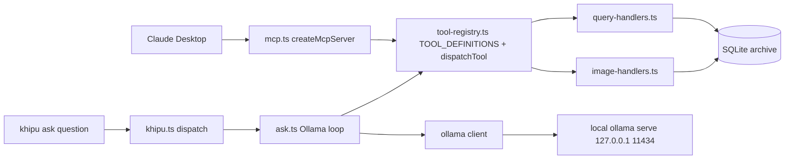
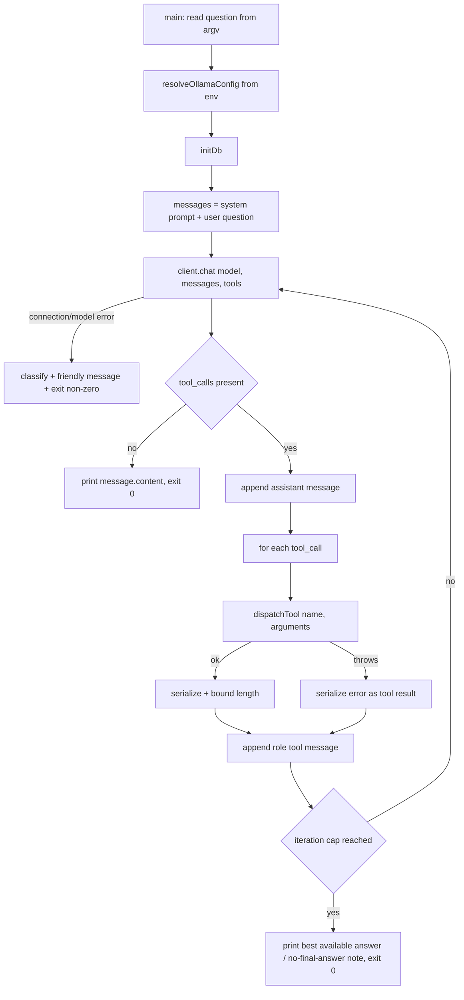

# Technical Design

## Overview

**Purpose**: Add a fourth, fully local query surface to KhipuChat — `khipu ask "<question>"` — that answers natural-language questions over the archive using a local Ollama model with tool access to the existing query handlers, so a self-hosting user can chat over their messages with zero cloud calls, at parity with what Claude answers through MCP.

**Users**: The operator runs `khipu ask "when did Tony last message me about the invoice?"`; the local model autonomously calls the archive tools and returns a synthesized answer. No new data path, schema, or handler logic is introduced.

**Impact**: The eight MCP tool definitions and the call-dispatch switch, currently inline in `src/mcp.ts`, are extracted into a new transport-agnostic `src/tool-registry.ts` (`TOOL_DEFINITIONS` + `dispatchTool`). `src/mcp.ts` is refactored to consume the registry with byte-for-byte identical behavior (guarded by `tests/mcp.test.ts`). A new `src/ask.ts` runs an Ollama tool-call loop over the same registry. The `khipu ask` entry point is wired in `src/khipu.ts`, the `ollama` dependency and an `ask` npm script are added, and an `ask-parity` test mirrors `query-parity.test.ts`. No cloud service is contacted; all inference is local Ollama.

### Goals

- Extract a single shared tool registry (`TOOL_DEFINITIONS` + `dispatchTool`) reused by MCP and ask, with zero handler duplication (R3).
- Preserve MCP behavior exactly after the extraction (R4).
- Implement a local Ollama agent loop that reuses all existing query handlers via `dispatchTool` and answers in natural language (R1, R5).
- Keep inference fully local and configurable via `OLLAMA_HOST` / `OLLAMA_MODEL` (R2).
- Degrade gracefully when Ollama is unreachable, the model is missing, or a tool errors (R6).
- Prove surface parity with an ask-parity test and keep MCP regression tests green (R7).

### Non-Goals

- Streaming/token UI, multi-turn session persistence, model auto-pull/management (out of scope).
- Exposing Ollama over the web UI or the network; any Ollama-specific auth.
- Multimodal/vision reasoning over image bytes (the `get_image` tool remains available for parity; the model consumes its OCR text, not the pixels).
- Any change to query-handler business logic, the embedding/index pipeline, or the DB schema.
- Replacing Claude/MCP — this feature is strictly additive.

## Boundary Commitments

### This Spec Owns

- `src/tool-registry.ts`: the `TOOL_DEFINITIONS` array (name + description + JSON Schema for all eight archive tools) and the single `async dispatchTool(name, args): Promise<unknown>` (argument coercion + handler dispatch), moved verbatim from `mcp.ts`.
- `src/ask.ts`: the Ollama client construction, system prompt, tool-format mapping, the bounded tool-call loop, tool-result serialization, `OLLAMA_HOST`/`OLLAMA_MODEL` resolution, graceful-degradation handling, and the `main()` CLI entrypoint.
- The refactor of `src/mcp.ts` to consume `tool-registry.ts` (delete the inline defs + switch; keep the SDK server, `MCP_SECRET` guard, content wrapping, and entrypoint).
- The `khipu ask` wiring in `src/khipu.ts` (`OPERATIONAL_SCRIPTS`, `SUBCOMMAND_USAGE`, `USAGE`), the `ollama` dependency + `ask` npm script in `package.json`, and `tests/ask-parity.test.ts`.

### Out of Boundary

- The query handlers themselves (`query-handlers.ts`, `image-handlers.ts`) — reused unchanged; owned by the semantic-search / image-support specs.
- The MCP SDK server semantics, tool set, and `MCP_SECRET` auth behavior — preserved, not redesigned.
- `config.ts` — intentionally not imported by `ask.ts` (see Allowed Dependencies); no change.
- The embedding/index pipeline, DB schema, CLI query commands, and Web UI — untouched.

### Allowed Dependencies

- `tool-registry.ts` may import from `query-handlers.ts`, `image-handlers.ts`, and `db.ts` types (`Platform`) only. It must NOT import the MCP SDK, the `ollama` client, or any transport code (R3.4).
- `mcp.ts` may import `TOOL_DEFINITIONS` + `dispatchTool` from `tool-registry.ts` and continues to re-export the handlers for the web surface.
- `ask.ts` may import `TOOL_DEFINITIONS` + `dispatchTool` from `tool-registry.ts`, `initDb` from `db.ts`, and the `ollama` npm client. It must NOT import `config.ts` (which eagerly requires Telegram env vars at load time); it resolves `OLLAMA_HOST`/`OLLAMA_MODEL` from `process.env` directly.
- New npm dependency: `ollama` (official client). No other new dependency.

### Revalidation Triggers

- A change to any query-handler signature or return shape (would change both `dispatchTool` and the parity test).
- A change to the MCP tool set, names, descriptions, or input schemas (must stay in sync in `TOOL_DEFINITIONS`).
- A change to the `ollama` client's chat/tool-call contract.
- A change to `khipu.ts` dispatch conventions.

## Architecture

### Existing Architecture Analysis

`src/mcp.ts` `createMcpServer()` registers two handlers. `ListToolsRequestSchema` returns an inline array of eight `{ name, description, inputSchema }` objects. `CallToolRequestSchema` performs the `MCP_SECRET` bearer check, shared argument coercion (`platform`, `account`, `since`, `until`, `type`, `limit`), a per-tool switch that calls the matching handler in `query-handlers.ts`/`image-handlers.ts` (with `list_messages` branching on `chat_id` to pick per-chat vs archive-wide), and wraps the result as `{ content: [{ type:'text', text: JSON.stringify(result) }] }`. The web surface and tests import handlers via `mcp.ts` re-exports. `tests/mcp.test.ts` reaches into `createMcpServer()._requestHandlers` and asserts tool names, descriptions, `inputSchema.properties`, and call results — this is the regression contract for the extraction.

`src/khipu.ts` routes operational subcommands from `OPERATIONAL_SCRIPTS` to a `tsx` script with `args: argv.slice(1)`, so `khipu ask "<q>"` forwards the question to `ask.ts`. Per-subcommand `--help` comes from `SUBCOMMAND_USAGE`.

### Architecture Pattern & Boundary Map



**Architecture Integration**:
- **Selected pattern**: Shared registry (a single seam) with two thin consumers. `tool-registry.ts` is the transport-agnostic source of truth for tool schemas + dispatch; `mcp.ts` adapts it to the MCP SDK; `ask.ts` adapts it to the Ollama chat API.
- **Domain boundaries**: the registry knows only tool schemas + handler dispatch; `mcp.ts` knows MCP/stdio + auth; `ask.ts` knows Ollama + the agent loop. None duplicates handler logic.
- **Existing patterns preserved**: MCP `ListTools`/`CallTool` shapes, `MCP_SECRET` guard, content wrapping, handler re-exports; `khipu.ts` operational-command convention.
- **New components rationale**: `tool-registry.ts` because two surfaces now share the tool set; `ask.ts` because no existing file speaks to Ollama. Both stay under 200 lines; `mcp.ts` shrinks.
- **Steering compliance**: all inference is local Ollama (`127.0.0.1`); no cloud call; the fourth surface achieves agent-native parity by reusing the same handlers, keeping MCP the reference implementation.

### Dependency Direction

`db (Platform types) + query-handlers + image-handlers → tool-registry.ts → { mcp.ts, ask.ts }`. `mcp.ts` and `ask.ts` both depend on `tool-registry.ts`; neither depends on the other. `tool-registry.ts` depends on neither the MCP SDK nor `ollama`.

### Technology Stack

| Layer | Choice / Version | Role in Feature | Notes |
|-------|------------------|-----------------|-------|
| CLI | existing `khipu.ts` dispatch | Routes `ask "<q>"` to `ask.ts` | Registration edits only |
| Agent loop | new `src/ask.ts` (TypeScript) | System prompt + Ollama tool-call loop + serialization | Under 200 lines |
| Shared seam | new `src/tool-registry.ts` (TypeScript) | `TOOL_DEFINITIONS` + `dispatchTool` | Transport-agnostic |
| LLM client | `ollama` (official npm client) | Local chat + tool calling | **New dependency**; talks to `OLLAMA_HOST` |
| Query logic | existing `query-handlers.ts` / `image-handlers.ts` | Archive queries | Unchanged |
| MCP | existing `@modelcontextprotocol/sdk` | Claude surface | Refactored to consume registry |
| Data / Storage | existing SQLite via `db.ts` | Read-only archive access | No schema change |

## File Structure Plan

### New Files
```
src/
├── tool-registry.ts   # TOOL_DEFINITIONS: readonly array of { name, description, inputSchema } for all 8 tools
│                       # (moved verbatim from mcp.ts ListTools). dispatchTool(name, args): argument coercion +
│                       # per-tool switch calling query/image handlers; returns raw handler result. No SDK, no ollama.
└── ask.ts             # resolveOllamaConfig() (env → { host, model }); buildSystemPrompt(); toOllamaTools(TOOL_DEFINITIONS);
                        # runAskLoop(client, model, question) bounded tool-call loop calling dispatchTool + serializing
                        # results; classifyOllamaError(); main() → initDb + runAskLoop + print answer. Under 200 lines.
tests/
└── ask-parity.test.ts # dispatchTool(tool, args) deep-equals the direct handler; registry tool-name set == MCP tool-name set.
```

### Modified Files
- `src/mcp.ts` — remove the inline `ListTools` array and the `CallTool` coercion+switch; import `{ TOOL_DEFINITIONS, dispatchTool }`; `ListTools` returns `{ tools: TOOL_DEFINITIONS }`; `CallTool` keeps the `MCP_SECRET` guard, calls `dispatchTool(name, args)`, and wraps the result in `content`. Handler re-exports unchanged. Net line reduction.
- `src/khipu.ts` — add `ask: 'ask.ts'` to `OPERATIONAL_SCRIPTS`; add an `ask` block to `SUBCOMMAND_USAGE`; add an `ask` line under the query commands in `USAGE`.
- `package.json` — add `"ollama"` to `dependencies`; add `"ask": "tsx src/ask.ts"` to `scripts`.

> No change to `query-handlers.ts`, `image-handlers.ts`, `config.ts`, `db.ts`, the web UI, or the embedding pipeline.

## System Flows

### Ask agent tool-call loop



**Key decisions**: The first `chat` call is wrapped to classify unreachable-host vs missing-model (R6.1, R6.2) into friendly non-zero exits. A per-call `try/catch` around `dispatchTool` feeds the error back to the model as the tool result so one bad tool call never aborts the command (R6.3). A hard iteration cap guarantees termination (R5.3, R5.4). `get_image` results are length-bounded during serialization so base64 bytes never flood the context.

## Requirements Traceability

| Requirement | Summary | Components | Interfaces | Flows |
|-------------|---------|------------|------------|-------|
| 1.1, 1.4 | `khipu ask` dispatch + usage listing | `khipu.ts` edits | `OPERATIONAL_SCRIPTS`, `USAGE` | — |
| 1.2, 1.3 | No-question guidance; `--help` | `ask.ts`, `khipu.ts` | `SUBCOMMAND_USAGE` | Loop (entry) |
| 1.5 | Print final answer, exit 0 | `ask.ts` | `runAskLoop` | Loop |
| 2.1, 2.4 | Local-only inference; data only to local Ollama | `ask.ts` | `ollama` client | Loop |
| 2.2, 2.3 | `OLLAMA_HOST` / `OLLAMA_MODEL` defaults | `ask.ts` | `resolveOllamaConfig` | — |
| 3.1 | `TOOL_DEFINITIONS` name+desc+schema for all tools | `tool-registry.ts` | `TOOL_DEFINITIONS` | — |
| 3.2, 3.3 | `dispatchTool` coercion+dispatch; unknown-tool error | `tool-registry.ts` | `dispatchTool` | — |
| 3.4 | Registry imports no transport code | `tool-registry.ts` | module boundary | — |
| 3.5, 7.1 | Dispatch equals direct handler call | `tool-registry.ts`, `ask-parity.test.ts` | `dispatchTool` | — |
| 4.1, 4.2, 4.4 | MCP list/call unchanged; consumes registry | `mcp.ts` | `createMcpServer` | — |
| 4.3 | `MCP_SECRET` guard preserved | `mcp.ts` | `CallTool` handler | — |
| 5.1 | System prompt + tools in Ollama format | `ask.ts` | `buildSystemPrompt`, `toOllamaTools` | Loop |
| 5.2, 5.3 | Execute tool calls; loop until no calls | `ask.ts` | `runAskLoop` | Loop |
| 5.4 | Iteration cap → best available answer | `ask.ts` | `runAskLoop` | Loop |
| 5.5 | DB initialized before dispatch | `ask.ts` | `main` | Loop |
| 6.1, 6.2, 6.4 | Friendly errors for unreachable host / missing model | `ask.ts` | `classifyOllamaError` | Loop (entry) |
| 6.3 | Tool failure returned to model, loop continues | `ask.ts` | `runAskLoop` | Loop |
| 7.2 | Registry tool set == MCP tool set | `ask-parity.test.ts` | `TOOL_DEFINITIONS` | — |
| 7.3 | MCP regression tests still pass | `mcp.ts` | `tests/mcp.test.ts` | — |

## Components and Interfaces

| Component | Domain/Layer | Intent | Req Coverage | Key Dependencies (P0/P1) | Contracts |
|-----------|--------------|--------|--------------|--------------------------|-----------|
| `TOOL_DEFINITIONS` | Shared seam | Single source of truth for tool schemas | 3.1, 7.2 | query-handlers types (P1) | State |
| `dispatchTool` | Shared seam | Coerce args + call the right handler | 3.2, 3.3, 3.5 | query-handlers (P0), image-handlers (P0) | Service |
| `mcp.ts` (refactored) | MCP surface | Adapt registry to MCP SDK; preserve behavior | 4.1–4.4 | tool-registry (P0), MCP SDK (P0) | Service |
| `ask.ts` | Ask surface | Ollama tool-call loop over the registry | 1, 2, 5, 6 | tool-registry (P0), ollama (P0), db initDb (P0) | Service, Batch |
| `khipu.ts` edits | CLI routing | Route `ask` subcommand | 1.1, 1.3, 1.4 | none | State |

### Shared Seam

#### tool-registry.ts

| Field | Detail |
|-------|--------|
| Intent | Transport-agnostic tool schemas + dispatch shared by MCP and ask |
| Requirements | 3.1, 3.2, 3.3, 3.4, 3.5 |

**Responsibilities & Constraints**
- Export `TOOL_DEFINITIONS`: the eight `{ name, description, inputSchema }` objects moved verbatim from `mcp.ts` `ListTools` (names, descriptions, and schemas byte-identical so MCP output is unchanged).
- Export `async dispatchTool(name, args)`: reproduce the exact `CallTool` coercion (`platform`/`account`/`since`/`until`/`type`/`limit`) and the per-tool switch, including `list_messages` branching on `chat_id` (per-chat `handleListMessages` vs archive-wide `handleListArchiveMessages`). `await` every handler; return the raw result.
- Throw `Error(\`Unknown tool: ${name}\`)` for an unrecognized name (R3.3), matching current `mcp.ts` behavior.
- Import only from `query-handlers.ts`, `image-handlers.ts`, and `db.ts` (`Platform` type). No MCP SDK, no `ollama` (R3.4).

**Contracts**: Service [x] / API [ ] / Event [ ] / Batch [ ] / State [x]

##### Service Interface
```typescript
export interface ToolDefinition {
  name: string
  description: string
  inputSchema: Record<string, unknown>   // JSON Schema, shared verbatim by MCP and Ollama
}

export const TOOL_DEFINITIONS: readonly ToolDefinition[]

export function dispatchTool(name: string, args: Record<string, unknown>): Promise<unknown>
```
- **Preconditions**: `initDb` has been called by the surface before dispatch; `args` is the raw tool arguments object.
- **Postconditions**: returns the same value the corresponding handler returns; unknown name throws.
- **Invariants**: no transport/auth/formatting logic; identical dispatch to the pre-refactor `mcp.ts` switch.

**Implementation Notes**
- Integration: `mcp.ts` `ListTools` returns `{ tools: TOOL_DEFINITIONS }`; its `CallTool` calls `dispatchTool(name, args)` and wraps the result. The `MCP_SECRET` check stays in `mcp.ts`, before dispatch.
- Risks: the extraction must preserve the `chat_id` branch and the numeric/string coercions exactly, or `mcp.test.ts` fails — that suite is the guard.

### Ask Surface

#### ask.ts

| Field | Detail |
|-------|--------|
| Intent | Run a local Ollama agent loop that answers questions via the registry tools |
| Requirements | 1.1, 1.2, 1.5, 2.1–2.4, 5.1–5.5, 6.1–6.4 |

**Responsibilities & Constraints**
- `resolveOllamaConfig()`: read `OLLAMA_HOST` (default `http://127.0.0.1:11434`) and `OLLAMA_MODEL` (default `qwen2.5`) from `process.env` (R2.2, R2.3). Does not import `config.ts`.
- `toOllamaTools(TOOL_DEFINITIONS)`: map each `{ name, description, inputSchema }` to `{ type:'function', function:{ name, description, parameters: inputSchema } }` (R5.1).
- `buildSystemPrompt()`: describe the assistant as a KhipuChat archive helper that uses the tools to answer, cites chats/senders/timestamps, and states when it cannot find an answer.
- `runAskLoop(client, model, question)`: seed `messages` with system + user; call `client.chat({ model, messages, tools })`; while `message.tool_calls` is present, append the assistant message, run each call through `dispatchTool`, append a `{ role:'tool', content, tool_name }` message with a length-bounded serialized result, and re-invoke — up to a hard iteration cap (R5.2, R5.3, R5.4). Return the final `message.content`.
- `classifyOllamaError(err, host, model)`: distinguish connection failure (name Ollama + host, R6.1) from missing-model (name model + suggest pull, R6.2) and return a friendly message; the caller exits non-zero (R6.4).
- `main()`: parse the question from `process.argv`; if absent, print usage and exit without contacting the model (R1.2); else `initDb` (R5.5), build the client, run the loop, print the answer, exit 0 (R1.5). Wrap the first `chat` failure via `classifyOllamaError`.
- Per-tool-call `try/catch`: on dispatch failure, serialize the error as the tool result and continue (R6.3).

**Dependencies**
- Outbound: `ollama` client (P0); `tool-registry.ts` `TOOL_DEFINITIONS`/`dispatchTool` (P0); `db.ts` `initDb` (P0).

**Contracts**: Service [x] / API [ ] / Event [ ] / Batch [x] / State [ ]

##### Batch / Job Contract
- **Trigger**: `khipu ask "<question>"` → `khipu.ts` dispatch → `ask.ts main()`.
- **Input / validation**: the question string from argv; empty ⇒ usage + no model contact.
- **Output / destination**: the model's final natural-language answer to stdout; non-zero exit with a friendly message on unreachable-host / missing-model.
- **Idempotency & recovery**: read-only over the archive (no writes); per-call error isolation; bounded iterations guarantee termination.

**Implementation Notes**
- Integration: uses `new Ollama({ host })` and `client.chat`. Tool arguments arrive already parsed (`call.function.arguments` is an object), passed straight to `dispatchTool`.
- Validation: bound each serialized tool result (e.g. cap length, append a truncation note) so a large `get_image` `content_base64` never overruns the context window.
- Risks: a non-tool-capable model still terminates (empty `tool_calls`) and prints its content; documented model requirement (`qwen2.5`/`llama3.1`).

### MCP Surface (refactored)

#### mcp.ts

| Field | Detail |
|-------|--------|
| Intent | Adapt the shared registry to the MCP SDK with unchanged behavior |
| Requirements | 4.1, 4.2, 4.3, 4.4 |

**Responsibilities & Constraints**
- `ListTools` returns `{ tools: TOOL_DEFINITIONS }` (R4.1, R4.4).
- `CallTool` keeps the `MCP_SECRET` bearer check (R4.3), calls `dispatchTool(name, args)` (R4.4), and wraps the result as `{ content: [{ type:'text', text: JSON.stringify(result) }] }` (R4.2). Unknown-tool error propagates as before.
- Continues to re-export the handlers for the web surface. Entrypoint (`main`, `initDb`, stdio transport) unchanged.

**Contracts**: Service [x]

**Implementation Notes**
- The refactor is a mechanical move; `tests/mcp.test.ts` (`tools/list` shapes, `tools/call` results, `MCP_SECRET`, `search_messages` schema, `khipu index` descriptions) is the acceptance gate (R7.3).

## Data Models

No data model changes. `dispatchTool` reads through the existing handlers against the existing `chats`/`messages` tables. `ask.ts` holds only an in-memory Ollama `messages` array for the duration of one invocation (system + user + assistant + tool messages), discarded on exit (no session persistence — Non-Goal).

## Error Handling

### Error Strategy
- **Ollama unreachable** (system dependency): the first `chat` call throws a connection error; `classifyOllamaError` produces a message naming Ollama + the resolved host; `main` exits non-zero (R6.1, R6.4).
- **Model missing** (setup error): the error message references the model name; `classifyOllamaError` names the model and suggests `ollama pull <model>`; `main` exits non-zero (R6.2, R6.4).
- **Single tool-call failure** (partial degradation): caught in the loop; the error text is returned to the model as that tool's result so it can recover or explain; the loop continues (R6.3).
- **No question supplied** (user error): usage guidance, no model contact, non-error exit path (R1.2).
- **Runaway model**: the iteration cap ends the loop and prints the best available content (R5.4).

### Monitoring
- The final answer is printed to stdout; errors and the friendly degradation messages go to stderr. Optional concise per-iteration tool-call logging to stderr for debugging.

## Testing Strategy

### Unit Tests
- `resolveOllamaConfig` returns the defaults (`http://127.0.0.1:11434`, `qwen2.5`) when env is unset and the overrides when `OLLAMA_HOST`/`OLLAMA_MODEL` are set (2.2, 2.3).
- `toOllamaTools(TOOL_DEFINITIONS)` yields one `{ type:'function', function:{ name, description, parameters } }` per tool, preserving names and schemas (5.1).
- `dispatchTool` throws `Unknown tool: <name>` for an unrecognized name (3.3).

### Integration Tests (ask loop against a mock Ollama client)
- Given a mock client that returns one tool call then a final answer, `runAskLoop` calls `dispatchTool`, appends a tool-role message, and returns the final content (5.2, 5.3).
- A mock returning tool calls forever is stopped at the iteration cap and yields a best-available answer (5.4).
- A `dispatchTool` throw is serialized back as the tool result and the loop continues (6.3).
- `classifyOllamaError` maps a connection error to an Ollama+host message and a model-not-found error to a model+pull message (6.1, 6.2).

### Parity Tests (`tests/ask-parity.test.ts`)
- Seed an in-memory DB (mirroring `query-parity.test.ts`); assert `await dispatchTool('search_messages', args)` deep-equals `handleSearchMessages(query, filters)`, and `await dispatchTool('list_chats', args)` deep-equals `handleListChats(filters)` (3.5, 7.1).
- Assert the set of `TOOL_DEFINITIONS` names equals the set of tool names the MCP `tools/list` handler returns (7.2).

### Regression
- `tests/mcp.test.ts` continues to pass unchanged against the refactored `mcp.ts` (`tools/list` shapes, `tools/call` results, `MCP_SECRET`) (4.1–4.3, 7.3).

## Security Considerations

- All inference is local: `ask.ts` contacts only the resolved `OLLAMA_HOST` (default `127.0.0.1`), consistent with the self-hosted, no-cloud steering constraint. No archive data leaves the machine except as tool results within the local conversation (R2.1, R2.4).
- `ask.ts` does not import `config.ts`, so running `khipu ask` neither reads nor requires Telegram/platform secrets.
- The registry extraction does not weaken the `MCP_SECRET` bearer check, which remains in `mcp.ts` and gates every MCP tool call (R4.3).
