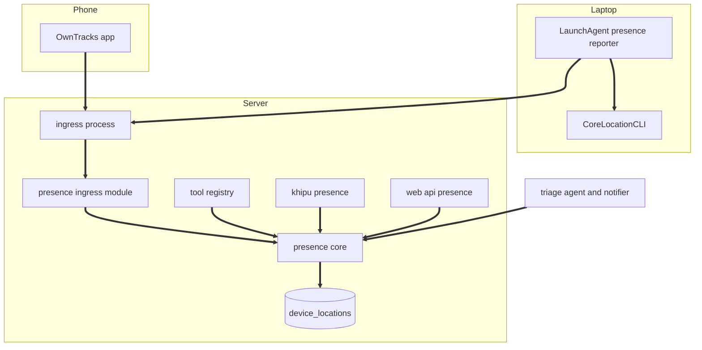
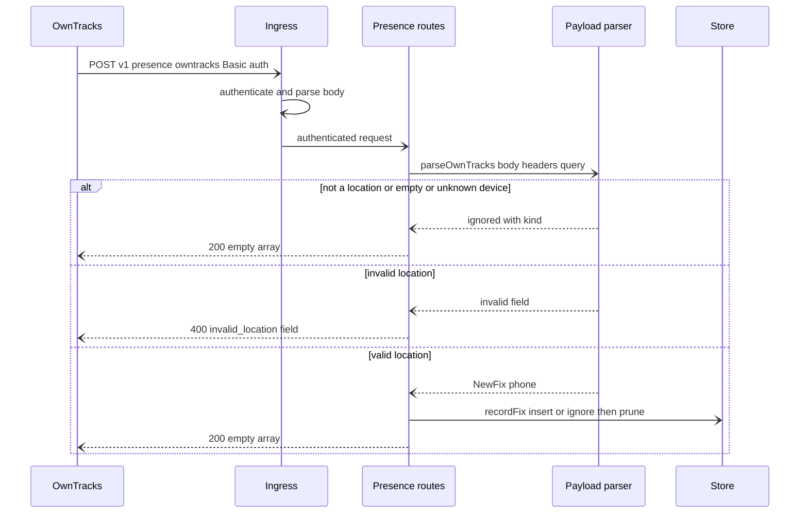
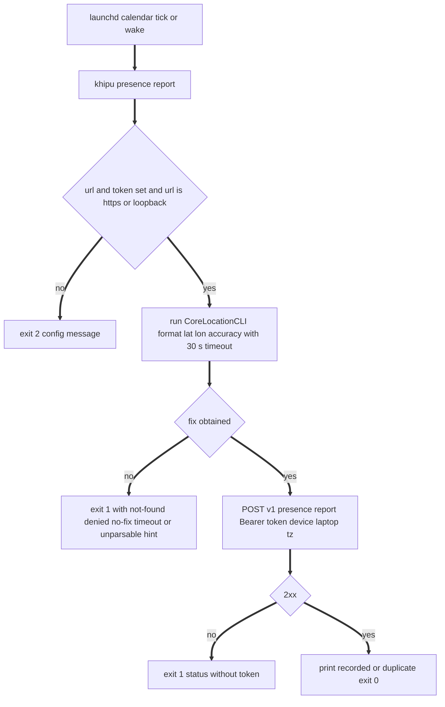
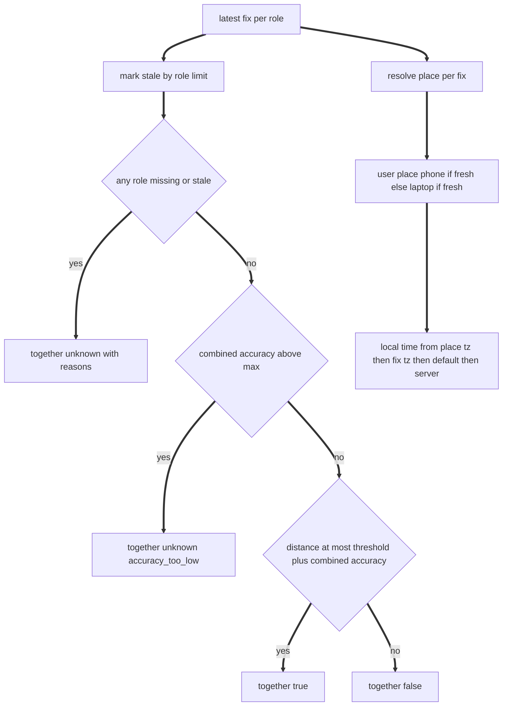

# Design Document: presence-context

## Overview
**Purpose**: This feature gives khipuchat a privacy-preserving answer to "where is the user, and are the phone and laptop together", so that triage-agent can add presence to its LLM context and notifier can route alerts to the device the user is actually near.

**Users**: The operator connects an OwnTracks phone and a macOS laptop once. Downstream spec developers (triage-agent, notifier) call `getPresence()` and `presenceForLlm()`. LLM clients (Claude over MCP, `khipu ask`) call the `get_presence` tool.

**Impact**: Adds a `src/presence/` module tree, a `device_locations` table (DDL in `src/presence/schema.ts`, registered in message-events' `src/schema-registry.ts`), a shared feature-neutral launchd helper `src/launchd-plist.ts`, one ingress module (`presence`, mounted at `/v1/presence`), a `get_presence` tool, a `khipu presence` command family, a `GET /api/presence` web route, and a per-user macOS LaunchAgent. Existing behavior is unchanged when no presence data or settings exist.

### Goals
- Phone and laptop fixes reach the server over the authenticated ingress and are kept only briefly.
- One pure snapshot computation answers together / apart / unknown, distance, place, and local time.
- Coarse location toward every LLM by default, enforced in one function.
- A stable `PresenceSnapshot` / `getPresence()` contract for triage-agent and notifier.

### Non-Goals
- Notification routing, urgency, or importance decisions (notifier, triage-agent).
- Reverse geocoding, timezone-from-coordinates lookup, maps or history UI, geofence actions.
- Find My decryption, OwnTracks encrypted payloads, Overland's native batch format.
- More than one phone and one laptop.
- Laptop-side action execution (action-runner may later reuse the agent channel).

## Boundary Commitments

### This Spec Owns
- The `device_locations` table, its retention, and the forget operation.
- Payload contracts for `POST /v1/presence/owntracks` and `POST /v1/presence/report`.
- The `presence` ingress module (id, body limit, handlers). Authentication stays with the ingress.
- Co-location, place resolution, and local-time rules; all presence settings (`KHIPU_PRESENCE_*`).
- `PresenceSnapshot`, `getPresence()`, `PresenceView`, `presenceForLlm()`, `formatPresenceSummary()`: the downstream contract.
- The `get_presence` tool definition and handler, `khipu presence` subcommands, `GET /api/presence`.
- The laptop reporter, CoreLocationCLI invocation, and the LaunchAgent `com.khipuchat.presence-reporter`.
- `docs/PRESENCE.md` and the presence block of `.env.example`.
- `src/presence/schema.ts` (`applyPresenceSchema`, DDL-only) and its single entry in `SCHEMA_MODULES` (decision D6).
- `src/launchd-plist.ts`: the shared, feature-neutral launchd plist builder plus install / uninstall / status via `launchctl` (decision D9). presence's LaunchAgentManager is its first consumer; action-runner's laptop agent and the roadmap fix `setup-sync-stale-path` reuse it and must not fork their own plist builder.

### Out of Boundary
- Ingress process, auth, token parsing, body parsing, error envelope (cloud-deployment).
- Deciding which channel to notify or whether a message matters (notifier, triage-agent).
- How triage-agent phrases its prompt; it only receives the summary or view.
- A command channel from server to laptop (action-runner, if ever).
- Changes to `account-registry`, `khipu.config.json`, MCP transport.
- The schema registry itself (`src/schema-registry.ts`, `SCHEMA_MODULES`, the single call from `initDb`): message-events (D6). presence adds one import and one entry only.
- `IngressContext` (including `ctx.env`), the ingress isolation test, and `resolveDataFile` in `src/db-path.ts`: cloud-deployment (D4, D5).
- Migrating `src/setup-sync.ts` onto `src/launchd-plist.ts`: the roadmap direct fix `setup-sync-stale-path`, not this spec.

### Allowed Dependencies
- cloud-deployment: `src/ingress/types.ts` (`IngressModule`, `IngressContext` including `readonly env: NodeJS.ProcessEnv`, type-only import) and one entry in `src/ingress/modules.ts`. Ingress-side presence code reads settings only from `ctx.env`, never `process.env` (D4).
- message-events: `src/schema-registry.ts` (`SCHEMA_MODULES`), to which presence adds one import of `applyPresenceSchema` and one entry (D6). `src/db.ts` is not modified by this spec.
- `src/db.ts` (`getDb`, `initDb`, read only), cloud-deployment's `src/db-path.ts` (`resolveDbPath`; `resolveDataFile` for any future presence data file, D5), `better-sqlite3-multiple-ciphers` `Database` type.
- Node 24 built-ins (`node:child_process` `execFile`, `node:os`, `node:fs`, `node:path`), global `fetch`, `Intl`.
- Existing `express` 5 (types for handlers), `dotenv`.
- External tools on the laptop only: CoreLocationCLI (MIT, Homebrew cask), `launchctl`.
- `src/presence/**` must NOT import `src/mcp.ts`, `src/tool-registry.ts`, `src/query-handlers.ts`, `src/web/**`, `src/ask.ts`, `src/cli.ts`, `src/config.ts`. The ingress isolation test (cloud-deployment) follows the transitive import closure of `src/presence/ingress-module.ts` and enforces this for every file in it; that closure contains no `process.env` reference (D4).
- `src/presence/schema.ts` is DDL-only: it imports nothing but the `better-sqlite3-multiple-ciphers` `Database` type, so `db.ts` => `schema-registry.ts` => `presence/schema.ts` never pulls presence logic (or `store.ts`) into the archive layer (D6). `store.ts` does not create tables.
- `src/launchd-plist.ts` imports only Node built-ins (`node:child_process`, `node:fs`, `node:os`, `node:path`) and nothing from `src/presence/**` or any other feature, so action-runner and `setup-sync.ts` can import it without depending on presence.
- No new npm dependency. No Beeper dependency.

### Revalidation Triggers
- Any change to `PresenceSnapshot`, `PresenceView`, `getPresence`, `presenceForLlm`, `formatPresenceSummary`, or the `TogetherState` / `UnknownReason` unions: triage-agent and notifier re-check.
- Changing default thresholds or staleness limits: notifier re-checks routing expectations.
- Adding device roles or multiple phones: snapshot shape changes; all consumers re-check.
- Changing the `presence` module id, paths, or body limit: OwnTracks app settings, laptop agent, and `docs/PRESENCE.md`.
- Reusing the laptop agent or its endpoint for anything other than location (action-runner laptop actions): requires a new design for a server-to-laptop channel and a review of the agent's permissions and schedule.
- Changes to cloud-deployment's `IngressModule` / `IngressContext` (including `ctx.env`) or Basic-auth handling: re-check the presence module.
- Any change to the exported contract of `src/launchd-plist.ts` (`LaunchdJob`, `buildLaunchdPlist`, `installLaunchAgent`, `uninstallLaunchAgent`, `launchAgentStatus`, `launchAgentPlistPath`, result unions): action-runner (AgentLaunchd, laptop agent) re-validates, and the `setup-sync-stale-path` fix re-checks.
- Changes to message-events' schema registry convention (`SCHEMA_MODULES` shape, `apply<Name>Schema(db)` signature, call point in `initDb`): re-check `src/presence/schema.ts` and its entry.

## Architecture

### Existing Architecture Analysis
- Separate process per surface sharing one SQLite file: `khipu ingress` (writes fixes), `khipu mcp` / `khipu ask` / `khipu web` / `khipu presence` (read). WAL mode and cloud-deployment's `busy_timeout` cover concurrent access.
- `tool-registry.ts` is the single tool list for MCP and ask; adding a tool there gives parity for both.
- Ingress modules must not reach query surfaces; presence therefore puts all logic in `src/presence/`, imported by both the ingress module and the tool registry.
- `khipu.ts` (280 lines) exceeds the 200-line target and gains at most a few lines. `db.ts` (315 lines) is not modified: table creation goes through message-events' `src/schema-registry.ts`, which `initDb` calls once (D6).
- `src/setup-sync.ts` builds its own launchd plist inline with legacy `launchctl load`; `src/launchd-plist.ts` is introduced here as the shared replacement, and migrating setup-sync onto it is the roadmap fix `setup-sync-stale-path` (D9).

### Architecture Pattern & Boundary Map



**Dependency direction** (imports point only leftward; violations are errors):
`types` => `config` (owns `isValidTimeZone`) => `geo`, `local-time` => `payloads`, `store` => `snapshot` => `views` => (`routes` => `ingress-module`), `query`, (`corelocation` => `reporter`), (`../launchd-plist` => `launch-agent`) => `cli`. `schema.ts` stands alone (type-only import of `Database`) and is imported only by `src/schema-registry.ts`; `src/launchd-plist.ts` stands alone (Node built-ins only). External callers (`tool-registry.ts`, `web/routes.ts`, `ingress/modules.ts`, `schema-registry.ts`, triage-agent, notifier) import from `snapshot`, `views`, `query`, `ingress-module`, or `schema` only; action-runner and `setup-sync.ts` import `src/launchd-plist.ts`, never `src/presence/**`.

**Architecture Integration**:
- Selected pattern: pure core (config, geo, payload parsing, snapshot, views) over a small store, with thin adapters per surface.
- Existing patterns preserved: env-driven config, sync DB, `:memory:` real-DB tests, dependency injection (`now`, `env`, `execFile`, `fetch`) for tests, `khipu` subcommand routing to a script.
- New components rationale: each file owns one concern and stays under 200 lines.
- Steering compliance: MCP stays stdio, no `any`, no new dependency, no Beeper, local-only by default (nothing is sent anywhere unless the operator configures OwnTracks or the agent).

### Technology Stack

| Layer | Choice / Version | Role in Feature | Notes |
|-------|------------------|-----------------|-------|
| Phone client | OwnTracks iOS / Android, HTTP mode | Posts phone fixes | Configured by the operator; no code |
| Laptop client | CoreLocationCLI (MIT, Homebrew cask) | One-shot fix with accuracy | Invoked with `--format "%latitude %longitude %h_accuracy"` |
| Laptop scheduler | launchd user agent, `StartCalendarInterval`, `LimitLoadToSessionType` Aqua | Runs reporter on schedule and on wake | `launchctl bootstrap gui/<uid>` |
| Backend | Express 5 router via ingress module | Two POST handlers | Body parsing and auth by ingress |
| Data | better-sqlite3-multiple-ciphers (existing) | `device_locations` table | Encrypted at rest when `DB_KEY` set |
| Runtime | Node 24, `Intl`, global `fetch` | Local time, reporter HTTP | No new dependency |

## File Structure Plan

### Directory Structure
```
src/presence/
├── types.ts            # DeviceRole, PresenceSource, StoredFix, NewFix, PresenceSnapshot, PresenceView, UnknownReason, errors
├── config.ts           # resolvePresenceConfig(env), isValidTimeZone: thresholds, places, retention, precision, phone device id
├── geo.ts              # distanceMeters (haversine), resolvePlace
├── local-time.ts       # resolveLocalTime
├── payloads.ts         # parseOwnTracks, parseReport: validation and field minimisation
├── schema.ts           # applyPresenceSchema(db): DDL-only (D6), registered in src/schema-registry.ts
├── store.ts            # recordFix (insert + prune), latestFixes, countFixes, forgetAll (no DDL)
├── snapshot.ts         # computeSnapshot (pure), getPresence(db, opts)
├── views.ts            # toView, presenceForLlm, formatPresenceSummary
├── query.ts            # handleGetPresence(args): shared by tool registry, CLI, web
├── routes.ts           # handleOwnTracksPost, handleReportPost (Express handlers bound to ctx and config)
├── ingress-module.ts   # presenceIngressModule: IngressModule { id: 'presence', bodyLimitBytes: 16384, mount }
├── corelocation.ts     # runCoreLocation: execFile with timeout, output parsing, error mapping
├── reporter.ts         # runLaptopReport: endpoint checks, build report, POST
├── launch-agent.ts     # agentJob (pure, presence LaunchdJob), installAgent, uninstallAgent, agentStatus via ../launchd-plist
└── cli.ts              # khipu presence entry: status, report, install-agent, uninstall-agent, forget
src/
└── launchd-plist.ts    # shared (D9): buildLaunchdPlist (pure), installLaunchAgent, uninstallLaunchAgent, launchAgentStatus
tests/
├── launchd-plist.test.ts         # shared helper: plist XML, escaping, launchctl sequence
├── presence-config.test.ts
├── presence-geo.test.ts          # also covers local-time.ts
├── presence-payloads.test.ts
├── presence-store.test.ts         # also covers schema.ts and its SCHEMA_MODULES entry
├── presence-snapshot.test.ts
├── presence-views.test.ts        # also covers query.ts precision handling
├── presence-ingress.test.ts      # supertest against createIngressApp with the presence module
├── presence-corelocation.test.ts
├── presence-reporter.test.ts
├── presence-launch-agent.test.ts
├── presence-cli.test.ts
└── presence-e2e.test.ts          # ingest via ingress, read via dispatchTool, CLI, web
docs/
└── PRESENCE.md
```

### Modified Files
- `src/schema-registry.ts` (owned by message-events): import `applyPresenceSchema` from `./presence/schema` and add one `SCHEMA_MODULES` entry. `src/db.ts` is not touched; `initDb` already calls the registry once (D6).
- `src/ingress/modules.ts`: import `presenceIngressModule` and add it to `INGRESS_MODULES`.
- `src/tool-registry.ts`: add the `get_presence` definition and a `dispatchTool` branch calling `handleGetPresence(args)`.
- `src/khipu.ts`: `OPERATIONAL_SCRIPTS['presence'] = 'presence/cli.ts'`; usage lines and a `presence` entry in `SUBCOMMAND_USAGE`.
- `src/web/routes.ts`: `GET /api/presence` (behind the existing auth middleware) returning `handleGetPresence({ precision })`.
- `tests/ask-parity.test.ts`: tool count 8 becomes 9; add a `get_presence` parity case.
- `scripts/test-mcp.sh`: add a `get_presence` tools/call line.
- `.env.example`: presence settings block.
- `docs/DEPLOYMENT.md`: one link line to `docs/PRESENCE.md` (file owned by cloud-deployment; link only).

## System Flows

### Phone fix ingestion

Key decisions: anything well-formed but not storable gets `200 []` so the phone never retries it; duplicates are silent successes; logs carry role, source, device id, fix time, never coordinates.

### Laptop report


### Snapshot computation


## Requirements Traceability

| Requirement | Summary | Components | Interfaces | Flows |
|-------------|---------|------------|------------|-------|
| 1.1, 1.2 | OwnTracks location recorded, Basic auth via ingress | PresenceRoutes, PresenceIngressModule, PayloadParser, PresenceStore | `POST /v1/presence/owntracks`, `parseOwnTracks`, `recordFix` | Phone fix ingestion |
| 1.3, 1.6, 1.7 | Non-location ack, device id order, phone allowlist | PayloadParser, PresenceRoutes | `OwnTracksParse` | Phone fix ingestion |
| 1.4 | Location validation | PayloadParser | `ParseError` | Phone fix ingestion |
| 1.5, 2.5 | Duplicate suppression | PresenceSchema, PresenceStore | `UNIQUE (device, source, at)`, `RecordResult` | Phone fix ingestion |
| 2.1, 2.2, 2.3, 2.4 | Generic report | PayloadParser, PresenceRoutes, PresenceStore | `POST /v1/presence/report`, `parseReport` | |
| 3.1, 3.2, 3.4 | Laptop fix via tool, error cases, coordinates only | CoreLocationRunner, LaptopReporter | `runCoreLocation`, `runLaptopReport` | Laptop report |
| 3.3, 3.5 | Post failures, endpoint safety, env source | LaptopReporter | `ReporterError` | Laptop report |
| 4.1, 4.4, 4.5 | Agent schedule, no secrets, reinstall and uninstall | LaunchAgentManager | `buildAgentPlist`, `installAgent`, `uninstallAgent` | |
| 4.2, 4.3 | Foreground permission check, macOS only | LaunchAgentManager, PresenceCli | `installAgent` | |
| 4.6 | Shared feature-neutral job helper, escaping | LaunchdPlist, LaunchAgentManager | `buildLaunchdPlist`, `installLaunchAgent`, `uninstallLaunchAgent` | |
| 5.1, 5.2 | Retention by count and age | PresenceStore, PresenceConfig | `recordFix` | |
| 5.3 | Field minimisation | PayloadParser, PresenceSchema, PresenceStore | `NewFix`, `applyPresenceSchema` | |
| 5.4 | Latest by fix time | PresenceStore | `latestFixes` | |
| 5.5 | Forget | PresenceStore, PresenceCli | `forgetAll` | |
| 5.6 | No coordinates in logs | PresenceRoutes, LaptopReporter | log format | Phone fix ingestion |
| 6.1, 6.2, 6.3, 6.5 | Together rules, reasons, distance | SnapshotEngine, Geo | `computeSnapshot` | Snapshot computation |
| 6.4, 6.6 | Defaults and config errors | PresenceConfig | `resolvePresenceConfig` | |
| 7.1, 7.2 | Place resolution, user place | Geo, SnapshotEngine | `resolvePlace` | Snapshot computation |
| 7.3 | Local time sources | LocalTime | `resolveLocalTime` | Snapshot computation |
| 7.4 | Place config errors | PresenceConfig | `PresenceConfigError` | |
| 7.5 | No external geocoding | Geo, LocalTime, CoreLocationRunner | | |
| 8.1 | MCP and ask tool | PresenceQuery, ToolRegistryEntry | `get_presence`, `handleGetPresence` | |
| 8.2 | CLI status and JSON | PresenceCli | `khipu presence` | |
| 8.3 | Web endpoint | WebPresenceRoute | `GET /api/presence` | |
| 8.4, 8.5 | Empty archive answer, read-only | SnapshotEngine, PresenceQuery | `getPresence` | |
| 9.1, 9.2, 9.3, 9.5 | Coarse default, opt-in precise | PresenceViews, PresenceQuery | `presenceForLlm`, `toView` | |
| 9.4 | One-line summary | PresenceViews | `formatPresenceSummary` | |
| 10.1, 10.2, 10.3 | Downstream contract | SnapshotEngine, PresenceViews | `PresenceSnapshot`, `getPresence` | |
| 11.1, 11.2, 11.3, 11.4 | Guide and env template | PresenceDocs | | |

## Components and Interfaces

| Component | Domain/Layer | Intent | Req Coverage | Key Dependencies | Contracts |
|-----------|--------------|--------|--------------|------------------|-----------|
| PresenceTypes | Types | Shared types and unions | 10.1 | none | State |
| PresenceConfig | Config | Parse `KHIPU_PRESENCE_*` | 6.4, 6.6, 7.4, 5.1, 1.7, 9.2 | Intl (P0) | Service |
| Geo | Core | Distance and place containment | 6.1, 6.5, 7.1, 7.5 | none | Service |
| LocalTime | Core | Timezone validation and local time | 7.3, 7.5 | Intl (P0) | Service |
| PayloadParser | Core | Validate and minimise payloads | 1.3, 1.4, 1.6, 2.1 to 2.4, 5.3 | PresenceConfig (P0) | Service |
| PresenceSchema | Data | DDL-only `device_locations` table and index, registered in `SCHEMA_MODULES` | 1.5, 2.5, 5.3 | message-events schema registry (P0) | State |
| PresenceStore | Data | Insert, prune, read, forget (no DDL) | 1.5, 2.5, 5.1 to 5.5 | db handle, PresenceSchema (P0) | Service, State |
| SnapshotEngine | Core | Compute `PresenceSnapshot` | 6.1 to 6.3, 6.5, 7.2, 8.4, 8.5, 10.1 to 10.3 | Geo, LocalTime, Store, Config (P0) | Service |
| PresenceViews | Core | Coarse/precise views and summary | 9.1 to 9.5 | SnapshotEngine (P0) | Service |
| PresenceQuery | Surface adapter | Tool / CLI / web handler | 8.1, 8.4, 9.3 | Views, `getDb` (P0) | Service |
| PresenceRoutes | Ingress adapter | Two POST handlers | 1.1 to 1.7, 2.1 to 2.5, 5.6 | Parser, Store, Config (P0) | API |
| PresenceIngressModule | Ingress adapter | `IngressModule` registration | 1.2 | cloud-deployment ingress (P0) | API |
| ToolRegistryEntry | Surface adapter | `get_presence` definition and dispatch | 8.1 | PresenceQuery (P0) | Service |
| WebPresenceRoute | Surface adapter | `GET /api/presence` | 8.3, 9.5 | PresenceQuery (P0) | API |
| CoreLocationRunner | Laptop | Run CoreLocationCLI once | 3.1, 3.2, 3.4 | execFile (P0), CoreLocationCLI (P0) | Service |
| LaptopReporter | Laptop | Build and post laptop report | 3.1, 3.3, 3.5, 5.6 | CoreLocationRunner (P0), fetch (P0) | Service |
| LaunchdPlist (`src/launchd-plist.ts`) | Shared infra | Feature-neutral plist builder, install / uninstall / status via launchctl | 4.1, 4.4, 4.5, 4.6 | launchctl (P0), node:fs (P0) | Service, Batch |
| LaunchAgentManager | Laptop | Presence job definition, permission check, install, uninstall, status | 4.1 to 4.6 | LaunchdPlist (P0), CoreLocationRunner (P1) | Service, Batch |
| PresenceCli | Entrypoint | `khipu presence` subcommands | 4.2, 4.3, 5.5, 8.2, 9.5 | Query, Reporter, Agent, Store (P0) | Service |
| PresenceDocs | Docs | Guide and env template | 11.1 to 11.4 | | |

### Types Layer

#### PresenceTypes (`src/presence/types.ts`): the downstream contract

```typescript
export type DeviceRole = 'phone' | 'laptop'
export const DEVICE_ROLES: readonly DeviceRole[]                 // ['phone', 'laptop']

export type PresenceSource = 'owntracks' | 'report' | 'laptop-agent'

/** true = together, false = apart, 'unknown' = cannot tell (see unknown_reasons). */
export type TogetherState = boolean | 'unknown'

export type UnknownReason =
  | 'phone_missing' | 'laptop_missing'
  | 'phone_stale' | 'laptop_stale'
  | 'accuracy_too_low'

/** A validated fix ready to store. Only these fields are ever persisted (5.3). */
export interface NewFix {
  readonly device: DeviceRole
  readonly lat: number                 // -90..90
  readonly lon: number                 // -180..180, never (0, 0) together with lat
  readonly accuracy_m: number | null   // >= 0; null when the client did not send one
  readonly at: number                  // fix time, unix seconds
  readonly received_at: number         // unix seconds
  readonly source: PresenceSource
  readonly source_device: string | null  // client device id (OwnTracks d / topic / tid), max 64 chars
  readonly tz: string | null           // IANA zone, validated
}

export interface StoredFix extends NewFix {
  readonly id: number
}

export interface DevicePresence {
  readonly role: DeviceRole
  readonly lat: number
  readonly lon: number
  readonly accuracy_m: number | null
  readonly at: number
  readonly received_at: number
  readonly age_s: number               // computed_at minus at, floored at 0
  readonly stale: boolean
  readonly source: PresenceSource
  readonly place: string | null
  readonly tz: string | null
}

export interface LocalTime {
  readonly iso: string                 // e.g. '2026-11-12T14:05:00-05:00'
  readonly display: string             // e.g. 'Thu 14:05'
  readonly timezone: string            // IANA zone
  readonly source: 'place' | 'report' | 'config' | 'server'
}

export interface PresenceThresholds {
  readonly together_distance_m: number
  readonly stale_after_s: Readonly<Record<DeviceRole, number>>
  readonly max_combined_accuracy_m: number
  readonly default_accuracy_m: number  // 100, applied when accuracy_m is null
}

export interface PresenceSnapshot {
  readonly computed_at: number         // unix seconds
  readonly together: TogetherState
  readonly unknown_reasons: readonly UnknownReason[]   // empty unless together === 'unknown'
  readonly distance_m: number | null   // whole metres when both fixes exist (fresh or stale), else null
  readonly place: string | null        // user place (7.2)
  readonly local_time: LocalTime
  readonly phone: DevicePresence | null
  readonly laptop: DevicePresence | null
  readonly stale: readonly DeviceRole[]  // roles that have a fix but it is stale
  readonly thresholds: PresenceThresholds
}

export type PresencePrecision = 'coarse' | 'precise'

export interface CoarseDevice {
  readonly role: DeviceRole
  readonly place: string | null
  readonly age_s: number
  readonly stale: boolean
}

export interface PresenceView {
  readonly precision: PresencePrecision
  readonly together: TogetherState
  readonly unknown_reasons: readonly UnknownReason[]
  readonly distance_m: number | null   // coarse: rounded to nearest 50
  readonly place: string | null
  readonly local_time: LocalTime
  readonly phone: CoarseDevice | DevicePresence | null   // DevicePresence only when precision === 'precise'
  readonly laptop: CoarseDevice | DevicePresence | null
  readonly stale: readonly DeviceRole[]
  readonly summary: string             // formatPresenceSummary of this view
  readonly note?: string               // e.g. 'precise output is disabled (KHIPU_PRESENCE_LLM_PRECISION=coarse)'
}

export class PresenceConfigError extends Error {
  readonly problems: readonly string[]   // each names the setting or place entry
}
```

### Config and Core

#### PresenceConfig (`src/presence/config.ts`)

| Field | Detail |
|-------|--------|
| Intent | Resolve all presence settings into a typed config, or a config error naming each bad setting |
| Requirements | 1.7, 5.1, 6.4, 6.6, 7.4, 9.2 |

**Settings**

| Variable | Default | Meaning |
|----------|---------|---------|
| `KHIPU_PRESENCE_TOGETHER_M` | 200 | Together distance threshold in metres (positive integer) |
| `KHIPU_PRESENCE_STALE_PHONE_MIN` | 180 | Phone staleness limit in minutes |
| `KHIPU_PRESENCE_STALE_LAPTOP_MIN` | 30 | Laptop staleness limit in minutes |
| `KHIPU_PRESENCE_MAX_ACCURACY_M` | 1000 | Maximum combined accuracy for a together/apart verdict |
| `KHIPU_PRESENCE_PLACES` | empty | `name=lat,lon,radius_m[,tz]` entries separated by `;` (inline value, not a file path) |
| `KHIPU_PRESENCE_TIMEZONE` | empty | Default IANA zone for local time |
| `KHIPU_PRESENCE_RETENTION_COUNT` | 50 | Max fixes kept per role (1..10000) |
| `KHIPU_PRESENCE_RETENTION_DAYS` | 7 | Max fix age in days (1..365) |
| `KHIPU_PRESENCE_PHONE_DEVICE` | empty | Only this OwnTracks device id is accepted as the phone |
| `KHIPU_PRESENCE_LLM_PRECISION` | `coarse` | `coarse` or `precise` for LLM-bound output |
| `KHIPU_PRESENCE_URL` | empty | Laptop only: ingress base URL, e.g. `https://khipu.example.com` |
| `KHIPU_PRESENCE_TOKEN` | empty | Laptop only: Bearer token (`INGRESS_TOKEN_PRESENCE` value recommended) |
| `KHIPU_PRESENCE_INTERVAL_MIN` | 5 | Laptop only: agent interval, a divisor of 60 |
| `KHIPU_CORELOCATIONCLI` | empty | Laptop only: absolute path to CoreLocationCLI; else resolved from PATH, `/opt/homebrew/bin`, `/usr/local/bin` |

```typescript
export interface NamedPlace {
  readonly name: string                // /^[a-z0-9][a-z0-9 _-]{0,31}$/i, unique case-insensitively
  readonly lat: number
  readonly lon: number
  readonly radius_m: number            // 10..100000
  readonly tz: string | null
}

export interface PresenceConfig {
  readonly thresholds: PresenceThresholds
  readonly places: readonly NamedPlace[]
  readonly defaultTimeZone: string | null
  readonly retention: { readonly maxCount: number; readonly maxAgeS: number }
  readonly phoneDevice: string | null
  readonly llmPrecision: PresencePrecision
}

export interface ReporterConfig {
  readonly url: string
  readonly token: string
  readonly intervalMin: number
  readonly coreLocationBin: string | null
}

/** Throws PresenceConfigError listing every problem; never includes token values.
 *  `env` is required (no process.env default): the ingress passes ctx.env (D4); CLI, query, and reporter pass their own env. */
export function resolvePresenceConfig(env: NodeJS.ProcessEnv): PresenceConfig
export function resolveReporterConfig(env: NodeJS.ProcessEnv): ReporterConfig   // throws PresenceConfigError
export const DEFAULT_PRESENCE_CONFIG: PresenceConfig

/** Intl.DateTimeFormat throws RangeError on invalid zones. Used by config, payloads, and local-time. */
export function isValidTimeZone(tz: string): boolean
```
- Invariants: numbers are finite and in range; place timezones pass `isValidTimeZone`.
- Data files (D5): presence reads no data or config file. Every setting, including `KHIPU_PRESENCE_PLACES`, is an inline env value and stays as is. If a file-backed setting is ever added (for example a places file), its path must be resolved with cloud-deployment's `resolveDataFile(name, envVar)`, never relative to the working directory.
- `config.ts` contains no `process.env` reference, because it is in the ingress module's import closure (D4).

#### Geo (`src/presence/geo.ts`) and LocalTime (`src/presence/local-time.ts`)

| Field | Detail |
|-------|--------|
| Intent | Pure distance, place containment, and local-time helpers; no I/O, no network |
| Requirements | 6.1, 6.5, 7.1, 7.3, 7.5 |

```typescript
/** Haversine great-circle distance, earth radius 6371008.8 m. */
export function distanceMeters(a: { lat: number; lon: number }, b: { lat: number; lon: number }): number

/** Nearest place whose radius contains the point (distance <= radius_m); ties by name. Null when none. */
export function resolvePlace(point: { lat: number; lon: number }, places: readonly NamedPlace[]): NamedPlace | null

export interface LocalTimeInput {
  readonly nowS: number
  readonly placeTz: string | null
  readonly fixTz: string | null          // tz of the most recent fresh fix carrying one
  readonly defaultTz: string | null
  readonly serverTz: string              // Intl.DateTimeFormat().resolvedOptions().timeZone
}
export function resolveLocalTime(input: LocalTimeInput): LocalTime
```

#### PayloadParser (`src/presence/payloads.ts`)

| Field | Detail |
|-------|--------|
| Intent | Validate incoming bodies and keep only persisted fields |
| Requirements | 1.3, 1.4, 1.6, 1.7, 2.1, 2.2, 2.3, 2.4, 5.3 |

```typescript
export interface ParseError { readonly field: string; readonly message: string }

export type OwnTracksParse =
  | { readonly kind: 'fix'; readonly fix: NewFix }
  | { readonly kind: 'ignored'; readonly reason: 'not-location' | 'empty' | 'unknown-device' | 'encrypted' | 'too-old'; readonly type?: string; readonly device?: string }
  | { readonly kind: 'invalid'; readonly error: ParseError }

export interface OwnTracksRequest {
  readonly body: unknown
  readonly deviceHeader?: string        // x-limit-d
  readonly deviceQuery?: string         // ?d=
}

export function parseOwnTracks(req: OwnTracksRequest, cfg: PresenceConfig, nowS: number): OwnTracksParse

/** Generic report body. */
export interface ReportBody {
  readonly device: DeviceRole
  readonly lat: number
  readonly lon: number
  readonly accuracy_m?: number
  readonly at?: number                  // unix seconds; defaults to receive time
  readonly tz?: string
  readonly source?: 'report' | 'laptop-agent'   // default 'report'
  readonly device_id?: string           // optional client id, max 64 chars
}

export type ReportParse =
  | { readonly kind: 'fix'; readonly fix: NewFix }
  | { readonly kind: 'ignored'; readonly reason: 'too-old' }
  | { readonly kind: 'invalid'; readonly error: ParseError }

export function parseReport(body: unknown, cfg: PresenceConfig, nowS: number): ReportParse
```
- Rules: numbers must be finite JSON numbers (strings rejected); `(0, 0)` rejected with field `lat`; future skew limit 300 s (field `tst` or `at`); fix older than `retention.maxAgeS` yields `ignored too-old`; device id order for OwnTracks: header, query, last `/` segment of `topic`, `tid`; unknown device only when `phoneDevice` is set and the resolved id differs; `_type` absent or `encrypted` or non-`location` yields `ignored`.

#### PresenceSchema (`src/presence/schema.ts`)

| Field | Detail |
|-------|--------|
| Intent | DDL-only creation of `device_locations` and its index, run once by message-events' schema registry at `initDb` (D6) |
| Requirements | 1.5, 2.5, 5.3 |

**Contracts**: State [x]

```typescript
import type Database from 'better-sqlite3-multiple-ciphers'

/** Idempotent CREATE TABLE / CREATE INDEX IF NOT EXISTS (see Physical Data Model). DDL only: no other imports, no queries, no data writes. */
export function applyPresenceSchema(db: Database.Database): void
```
- Registration: one import plus one entry in `SCHEMA_MODULES` of `src/schema-registry.ts` (shape owned by message-events), after the entries of upstream specs. No lazy `ensure*Schema` on first use; `store.ts`, `snapshot.ts`, and the CLI assume the table exists because every archive handle comes from `initDb`. Tests on `:memory:` databases obtain them through `initDb` (or call `applyPresenceSchema` directly in pure store tests).
- Isolation: allowed by the triage, notifier, action-runner, and ingress isolation rules as a DDL-only `*/schema.ts` module.

#### PresenceStore (`src/presence/store.ts`)

| Field | Detail |
|-------|--------|
| Intent | Operate on `device_locations`: insert with dedupe and prune, latest read, forget. Creates no tables |
| Requirements | 1.5, 2.5, 5.1, 5.2, 5.3, 5.4, 5.5 |

**Contracts**: Service [x] / State [x]

```typescript
export type RecordResult = { readonly recorded: true; readonly pruned: number } | { readonly recorded: false; readonly reason: 'duplicate' }

/** INSERT OR IGNORE then prune that role, in one transaction. */
export function recordFix(db: Database.Database, fix: NewFix, retention: PresenceConfig['retention'], nowS: number): RecordResult

/** Fix with the greatest `at` per role (ties: greatest id). Read-only. */
export function latestFixes(db: Database.Database): Readonly<Record<DeviceRole, StoredFix | null>>

export function countFixes(db: Database.Database): Readonly<Record<DeviceRole, number>>
export function forgetAll(db: Database.Database): number        // rows deleted
```
- State model: append-only rows per role, bounded by retention; no updates.
- Concurrency: single writer (ingress process); readers in other processes rely on WAL. Prune runs inside the insert transaction (5.2).

#### SnapshotEngine (`src/presence/snapshot.ts`)

| Field | Detail |
|-------|--------|
| Intent | Compute the presence snapshot from current fixes, config, and time |
| Requirements | 6.1, 6.2, 6.3, 6.5, 7.2, 8.4, 8.5, 10.1, 10.2, 10.3 |

**Contracts**: Service [x]

```typescript
export interface ComputeInput {
  readonly fixes: Readonly<Record<DeviceRole, StoredFix | null>>
  readonly config: PresenceConfig
  readonly nowS: number
  readonly serverTz: string
}

/** Pure. Rules below. */
export function computeSnapshot(input: ComputeInput): PresenceSnapshot

export interface GetPresenceOptions {
  readonly now?: () => Date                  // default () => new Date()
  readonly config?: PresenceConfig           // default resolvePresenceConfig(env)
  readonly env?: NodeJS.ProcessEnv           // default process.env (snapshot.ts is outside the ingress closure)
}

/** Reads latestFixes(db) and calls computeSnapshot. Read-only. Throws PresenceConfigError. */
export function getPresence(db: Database.Database, opts?: GetPresenceOptions): PresenceSnapshot
```
- Rules:
  - `stale` for a role when `nowS - at > stale_after_s[role]`.
  - Reasons in fixed order: `phone_missing`, `phone_stale`, `laptop_missing`, `laptop_stale`, `accuracy_too_low`.
  - `accSum = (phone.accuracy_m ?? 100) + (laptop.accuracy_m ?? 100)`. If any reason so far, `together = 'unknown'`. Else if `accSum > max_combined_accuracy_m`, `unknown` with `accuracy_too_low`. Else `together = distance <= together_distance_m + accSum`.
  - `distance_m = Math.round(distanceMeters(phone, laptop))` whenever both fixes exist.
  - Device `place` is `resolvePlace(fix)`; user `place` is the phone's when phone is fresh, else the laptop's when fresh, else null.
  - `local_time`: place tz of the user place, else tz of the freshest fresh fix with a tz, else `defaultTimeZone`, else `serverTz`.
- Postconditions: never writes; no network; with no fixes returns `together: 'unknown'`, reasons `['phone_missing', 'laptop_missing']`, `distance_m: null` (8.4).

#### PresenceViews (`src/presence/views.ts`)

| Field | Detail |
|-------|--------|
| Intent | The single place that decides how much location detail leaves the snapshot |
| Requirements | 9.1, 9.2, 9.3, 9.4, 9.5 |

```typescript
/** Coarse: drop lat, lon, accuracy_m, received_at, source, tz from devices; distance rounded to nearest 50. */
export function toView(snapshot: PresenceSnapshot, precision: PresencePrecision): PresenceView

/** LLM-bound view: precise only when cfg.llmPrecision === 'precise'. Requested 'precise' without opt-in yields coarse plus note. */
export function presenceForLlm(snapshot: PresenceSnapshot, cfg: PresenceConfig, requested?: PresencePrecision): PresenceView

/** One line, no coordinates even for precise views. */
export function formatPresenceSummary(view: PresenceView): string
```
- Summary examples: `Phone and laptop together at home. Local time Thu 14:05 (America/Toronto).`; `Phone and laptop apart (about 3200 m); user at office. Local time Thu 09:12 (Europe/Paris).`; `Presence unknown (laptop stale 2 h). User at no known place. Local time Thu 22:40 (America/Toronto).`
- Consumer obligation: triage-agent passes `presenceForLlm(...)` or its `summary` to any LLM, never the raw `PresenceSnapshot`. notifier may use the raw snapshot (no LLM involved).

### Surface Adapters

#### PresenceQuery (`src/presence/query.ts`)

```typescript
export interface GetPresenceArgs {
  readonly precision?: PresencePrecision
  readonly surface: 'llm' | 'operator'   // llm: MCP and ask (opt-in gate); operator: CLI and web (explicit flag suffices)
}

export type GetPresenceResult = PresenceView | { readonly error: 'presence_config'; readonly problems: readonly string[] }

/** Uses getDb() and process.env (query surfaces only; not in the ingress closure). Never throws for config problems; returns the error object. */
export function handleGetPresence(args: GetPresenceArgs, deps?: { db?: Database.Database; now?: () => Date; env?: NodeJS.ProcessEnv }): GetPresenceResult
```
- `surface: 'llm'` uses `presenceForLlm`; `surface: 'operator'` uses `toView(snapshot, precision ?? 'coarse')` (9.5).

#### ToolRegistryEntry (modification of `src/tool-registry.ts`)
- Definition: `{ name: 'get_presence', description: 'Where the user is: whether phone and laptop are together, named place, local time, and data freshness. Coarse by default; never includes coordinates unless the operator enabled precise mode.', inputSchema: { type: 'object', properties: { precision: { type: 'string', enum: ['coarse', 'precise'] } } } }`.
- Dispatch: `handleGetPresence({ precision, surface: 'llm' })` where `precision` is accepted only when it equals one of the enum values.

#### WebPresenceRoute (modification of `src/web/routes.ts`)
| Method | Endpoint | Request | Response | Errors |
|--------|----------|---------|----------|--------|
| GET | /api/presence | `?precision=coarse|precise` | `PresenceView` | 400 `{error:'invalid_precision'}`, 500 `{error:'presence_config', problems}` |
- Uses `surface: 'operator'`.

#### PresenceRoutes and PresenceIngressModule (`src/presence/routes.ts`, `src/presence/ingress-module.ts`)

| Field | Detail |
|-------|--------|
| Intent | Accept authenticated phone and laptop fixes on the ingress |
| Requirements | 1.1 to 1.7, 2.1 to 2.5, 5.6 |

**Contracts**: API [x]

```typescript
import type { IngressModule } from '../ingress/types'
export const presenceIngressModule: IngressModule   // { id: 'presence', bodyLimitBytes: 16384, mount }
```
- `mount(router, ctx)` resolves `PresenceConfig` once with `resolvePresenceConfig(ctx.env)` (D4; never `process.env`; a `PresenceConfigError` aborts ingress startup with the problem list, cloud-deployment exit-1 behavior) and registers `POST /owntracks` and `POST /report`. Handlers use the config captured at mount and `ctx` for the archive and log; no file in the module's transitive import closure reads `process.env`.
- Token: master `INGRESS_TOKEN` or per-module `INGRESS_TOKEN_PRESENCE`, as Bearer or as Basic-auth password (cloud-deployment). No `tokenHeader`.

##### API Contract
| Method | Endpoint | Auth | Request | Response | Errors |
|--------|----------|------|---------|----------|--------|
| POST | /v1/presence/owntracks | Basic (password = token) or Bearer | OwnTracks JSON message; headers `X-Limit-U`, `X-Limit-D`; query `u`, `d` | 200 `[]` for recorded, duplicate, and ignored | 400 `{"error":"invalid_location","field":"<name>"}`; 401, 413 from ingress |
| POST | /v1/presence/report | Bearer | `ReportBody` JSON | 200 `{"ok":true,"recorded":true}` or `{"ok":true,"recorded":false,"reason":"duplicate"|"too_old"}` | 400 `{"error":"invalid_report","field":"<name>","message":"<text>"}`; 401, 413 from ingress |

- Log lines (via `ctx.log`, prefixed `[ingress:presence]`): `fix phone owntracks device=<id> at=<iso>`, `duplicate ...`, `ignored owntracks type=<t> reason=<r>`, `rejected owntracks field=<f>`. No coordinates, no accuracy, no body dumps (5.6).

### Laptop Side

#### CoreLocationRunner (`src/presence/corelocation.ts`)

| Field | Detail |
|-------|--------|
| Intent | Obtain one coordinate fix without address resolution |
| Requirements | 3.1, 3.2, 3.4 |

```typescript
export interface CoreLocationFix { readonly lat: number; readonly lon: number; readonly accuracy_m: number | null }

export type CoreLocationError =
  | { readonly kind: 'not-found'; readonly searched: readonly string[] }
  | { readonly kind: 'denied' }              // stderr contains 'kCLErrorDomain error 1'
  | { readonly kind: 'no-fix' }              // 'kCLErrorDomain error 0' (Wi-Fi off or no signal)
  | { readonly kind: 'timeout'; readonly afterMs: number }
  | { readonly kind: 'unparsable'; readonly output: string }   // output truncated to 80 chars
  | { readonly kind: 'failed'; readonly code: number | null }

export type ExecFileFn = (file: string, args: readonly string[], opts: { timeout: number }) =>
  Promise<{ readonly stdout: string; readonly stderr: string; readonly code: number | null; readonly timedOut: boolean }>

export function findCoreLocationCli(explicit: string | null, exists?: (p: string) => boolean, pathEnv?: string): string | null

export function runCoreLocation(bin: string, deps?: { execFile?: ExecFileFn; timeoutMs?: number }):
  Promise<{ readonly ok: true; readonly fix: CoreLocationFix } | { readonly ok: false; readonly error: CoreLocationError }>

export function describeCoreLocationError(e: CoreLocationError): string   // actionable hint per kind
```
- Invocation: `[bin, '--format', '%latitude %longitude %h_accuracy']`, timeout 30000 ms, no shell. Negative `h_accuracy` maps to `null`.

#### LaptopReporter (`src/presence/reporter.ts`)

```typescript
export type ReporterError =
  | { readonly kind: 'config'; readonly problems: readonly string[] }
  | { readonly kind: 'insecure-url'; readonly host: string }
  | { readonly kind: 'location'; readonly error: CoreLocationError }
  | { readonly kind: 'unreachable'; readonly message: string }
  | { readonly kind: 'rejected'; readonly status: number; readonly error?: string }

export interface ReporterDeps {
  readonly env?: NodeJS.ProcessEnv
  readonly fetch?: typeof fetch
  readonly locate?: (bin: string) => ReturnType<typeof runCoreLocation>
  readonly now?: () => Date
  readonly timeZone?: () => string
}

export type ReportOutcome = { readonly ok: true; readonly recorded: boolean } | { readonly ok: false; readonly error: ReporterError }

export function runLaptopReport(deps?: ReporterDeps): Promise<ReportOutcome>
export function describeReporterError(e: ReporterError): string   // never contains the token
```
- Endpoint: `new URL('/v1/presence/report', KHIPU_PRESENCE_URL)`; `http:` allowed only for loopback hosts (`127.0.0.0/8`, `::1`, `localhost`) (3.5). Request timeout 15 s. Body: `{ device: 'laptop', lat, lon, accuracy_m, at: nowS, tz, source: 'laptop-agent', device_id: os.hostname() truncated to 64 }`.
- Logs: `report recorded at=<iso>` or the error description; no coordinates (5.6).

#### LaunchdPlist (`src/launchd-plist.ts`): shared helper (D9)

| Field | Detail |
|-------|--------|
| Intent | Feature-neutral launchd user-agent plumbing: build a plist from a typed job, install or replace it in `gui/<uid>`, uninstall it, report status |
| Requirements | 4.1, 4.4, 4.5, 4.6 |
| Consumers | presence LaunchAgentManager (this spec); action-runner AgentLaunchd / laptop agent (`com.khipuchat.action-agent`, `StartInterval`); `src/setup-sync.ts` via roadmap fix `setup-sync-stale-path` (`KeepAlive`, `ThrottleInterval`) |

**Contracts**: Service [x] / Batch [x]

```typescript
export interface CalendarEntry {
  readonly Minute?: number             // 0..59
  readonly Hour?: number               // 0..23
  readonly Day?: number                // 1..31
  readonly Weekday?: number            // 0..7 (0 and 7 = Sunday)
  readonly Month?: number              // 1..12
}

export interface LaunchdJob {
  readonly label: string                                   // /^[A-Za-z0-9][A-Za-z0-9._-]{0,127}$/, e.g. com.khipuchat.presence-reporter
  readonly programArguments: readonly string[]             // non-empty; [0] absolute path
  readonly workingDirectory?: string
  readonly startCalendarInterval?: readonly CalendarEntry[]
  readonly startInterval?: number                          // seconds, positive integer
  readonly runAtLoad?: boolean
  readonly keepAlive?: boolean
  readonly throttleInterval?: number                       // seconds
  readonly sessionType?: 'Aqua' | 'Background' | 'LoginWindow'   // LimitLoadToSessionType
  readonly processType?: 'Background' | 'Standard' | 'Adaptive' | 'Interactive'
  readonly stdoutPath?: string
  readonly stderrPath?: string
  readonly environment?: Readonly<Record<string, string>>  // EnvironmentVariables; callers must never put secrets here (presence and action-runner pass none)
}

export class LaunchdJobError extends Error {
  readonly problems: readonly string[]   // each names the offending field
}

/** Pure and deterministic: XML 1.0 plist with the Apple DOCTYPE, fixed key order, every string XML-escaped (& < > " '), omitted fields absent. Throws LaunchdJobError on an invalid job. */
export function buildLaunchdPlist(job: LaunchdJob): string

/** `<home>/Library/LaunchAgents/<label>.plist`. */
export function launchAgentPlistPath(label: string, home?: string): string

export type LaunchctlFn = (args: readonly string[]) => { readonly code: number; readonly stderr: string }

export interface LaunchdDeps {
  readonly platform?: NodeJS.Platform                      // default process.platform
  readonly uid?: number                                    // default process.getuid()
  readonly home?: string                                   // default os.homedir()
  readonly fs?: {
    writeFile(p: string, s: string): void                  // creates parent dir; mode 0644
    exists(p: string): boolean
    remove(p: string): void
  }
  readonly launchctl?: LaunchctlFn                         // default execFileSync('launchctl', args), no shell
}

export type LaunchdInstallResult =
  | { readonly ok: true; readonly action: 'installed' | 'replaced'; readonly plistPath: string }
  | { readonly ok: false; readonly reason: 'not-macos' | 'invalid-job' | 'launchctl-failed'; readonly message: string }

export type LaunchdUninstallResult =
  | { readonly ok: true; readonly action: 'removed' | 'absent'; readonly plistPath: string }
  | { readonly ok: false; readonly reason: 'not-macos' | 'launchctl-failed'; readonly message: string }

/** darwin only. If the plist exists: bootout gui/<uid>/<label> (not-loaded ignored). Write plist, then bootstrap gui/<uid> <plist>. */
export function installLaunchAgent(job: LaunchdJob, deps?: LaunchdDeps): LaunchdInstallResult

/** darwin only. bootout (not-loaded ignored), delete the plist; nothing installed yields 'absent'. */
export function uninstallLaunchAgent(label: string, deps?: LaunchdDeps): LaunchdUninstallResult

export function launchAgentStatus(label: string, deps?: LaunchdDeps): { readonly installed: boolean; readonly plistPath: string }
```
- Imports: Node built-ins only; no `src/presence/**`, no feature code, no env reads beyond the injectable defaults above.
- Uses modern `launchctl bootstrap` / `bootout` with `gui/<uid>` (not legacy `load` / `unload`); arguments passed as an array, never through a shell.
- `launchctl-failed` messages include the launchctl exit code and stderr, truncated to 200 chars; the helper never prints `environment` values.
- Owned here, reused elsewhere: action-runner and `setup-sync.ts` build their own `LaunchdJob` and call these functions; they do not copy plist XML.

#### LaunchAgentManager (`src/presence/launch-agent.ts`)

| Field | Detail |
|-------|--------|
| Intent | Define the presence reporter job and run its permission-checked install, replace, remove, and status through LaunchdPlist |
| Requirements | 4.1, 4.2, 4.3, 4.4, 4.5, 4.6 |

**Contracts**: Service [x] / Batch [x]

```typescript
import type { LaunchdJob, LaunchdDeps } from '../launchd-plist'

export const AGENT_LABEL = 'com.khipuchat.presence-reporter'

export interface AgentPlistInput {
  readonly nodePath: string            // process.execPath
  readonly tsxPath: string
  readonly cliScript: string           // src/presence/cli.ts
  readonly projectRoot: string         // WorkingDirectory, so dotenv finds .env
  readonly coreLocationBin: string     // absolute, passed as --corelocation <path>
  readonly intervalMin: number         // divisor of 60
  readonly logPath: string             // ~/Library/Logs/khipuchat-presence.log
}

/** Pure. The presence job: no `environment`, no secrets (4.4). */
export function agentJob(input: AgentPlistInput): LaunchdJob

/** Pure. buildLaunchdPlist(agentJob(input)). Kept for tests and status output. */
export function buildAgentPlist(input: AgentPlistInput): string

export type AgentResult =
  | { readonly ok: true; readonly action: 'installed' | 'replaced' | 'removed' | 'absent' }
  | { readonly ok: false; readonly reason: 'not-macos' | 'permission-denied' | 'location-failed' | 'launchctl-failed' | 'config'; readonly message: string }

export interface AgentDeps extends LaunchdDeps {
  readonly locate?: (bin: string) => ReturnType<typeof runCoreLocation>
  readonly env?: NodeJS.ProcessEnv
}

export function installAgent(deps?: AgentDeps): Promise<AgentResult>
export function uninstallAgent(deps?: AgentDeps): AgentResult
export function agentStatus(deps?: AgentDeps): { readonly installed: boolean; readonly plistPath: string }
```
- Job: `label` `AGENT_LABEL`, `programArguments` `[node, tsx, cli.ts, 'report', '--corelocation', bin]`, `workingDirectory`, `startCalendarInterval` array of `{ Minute: m }` for `m = 0, N, 2N, ...`, `runAtLoad` true, `sessionType` `Aqua`, `processType` `Background`, `stdoutPath` / `stderrPath` log path. No `environment`, no `keepAlive`.
- Install sequence: refuse unless `darwin` (4.3); resolve reporter config (URL and token must be set, 3.5 rules); resolve CoreLocationCLI; run one foreground `locate` (4.2) and stop with `permission-denied` (message: System Settings, Privacy and Security, Location Services, enable for CoreLocationCLI) or `location-failed`; then `installLaunchAgent(agentJob(...), deps)` (boot out existing, write, bootstrap) and map its result to `installed` or `replaced` (4.5, 4.6).
- Uninstall and status: `uninstallLaunchAgent(AGENT_LABEL)` and `launchAgentStatus(AGENT_LABEL)`; nothing installed yields `absent`.

#### PresenceCli (`src/presence/cli.ts`)

| Command | Behavior | Exit |
|---------|----------|------|
| `khipu presence` | Human status from `handleGetPresence({ surface: 'operator', precision })`: together and reasons, distance, place, local time, per device age and stale; plus agent installed line on macOS | 0; 1 on config error |
| `khipu presence --json [--precise]` | Prints the `PresenceView` JSON | 0 / 1 |
| `khipu presence report [--corelocation <path>]` | `runLaptopReport` | 0 ok; 1 location or post failure; 2 config |
| `khipu presence install-agent` | `installAgent` and prints result and log path | 0 / 1 |
| `khipu presence uninstall-agent` | `uninstallAgent` | 0 / 1 |
| `khipu presence forget [--yes]` | Prompts for `yes` on a TTY unless `--yes`; `forgetAll`; prints count. Without TTY and without `--yes`, refuses | 0 / 1 |

- Opens the DB with `initDb(resolveDbPath())` (cloud-deployment) only for status and forget; `report` and agent commands never open the DB.
- Loads `.env` via `dotenv` at start.

### Docs

#### PresenceDocs (`docs/PRESENCE.md`, `.env.example`)
- Sections: How it works; Privacy (stored fields, retention, coarse LLM default, forget); Phone with OwnTracks (Mode HTTP, URL `https://<host>/v1/presence/owntracks`, Identification user any value, password = `INGRESS_TOKEN_PRESENCE`, Device ID matches `KHIPU_PRESENCE_PHONE_DEVICE`, Monitoring significant, verify with `khipu presence`); Laptop agent (install CoreLocationCLI cask, set `KHIPU_PRESENCE_URL` and `KHIPU_PRESENCE_TOKEN` in `.env`, `khipu presence install-agent`, permission grant, logs, uninstall); Generic report format with a curl example and a Home Assistant `rest_command` example; Settings table; Troubleshooting (`kCLErrorDomain error 0` Wi-Fi off; error 1 denied; stale laptop when lid closed).

## Data Models

### Physical Data Model
Defined in `src/presence/schema.ts` (`applyPresenceSchema`), applied by `SCHEMA_MODULES` at `initDb`.
```sql
CREATE TABLE IF NOT EXISTS device_locations (
  id            INTEGER PRIMARY KEY,
  device        TEXT    NOT NULL CHECK (device IN ('phone', 'laptop')),
  lat           REAL    NOT NULL,
  lon           REAL    NOT NULL,
  accuracy_m    REAL,
  at            INTEGER NOT NULL,
  received_at   INTEGER NOT NULL,
  source        TEXT    NOT NULL CHECK (source IN ('owntracks', 'report', 'laptop-agent')),
  source_device TEXT,
  tz            TEXT,
  UNIQUE (device, source, at)
);
CREATE INDEX IF NOT EXISTS idx_device_locations_device_at ON device_locations (device, at DESC);
```
- Retention prune (per role, in the insert transaction): delete rows with `at < now - maxAgeS`, then rows not among the `maxCount` greatest `at`.
- No foreign keys; no relation to messages. Encrypted at rest with the archive when `DB_KEY` is set; included in `khipu backup`.

## Error Handling

### Error Strategy
- Configuration errors fail fast: ingress startup exits 1 with the problem list; CLI exits 1 (status) or 2 (report); tool and web return `presence_config` with problems.
- Ingestion: schema violations return 400 naming the field; well-formed but non-storable messages return success so clients do not retry; storage errors propagate to the ingress 500 envelope.
- Laptop: each failure kind maps to one actionable line and a non-zero exit; launchd simply runs again at the next tick.

### Error Categories and Responses
- 400 `invalid_location` / `invalid_report` with `field`.
- 200 ignored (`[]` or `recorded:false` with `reason`).
- 401 / 413 / 500: ingress-owned.
- Tool / web `presence_config`: problems name settings, never values of `KHIPU_PRESENCE_TOKEN`.

### Monitoring
- Ingress log lines per fix (no coordinates); laptop agent log at `~/Library/Logs/khipuchat-presence.log`; `khipu presence` shows per-device age, which is the health signal for both clients.

## Testing Strategy

### Unit Tests
- `presence-config.test.ts`: defaults (6.4); each invalid numeric setting named (6.6); place parsing incl. tz, duplicate name, bad radius, bad tz (7.4); precision values; reporter config interval must divide 60 and token never in messages.
- `presence-geo.test.ts`: haversine known pairs within 0.5%; nearest containing place and none (7.1); local-time source order place, report, config, server and display format (7.3).
- `presence-payloads.test.ts`: OwnTracks location fields kept and battery/SSID/inregions dropped (1.1, 5.3); each non-location type and empty body ignored (1.3); each invalid field incl. (0,0) and future tst (1.4); device id order (1.6); phone device allowlist (1.7); report defaults `at` to now (2.2), invalid role, tz, accuracy (2.3), too old (2.4).
- `presence-store.test.ts` (`:memory:`): `applyPresenceSchema` idempotent and `SCHEMA_MODULES` contains it so `initDb` creates `device_locations`; `schema.ts` imports nothing but types (D6); insert and duplicate (1.5, 2.5); count and age prune per role only (5.1, 5.2); latest by `at` with out-of-order arrival (5.4); forget count (5.5).
- `presence-snapshot.test.ts`: together true within threshold plus accuracy, false beyond (6.1); missing and stale reasons in order (6.2); accuracy cap (6.3); null accuracy counts 100 (6.4); distance present for stale fixes (6.5); user place fallback (7.2); empty store answer (8.4); 1000 stored fixes computed under 50 ms (10.2).
- `presence-views.test.ts`: coarse omits lat, lon, accuracy (9.1); precise with opt-in (9.2); precise requested without opt-in gives coarse plus note (9.3); summary text for together, apart, unknown and never coordinates (9.4); operator surface precise via flag (9.5).
- `presence-corelocation.test.ts`: parses output; maps error 1, error 0, timeout, unparsable, missing binary (3.2); asserts args contain only coordinate specifiers (3.4).
- `presence-reporter.test.ts`: body shape with tz (3.1); http to non-loopback refused, loopback allowed (3.5); unreachable and 4xx produce errors without token text (3.3); location error sends nothing (3.2).
- `launchd-plist.test.ts`: plist XML for calendar, interval, keep-alive, and throttle jobs with fixed key order and omitted fields absent; `&`, `<`, quotes in paths escaped (4.6); invalid label, empty program arguments, and out-of-range calendar values rejected naming the field; install on linux returns `not-macos` and writes nothing; reinstall boots out before bootstrap; bootout "not loaded" ignored; uninstall with nothing installed yields `absent`; launchctl called with an argument array; the module imports only Node built-ins.
- `presence-launch-agent.test.ts`: presence job has calendar entries for interval 5 (12 entries), Aqua, RunAtLoad, no `environment`, no secrets (4.1, 4.4); install refuses on linux (4.3); denied foreground lookup does not write plist (4.2); reinstall boots out then bootstraps, uninstall removes, all through the injected LaunchdPlist deps (4.5, 4.6).

### Integration Tests
- `presence-ingress.test.ts` (supertest, `createIngressApp` with `presenceIngressModule`, `:memory:` DB): Basic auth with any username and token password records a fix and returns `[]` (1.1, 1.2); wrong password 401; `transition` returns `[]` and stores nothing (1.3); 400 field naming (1.4); report endpoint recorded and duplicate (2.1, 2.5); captured logs contain no coordinate digits from the payload (5.6); an invalid presence setting in `ctx.env` aborts mount while `process.env` is clean, and a valid one in `ctx.env` is honoured (D4); module passes the ingress isolation test over its transitive import closure, and no file in that closure contains `process.env`.
- `presence-cli.test.ts`: status text and `--json` equal `handleGetPresence` output (8.2); forget refuses without `--yes` on non-TTY (5.5).
- `ask-parity.test.ts` addition: `dispatchTool('get_presence', {})` deep-equals `handleGetPresence({ surface: 'llm' })` (8.1); count 9.

### E2E
- `presence-e2e.test.ts`: post an OwnTracks phone fix and a laptop report 50 m apart through the ingress app; `dispatchTool('get_presence')` returns together true at a configured place without coordinates; `GET /api/presence` returns the same view (8.1, 8.3, 9.1, 10.1); after advancing `now` past 30 minutes, together becomes unknown with `laptop_stale`; queries leave the row count unchanged (8.5).
- Manual on macOS (task 1.1 spike and final check): agent installed, fix reported after wake, `khipu presence` shows laptop age under 5 minutes.

## Security Considerations
- Location is personal data: minimal fields, bounded retention, forget command, encryption at rest via the existing `DB_KEY`, no coordinates in logs, coarse default toward LLMs with a single enforcement function.
- Ingress auth is not reimplemented; a dedicated `INGRESS_TOKEN_PRESENCE` lets the operator revoke phone and laptop access without touching the master token.
- The LaunchAgent holds no secrets (the shared `src/launchd-plist.ts` writes `EnvironmentVariables` only when a caller passes `environment`, and presence passes none); the token lives in the project `.env` on the laptop (file mode is the operator's responsibility, documented).
- No reverse geocoding: CoreLocationCLI is called with coordinate-only format specifiers, avoiding Apple geocoder requests.
- Reporter refuses plain HTTP to non-loopback hosts.

## Performance & Scalability
- Writes: one insert plus a bounded prune per fix; at most a few hundred rows total.
- `getPresence` reads two rows through the `(device, at DESC)` index and runs pure arithmetic: target under 50 ms (10.2), typically under 1 ms.
- Laptop agent: one CoreLocationCLI run per interval (default 5 minutes) while the user session is active.
