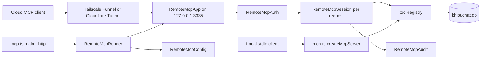
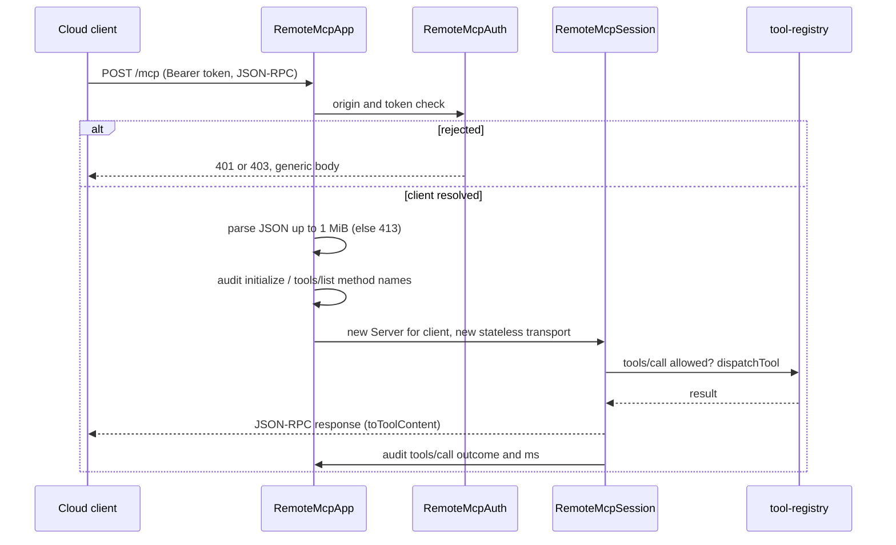

# Design Document

## Overview
**Purpose**: This feature lets cloud-hosted AI clients (for example Muse.ai) query the khipuchat archive through MCP over HTTP, with one secret token per client and an optional per-client tool allowlist.
**Users**: The archive owner, who starts `khipu mcp --http`, publishes it through Tailscale Funnel or Cloudflare Tunnel, and pastes the URL and token into a cloud client.
**Impact**: Adds an opt-in remote mode to the MCP server. The stdio server, the web UI, and the planned ingress server keep their behavior. The project rule "MCP is stdio only" becomes "MCP is stdio by default, with an opt-in HTTP mode on its own port".

### Goals
- A standard MCP client can initialize, list tools, and call tools at `https://<public host>/mcp` with `Authorization: Bearer <token>`.
- Tool results are identical to stdio for the same tool and arguments.
- Nothing is reachable without a configured client token, and nothing is logged that holds message content or secrets.

### Non-Goals
- OAuth, token management commands, hot revocation, rate limiting, TLS inside khipuchat.
- New tools or write tools.
- Sessions, server-initiated notifications, SSE streams.
- Mounting MCP on the ingress server.

## Boundary Commitments

### This Spec Owns
- The `--http` mode of `src/mcp.ts` and everything under `src/remote-mcp/`.
- Remote settings: `MCP_TOKEN_<CLIENT>`, `MCP_TOOLS_<CLIENT>`, `MCP_HTTP_HOST`, `MCP_HTTP_PORT`, `MCP_ALLOWED_ORIGINS`.
- The remote HTTP contract: `POST /mcp`, `GET /healthz`, status codes, headers, audit line format.
- `toToolContent` in `src/tool-registry.ts` (shared result formatting).
- `docs/REMOTE-MCP.md`.
- Spec and steering edits listed under Requirement 8, and decision D18 in `phase5-cross-spec-decisions.md`.

### Out of Boundary
- Secret-file resolution (`resolveSecretFiles`, cloud-deployment, D2). remote-mcp only adds a name pattern to its allowlist in the spec.
- The database location resolver (cloud-deployment `resolveDbPath`). remote-mcp uses whatever path `src/mcp.ts` uses.
- `docker-compose.yml` (cloud-deployment ComposeStack). remote-mcp adds the service to cloud-deployment's spec only.
- Tool definitions and handlers (`TOOL_DEFINITIONS`, `dispatchTool`, query and image handlers).
- Stdio `MCP_SECRET` behavior in `createMcpServer`.
- The ingress server and its isolation test.

### Allowed Dependencies
- `@modelcontextprotocol/sdk` 1.29.0 (`Server`, `StreamableHTTPServerTransport`, `McpError`, `ErrorCode`, request schemas).
- `express` 5 (already used by the web UI), `node:crypto`, `node:http`.
- `src/tool-registry.ts` (`TOOL_DEFINITIONS`, `dispatchTool`, `toToolContent`), `src/db.ts` (`initDb`, `getDb`).
- `src/remote-mcp/**` must not import `src/web/**`, `src/ingress/**`, `src/cli.ts`, or `src/mcp.ts` (the dependency points from `mcp.ts` to `remote-mcp`, never back).

### Revalidation Triggers
- A tool that writes to the archive is added to `TOOL_DEFINITIONS` (Req 5.2 would need an explicit remote denylist).
- cloud-deployment changes `resolveSecretFiles` semantics (for example, stops leaving `<NAME>_FILE` in the env) or the CLI router stops resolving secrets for `khipu mcp`.
- cloud-deployment replaces the MCP database path with `resolveDbPath()` (both modes follow automatically; re-run remote tests).
- SDK major upgrade changing `StreamableHTTPServerTransport` options.

## Architecture

### Existing Architecture Analysis
- `src/mcp.ts`: `createMcpServer()` (stdio, `MCP_SECRET` via `_meta`) and `main()` (opens `join(__dirname, '..', 'khipuchat.db')`, connects stdio).
- `src/tool-registry.ts`: single tool list and dispatch, shared with `khipu ask`.
- `src/khipu.ts`: `mcp` maps to `mcp.ts`; extra argv is forwarded.
- Web UI pattern for Express apps: `createApp()` plus `startServer(app, host, port)` with an `EADDRINUSE` exit.

### Architecture Pattern & Boundary Map



**Architecture Integration**:
- Selected pattern: stateless Streamable HTTP, one SDK Server per request, scoped to the authenticated client.
- Boundaries: config parsing (pure), auth (pure middleware), session (SDK wiring), app (HTTP composition), runner (process lifecycle).
- Existing patterns preserved: single tool registry, Express app plus start function, loopback default bind, synchronous DB.
- Steering compliance: no `any`, no new dependency, files under 200 lines, no Beeper.

### Technology Stack

| Layer | Choice / Version | Role in Feature | Notes |
|-------|------------------|-----------------|-------|
| CLI | `khipu mcp --http` | Start remote mode | No router change besides help text |
| Backend | Express 5, `@modelcontextprotocol/sdk` 1.29.0 | HTTP server and MCP transport | `StreamableHTTPServerTransport`, stateless, JSON responses |
| Data | `better-sqlite3-multiple-ciphers` | Archive reads | Same `initDb` as stdio |
| Runtime | Node.js 24, `node:crypto` | Token digests, constant-time compare | |
| Infrastructure | Tailscale Funnel / Cloudflare Tunnel | Public TLS endpoint | Operator-owned, documented only |

## File Structure Plan

### Directory Structure
```
src/
├── remote-mcp/
│   ├── config.ts        # Pure: env => RemoteMcpConfig or RemoteMcpConfigError; formatConfigError
│   ├── auth.ts          # Pure middleware factory: Origin check, bearer parse, constant-time client lookup, 401/403
│   ├── audit.ts         # Audit line formatting and writer (client, op, tool, outcome, ms); auth-failure line
│   ├── session.ts       # createRemoteMcpServer(client, audit): SDK Server with filtered tools + guarded CallTool
│   ├── app.ts           # createRemoteMcpApp(deps): headers, /healthz, auth, 1 MiB JSON body, POST /mcp, 405s, 404
│   └── runner.ts        # runRemoteMcp({ env, dbPath }): validate config, initDb, listen, startup log, warnings, stop
docs/
└── REMOTE-MCP.md        # Tokens, allowlists, start, Funnel, Cloudflare Tunnel, verify, uptime, privacy, compose
tests/
├── remote-mcp-config.test.ts
├── remote-mcp-auth.test.ts
├── remote-mcp-http.test.ts     # Real SDK client over HTTP against a seeded :memory: archive
└── remote-mcp-parity.test.ts   # Remote vs stdio results, total_changes() unchanged
```

### Modified Files
- `src/mcp.ts`: `main()` branches on `--http` to `runRemoteMcp({ env: process.env, dbPath })` (dynamic import so stdio never loads Express); CallTool uses `toToolContent`. `createMcpServer()` contract unchanged.
- `src/tool-registry.ts`: add `export function toToolContent(result: unknown): ToolContent` (moved from the inline expression in `mcp.ts`).
- `src/khipu.ts`: help text line `mcp [--http]  Start the MCP server (stdio, or remote HTTP on port 3335)`.
- `README.md`: one paragraph linking `docs/REMOTE-MCP.md`.
- `.kiro/specs/cloud-deployment/requirements.md`, `design.md`, `tasks.md`: see Requirement 8 mapping below.
- `.kiro/specs/phase5-cross-spec-decisions.md`: add D18.
- `.kiro/steering/tech.md`, `.kiro/steering/product.md`: MCP transport and privacy lines.

## System Flows



Request middleware order (fixed): security headers, `GET /healthz`, auth (all other paths, so unknown paths also need a token), JSON body parser with 1 MiB limit, `POST /mcp`, `GET|DELETE /mcp` => 405, fallback 404, error handler (500 generic).

## Requirements Traceability

| Requirement | Summary | Components | Interfaces | Flows |
|-------------|---------|------------|------------|-------|
| 1.1 | `khipu mcp --http`, `/mcp` | McpEntry, RemoteMcpApp | `runRemoteMcp` | Request |
| 1.2 | Stdio unchanged | McpEntry | `createMcpServer()` | |
| 1.3 | Own process and port | RemoteMcpRunner | | |
| 1.4 | Default `127.0.0.1:3335` | RemoteMcpConfig | `parseRemoteMcpConfig` | |
| 1.5 | Port in use exits | RemoteMcpRunner | | |
| 1.6 | Startup log without tokens | RemoteMcpRunner | `startupLines` | |
| 1.7 | Non-loopback warning | RemoteMcpRunner, RemoteMcpConfig | `isLoopbackHost` | |
| 2.1 | `MCP_TOKEN_<CLIENT>` naming | RemoteMcpConfig | | |
| 2.2, 2.3, 2.4 | No clients, short token, duplicate token | RemoteMcpConfig | `RemoteMcpConfigError` | |
| 2.5 | `_FILE` tokens | cloud-deployment SecretFileLoader (pattern added), RemoteMcpConfig (`unresolved-secret-file`) | | |
| 2.6 | Removed token rejected after restart | RemoteMcpConfig, RemoteMcpAuth | | |
| 2.7 | `MCP_SECRET` not a remote token | RemoteMcpConfig | | |
| 3.1 | Token on every path except `/healthz` | RemoteMcpApp, RemoteMcpAuth | middleware order | Request |
| 3.2 | Bearer header resolves client | RemoteMcpAuth | `createRemoteMcpAuth` | Request |
| 3.3 | 401 generic, no tool runs | RemoteMcpAuth | | Request |
| 3.4 | Constant-time compare | RemoteMcpAuth | `findClient` | |
| 3.5 | Auth-failure log | RemoteMcpAudit | `authFailureLine` | |
| 3.6, 3.7 | Origin allowlist, no Origin allowed | RemoteMcpAuth, RemoteMcpConfig | | Request |
| 4.1, 4.2, 4.3 | Default all tools, allowlist, filtered list | RemoteMcpConfig, RemoteMcpSession | `RemoteMcpClient.tools` | |
| 4.4 | Not-available error | RemoteMcpSession | | |
| 4.5, 4.6 | Unknown tool, empty list, list without token | RemoteMcpConfig | | |
| 4.7 | Same results as stdio | RemoteMcpSession, tool-registry | `toToolContent` | |
| 5.1 | Streamable HTTP | RemoteMcpSession, RemoteMcpApp | SDK transport | Request |
| 5.2 | No archive modification | RemoteMcpSession (registry tools only) | | |
| 5.3 | 413 over 1 MiB | RemoteMcpApp | | |
| 5.4 | Generic tool error, keep serving | RemoteMcpSession, RemoteMcpAudit | | |
| 5.5 | No-cache, nosniff | RemoteMcpApp | | |
| 5.6 | `/healthz` | RemoteMcpApp | | |
| 5.7 | Graceful stop 10 s | RemoteMcpRunner | | |
| 6.1, 6.2, 6.3 | Audit lines | RemoteMcpAudit, RemoteMcpSession, RemoteMcpApp | `AuditEvent` | |
| 7.1 to 7.5 | Guide | RemoteMcpDocs | | |
| 7.6 | Optional compose service | cloud-deployment ComposeStack (spec edit) | | |
| 8.1, 8.2 | cloud-deployment spec edits | SpecAlignment | | |
| 8.3 | Decision D18 | SpecAlignment | | |
| 8.4 | Steering edits | SpecAlignment | | |
| 8.5 | Ingress isolation intact | cloud-deployment IngressIsolationTest (unchanged), RemoteMcpDocs | | |

## Components and Interfaces

| Component | Layer | Intent | Req Coverage | Key Dependencies | Contracts |
|-----------|-------|--------|--------------|------------------|-----------|
| RemoteMcpConfig | Config | Parse and validate remote settings | 1.4, 1.7, 2.1 to 2.7, 3.6, 4.1, 4.2, 4.5, 4.6 | node:crypto (P0), TOOL_DEFINITIONS names (P0) | Service |
| RemoteMcpAuth | Policy | Origin and bearer checks | 3.1 to 3.7, 2.6 | RemoteMcpConfig (P0), RemoteMcpAudit (P1) | Service |
| RemoteMcpAudit | Observability | Audit and auth-failure lines | 3.5, 5.4, 6.1 to 6.3 | none | Service |
| RemoteMcpSession | Protocol | Per-request scoped MCP server | 4.3, 4.4, 4.7, 5.1, 5.2, 5.4, 6.1 | SDK (P0), tool-registry (P0) | Service |
| RemoteMcpApp | Composition | Express app and routes | 1.1, 3.1, 5.3, 5.5, 5.6, 6.3 | express (P0), Auth, Session | API |
| RemoteMcpRunner | Entrypoint | Process lifecycle | 1.3, 1.5, 1.6, 1.7, 5.7 | Config, App, db (P0) | Service |
| McpEntry | Entrypoint | `--http` branch in `mcp.ts` | 1.1, 1.2 | Runner (P0) | |
| RemoteMcpDocs | Docs | Guide | 7.1 to 7.5 | | |
| SpecAlignment | Docs | Spec and steering edits | 2.5, 7.6, 8.1 to 8.5 | | |

### Config

#### RemoteMcpConfig (`src/remote-mcp/config.ts`)

**Responsibilities & Constraints**
- Client discovery: every env key starting with `MCP_TOKEN_` and not ending in `_FILE`. The suffix must match `^[A-Z0-9_]{1,32}$`, else `invalid-client-name`. Client name = suffix lowercased.
- For each key `MCP_TOKEN_<C>_FILE` present while `MCP_TOKEN_<C>` is absent or empty: `unresolved-secret-file` (the CLI router's loader did not run).
- Token: raw value, length >= 32 else `token-too-short`; stored only as its SHA-256 digest. Two clients with equal digests: `duplicate-token`.
- `MCP_SECRET` is never read (2.7).
- Allowlist `MCP_TOOLS_<C>`: split on commas, trim, drop nothing silently; empty after trim => `empty-allowlist`; name not in the known tool names => `unknown-tool`; key with no matching client => `allowlist-without-token`. Absent => all known tools, `allowlisted: false`.
- `MCP_HTTP_HOST` default `127.0.0.1`; `MCP_HTTP_PORT` default 3335, integer 1 to 65535 else `invalid-port`.
- `MCP_ALLOWED_ORIGINS`: comma list, each normalized (lowercase, trailing `/` removed); default empty.
- Errors are reported in a fixed order (first error wins) so messages are deterministic. No error carries a token value.

**Contracts**: Service [x]

```typescript
export interface RemoteMcpClient {
  readonly name: string               // lowercase, e.g. 'muse'
  readonly setting: string            // 'MCP_TOKEN_MUSE'
  readonly tokenDigest: Buffer        // sha256(token)
  readonly tools: ReadonlySet<string>
  readonly allowlisted: boolean
}

export interface RemoteMcpConfig {
  readonly host: string
  readonly port: number
  readonly clients: readonly RemoteMcpClient[]
  readonly allowedOrigins: ReadonlySet<string>
}

export type RemoteMcpConfigError =
  | { readonly kind: 'no-clients' }
  | { readonly kind: 'invalid-client-name'; readonly setting: string }
  | { readonly kind: 'unresolved-secret-file'; readonly setting: string }
  | { readonly kind: 'token-too-short'; readonly setting: string }
  | { readonly kind: 'duplicate-token'; readonly settings: readonly [string, string] }
  | { readonly kind: 'empty-allowlist'; readonly setting: string }
  | { readonly kind: 'unknown-tool'; readonly setting: string; readonly tool: string }
  | { readonly kind: 'allowlist-without-token'; readonly setting: string }
  | { readonly kind: 'invalid-port'; readonly value: string }

export type RemoteMcpConfigResult =
  | { readonly ok: true; readonly config: RemoteMcpConfig }
  | { readonly ok: false; readonly error: RemoteMcpConfigError }

export function parseRemoteMcpConfig(
  env: NodeJS.ProcessEnv,
  knownTools: readonly string[],
): RemoteMcpConfigResult

export function formatConfigError(error: RemoteMcpConfigError): string
export function isLoopbackHost(host: string): boolean   // 127.0.0.0/8, ::1, localhost
```
- Preconditions: `env` already passed through the CLI router's secret resolution when started via `khipu`.
- Postconditions: `clients.length >= 1` on success; every `tools` set is a non-empty subset of `knownTools`.

### Policy

#### RemoteMcpAuth (`src/remote-mcp/auth.ts`)

**Responsibilities & Constraints**
- Step 1, Origin: if an `Origin` header is present and its normalized value is not in `allowedOrigins`, respond 403 `{"error":"forbidden"}`, reason `origin`.
- Step 2, token: accept only `Authorization: Bearer <token>` (scheme case-insensitive, single space, non-empty token). Missing header => `missing` (or `query-token` when the query string has a key among `token`, `access_token`, `key`, `auth`); other shapes => `malformed`; no match => `unknown-token`. All respond 401 `{"error":"unauthorized"}` with `WWW-Authenticate: Bearer`.
- Lookup: digest the presented token once, compare with `timingSafeEqual` against every client digest, no early exit; pick the matching client after the loop.
- On success sets `res.locals.remoteClient: RemoteMcpClient`. Never logs or echoes the presented value.

```typescript
export function createRemoteMcpAuth(deps: {
  readonly config: RemoteMcpConfig
  readonly audit: RemoteMcpAudit
}): RequestHandler

export function findClient(
  clients: readonly RemoteMcpClient[],
  presentedToken: string,
): RemoteMcpClient | undefined
```

### Observability

#### RemoteMcpAudit (`src/remote-mcp/audit.ts`)

- One line per event to stderr, prefixed `[remote-mcp]`, key=value fields, ISO timestamp.
- Tool call: `ts=... client=muse op=tools/call tool=search_messages outcome=ok ms=12`.
- Other ops: `op=initialize` or `op=tools/list`, no tool, no outcome.
- Auth failure: `ts=... op=auth-failed reason=unknown-token method=POST path=/mcp addr=100.64.0.3` (path without query).
- Tool error: `op=tools/call outcome=error` plus a separate `op=tool-error client=... tool=... message=<error type>` line. Only the thrown error's type name (for example `Error`, `SqliteError`) is logged, because tool error messages can echo argument values such as ids or search text (Req 6.2). Nothing about the error is sent to the client.

```typescript
export type AuditOutcome = 'ok' | 'error' | 'denied'
export type AuthFailureReason = 'origin' | 'missing' | 'malformed' | 'unknown-token' | 'query-token'  // owned here; auth.ts imports it

export type AuditEvent =
  | { readonly op: 'initialize' | 'tools/list'; readonly client: string }
  | { readonly op: 'tools/call'; readonly client: string; readonly tool: string; readonly outcome: AuditOutcome; readonly ms: number }
  | { readonly op: 'tool-error'; readonly client: string; readonly tool: string; readonly message: string }
  | { readonly op: 'auth-failed'; readonly reason: AuthFailureReason; readonly method: string; readonly path: string; readonly addr: string }

export interface RemoteMcpAudit { record(event: AuditEvent): void }
export function formatAuditLine(event: AuditEvent, now: Date): string
export function createStderrAudit(write?: (line: string) => void): RemoteMcpAudit
```
- Invariant: `AuditEvent` has no field for arguments, results, or tokens (6.2 enforced by type).

### Protocol

#### RemoteMcpSession (`src/remote-mcp/session.ts`)

- Builds `new Server({ name: 'khipuchat', version }, { capabilities: { tools: {} } })` per request.
- ListTools: `TOOL_DEFINITIONS.filter(t => client.tools.has(t.name))`.
- CallTool: if `name` not in `client.tools` (including names that are not tools), throw `McpError(ErrorCode.InvalidParams, 'Tool not available')` and audit `denied`. Else `dispatchTool(name, args)`, return `toToolContent(result)`, audit `ok` with duration. On thrown error: audit `error` and `tool-error`, throw `McpError(ErrorCode.InternalError, 'Tool failed')`.
- No `_meta` auth (authentication happened in the HTTP layer).

```typescript
export function createRemoteMcpServer(client: RemoteMcpClient, audit: RemoteMcpAudit): Server
```

#### Shared formatter (`src/tool-registry.ts`)
```typescript
export interface ToolContent { content: { type: 'text'; text: string }[] }
export function toToolContent(result: unknown): ToolContent  // { content: [{ type: 'text', text: JSON.stringify(result) }] }
```

### Composition

#### RemoteMcpApp (`src/remote-mcp/app.ts`)

##### API Contract
| Method | Endpoint | Auth | Request | Response | Errors |
|--------|----------|------|---------|----------|--------|
| GET | /healthz | none | | 200 `{"status":"ok"}` | 503 `{"status":"unavailable"}` |
| POST | /mcp | Bearer | JSON-RPC message, at most 1 MiB | JSON-RPC response (`application/json`) | 401, 403, 413, 415 (Content-Type the SDK would not accept, or unsupported charset), 400 (invalid JSON), 500 |
| GET, DELETE | /mcp | Bearer | | | 405 with `Allow: POST` |
| any | other | Bearer | | | 404 `{"error":"not found"}` |

- Every response: `Cache-Control: no-store`, `X-Content-Type-Options: nosniff`.
- `/healthz` runs `SELECT 1 FROM messages LIMIT 1` through `getDb()`; any throw => 503. Body never includes error text.
- `POST /mcp`: read `res.locals.remoteClient`; audit `initialize` / `tools/list` for each JSON-RPC object in the body with that `method`; create session server and `new StreamableHTTPServerTransport({ sessionIdGenerator: undefined, enableJsonResponse: true })`; `await server.connect(transport)`; `await transport.handleRequest(req, res, req.body)`; on `res` close, close transport and server.
- Error handler: 413 for `entity.too.large`, 400 for JSON parse errors, else 500 `{"error":"internal error"}`, details logged only.

```typescript
export interface RemoteMcpAppDeps {
  readonly config: RemoteMcpConfig
  readonly audit: RemoteMcpAudit
  readonly healthCheck: () => boolean
}
export function createRemoteMcpApp(deps: RemoteMcpAppDeps): Application
```

### Entrypoint

#### RemoteMcpRunner (`src/remote-mcp/runner.ts`)

- `parseRemoteMcpConfig(env, TOOL_DEFINITIONS.map(t => t.name))`; on error write `formatConfigError` to stderr and return 1.
- `initDb(dbPath)`; build app; `listen(port, host)`. `EADDRINUSE` => message naming `host:port`, return 1.
- Startup log: `remote MCP listening on http://<host>:<port>/mcp`, then one line per client `client=<name> tools=<n>/<total>`. If `!isLoopbackHost(host)`: warning that the endpoint is reachable from the network without TLS.
- SIGINT/SIGTERM: `server.close()`; after 10 s `server.closeAllConnections()`; resolve 0.

```typescript
export function runRemoteMcp(opts: {
  readonly env: NodeJS.ProcessEnv
  readonly dbPath: string
  readonly signals?: NodeJS.EventEmitter   // test injection; default process
}): Promise<number>
```

#### McpEntry (`src/mcp.ts` change)
- `main()`: compute `dbPath` as today. If `process.argv.slice(2).includes('--http')`: `const { runRemoteMcp } = await import('./remote-mcp/runner')`; `process.exitCode = await runRemoteMcp({ env: process.env, dbPath })`; return. Else the existing stdio path, unchanged.

### Docs

#### RemoteMcpDocs (`docs/REMOTE-MCP.md`)
Sections: What it is and when to use it; Generate a token (`openssl rand -hex 32`); Configure clients (`MCP_TOKEN_MUSE`, optional `MCP_TOOLS_MUSE=search_messages,list_chats,get_chat_summary`, `.env` or `_FILE` via `khipu`); Start (`khipu mcp --http`, settings table); Publish with Tailscale Funnel (`tailscale funnel --bg 3335`, why Serve alone is tailnet-only and unreachable from cloud services); Publish with Cloudflare Tunnel (`cloudflared tunnel` ingress rule to `http://127.0.0.1:3335`); Verify (`curl https://<host>/healthz`, `curl -X POST https://<host>/mcp` without token => 401, with token an `initialize` request => 200); Connect a cloud client (URL `https://<host>/mcp`, header `Authorization: Bearer <token>`; clients requiring OAuth are not supported); Uptime (Mac must be awake; server deployment via cloud-deployment, macOS-only sources still sync from the Mac); Privacy (clients read whatever their tools return; tokens are credentials until removed; revoke by deleting the setting and restarting; audit log format); Docker compose (`docker compose --profile remote-mcp up -d mcp-http`, once cloud-deployment lands).

### SpecAlignment (Requirement 8 and 2.5, 7.6)
- `cloud-deployment/requirements.md`: Boundary "Adjacent expectations" sentence becomes "The MCP server is reachable over stdio and, only when started with `--http`, through the remote MCP endpoint (remote-mcp) on its own port; it is never reachable through the ingress." Req 10.3 becomes "The MCP server shall not be reachable through the ingress server; remote HTTP access is provided only by the remote MCP endpoint defined in remote-mcp." Req 6.7 adds `every name matching ^MCP_TOKEN_[A-Z0-9_]+$`. New compose criterion (numbered Req 4.5 in cloud-deployment) "Where the operator enables the `remote-mcp` compose profile, the compose definition shall run `khipu mcp --http` as service `mcp-http`, publish its port only on the host loopback interface, and health-check it through `/healthz`."
- `cloud-deployment/design.md`: SecretFileLoader patterns add `^MCP_TOKEN_[A-Z0-9_]+$`; Non-Goals line "MCP transport (stays stdio)" and steering-compliance line updated; ComposeStack gains the `mcp-http` profile service (`MCP_HTTP_HOST=0.0.0.0` inside the container, `127.0.0.1:3335:3335` published); line 926 updated to mention the profile.
- `cloud-deployment/tasks.md`: task 1.4 lists the new pattern; task 3.5 replaces "MCP server still connects only through the stdio transport" with "the ingress closure contains neither the MCP server nor `src/remote-mcp/**`" and adds `src/remote-mcp/**` to its forbidden modules; task 7.2 owns the `mcp-http` profile service; task 7.3 describes three secret name patterns and adds `MCP_HTTP_HOST`, `MCP_HTTP_PORT`, `MCP_ALLOWED_ORIGINS` to the env template.
- `phase5-cross-spec-decisions.md`: D18 "Remote MCP endpoint: owner remote-mcp" with the rules above (own process and port, ingress isolation unchanged, `MCP_TOKEN_*` pattern in D2 allowlist, compose profile owned by cloud-deployment ComposeStack).
- `steering/tech.md`: MCP row "stdio by default; opt-in Streamable HTTP via `khipu mcp --http` (remote-mcp)"; `steering/product.md`: Value Proposition adds that remote MCP, when enabled, sends tool results to the configured cloud clients.

## Error Handling

### Error Strategy
- Startup errors (config, port) exit non-zero with one stderr message naming the setting; never a token value.
- Request errors map to fixed generic bodies; detail goes only to the audit log.

### Error Categories and Responses
| Case | Response | Log |
|------|----------|-----|
| Disallowed Origin | 403 `{"error":"forbidden"}` | `auth-failed reason=origin` |
| Missing / malformed / unknown / query token | 401 `{"error":"unauthorized"}`, `WWW-Authenticate: Bearer` | `auth-failed reason=...` |
| Body over 1 MiB | 413 `{"error":"payload too large"}` | none |
| Invalid JSON | 400 `{"error":"bad request"}` | none |
| Body not parsed as JSON (Content-Type without `application/json`, unsupported charset or encoding) | 415 `{"error":"unsupported media type"}`, before any audit or transport | none |
| Tool outside allowlist | JSON-RPC error `InvalidParams` "Tool not available" | `tools/call outcome=denied` |
| Tool throws | JSON-RPC error `InternalError` "Tool failed" | `outcome=error` + `tool-error` |
| Unexpected middleware error | 500 `{"error":"internal error"}` | error message |
| Archive unreadable | `/healthz` 503 | none |

### Monitoring
`/healthz` for tunnel and compose health checks; audit lines on stderr (captured by the terminal, launchd, or `docker logs`).

## Testing Strategy

### Unit Tests
- `remote-mcp-config.test.ts`: defaults (2.1, 1.4); each `RemoteMcpConfigError` kind (2.2, 2.3, 2.4, 4.5, 4.6, invalid port, invalid client name); `_FILE` key ignored for discovery and `unresolved-secret-file` raised (2.5); `MCP_SECRET` alone => `no-clients` (2.7); allowlist parsing and default all tools (4.1, 4.2); `formatConfigError` output never contains the token; `isLoopbackHost` cases (1.7).
- `remote-mcp-auth.test.ts`: bearer accepted, scheme case-insensitive (3.2); missing, malformed, Basic, unknown, query-only token => 401 with identical body and correct reason (3.3, 3.5); Origin disallowed => 403, absent Origin + valid token passes (3.6, 3.7); `findClient` checks all clients (3.4); removed client's token unknown after re-parse (2.6).
- Audit formatting: tool-call line fields, auth line strips query string, no argument fields exist (6.1, 6.2, 3.5).

### Integration Tests
- `remote-mcp-http.test.ts` (seeded `:memory:` archive, app on an ephemeral port, real SDK `Client` + `StreamableHTTPClientTransport` with `requestInit.headers`): initialize, list tools, call `list_chats` (5.1); allowlisted client sees only its tools and gets "Tool not available" for others and for nonexistent names (4.3, 4.4); `/healthz` 200 without auth and 503 when `healthCheck` returns false (5.6); unknown path without token 401, with token 404 (3.1); 1.5 MiB body => 413 and no tool runs (5.3); headers present on 200, 401, 404 (5.5); `GET /mcp` => 405; a dispatch that throws yields generic error and the next request succeeds (5.4); audit records for initialize, tools/list, tools/call contain no arguments (6.1 to 6.3).
- `remote-mcp-parity.test.ts`: every tool in `TOOL_DEFINITIONS` called with the same arguments through stdio `createMcpServer()` handler and through HTTP returns identical `content` (4.7); `SELECT total_changes()` unchanged across all remote calls (5.2).
- Runner: config error returns 1 with message (2.2); port in use returns 1 naming the address (1.5); startup lines list clients and tool counts, no token text (1.6); non-loopback host warning (1.7); injected SIGTERM resolves 0 and in-flight request completes (5.7).

### Regression
- Existing `tests/mcp.test.ts`, `tests/security.test.ts` (stdio `MCP_SECRET`), and `tests/ask-parity.test.ts` pass unchanged (1.2).
- Manual end-to-end (recorded in the docs task): `khipu mcp --http` + `tailscale funnel --bg 3335`, `curl` checks through the public URL (7.3).

## Security Considerations
- Threats: token guessing (32-char minimum, constant-time compare), token leakage via URLs or logs (query tokens rejected, never logged), browser-driven requests via DNS rebinding or CSRF (Origin allowlist, no cookies, bearer only), information leakage via errors (generic bodies), over-sharing (per-client allowlist, documented privacy note).
- The tunnel terminates TLS; plain HTTP never leaves loopback unless the operator overrides the host, which logs a warning.
- Data minimization is the operator's choice through allowlists; `get_image` returns image bytes and can be excluded per client.
