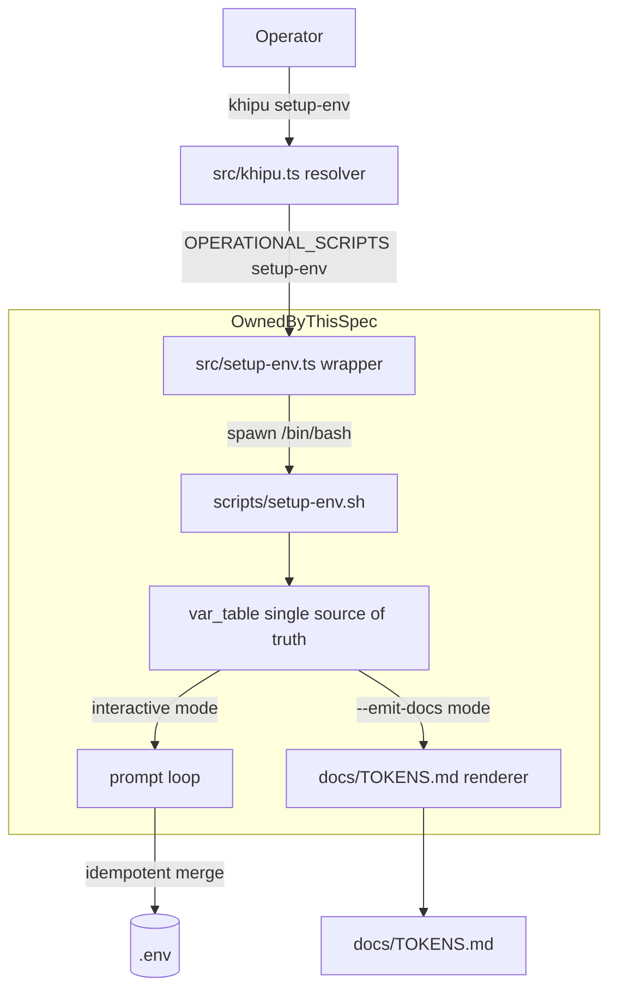
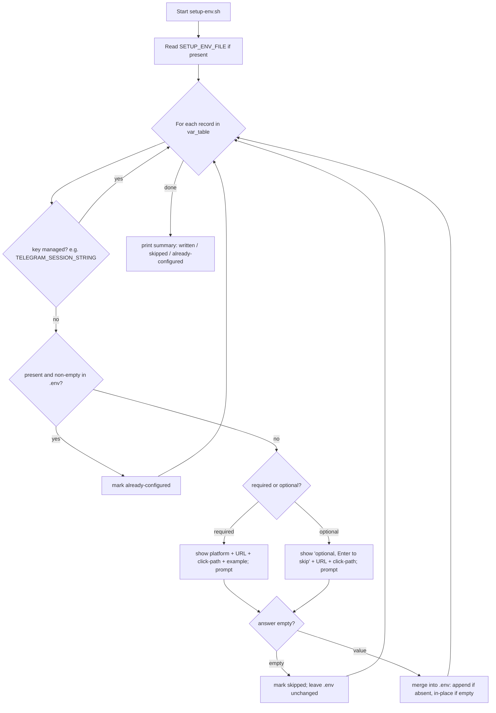

# Design Document: setup-wizard

## Overview

**Purpose**: This feature delivers a single interactive path from a fresh clone to a working
`.env`, so new KhipuChat operators no longer hand-edit credentials or hunt across the internet
to learn where each one comes from.

**Users**: KhipuChat operators setting up single-account credentials will run `khipu setup-env`,
which inspects `.env`, prompts only for missing/empty recognised variables, and shows a precise
acquisition URL + click-path + field-to-copy for each. Maintainers benefit from a single
declarative variable table that drives both the prompts and the generated `docs/TOKENS.md`.

**Impact**: Adds one operational subcommand (`khipu setup-env`) backed by a POSIX bash script,
one generated reference doc (`docs/TOKENS.md`), and expands `.env.example` to list every
recognised variable. It changes no schema, adapter, MCP tool, CLI query, or web code.

### Goals
- Expose a discoverable `khipu setup-env` command alongside `setup-claude` / `setup-sync` (R1).
- Detect missing/empty recognised variables and prompt only for those (R2).
- Show a precise acquisition URL + click-path + field-to-copy on every prompt (R3).
- Offer optional security variables with an explicit skip affordance (R4).
- Merge answers into `.env` idempotently, never clobbering or reordering existing content (R5).
- Drive prompts and `docs/TOKENS.md` from one declarative variable table so they never drift
  (R6, R7).
- Expand `.env.example` to list every recognised variable with a comment link (R8).
- Run under macOS `/bin/bash` 3.2 and Linux with no dependencies and no network calls (R9).

### Non-Goals
- Generating or OAuth-ing tokens on the operator's behalf.
- Validating a pasted credential against any live service (no network calls).
- Any GUI/TUI beyond simple line prompts.
- Authoring or editing `khipu.config.json` multi-account registries.
- Changing how any adapter reads its credentials.

## Boundary Commitments

### This Spec Owns
- The `scripts/setup-env.sh` interactive filler: the declarative variable table, the missing/empty
  detection, the per-variable prompts, the idempotent `.env` merge, and the `--emit-docs` renderer.
- The thin `src/setup-env.ts` wrapper that spawns the bash script.
- The generated `docs/TOKENS.md` reference document (a build artifact of the same table).
- The `khipu setup-env` router entry and its USAGE line.
- The expanded `.env.example` template listing every recognised variable with comment links.

### Out of Boundary
- Token/credential generation or OAuth flows.
- Live credential verification / any network call.
- `khipu.config.json` multi-account authoring (owned by the multi-account spec).
- The authoritative variable-to-platform mapping logic in `account-registry.ts` (this spec mirrors
  that list; it does not redefine credential resolution).
- Writing `TELEGRAM_SESSION_STRING` (owned by `config.ts#saveSessionString` at Telegram login).

### Allowed Dependencies
- `src/khipu.ts` `OPERATIONAL_SCRIPTS` map and `spawnScript` mechanism (router registration).
- The recognised variable list as pinned by `src/account-registry.ts#LEGACY_ENV_VARS` and the
  optional security vars documented in steering `tech.md`.
- Node's `child_process.spawn` and `/bin/bash` (already present on macOS/Linux). No new npm deps.

### Revalidation Triggers
- A new platform or credential variable is added to `account-registry.ts` (the table and
  `.env.example` must gain the new entry).
- A platform's credential acquisition URL or click-path changes (update the table; regenerate the
  doc).
- The `khipu` router's operational-subcommand contract changes shape.
- `docs/TOKENS.md` is edited by hand instead of via `--emit-docs` (drift test will fail).

## Architecture

### Existing Architecture Analysis
- `src/khipu.ts` exposes a pure `resolveCommand(argv)` resolver and an impure `spawnScript(script,
  args)` that runs `process.execPath tsx <script>` with inherited stdio. Operational subcommands
  are a `Record<string,string>` map (`OPERATIONAL_SCRIPTS`) from subcommand to a `src/*.ts` file.
- `setup-claude.ts` and `setup-sync.ts` are precedents: thin TS scripts doing OS-level work with
  `console.log` UX and `process.exit(code)`.
- The recognised single-account variables are pinned in `account-registry.ts` (`LEGACY_ENV_VARS`)
  plus the local-only platforms (imessage, whatsapp — no env vars) and the optional security vars.

This feature follows the established seam exactly: register one operational script; the script
itself is a thin wrapper that spawns the bash engine.

### Architecture Pattern & Boundary Map



**Architecture Integration**:
- Selected pattern: **thin TS wrapper + self-contained bash engine**. The wrapper satisfies the
  router's TS-script contract; the bash engine holds all logic and the single-source table.
- Domain/feature boundaries: the wrapper only spawns; the engine owns table + prompts + merge +
  docs. `.env` and `docs/TOKENS.md` are the only writable outputs.
- Existing patterns preserved: `OPERATIONAL_SCRIPTS` registration, `spawnScript` stdio-inherit,
  `console.log` UX, `process.exit` codes.
- New components rationale: bash engine is required by the POSIX-bash constraint; the wrapper is
  required to bridge the TS router to bash.
- Steering compliance: no new deps, self-hosted, no network calls, synchronous.

### Technology Stack

| Layer | Choice / Version | Role in Feature | Notes |
|-------|------------------|-----------------|-------|
| CLI | Node 20+ `tsx` (`src/khipu.ts`, `src/setup-env.ts`) | Route `setup-env`; spawn bash | Existing runtime |
| Engine | POSIX `bash` 3.2+ (`scripts/setup-env.sh`) | Table, prompts, merge, docs emit | macOS default `/bin/bash` |
| Data / Storage | Local `.env` (read/merge/write) | Persisted single-account credentials | Order + comments preserved |
| Docs | Generated `docs/TOKENS.md` | Reference of the same table | Build artifact, committed |
| Infrastructure / Runtime | `child_process.spawn` + `/bin/bash` | Interactive stdio bridge | No new npm deps |

## File Structure Plan

### Directory Structure
```
scripts/
└── setup-env.sh          # NEW: bash engine — var_table (single source), prompt loop,
                          #      idempotent .env merge, --emit-docs renderer
src/
├── khipu.ts              # MODIFIED: add 'setup-env' to OPERATIONAL_SCRIPTS + USAGE line
└── setup-env.ts          # NEW: thin wrapper — spawn /bin/bash scripts/setup-env.sh, exit(code)
docs/
└── TOKENS.md             # NEW (generated): per-platform acquisition reference
tests/
└── setup-env.test.ts     # NEW: resolver routing + bash merge/emit/idempotency integration tests
.env.example             # MODIFIED: list every recognised variable with comment links
```

### Modified Files
- `src/khipu.ts` — add `'setup-env': 'setup-env.ts'` to `OPERATIONAL_SCRIPTS`; add a
  `setup-env` line to the `USAGE` "Operational commands" block.
- `.env.example` — replace the four-line Telegram-only template with the full recognised set
  (Telegram incl. auto-managed `TELEGRAM_SESSION_STRING`, Discord, Slack, Email/IMAP, Beeper) plus
  optional security vars, each with a comment link or a `docs/TOKENS.md` pointer.

## System Flows

### Interactive fill flow


Gating notes: managed keys are never prompted (R2.5). Both required and optional prompts are
skippable via empty input (R4.2); the required/optional distinction changes only the label and
messaging. The merge step never touches populated keys, comments, or ordering (R5.3).

### Docs emit flow
`setup-env.sh --emit-docs` iterates the same `var_table` records and writes a grouped-by-platform
markdown table to `SETUP_ENV_DOCS` (default `docs/TOKENS.md`), including URL, click-path, example,
and required/optional status for each variable (R6.2, R7).

## Requirements Traceability

| Requirement | Summary | Components | Flows |
|-------------|---------|------------|-------|
| 1.1–1.4 | Discoverable `khipu setup-env` command | `src/khipu.ts` router, `src/setup-env.ts` wrapper | — |
| 2.1–2.5 | Detect missing/empty; skip configured & managed | `setup-env.sh` read + detection | Interactive fill flow |
| 3.1–3.7 | Precise acquisition guidance per prompt | `var_table`, prompt loop | Interactive fill flow |
| 4.1–4.4 | Optional vars with skip affordance; no live validation | `var_table` (required flag), prompt loop | Interactive fill flow |
| 5.1–5.6 | Idempotent, non-destructive `.env` merge + summary | `setup-env.sh` merge | Interactive fill flow |
| 6.1–6.3 | Single source-of-truth table drives prompts + docs | `var_table`, `--emit-docs` | Docs emit flow |
| 7.1–7.3 | `docs/TOKENS.md` reference | `--emit-docs` renderer | Docs emit flow |
| 8.1–8.3 | Complete `.env.example` | `.env.example` | — |
| 9.1–9.3 | Bash 3.2 portability; no network calls | `setup-env.sh` | Both flows |

## Components and Interfaces

| Component | Domain/Layer | Intent | Req Coverage | Key Dependencies | Contracts |
|-----------|--------------|--------|--------------|------------------|-----------|
| khipu router entry | CLI | Route `setup-env` to wrapper + USAGE | 1 | `OPERATIONAL_SCRIPTS`, `spawnScript` | State |
| setup-env wrapper | CLI | Spawn bash engine, propagate exit | 1 | `child_process.spawn`, `/bin/bash` | Service |
| var_table | Engine | Single source of truth records | 3, 6, 7, 8 | none | Data |
| prompt loop | Engine | Detect, prompt, merge | 2, 3, 4, 5 | var_table, `.env` | Batch |
| emit-docs renderer | Engine | Render docs from table | 6, 7 | var_table | Batch |

### CLI Layer

#### khipu router entry (`src/khipu.ts`)
| Field | Detail |
|-------|--------|
| Intent | Make `khipu setup-env` discoverable and routable |
| Requirements | 1.1, 1.2, 1.3, 1.4 |

**Responsibilities & Constraints**
- Add `'setup-env': 'setup-env.ts'` to `OPERATIONAL_SCRIPTS` so `resolveCommand` returns
  `{kind:'run', script: <src>/setup-env.ts, args}` and `spawnScript` runs it.
- Add a `setup-env` line to the `USAGE` "Operational commands" block, e.g.
  `setup-env                  Interactively fill .env (missing credentials)`.
- No change to the `CommandResolution` shape or `spawnScript`.

**Contracts**: State [x]

#### setup-env wrapper (`src/setup-env.ts`)
| Field | Detail |
|-------|--------|
| Intent | Bridge the TS router to the bash engine |
| Requirements | 1.1, 1.3, 1.4 |

**Responsibilities & Constraints**
- Resolve `PROJECT_ROOT` from `__dirname` (mirrors `setup-claude.ts`) and the script path
  `scripts/setup-env.sh`.
- Spawn `/bin/bash scripts/setup-env.sh` with `stdio: 'inherit'` and `cwd: PROJECT_ROOT` so the
  engine reads/writes the project's `.env`.
- On child close, `process.exit(code ?? 1)` so success/failure propagates (R1.3, R1.4).

**Contracts**: Service [x]

##### Service Interface
```typescript
// src/setup-env.ts — no exported API; CLI entrypoint only
// spawn('/bin/bash', [scriptPath], { stdio: 'inherit', cwd: PROJECT_ROOT })
// child.on('close', code => process.exit(code ?? 1))
```
- Preconditions: `/bin/bash` exists; `scripts/setup-env.sh` present and executable-or-invocable.
- Postconditions: process exit code equals the bash engine's exit code.
- Invariants: the wrapper performs no `.env` I/O itself.

### Engine Layer (`scripts/setup-env.sh`)

#### var_table (single source of truth)
| Field | Detail |
|-------|--------|
| Intent | Emit one pipe-delimited record per recognised variable |
| Requirements | 3.1–3.7, 6.1, 8.1 |

**Responsibilities & Constraints**
- A shell function `var_table` prints records to stdout; both the prompt loop and the docs renderer
  consume it, guaranteeing no drift (R6.3).
- Record schema (pipe-delimited, one per line):
  `key|platform|required|url|example|click_path`
  where `required` is `1` (required) or `0` (optional), and `click_path` uses ` => ` between steps.
- bash-3.2 safe: records are plain text parsed with `while IFS='|' read -r key platform required
  url example click_path`. No associative arrays.

**Record set** (the authoritative recognised variables):

| key | platform | required | url | example |
|-----|----------|----------|-----|---------|
| `TELEGRAM_API_ID` | Telegram | 1 | https://my.telegram.org/apps | `1234567` |
| `TELEGRAM_API_HASH` | Telegram | 1 | https://my.telegram.org/apps | `0123456789abcdef0123456789abcdef` |
| `TELEGRAM_PHONE_NUMBER` | Telegram | 1 | https://my.telegram.org/apps | `+14155552671` |
| `DISCORD_TOKEN` | Discord | 1 | https://discord.com/developers/applications | `MTk4N...` (bot token) |
| `SLACK_USER_TOKEN` | Slack | 1 | https://api.slack.com/apps | `xoxp-...` |
| `EMAIL_IMAP_HOST` | Email/IMAP | 1 | (provider docs; Gmail: imap.gmail.com) | `imap.gmail.com` |
| `EMAIL_IMAP_USER` | Email/IMAP | 1 | (provider account) | `you@gmail.com` |
| `EMAIL_IMAP_PASS` | Email/IMAP | 1 | https://myaccount.google.com/apppasswords | `abcd efgh ijkl mnop` (app password) |
| `BEEPER_ACCESS_TOKEN` | Beeper (Signal / Facebook Messenger) | 1 | Beeper Desktop app | `(token from Beeper Desktop)` |
| `DB_KEY` | Security (optional) | 0 | steering: security-hardening | `(SQLCipher passphrase)` |
| `WEB_USER` | Security (optional) | 0 | operator-chosen | `admin` |
| `WEB_PASS` | Security (optional) | 0 | operator-chosen | `(web basic-auth password)` |
| `MCP_SECRET` | Security (optional) | 0 | operator-chosen | `(MCP bearer token)` |

`TELEGRAM_SESSION_STRING` is **not** a table record (never prompted); it appears only in
`.env.example` and `docs/TOKENS.md` as an auto-managed note (R2.5).

**Click-path text (verified 2026-08-01)** — carried in the `click_path` column:
- Telegram: `Open https://my.telegram.org => log in with your phone (+countrycode) and the code
  sent in your Telegram app => click "API development tools" => copy the "App api_id" and "App
  api_hash" fields`.
- Discord: `Open https://discord.com/developers/applications => New Application => Bot => Reset
  Token => Copy. Enable "Message Content Intent" if reading message text`.
- Slack: `Open https://api.slack.com/apps => Create New App => From scratch => OAuth & Permissions
  => add User Token Scopes (channels:history, groups:history, im:history, mpim:history, users:read)
  => Install to Workspace => copy the "User OAuth Token" starting with xoxp-`.
- Email/IMAP: `Use your provider's IMAP host (Gmail: imap.gmail.com, port 993 SSL). Enable 2-Step
  Verification, then create an App Password at https://myaccount.google.com/apppasswords and use
  it as EMAIL_IMAP_PASS (your normal password will not work)`.
- Beeper: `Open Beeper Desktop => Settings => Integrations => click "+" next to Approved
  connections => create the token. This token backs Signal and Facebook Messenger`.
- Security vars: operator-chosen; see steering security-hardening notes.

**Contracts**: Batch [x]

#### prompt loop
| Field | Detail |
|-------|--------|
| Intent | Detect missing/empty, prompt, and merge answers |
| Requirements | 2.1–2.4, 3.1, 4.1–4.4, 5.1–5.6 |

**Responsibilities & Constraints**
- Read `SETUP_ENV_FILE` (default `.env`); build a lookup of currently populated keys. A key is
  "configured" iff a line matches `^KEY=` and the value after `=` is non-empty (R2.2).
- For each table record: skip if configured; otherwise show the platform, URL, click-path, and
  example (required) or the optional/skip label (optional), then `IFS= read -r answer`.
- Empty answer => skip, `.env` unchanged (R4.2, R5.4). Non-empty => merge (below).
- Accept values as-is; never call out to a network (R4.4, R9.3).
- Merge (order-preserving, non-clobbering): rewrite the env file through a temp file — for an
  answered key present with an empty value, replace that single line in place; for an absent key,
  append at end; copy all populated keys, comments, and blank lines verbatim; `mv` temp over
  original only at the end (R5.1–5.3). Write values with `printf '%s'`.
- Print a final summary listing written / skipped / already-configured keys (R5.5).

**Contracts**: Batch [x] State [x]

##### Batch / Job Contract
- Trigger: `scripts/setup-env.sh` (no args) or via `khipu setup-env`.
- Input / validation: existing `SETUP_ENV_FILE`; stdin answers (tests pipe them).
- Output / destination: merged `SETUP_ENV_FILE`; human-readable summary on stdout.
- Idempotency & recovery: re-running only prompts for still-missing/empty keys; providing nothing
  makes no changes (R5.6).

#### emit-docs renderer
| Field | Detail |
|-------|--------|
| Intent | Render `docs/TOKENS.md` from the same table |
| Requirements | 6.2, 6.3, 7.1–7.3 |

**Responsibilities & Constraints**
- `scripts/setup-env.sh --emit-docs` iterates `var_table` and writes grouped-by-platform markdown
  to `SETUP_ENV_DOCS` (default `docs/TOKENS.md`): per variable a URL, click-path, example, and
  required/optional status, plus the `TELEGRAM_SESSION_STRING` auto-managed note.
- The committed `docs/TOKENS.md` must equal a fresh `--emit-docs` (drift test).

**Contracts**: Batch [x]

## Error Handling

### Error Strategy
- **Missing `/bin/bash`**: extremely unlikely on macOS/Linux; the wrapper's spawn error surfaces a
  non-zero exit (R1.4). No fallback shell is attempted (out of scope).
- **`.env` unreadable/unwritable**: the engine reports the path and exits non-zero; no partial write
  because the merge only `mv`s the temp file after a full successful rewrite.
- **Malformed existing `.env` line** (no `=`): treated as opaque content and copied verbatim
  (comments/blank lines preserved, R5.3).
- **User errors**: empty input is a valid "skip", not an error (R4.2). No value is validated against
  a live service (R4.4).

### Error Categories and Responses
- User Errors: empty answer => skip; no destructive action.
- System Errors: I/O failure => report path, non-zero exit, no partial `.env`.
- Business Logic Errors: none — there is no external state to conflict with.

### Monitoring
- Human-readable summary of written/skipped/already-configured keys is the observable signal; the
  exit code reflects success/failure for scripted use.

## Testing Strategy

### Unit / Resolver Tests (Vitest, `tests/setup-env.test.ts`)
- `resolveCommand(['setup-env'])` returns `{kind:'run'}` with `script` ending in `setup-env.ts`
  (R1.1).
- `resolveCommand(['--help'])` / no-arg help text contains a `setup-env` line (R1.2).

### Integration Tests (bash invoked from Vitest via `execFileSync('/bin/bash', ...)`)
- **Missing/empty detection + append**: fixture `.env` with only populated `TELEGRAM_API_ID`; pipe
  answers; assert only missing keys were prompted and appended; populated key untouched (R2.2, R2.3,
  R5.1).
- **In-place fill of empty key**: fixture with `DISCORD_TOKEN=` (empty) plus surrounding comments
  and blank lines; provide a value; assert the line is filled in place and every comment/blank
  line/order is preserved byte-for-byte except that one value (R5.2, R5.3).
- **Skip leaves file unchanged**: press-Enter (empty) for an optional var; assert `.env` unchanged
  for it and the summary lists it as skipped (R4.1, R4.2, R5.4, R5.5).
- **Idempotent re-run**: run twice; second run with no input makes zero changes (R5.6).
- **Managed var never prompted**: assert `TELEGRAM_SESSION_STRING` is never prompted and never
  written by the wizard (R2.5).
- **Bash 3.2 compatibility**: run the script under `/bin/bash` and assert it does not use
  associative arrays / `mapfile` (grep the script; execute successfully) (R9.1, R9.2).
- **No network calls**: static assertion that the script contains no `curl`/`wget`/`nc` and makes no
  outbound call (R9.3).

### Docs / Drift Tests
- Run `setup-env.sh --emit-docs` to a temp path; assert output contains every recognised key with
  its URL/click-path/example/required flag and the Telegram session-string note (R6.2, R7.1–7.3).
- Assert the committed `docs/TOKENS.md` byte-equals a fresh `--emit-docs` (R6.3).
- Assert `.env.example` lists every recognised variable and includes a comment link per variable
  (R8.1–8.3).

## Security Considerations
- The wizard reads and writes only the local `.env`; it makes no network calls and transmits no
  entered value anywhere (R9.3). Values are written with `printf '%s'` to avoid shell interpretation.
- Optional security vars (`DB_KEY`, `WEB_USER`, `WEB_PASS`, `MCP_SECRET`) are offered but never
  required, matching security-hardening's "optional by default" posture.
- `.env` is already gitignored by the project; this feature does not change that. `.env.example`
  contains only placeholders and comment links, never real values.
