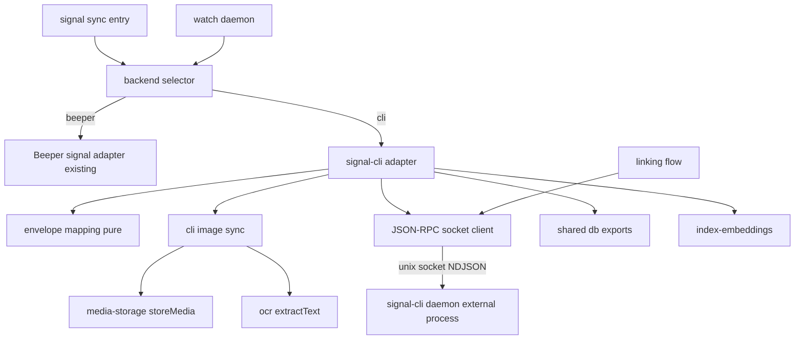
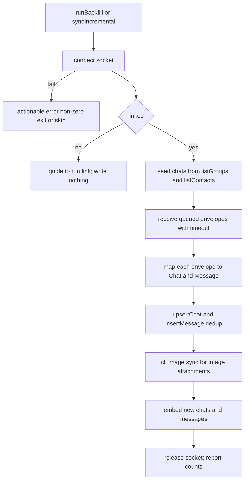

# Design Document

## Overview

**Purpose**: Add a second, Beeper-independent Signal backend to KhipuChat. Operators who do not run Beeper can link KhipuChat to their Signal account as a secondary device by driving a separately-installed `signal-cli` daemon over its JSON-RPC socket, then archive live Signal chats and messages (text + images) into the existing `chats`/`messages` tables.

**Users**: Self-hosting KhipuChat operators who want Signal in their unified archive without a third-party bridge.

**Impact**: Introduces a new `signal-cli` adapter alongside the existing Beeper Signal adapter under `src/platforms/signal/`, selected at runtime by a `SIGNAL_BACKEND` environment variable. Both backends emit `platform: 'signal'` and reuse the shared sync runner, ingestion helpers, and media/OCR pipeline, so the MCP/CLI/Web surfaces need no changes. The existing Beeper path is the default and is unaffected.

### Goals
- A signal-cli-backed `PlatformAdapter` that ingests live Signal messages from link-time forward into the shared schema.
- A secondary-device linking flow (QR from `sgnl://linkdevice`) that persists across runs.
- Backend selection (`beeper` default | `cli`) with no change to query surfaces and no regression to the Beeper backend.
- Deterministic tests over a mocked JSON-RPC transport.

### Non-Goals
- Sending Signal messages.
- Complete pre-link back-history import (deferred to a separate future spec: local-backup / `signalbackup-tools` parser).
- Recovering encrypted media older than 45 days (server-deleted, unrecoverable via linking).
- Vendoring, embedding, or source-linking signal-cli; a DIY libsignal client.
- Installing/managing the `signal-cli` binary or its JVM (documented operator prerequisite).
- Multi-account Signal for the cli backend (single `default` account, matching current Beeper signal behavior).

## Boundary Commitments

### This Spec Owns
- The signal-cli JSON-RPC transport client (socket connect, NDJSON framing, request/response correlation, `receive` notification delivery).
- The secondary-device linking flow (`startLink`/`finishLink`, QR/URI presentation, link-state reporting).
- The signal-cli `PlatformAdapter` (`runBackfill`, `syncIncremental`, `startListener`) and envelope→`Chat`/`Message` mapping.
- signal-cli image-attachment ingestion (resolve local decrypted file, store, OCR) via the shared pipeline.
- The `SIGNAL_BACKEND` selection seam and its wiring into the signal sync entrypoint and the watch loop.

### Out of Boundary
- The shared schema (`src/db.ts`), media-storage (`src/media-storage.ts`), and OCR (`src/ocr.ts`) modules — reused unchanged.
- The existing Beeper Signal adapter's behavior — must keep working; mapping/ingestion conventions are reused, not rewritten.
- The sync runner (`src/sync-runner.ts`), embeddings (`src/index-embeddings.ts`), and query surfaces (MCP/CLI/Web) — reused unchanged.
- Full back-history recovery and 45-day-old media — deferred / impossible via this path.
- Installing signal-cli/JVM; managing multiple Signal accounts.

### Allowed Dependencies
- `src/platforms/types.ts` (`PlatformAdapter`, `AdapterFactory`, `Platform` — `signal` already present).
- `src/db.ts` exports only: `upsertChat`, `insertMessage`, `getMessageIdByExternalId`, `getDb`, `updateMessageMedia`.
- `src/media-storage.ts` (`storeMedia`), `src/ocr.ts` (`extractText`), `src/index-embeddings.ts` (`embedNewMessages`, `embedNewChats`), `src/sync-runner.ts` (`runPlatformSync`).
- Node built-ins (`net`, `fs`, `readline`) and `qrcode-terminal` (QR rendering), already a dependency (used by whatsapp); types resolve from the installed `@types/qrcode-terminal`. No `package.json` edit is required.
- Additive touches to `src/account-registry.ts` and `src/watch.ts` for backend-aware configuration/selection (see Modified Files).

### Revalidation Triggers
- Any change to the `PlatformAdapter` contract or `Chat`/`Message` shapes.
- Any change to `storeMedia`/`extractText` signatures or the media path convention.
- Any change to how the watch loop resolves adapters/accounts or `isConfigured`.
- A signal-cli JSON-RPC method/notification schema change (transport or envelope shape).

## Architecture

### Existing Architecture Analysis
KhipuChat isolates each platform under `src/platforms/<name>/`. Adapters implement `PlatformAdapter` and call only `src/db.ts` exports; `runPlatformSync` owns incremental-vs-backfill mode selection and post-sync FTS/embedding rebuild; the watch daemon iterates configured platforms and calls `syncIncremental`/`runBackfill` per adapter. The current Signal adapter (`src/platforms/signal/sync.ts`) is Beeper-only: its `main()` builds a single `default` adapter from `BEEPER_ACCESS_TOKEN` and calls `runPlatformSync`. This design adds a sibling backend and a selector without disturbing that structure.

### Architecture Pattern & Boundary Map



**Architecture Integration**:
- Selected pattern: Ports-and-adapters — a new adapter implementing the existing `PlatformAdapter` port, chosen by a thin selector.
- Boundaries: transport (`cli-client`) ← pure mapping (`cli-mapping`) ← image ingestion (`cli-image-sync`) ← orchestration (`cli-sync`) ← selection/entry (`backend`, `sync.ts`). Linking (`cli-link`) uses only the transport.
- Existing patterns preserved: `PlatformAdapter`, `runPlatformSync`, adapter→`db.ts`-only calls, shared media/OCR pipeline, `external_id` dedup.
- New components rationale: signal-cli speaks a different protocol and envelope shape than Beeper, so it needs its own transport, mapping, and image resolution; the selector keeps both backends live.
- Steering compliance: files under 200 lines, TS strict/no-`any`, synchronous DB, local-only, single Node process per role.

**Dependency direction** (imports only leftward): `types`/`db`/`media-storage`/`ocr` → `cli-client` → `cli-mapping` → `cli-image-sync` → `cli-sync` → `backend` → `sync.ts` / `watch.ts`.

### Technology Stack

| Layer | Choice / Version | Role in Feature | Notes |
|-------|------------------|-----------------|-------|
| Backend / Services | Node 24 + TypeScript 5 (strict) | Adapter, transport, mapping | No `any`; files < 200 lines |
| Messaging / IPC | signal-cli ~v0.13.x `daemon --socket` (external, GPLv3) | Signal data source over NDJSON JSON-RPC 2.0 | Arm's-length process; not vendored/linked |
| Transport | Node `net` + `readline` | Socket connect + line-delimited framing | UNIX socket default `$XDG_RUNTIME_DIR/signal-cli/socket`; overridable via `SIGNAL_CLI_SOCKET` |
| CLI/UX | `qrcode-terminal` (MIT) | Render `sgnl://linkdevice` QR in terminal | Already a dependency (used by whatsapp); types resolve from installed `@types/qrcode-terminal` |
| Data / Storage | `better-sqlite3-multiple-ciphers` via `src/db.ts` | Ingest into shared `chats`/`messages` | Reused unchanged |
| Media | `src/media-storage.ts`, `src/ocr.ts` | Store + OCR image attachments | Reused unchanged |

## File Structure Plan

### Directory Structure
```
src/platforms/signal/
├── sync.ts            # MODIFIED: main() delegates to backend selector; --link handling
├── client.ts          # unchanged (Beeper client)
├── image-sync.ts      # unchanged (Beeper image sync)
├── backend.ts         # NEW: SIGNAL_BACKEND selection -> AdapterFactory; cli-configured probe
├── cli-client.ts      # NEW: JSON-RPC NDJSON socket transport (requests + receive notifications)
├── cli-link.ts        # NEW: secondary-device linking flow (startLink/finishLink + QR/URI)
├── cli-mapping.ts     # NEW: pure envelope -> Chat/Message mapping, classification, chat resolution
├── cli-image-sync.ts  # NEW: resolve decrypted attachment file, storeMedia, OCR, updateMessageMedia
└── cli-sync.ts        # NEW: SignalCliAdapter (PlatformAdapter) + createSignalCliAdapter factory
```
`qrcode-terminal` is imported directly; no ambient `.d.ts` is added (a hand-rolled declaration would collide with the installed `@types/qrcode-terminal`).

### Modified Files
- `src/platforms/signal/sync.ts` — `main()` calls the backend selector to build the default adapter; when the cli backend is active and argv contains `--link`, run the linking flow instead of a sync. Beeper mapping/adapter exports remain intact.
- `src/account-registry.ts` — additive: in the legacy (no config file) builder, synthesize a `default` Signal account when `SIGNAL_BACKEND=cli` even if `BEEPER_ACCESS_TOKEN` is absent (fields may carry `SIGNAL_CLI_SOCKET`). Beeper-token behavior unchanged.
- `src/watch.ts` — additive: resolve the Signal adapter factory via the backend selector; extend `isConfigured('signal')` to return true when the cli backend is configured. Other platforms unchanged.
- `tests/` — new test files (see Testing Strategy).

### Reused Unchanged
`src/db.ts`, `src/media-storage.ts`, `src/ocr.ts`, `src/sync-runner.ts`, `src/index-embeddings.ts`, and all query surfaces.

## System Flows

### Linking (one-time, secondary device)
```mermaid
sequenceDiagram
    participant Op as Operator
    participant Link as cli-link
    participant Client as cli-client
    participant Daemon as signal-cli daemon
    participant Phone as Signal phone primary
    Op->>Link: khipu sync signal --link
    Link->>Client: startLink
    Client->>Daemon: startLink request
    Daemon-->>Client: deviceLinkUri sgnl linkdevice
    Client-->>Link: deviceLinkUri
    Link-->>Op: print URI plus QR
    Op->>Phone: scan QR and approve
    Link->>Client: finishLink deviceLinkUri deviceName
    Client->>Daemon: finishLink request blocks
    Daemon-->>Client: linked account provisioned
    Client-->>Link: success
    Link-->>Op: linked report
```
Timeout: if `finishLink` does not resolve within the linking window, report a timeout and exit without ingesting.

### Sync / drain (per run)

The watch daemon's `pollCycle` calls only `syncIncremental`/`runBackfill` (never `startListener`), so live-from-link-forward ingestion under the daemon is achieved by repeated bounded `syncIncremental` drains — each poll connects, drains queued envelopes, ingests, and releases the socket. `startListener` is a no-op, matching every other adapter. `runPlatformSync` records the sync point and rebuilds FTS/embeddings on `--force`. (A true streaming `subscribeReceive` listener would be a separate, out-of-scope daemon-level change.)

## Requirements Traceability

| Requirement | Summary | Components | Interfaces | Flows |
|-------------|---------|------------|------------|-------|
| 1.1–1.6 | Backend selection, Beeper default, shared `signal` platform | backend, sync.ts, watch.ts | `resolveSignalFactory`, `SIGNAL_BACKEND` | Sync |
| 2.1–2.6 | Daemon connectivity/lifecycle over socket, arm's-length | cli-client | `SignalCliClient` | Sync |
| 3.1–3.6 | Secondary-device linking, QR, reuse existing link | cli-link, cli-client | `linkSignalCli`, `startLink`/`finishLink` | Linking |
| 4.1–4.6 | Live ingestion, direction, metadata, reply, group vs direct | cli-mapping, cli-sync | `mapEnvelope`, `resolveChat` | Sync |
| 5.1–5.5 | Chat records, dedup, shared conventions | cli-mapping, cli-sync | `upsertChat`, `insertMessage` | Sync |
| 6.1–6.5 | Image store + OCR, failures non-fatal, 45-day gap | cli-image-sync | `processCliImageMessages` | Sync |
| 7.1–7.5 | Live-forward guarantee, backlog unverified, media cap, defer | cli-sync (behavior/docs) | adapter semantics | Sync |
| 8.1–8.5 | Incremental drain, sync point, `--force`, daemon polls via repeated `syncIncremental` (no-op `startListener`) | cli-sync | `runBackfill`/`syncIncremental` (`startListener` no-op) | Sync |
| 9.1–9.5 | Query parity via existing surfaces | (reuse) db + surfaces | shared `Chat`/`Message` | — |
| 10.1–10.5 | Graceful degradation: unlinked, daemon down, no-op | cli-client, cli-sync, backend, watch.ts | error envelopes, `isConfigured` | Sync |
| 11.1–11.4 | Mocked-transport tests | tests | `SignalCliTransport` mock | — |

## Components and Interfaces

| Component | Domain/Layer | Intent | Req Coverage | Key Dependencies (P0/P1) | Contracts |
|-----------|--------------|--------|--------------|--------------------------|-----------|
| cli-client | Transport | NDJSON JSON-RPC over socket; requests + notifications | 2, 3, 10 | Node `net` (P0) | Service |
| cli-link | UX/Flow | Secondary-device linking + QR | 3 | cli-client (P0), qrcode-terminal (P1) | Service |
| cli-mapping | Domain (pure) | Envelope → Chat/Message; classify; resolve chat | 4, 5 | types, db types (P0) | Service |
| cli-image-sync | Media | Resolve decrypted file, store, OCR | 6 | media-storage, ocr, db (P0) | Batch |
| cli-sync | Orchestration | PlatformAdapter bounded drain; ingest (`startListener` no-op) | 4,5,6,7,8,10 | cli-client, cli-mapping, cli-image-sync, db, embeddings (P0) | Service, State |
| backend | Selection | `SIGNAL_BACKEND` → factory; cli-configured probe | 1, 10 | cli-sync, Beeper sync (P0) | Service |

### Transport

#### cli-client
| Field | Detail |
|-------|--------|
| Intent | Speak NDJSON JSON-RPC 2.0 to the signal-cli daemon over a UNIX/TCP socket |
| Requirements | 2.1, 2.2, 2.3, 2.5, 2.6, 3.1, 10.4 |

**Responsibilities & Constraints**
- Connect to the socket (`SIGNAL_CLI_SOCKET` or default), buffer by newline, parse each line as JSON-RPC.
- Correlate responses to requests by `id`; deliver `receive` notifications (no `id`) to a registered handler.
- Never import signal-cli source; the only coupling is the JSON-RPC wire format.
- Surface connection failure as a typed error; always release the socket on close/interrupt.

**Dependencies**
- External: signal-cli daemon — Signal data source (P0)
- Inbound: cli-link, cli-sync — issue requests / consume notifications (P0)

**Contracts**: Service [x]

##### Service Interface
```typescript
export type JsonRpcParams = Record<string, unknown>

export interface SignalCliConnectOptions {
  socketPath?: string   // default: SIGNAL_CLI_SOCKET or $XDG_RUNTIME_DIR/signal-cli/socket
  tcp?: { host: string; port: number }
}

export interface SignalCliClient {
  request<T>(method: string, params?: JsonRpcParams): Promise<T>
  onReceive(handler: (envelope: SignalEnvelope) => void): void
  close(): void
}

export type ConnectResult =
  | { ok: true; client: SignalCliClient }
  | { ok: false; reason: 'unreachable' | 'not_installed'; message: string }

export function connectSignalCli(opts?: SignalCliConnectOptions): Promise<ConnectResult>
```
- Preconditions: signal-cli daemon reachable at the socket for `ok: true`.
- Postconditions: `request` resolves/rejects per JSON-RPC `result`/`error`; `close` frees the socket.
- Invariants: one in-flight map keyed by request `id`; no unhandled socket errors escape as crashes.

### UX / Flow

#### cli-link
| Field | Detail |
|-------|--------|
| Intent | Link KhipuChat as a Signal secondary device and report status |
| Requirements | 3.1, 3.2, 3.3, 3.4, 3.5, 3.6 |

**Responsibilities & Constraints**
- Call `startLink`; print the returned `sgnl://linkdevice` URI and render it as a terminal QR.
- Call `finishLink` (with a device name); await primary approval within a bounded window.
- Report success/timeout/failure; never ingest messages in link mode.

**Contracts**: Service [x]
```typescript
export type LinkOutcome =
  | { status: 'linked'; deviceName: string }
  | { status: 'timeout' }
  | { status: 'failed'; message: string }
  | { status: 'already_linked' }

export function linkSignalCli(client: SignalCliClient, deviceName?: string): Promise<LinkOutcome>
```

### Domain (pure)

#### cli-mapping
| Field | Detail |
|-------|--------|
| Intent | Deterministically map a signal-cli envelope to `Chat` and `Message` |
| Requirements | 4.1, 4.2, 4.3, 4.4, 4.5, 4.6, 5.1, 5.4, 5.5 |

**Responsibilities & Constraints**
- Resolve chat identity: group => `external_id = "group.<groupId>"`, `type: 'group'`; direct => peer `sourceUuid`/`sourceNumber` (received) or `sentMessage.destination` (sent), `type: 'private'`.
- Message `external_id = "<senderOrSelf>.<timestamp>"`; `timestamp` = envelope ms → unix seconds; `is_sender = 1` when the payload is `syncMessage.sentMessage`, else `0`.
- `text` from `dataMessage.message` or `sentMessage.message`; `reply_to_external_id` from a `quote` reference when present.
- Classify `type`: `image` if any attachment `contentType` starts with `image/`; else `text` if text present; else `other`.
- Pure functions: no I/O, no DB, no clock beyond values in the envelope. Defensive on optional fields.

**Contracts**: Service [x]
```typescript
export interface SignalAttachment {
  id: string
  contentType?: string
  filename?: string
  size?: number
  width?: number
  height?: number
}
export interface SignalEnvelope {
  source?: string
  sourceNumber?: string
  sourceUuid?: string
  sourceName?: string
  timestamp: number
  dataMessage?: { message?: string; groupInfo?: { groupId: string }; attachments?: SignalAttachment[]; quote?: { id: number } }
  syncMessage?: { sentMessage?: { destination?: string; message?: string; groupInfo?: { groupId: string }; attachments?: SignalAttachment[]; timestamp?: number } }
}
export interface MappedChat { external_id: string; name: string; type: 'private' | 'group' }
export interface GroupNameLookup { (groupId: string): string | undefined }
export interface ContactNameLookup { (peerId: string): string | undefined }

export function resolveChat(env: SignalEnvelope, groupName: GroupNameLookup, contactName: ContactNameLookup): MappedChat | null
export function mapEnvelope(env: SignalEnvelope, chatId: number): { message: Message; imageAttachments: SignalAttachment[] } | null
```
- Returns `null` for envelopes with no ingestable content (receipts, typing, empty).

### Media

#### cli-image-sync
| Field | Detail |
|-------|--------|
| Intent | Ingest decrypted image attachments through the shared media/OCR pipeline |
| Requirements | 6.1, 6.2, 6.3, 6.4, 6.5 |

**Responsibilities & Constraints**
- Resolve the decrypted file path from the signal-cli attachments dir (`SIGNAL_CLI_ATTACHMENTS_DIR` or default `~/.local/share/signal-cli/attachments/<id>`); read the buffer.
- `storeMedia({ platform: 'signal', chatId, externalId, ext, data })`; run `extractText`; `updateMessageMedia` with path/dimensions/ocr_text. Idempotent (skip if `media_file_path` already set).
- Missing file (expired ≥45 days) or OCR failure => count as failure/skip and continue; never abort the sync.

**Contracts**: Batch [x]
```typescript
export function processCliImageMessages(
  chatId: number,
  items: readonly { externalId: string; attachment: SignalAttachment }[]
): Promise<{ stored: number; failed: number }>
```

### Orchestration

#### cli-sync
| Field | Detail |
|-------|--------|
| Intent | The signal-cli `PlatformAdapter`: connect, ensure linked, bounded drain, ingest (`startListener` no-op) |
| Requirements | 4.x, 5.x, 6.x, 7.x, 8.x, 10.1, 10.3, 10.5 |

**Responsibilities & Constraints**
- `runBackfill`/`syncIncremental`: connect; if unreachable => throw typed error (non-zero exit upstream); if not linked => guide and write nothing. Seed chats from `listGroups`/`listContacts`, then drain queued `receive` messages (bounded timeout), map, `upsertChat`+`insertMessage`, process image attachments, embed new rows. Both modes drain what the daemon delivers (signal-cli delivers server-queued messages on connect; `since` is informational — dedup guards overlap).
- `startListener`: a no-op, exactly like every other adapter. The watch daemon drives live ingestion by calling `syncIncremental` on each `pollCycle`, so each poll performs a bounded drain rather than holding a continuous listener. (A streaming `subscribeReceive` listener is out of scope — it would require a daemon-level change to `pollCycle`.)
- Live-forward only: no attempt to fetch pre-link history; ingest any history the daemon volunteers using the same path without claiming completeness.
- No-op cleanly (write nothing, report "nothing new") when the drain yields no messages.
- Release the socket on completion/interrupt.

**Contracts**: Service [x] / State [x]
```typescript
export function createSignalCliAdapter(account: string, credentials: AccountCredentials): PlatformAdapter
export const signalCliAdapter: PlatformAdapter // default account
```
- State: the "linked" flag lives in signal-cli's own account store; the adapter only reads link status, and `runPlatformSync` owns the sync-point (`sync_state`).

### Selection

#### backend
| Field | Detail |
|-------|--------|
| Intent | Resolve which Signal backend is active and whether the cli backend is configured |
| Requirements | 1.1, 1.2, 1.3, 1.4, 1.5, 1.6, 10.2 |

**Contracts**: Service [x]
```typescript
export type SignalBackend = 'beeper' | 'cli'
export function selectedSignalBackend(env?: NodeJS.ProcessEnv): SignalBackend // default 'beeper'
export function resolveSignalFactory(env?: NodeJS.ProcessEnv): AdapterFactory
export function signalCliConfigured(env?: NodeJS.ProcessEnv): boolean // true when backend === 'cli'
```

**Implementation Notes**
- Integration: `sync.ts main()` and `watch.ts` both consult `resolveSignalFactory`/`signalCliConfigured`; the Beeper factory is returned by default so existing behavior is byte-for-byte preserved.
- Validation: selecting `cli` must not require `BEEPER_ACCESS_TOKEN`; selecting `beeper` must not require signal-cli.
- Risks: switching backends for the same conversation can create parallel chat rows (different `external_id` namespaces) — documented limitation, out of scope to reconcile.

## Data Models

No schema changes. Reuse the existing `chats` and `messages` tables and their conflict rules.

- **Chat** (`upsertChat`, conflict on `platform, account, external_id`): `platform='signal'`, `account='default'`, `external_id` = `group.<groupId>` or peer id, `type` ∈ {`private`,`group`}, `name` from group/contact lookup (fallback to the id).
- **Message** (`insertMessage`, conflict on `external_id, chat_id`): fields per `cli-mapping`; media fields filled later by `cli-image-sync` via `updateMessageMedia`.
- **Dedup**: identical to other adapters — repeated observation of the same chat/message updates in place, never duplicates.

## Error Handling

### Error Strategy
Typed, non-throwing results at the transport/connect boundary; the adapter converts unrecoverable conditions into a single clear thrown error that `runPlatformSync`/entry translates to a non-zero exit, while per-item failures (one chat/message/image) are logged and skipped.

### Error Categories and Responses
- **Daemon unreachable / not installed** (2.3, 2.4, 10.3, 10.4): `connectSignalCli` returns `{ ok: false, reason }`; explicit runs exit non-zero with a message naming signal-cli and setup guidance; all-platform sync skips Signal and continues other platforms.
- **Not linked** (3.x, 10.1): adapter reports how to run linking and writes nothing.
- **Per-chat / per-message JSON-RPC error** (2.5, 5.5): log and continue; do not abort the whole sync.
- **Image download/OCR failure or expired media** (6.4, 6.5): record failure/skip, archive the message without media, continue.
- **Nothing queued** (10.5): clean no-op with a "nothing new" report.

### Monitoring
Console logging consistent with existing adapters: `[signal] ...` counts (chats, messages, images stored/failed) and explicit skip/no-op lines.

## Testing Strategy

### Unit Tests
- `cli-mapping`: group vs direct chat resolution; `is_sender` for `syncMessage.sentMessage` vs `dataMessage`; type classification (`image`/`text`/`other`); reply mapping; `null` for receipts/typing (4.x, 5.x).
- `cli-client`: NDJSON framing splits multi-line buffers; request/response `id` correlation; `receive` notification dispatch; `close` releases the socket (2.x).
- `backend`: default `beeper`; `cli` selection returns the cli factory and needs no Beeper token; `signalCliConfigured` reflects `SIGNAL_BACKEND` (1.x).

### Integration Tests (mocked transport)
- Drain-and-ingest over a `SignalCliTransport` mock feeding fixture envelopes into a `:memory:` DB: chats + messages appear once; re-running the drain creates no duplicates (5.2, 5.3, 8.1).
- Image path: fixture image on disk → `storeMedia` + OCR text persisted; missing/expired file → message archived without media, sync continues (6.1, 6.2, 6.4, 6.5).
- Graceful degradation: transport reports `unreachable` → typed error / non-zero for explicit run; `not linked` → guidance, zero rows written; empty queue → no-op (2.3, 10.1, 10.5).
- Beeper-untouched: selecting the cli backend leaves the Beeper adapter's mapping/behavior unchanged (1.4, 11.4).

### E2E / Manual (documented, not automated)
- Real `signal-cli daemon` + phone: `khipu sync signal --link` links; a subsequent `khipu sync signal` ingests live messages. (Out of the automated suite — no real daemon in CI, per 11.1.)

## Security Considerations
- The socket is local-only; no network listener is added by KhipuChat. signal-cli holds the linked-device keys in its own store outside KhipuChat's DB.
- The `sgnl://linkdevice` URI is a secret provisioning token; it is printed to the operator's terminal only and never persisted by KhipuChat.
- GPLv3 isolation: signal-cli is invoked solely over IPC; no source is imported, linked, or vendored (mere aggregation).

## Supporting References
- signal-cli JSON-RPC method/notification details and field-name uncertainties: see `research.md`.
- `qrcode-terminal` is already installed (with `@types/qrcode-terminal`) for the whatsapp adapter, so signal-direct requires no `package.json` change and no local type declaration.
