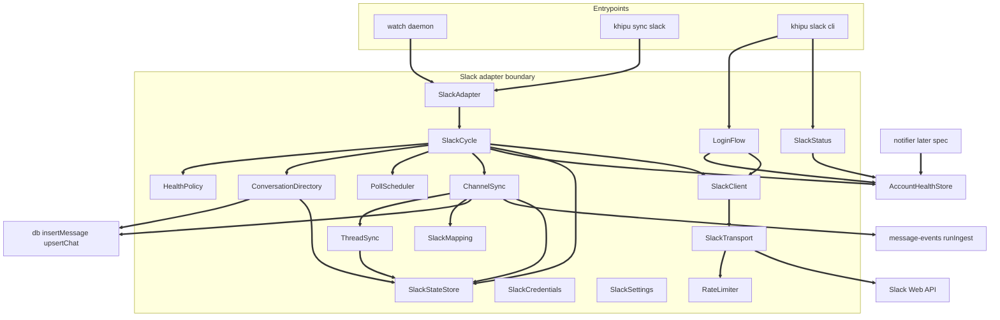
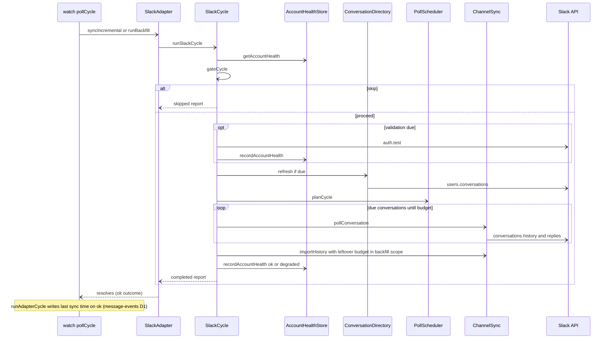
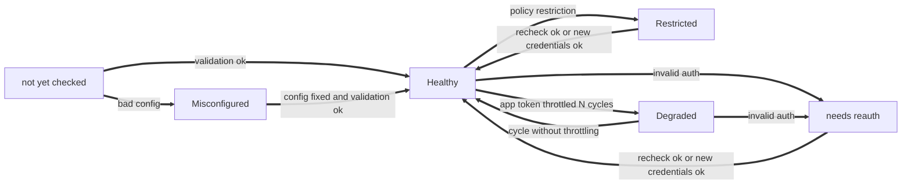
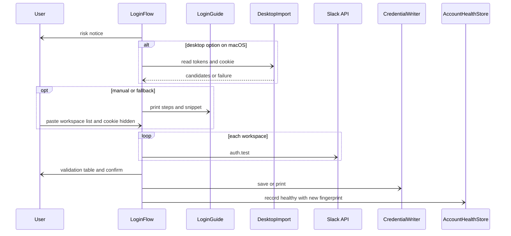

# Design Document: slack-all-workspaces

## Overview
**Purpose**: This feature makes every Slack workspace the user can sign into in a browser sync into khipuchat, including thread replies, without admin action, with watched channels stored within 1 to 2 minutes, and with a durable record of credential health that a later notifier can read.

**Users**: the user (operator) runs `khipu slack login` once per browser session and `khipu slack status` to check workspaces; the sync daemon on the laptop or the cloud server runs the Slack cycles; notifier and other features read the account health store.

**Impact**: replaces the Slack client's fixed-sleep fetch with a classified, rate-limited transport over two backends (session `xoxc` plus `d` cookie, app `xoxp`); replaces "list everything, read everything" with a cached members-only conversation directory and a per-conversation tier planner; adds thread reply sync, persisted read positions, chunked history import, and mapping fixes; replaces `process.exit(1)` with a persisted health state. No change to `insertMessage`, the event stream, or other adapters.

### Goals
- Session backend works on any workspace with no app install; `xoxp` still works.
- Watched conversations read every 60 seconds by default; new messages stored within 2 minutes.
- Thread replies stored and linked to parents.
- Auth failures recorded once in a persisted, sequenced health table with a read query; the daemon never dies on Slack errors.
- Secrets never logged; server secret files supported.

### Non-Goals
- Realtime websocket (deferred stretch goal), `client.counts` change detection.
- Sending, reacting, editing, deleting on Slack; file downloads; storing message edits after insert.
- Notifications of any kind (notifier); event emission (message-events); importance (triage-agent).
- Enterprise Grid org-wide export; Slack Connect specifics beyond storing what the member APIs return.
- Writing `sync_state` (the platform last-sync time) for any platform, Slack included: message-events `runAdapterCycle` owns that write (Phase 5 cross-spec decision D1, which folds the former `watch-lastsync` candidate).

## Boundary Commitments

### This Spec Owns
- Everything under `src/platforms/slack/**`: credentials, transport, rate limiting, client, settings, Slack state tables, mapping, planner, thread sync, cycle orchestration, adapter, `khipu slack` CLI (login, status), desktop import.
- The generic account health store `src/account-health.ts`: the `account_health` table, its write rule (sequence on transitions), and its read API. Slack is its only writer in this spec.
- The Slack-owned tables `slack_accounts`, `slack_channel_state`, `slack_threads`, defined in the DDL-only module `src/platforms/slack/schema.ts` (`applySlackSchema`), and the `account_health` table, defined in the DDL-only module `src/account-health-schema.ts` (`applyAccountHealthSchema`). Both are registered in message-events' `src/schema-registry.ts` (D6).
- The optional `pollIntervalMs` field on `PlatformAdapter` and its use in the daemon's interval selection.
- A verification test that the cloud-deployment secret-file allowlist accepts the Slack names (D2; no edit to its file), the Slack rows of the setup-env catalog, the generated `docs/TOKENS.md`, and `docs/SLACK.md`.
- The health column in `khipu sync` status output.

### Out of Boundary
- The `message_events` outbox, consumer API, origin rules, `insertMessage` (message-events). This spec only calls `insertMessage` and opens nested `backfill` scopes with `runIngest`.
- The platform last-sync time write after an ok daemon cycle (message-events `runAdapterCycle`, D1). Slack never calls `setPlatformLastSyncedAt`.
- The schema registry `src/schema-registry.ts` and `initDb`'s call to it (message-events, D6). This spec adds two import lines and two `SCHEMA_MODULES` entries only.
- The secret-file allowlist contents, including `SLACK_USER_TOKEN`, `SLACK_COOKIE`, and the pattern `^SLACK_(TOKEN|COOKIE)_[A-Z0-9_]+$` (cloud-deployment, D2).
- Delivering re-auth alerts (notifier): it polls `listAccountHealth`.
- Importance rules, watchlists for triage (triage-agent). The Slack watch list only controls read frequency.
- Platform host gating, secret-file loading mechanism, DB path resolution, server deployment guide (cloud-deployment).
- Daemon process structure, shutdown, embedding rebuild in `pollCycle` (sync-watcher, semantic-search).
- Any Beeper component.

### Allowed Dependencies
- Node 24 built-ins: `fetch`, `node:crypto`, `node:readline`, `node:fs`, `node:os`, `node:path`, `node:child_process` (desktop import keychain call only).
- Existing: `better-sqlite3-multiple-ciphers`, `dotenv`, `vitest`.
- `src/db.ts` (`upsertChat`, `insertMessage`, `getLastSyncedId`, `getDb`; never `setPlatformLastSyncedAt`, D1), `src/account-registry.ts` (`loadRegistry`, `AccountCredentials`), `src/sync-runner.ts` (`runSyncEntrypoint`), `src/index-embeddings.ts`, `src/vec-db.ts` (as today).
- message-events `src/ingest-context.ts` (`runIngest`) only, never `event-store.ts` or `event-bus.ts`; message-events `src/schema-registry.ts` receives the two Slack schema entries.
- cloud-deployment `src/db-path.ts` (`resolveDbPath`) in Slack entrypoints; cloud-deployment `src/secret-files.ts` is used as is (read by tests only, never edited).
- `src/account-health.ts` imports only `better-sqlite3-multiple-ciphers` types and `Platform`; it never imports Slack code. `src/account-health-schema.ts` and `src/platforms/slack/schema.ts` are DDL-only: they import nothing but types (better-sqlite3 `Database` type).
- No new npm dependency.

### Upstream Dependencies
Binding per `.kiro/specs/phase5-cross-spec-decisions.md`.

| Upstream spec | Contract used | Decision | Needed by |
|---------------|---------------|----------|-----------|
| message-events | `runIngest(origin, fn)` in `src/ingest-context.ts`, returning `IngestOutcome<T>` | D11 | Default `historical` wrapper (SlackAdapter) |
| message-events | IngestContext nesting invariant: Slack is a named nesting caller; inner `backfill` scopes inside the daemon's outer scope roll their stats into the outer scope | D11 | Daemon cycles with history import |
| message-events | `runAdapterCycle` writes the platform/account last-sync time on an ok cycle outcome | D1 | Requirement 7.8 |
| message-events | `src/schema-registry.ts` ordered `SCHEMA_MODULES`, called once by `initDb` | D6 | `account_health` and `slack_*` tables |
| cloud-deployment | `resolveDbPath()` in `src/db-path.ts` | D5 | One-shot entrypoint |
| cloud-deployment | Secret-file allowlist in `src/secret-files.ts` already containing `SLACK_USER_TOKEN`, `SLACK_COOKIE`, and `^SLACK_(TOKEN|COOKIE)_[A-Z0-9_]+$` | D2 | Requirement 10.3 (verification only) |
| cloud-deployment | Platform host gating allowing Slack on the server | none | Server deployment |

### Revalidation Triggers
- Any change to `AccountHealth` fields, status values, the sequence rule, or `listAccountHealth` filtering: notifier must re-check.
- Any change to which reads run inside a `backfill` scope: triage-agent and message-events assumptions about Slack origin.
- Any change to the `PlatformAdapter.pollIntervalMs` meaning: sync-watcher and every adapter.
- Changing Slack secret names: cloud-deployment owns the allowlist (D2) and must change it first, then its env template and deployment guide.
- Any change to message-events' D1 last-sync rule (what counts as an ok cycle outcome) or D11 nesting rule: re-check SlackAdapter outcome semantics and the 7.8 coverage.
- Changing `account_health` time units (unix seconds, D8): notifier and `khipu sync` status.
- Changing Slack table schemas: status command and any future Slack consumer.

## Architecture

### Existing Architecture Analysis
- Adapter contract: `PlatformAdapter { runBackfill, syncIncremental?, startListener }` created by `createSlackAdapter(account, credentials)`; the daemon (`watch.ts`) runs one adapter per account on `setInterval`, the one-shot runner (`sync-runner.ts`) runs each account in sequence.
- `pollCycle` chooses `syncIncremental(since)` only when `sync_state` has a row; the daemon never writes it, so today every daemon cycle is `runBackfill`. message-events fixes this for every platform with its `runAdapterCycle` last-sync write (D1); Slack relies on it and adds no write of its own.
- Messages are stored through the `db.ts` singleton; adapters receive a `Database` handle for their own state.
- Technical debt addressed: wrong chat type, `is_sender` always 0, no threads, full re-list each cycle, process exit on missing token, unclassified errors. `khipu.ts` (280 lines) gains one table entry and one usage line only.

### Architecture Pattern & Boundary Map



**Dependency direction** (imports point only to earlier layers; violations are errors):
1. Types and DDL: `slack/types.ts`, type exports of `src/account-health.ts`, DDL-only `slack/schema.ts` and `src/account-health-schema.ts` (imported only by message-events' `src/schema-registry.ts` and tests)
2. Primitives: `slack/settings.ts`, `slack/auth.ts`, `slack/redact.ts`, `slack/ts.ts`
3. Infrastructure: `slack/rate-limiter.ts`, `slack/transport.ts`, `slack/client.ts`, `slack/state-store.ts`, `src/account-health.ts`
4. Pure domain: `slack/mapping.ts`, `slack/scheduler.ts`, `slack/health-policy.ts`
5. Services: `slack/conversations.ts`, `slack/threads.ts`, `slack/channel-sync.ts`
6. Orchestration: `slack/cycle.ts`
7. Entrypoints: `slack/sync.ts`, `slack/cli.ts`, `slack/status.ts`, `slack/login/*`; modified `watch.ts`, `khipu.ts`, `khipu-sync-status.ts`

**Architecture Integration**:
- Selected pattern: adapter-internal tiered polling. The daemon runs each Slack account every watched interval; a pure planner picks due conversations within a time budget.
- Domain boundaries: transport knows HTTP and classification only; client knows Slack methods; state store owns Slack SQL; cycle owns health transitions and ordering; account health store is platform-agnostic.
- Existing patterns preserved: adapter factory per account, `insertMessage`/`upsertChat` singleton writes, env plus `khipu.config.json` fields, dependency injection of `fetch`, clock, and IO for tests, `:memory:` real-DB tests, files under 200 lines.
- New components rationale: each new file holds one responsibility so the adapter stays testable and under the line limit.
- Steering compliance: TS strict, no `any`, MCP untouched, no new dependency, no Beeper dependency, outbound traffic only to `slack.com`.

### Technology Stack

| Layer | Choice / Version | Role in Feature | Notes |
|-------|------------------|-----------------|-------|
| Runtime | Node.js 24 global `fetch` | Slack HTTP calls | Injected for tests |
| Data | better-sqlite3-multiple-ciphers (existing) | Slack state tables, account health, desktop cookie DB read | Tables created idempotently on archive open through message-events' schema registry (D6) |
| Crypto | `node:crypto` | Credential fingerprint (SHA-256), desktop cookie decrypt (PBKDF2, AES-128-CBC) | Built in |
| CLI | `node:readline` | Hidden input for login | Built in |
| External | Slack Web API | `auth.test`, `users.conversations`, `conversations.history`, `conversations.replies`, `conversations.info`, `users.info` | See research.md for tiers |

## File Structure Plan

### Directory Structure
```
src/
├── account-health-schema.ts         # DDL-only: applyAccountHealthSchema(db) (registered in schema-registry, D6)
├── account-health.ts                # recordAccountHealth, getAccountHealth, listAccountHealth (no DDL)
└── platforms/slack/
    ├── schema.ts                    # DDL-only: applySlackSchema(db) for slack_accounts, slack_channel_state, slack_threads (D6)
    ├── types.ts                     # Wire types (conversation, message, identity), SlackFailure, SlackBackend, shared result types
    ├── ts.ts                        # Slack timestamp helpers: compareTs, maxTs, tsToEpochSeconds
    ├── auth.ts                      # parseSlackCredentials, credential fingerprint, classifySlackError
    ├── redact.ts                    # redactSecrets(text, secrets): masks token and cookie values and xox patterns
    ├── settings.ts                  # resolveSlackSettings(fields, env): typed settings plus warnings
    ├── rate-limiter.ts              # Per-method token buckets per account, Retry-After penalties, deadline-aware acquire
    ├── transport.ts                 # Backend-specific request building, retries, 429 handling, result classification
    ├── client.ts                    # SlackClient methods over the transport (rewritten), user name cache
    ├── state-store.ts               # slack_accounts, slack_channel_state, slack_threads CRUD (no DDL)
    ├── mapping.ts                   # mapChat, mapMessage, hashStr (moved from sync.ts; re-exported there)
    ├── scheduler.ts                 # classifyTier, planCycle (pure)
    ├── health-policy.ts             # gateCycle, healthFromFailure, throttle tracking (pure)
    ├── conversations.ts             # ConversationDirectory: cached discovery, watch matching, chat upsert, DM names, position init
    ├── threads.ts                   # ThreadSync: record parents, fetch new replies, re-check active threads
    ├── channel-sync.ts              # pollConversation (incremental), importHistory (chunked backfill)
    ├── cycle.ts                     # runSlackCycle: gate, auth check, refresh, plan, execute, record health (no sync_state write, D1)
    ├── sync.ts                      # createSlackAdapter (modified), one-shot main with mode and force options
    ├── cli.ts                       # khipu slack <login|status> argument routing
    ├── status.ts                    # khipu slack status rendering
    └── login/
        ├── guide.ts                 # Risk notice, browser steps, console snippet text
        ├── prompt.ts                # LoginIO: hidden and visible prompts over readline (injectable)
        ├── flow.ts                  # runLogin: collect, parse, validate, confirm, save, record health
        ├── credential-writer.ts     # .env upsert (0600), khipu.config.json entry upsert, print mode, account naming
        ├── desktop-tokens.ts        # macOS Slack desktop Local Storage scan for xoxc tokens
        └── desktop-cookie.ts        # macOS Slack desktop d cookie read and decrypt
tests/
├── account-health.test.ts
├── slack-schema.test.ts             # registry entries present, DDL-only imports, tables exist after initDb
├── slack-auth.test.ts               # credentials, classification, redaction
├── slack-transport.test.ts          # backends, 429, retries, limiter
├── slack-scheduler.test.ts
├── slack-health-policy.test.ts
├── slack-state-store.test.ts
├── slack-mapping.test.ts
├── slack-threads.test.ts
├── slack-conversations.test.ts      # conversation directory
├── slack-channel-sync.test.ts       # incremental reads and history import
├── slack-cycle.test.ts              # cycle orchestration against a fake Slack API
├── slack-adapter.test.ts            # adapter modes, overlap guard, one-shot exit
├── slack-e2e.test.ts                # multi-cycle daemon scenario
├── slack-login-guide.test.ts        # guide text and terminal IO
├── slack-credential-writer.test.ts
├── slack-login.test.ts              # login flow
├── slack-desktop-tokens.test.ts
├── slack-desktop-cookie.test.ts
├── slack-status.test.ts
└── slack.test.ts                    # existing, updated to new client contract
```

### Modified Files
- `src/platforms/types.ts`: optional `readonly pollIntervalMs?: number` on `PlatformAdapter`.
- `src/watch.ts`: `getIntervalMs(platform, adapterDefault?)`; startup passes `adapter.pollIntervalMs`. Env override still wins.
- `src/khipu.ts`: `'slack': 'platforms/slack/cli.ts'` in `OPERATIONAL_SCRIPTS`; usage lines for `slack login` and `slack status`.
- `src/khipu-sync-status.ts`: `printSyncStatus` takes an optional health lookup and appends the health state.
- `src/schema-registry.ts` (message-events): two imports and two `SCHEMA_MODULES` entries, `applyAccountHealthSchema` and `applySlackSchema` (D6). No other edit.
- `src/secret-files.ts` (cloud-deployment) is not modified: it already allowlists `SLACK_USER_TOKEN`, `SLACK_COOKIE`, and `^SLACK_(TOKEN|COOKIE)_[A-Z0-9_]+$` (D2).
- `scripts/setup-env.sh`: Slack catalog rows (`SLACK_USER_TOKEN` describes the session token first, `SLACK_COOKIE` row added); `docs/TOKENS.md` regenerated with `--emit-docs`.
- `docs/SLACK.md` (new): backends, capture steps, multi-workspace config, watch settings, risks, re-auth.
- `tests/slack.test.ts`: updated to the new client contract and mapping.

## System Flows

### Daemon cycle for one account



Decisions: an auth or restricted failure from any call aborts the cycle immediately and records the state; transient failures only skip the affected conversation. Slack never writes `sync_state`: message-events `runAdapterCycle` writes it when the adapter call resolves (ok outcome, D1). In daemon mode the Slack adapter resolves for every report kind, including `skipped` and `auth_failed`, because the daemon must never fail on Slack errors (9.5); the account's real state is visible through `account_health`, which `khipu sync` shows next to the last sync time (11.2). `khipu sync` status shows account health next to last-sync so a stale-auth account is not read as healthy (D15). The history import's inner `backfill` scopes nest inside the daemon cycle's outer scope; message-events accepts Slack as a nesting caller and rolls inner stats into the outer scope (D11).

### Account health states



### Login



## Requirements Traceability

| Requirement | Summary | Components | Interfaces | Flows |
|-------------|---------|------------|------------|-------|
| 1.1, 1.2 | Session and app backends | SlackCredentials, SlackTransport | `parseSlackCredentials`, `createSlackTransport` | Daemon cycle |
| 1.3, 1.4 | Missing cookie or bad token | SlackCredentials, SlackCycle, AccountHealthStore | `CredentialResult`, `recordAccountHealth` | Health states |
| 1.5 | Same data on both backends | SlackClient, ChannelSync | `SlackClient` | Daemon cycle |
| 1.6 | One account per workspace, shared cookie | SlackSettings, SlackStateStore | `slack_accounts` | |
| 1.7 | Daemon survives misconfig | SlackCycle, SlackAdapter | `CycleReport` | |
| 1.8 | One-shot exits non-zero | SlackAdapter one-shot mode | `SlackCycleError` | |
| 2.1, 2.2 | Risk notice, browser steps, snippet | LoginGuide | `RISK_NOTICE`, `browserSteps` | Login |
| 2.3 | Hidden input | LoginPrompt | `LoginIO.secret` | Login |
| 2.4, 2.5 | Validate before save | LoginFlow, SlackClient | `validateCandidates` | Login |
| 2.6, 2.7, 2.8, 2.9, 2.10 | Save, update, config handling, print | CredentialWriter | `planCredentialWrite`, `applyCredentialWrite` | Login |
| 2.11 | Healthy after save | LoginFlow, AccountHealthStore | `recordAccountHealth` | Login |
| 2.12, 2.13, 2.14 | Desktop import and fallback | DesktopImport, LoginFlow | `readDesktopTokens`, `readDesktopCookie` | Login |
| 3.1 | Persisted record | AccountHealthStore | `AccountHealth` | Health states |
| 3.2, 3.3 | Classify auth and restriction | SlackCredentials classifier, HealthPolicy | `classifySlackError`, `healthFromFailure` | Health states |
| 3.4, 3.5 | No reads while unhealthy, recheck | HealthPolicy, SlackCycle | `gateCycle` | Daemon cycle |
| 3.6 | New credentials revalidated | HealthPolicy, SlackCredentials | fingerprint compare | Health states |
| 3.7, 3.8 | Sequence on transitions, read query | AccountHealthStore | `listAccountHealth` | |
| 3.9 | One log line per transition | SlackCycle | `describeHealthChange` | |
| 3.10 | Transient never re-auth | HealthPolicy | `healthFromFailure` returns null | |
| 3.11 | Degraded on throttling | HealthPolicy, SlackCycle | `ThrottleTracker` | Health states |
| 3.12 | No notifications | Boundary | | |
| 4.1, 4.2 | Members-only discovery, cache | ConversationDirectory, SlackClient | `refreshIfDue`, `listMemberConversations` | Daemon cycle |
| 4.3, 4.4, 4.5 | Watch and exclude matching | ConversationDirectory, SlackClient | `matchEntries`, `conversationInfo` | |
| 4.6 | New conversation historical import | ConversationDirectory, ChannelSync | `importHistory` in backfill scope | Daemon cycle |
| 4.7 | Left or archived | ConversationDirectory, SlackStateStore | `markMembership` | |
| 5.1, 5.4 | Replies stored once, linked | ThreadSync, SlackMapping | `syncThreadsForPage`, `mapMessage` | |
| 5.2, 5.3, 5.7 | Active window, re-check limit | ThreadSync, SlackStateStore | `recheckActiveThreads`, `listActiveThreads` | |
| 5.5 | Replies in historical import | ChannelSync, ThreadSync | backfill scope | |
| 5.6 | Per-thread failure isolation | ThreadSync | `ThreadSyncOutcome` | |
| 6.1, 6.2, 6.3, 6.4, 6.5 | Tiers and lists | PollScheduler, SlackSettings | `classifyTier` | |
| 6.6, 6.7 | Per-account settings, invalid values | SlackSettings | `resolveSlackSettings` | |
| 6.8 | Priority and budget | PollScheduler, SlackCycle | `planCycle`, `CycleBudget` | Daemon cycle |
| 6.9 | Daemon interval | SlackAdapter, WatchInterval | `pollIntervalMs`, `getIntervalMs` | |
| 6.10 | Overlap skip | SlackAdapter | in-flight guard | |
| 6.11 | One-shot all tiers | PollScheduler, SlackAdapter | `CycleMode` | |
| 7.1, 7.2 | Persisted positions, no gaps | SlackStateStore, ChannelSync | `setCursor` after store | |
| 7.3 | Chunked first import | ChannelSync, PollScheduler | `importHistory`, `backfill` plan list | Daemon cycle |
| 7.4 | Historical marking | ChannelSync, SlackCycle | `runIngest('backfill')` | |
| 7.5 | Continue from earlier version | ConversationDirectory | `initPosition` from `getLastSyncedId` | |
| 7.6 | Forced re-read | SlackAdapter, SlackStateStore | `resetHistoryImport` | |
| 7.7 | No duplicates | ChannelSync | `insertMessage` dedupe | |
| 7.8 | Last successful sync (superseded: relies on message-events D1) | SlackAdapter, message-events `runAdapterCycle` | adapter call resolves; `runAdapterCycle` writes the sync time | Daemon cycle |
| 8.1, 8.2 | Chat types | SlackMapping | `mapChat` | |
| 8.3 | Sent by me | SlackMapping | `mapMessage` with identity | |
| 8.4 | DM names | ConversationDirectory, SlackClient | `getUserName` | |
| 8.5, 8.6 | Bot sender, subtypes | SlackMapping | `senderNameFor`, `messageTypeFor` | |
| 8.7 | Name cache and fallback | SlackClient | `getUserName` | |
| 9.1, 9.2 | Retry-After, spacing | SlackTransport, RateLimiter | `acquire`, `penalize` | |
| 9.3 | Transient retries | SlackTransport, ChannelSync | `SlackFailure.transient` | |
| 9.4 | Per-conversation denial | ChannelSync, ConversationDirectory | `SlackFailure.conversation` | |
| 9.5 | Never exit daemon | SlackAdapter, SlackCycle | no `process.exit` | |
| 10.1 | No secrets anywhere | SlackRedactor, SlackTransport, AccountHealthStore callers | `redactSecrets` | |
| 10.2 | Fingerprint only | SlackCredentials | `fingerprintOf` | |
| 10.3 | Secret files | SecretAllowlistCheck, cloud-deployment SecretFileLoader | `SECRET_NAMES`, pattern (verification only, D2) | |
| 10.4 | Docs | TokenCatalog, SlackDocs | `docs/SLACK.md`, `docs/TOKENS.md` | |
| 10.5 | No Beeper | Boundary, dependency test | | |
| 11.1 | Slack status | SlackStatus | `renderSlackStatus` | |
| 11.2, 11.3 | Health in sync status | SyncStatus | `printSyncStatus` | |

## Components and Interfaces

| Component | Layer | Intent | Req Coverage | Key Dependencies | Contracts |
|-----------|-------|--------|--------------|------------------|-----------|
| SlackTypes | Types | Wire and result types | 1.5, 5.1 | none | State |
| SlackCredentials | Primitives | Parse token and cookie, fingerprint, classify errors | 1.1, 1.2, 1.3, 1.4, 3.2, 3.3, 10.2 | node:crypto (P0) | Service |
| SlackRedactor | Primitives | Strip secrets from text | 10.1 | none | Service |
| SlackSettings | Primitives | Typed per-account settings with defaults | 1.6, 6.1, 6.2, 6.3, 6.4, 6.5, 6.6, 6.7 | none | Service |
| RateLimiter | Infrastructure | Per-method spacing, penalties | 9.1, 9.2 | clock (P0) | Service |
| SlackTransport | Infrastructure | HTTP per backend, retries, classification | 1.1, 1.2, 9.1, 9.3, 10.1 | fetch (P0), RateLimiter (P0), SlackRedactor (P0) | Service |
| SlackClient | Infrastructure | Slack methods, pagination, name cache | 1.5, 4.1, 4.4, 8.4, 8.7 | SlackTransport (P0) | Service |
| SlackStateStore | Infrastructure | Slack tables | 1.6, 4.7, 5.2, 7.1, 7.2, 7.5, 7.6 | SQLite (P0) | State |
| AccountHealthStore | Infrastructure | Generic health table and query | 3.1, 3.7, 3.8 | SQLite (P0), schema registry (P0) | Service, State |
| SlackSchemas | Infrastructure | DDL-only modules for `account_health` and `slack_*` tables | 3.1, 7.1 | message-events schema registry (P0) | State |
| SlackMapping | Pure domain | Chat and message mapping | 5.1, 8.1, 8.2, 8.3, 8.5, 8.6 | none | Service |
| PollScheduler | Pure domain | Tiering and cycle plan | 6.1, 6.2, 6.3, 6.4, 6.5, 6.8, 6.11, 7.3 | SlackSettings (P0) | Service |
| HealthPolicy | Pure domain | Gate, failure to state, throttling | 3.2, 3.3, 3.4, 3.5, 3.6, 3.10, 3.11 | AccountHealth types (P0) | Service |
| ConversationDirectory | Services | Cached discovery, matching, chats, positions | 4.1, 4.2, 4.3, 4.4, 4.5, 4.6, 4.7, 7.5, 8.2, 8.4 | SlackClient (P0), SlackStateStore (P0), db (P0) | Service |
| ThreadSync | Services | Thread replies | 5.1, 5.2, 5.3, 5.4, 5.5, 5.6, 5.7 | SlackClient (P0), SlackStateStore (P0) | Service |
| ChannelSync | Services | Incremental reads and history import | 1.5, 4.6, 7.1, 7.2, 7.3, 7.4, 7.7, 9.3, 9.4 | SlackClient (P0), ThreadSync (P0), runIngest (P0), insertMessage (P0) | Service |
| SlackCycle | Orchestration | One account cycle | 1.3, 1.4, 1.7, 3.4, 3.5, 3.9, 3.11, 6.8, 7.6, 9.5 | all services (P0), AccountHealthStore (P0) | Batch |
| SlackAdapter | Entrypoint | Adapter factory, modes, overlap guard | 1.7, 1.8, 6.9, 6.10, 6.11, 7.6, 7.8, 9.5 | SlackCycle (P0), message-events runAdapterCycle (P0, D1) | Service |
| WatchInterval | Entrypoint change | Adapter-provided default interval | 6.9 | PlatformAdapter (P0) | Service |
| LoginGuide | Entrypoint | Notice, steps, snippet | 2.1, 2.2 | none | Service |
| LoginPrompt | Entrypoint | Hidden and visible input | 2.3 | node:readline (P0) | Service |
| LoginFlow | Entrypoint | Capture, validate, save | 2.3, 2.4, 2.5, 2.7, 2.11, 2.13, 2.14 | SlackClient (P0), CredentialWriter (P0), DesktopImport (P1) | Service |
| CredentialWriter | Entrypoint | Persist or print credentials | 2.6, 2.7, 2.8, 2.9, 2.10 | node:fs (P0) | Service |
| DesktopImport | Entrypoint | macOS desktop tokens and cookie | 2.12, 2.13, 2.14 | node:fs, node:crypto, keychain CLI, SQLite (P1) | Service |
| SlackStatus | Entrypoint | `khipu slack status` | 11.1 | AccountHealthStore, SlackStateStore, registry (P0) | Service |
| SlackCli | Entrypoint | Route `login` and `status` | 2.1, 11.1 | LoginFlow, SlackStatus (P0) | Service |
| SyncStatus | Entrypoint change | Health in `khipu sync` | 11.2, 11.3 | AccountHealthStore (P0) | Service |
| SecretAllowlistCheck | Verification | Test that Slack secret names are allowlisted | 10.3 | cloud-deployment SecretFileLoader (P0) | n/a |
| TokenCatalog and SlackDocs | Docs | Setup docs | 10.4 | setup-env.sh (P0) | n/a |

### Types and Primitives

#### SlackTypes (`slack/types.ts`)

```typescript
export type SlackBackend = 'session' | 'app'

export interface SlackConversation {
  readonly id: string
  readonly name: string | null
  readonly is_im: boolean
  readonly is_mpim: boolean
  readonly is_channel?: boolean
  readonly is_group?: boolean
  readonly is_private?: boolean
  readonly is_archived: boolean
  readonly is_member?: boolean
  readonly user?: string            // DM counterpart
}

export interface SlackMessage {
  readonly ts: string
  readonly user?: string
  readonly text: string
  readonly subtype?: string
  readonly thread_ts?: string
  readonly reply_count?: number
  readonly latest_reply?: string
  readonly bot_id?: string
  readonly username?: string
  readonly bot_profile?: { readonly name?: string }
}

export interface SlackIdentity {
  readonly teamId: string
  readonly teamName: string
  readonly url: string
  readonly userId: string
  readonly userName: string
  readonly enterpriseId: string | null
}

export type SlackFailure =
  | { readonly kind: 'auth'; readonly code: string }          // credential dead
  | { readonly kind: 'restricted'; readonly code: string }    // org or workspace policy
  | { readonly kind: 'conversation'; readonly code: string }  // one conversation denied or gone
  | { readonly kind: 'rate_limited'; readonly retryAfterMs: number }
  | { readonly kind: 'deadline' }                             // cycle budget would be exceeded
  | { readonly kind: 'transient'; readonly detail: string }   // network, 5xx, retries exhausted; detail redacted
  | { readonly kind: 'api'; readonly code: string }           // any other Slack error code

export type SlackResult<T> = { readonly ok: true; readonly value: T } | { readonly ok: false; readonly failure: SlackFailure }

export interface MessageBatch {
  readonly messages: readonly SlackMessage[]   // ascending ts, deduplicated
  readonly complete: boolean                   // false when paging stopped early (maxPages or deadline)
  readonly oldestTs: string | null
  readonly newestTs: string | null
}
```

#### SlackCredentials (`slack/auth.ts`)

| Field | Detail |
|-------|--------|
| Intent | Turn account fields into validated credentials; classify Slack error codes |
| Requirements | 1.1, 1.2, 1.3, 1.4, 3.2, 3.3, 10.2 |

**Contracts**: Service [x]

```typescript
export interface SlackCredentials {
  readonly backend: SlackBackend
  readonly token: string
  readonly cookie: string | null        // URL-encoded d cookie; null for app backend
  readonly fingerprint: string          // first 12 hex chars of sha256(token + '\n' + cookie)
}

export type CredentialProblem = 'missing_token' | 'missing_cookie' | 'unsupported_token'

export type CredentialResult =
  | { readonly ok: true; readonly credentials: SlackCredentials }
  | { readonly ok: false; readonly problem: CredentialProblem; readonly message: string }

/** Reads SLACK_USER_TOKEN and SLACK_COOKIE from account fields. xoxc- => session (cookie required), xoxp- => app. */
export function parseSlackCredentials(fields: Readonly<Record<string, string>>): CredentialResult

export function fingerprintOf(token: string, cookie: string | null): string

/** Normalizes a pasted cookie: trims, strips a leading "d=", URL-encodes when it contains no '%'. */
export function normalizeCookie(raw: string): string

export type FailureClass = 'auth' | 'restricted' | 'conversation' | 'api'
export function classifySlackError(code: string): FailureClass
```
- Classification table: `auth` = `invalid_auth`, `not_authed`, `token_revoked`, `token_expired`, `account_inactive`; `restricted` = `enterprise_is_restricted`, `team_access_not_granted`, `org_login_required`; `conversation` = `channel_not_found`, `not_in_channel`, `missing_scope`, `is_archived`; everything else `api`.
- Invariant: `message` never contains token or cookie text.

#### SlackRedactor (`slack/redact.ts`)

```typescript
/** Replaces every exact secret value and any /xox[a-z]-[A-Za-z0-9-]+/ match with "[redacted]". */
export function redactSecrets(text: string, secrets: readonly string[]): string
```
- Used by the transport for every failure detail and by the cycle for every log line that includes an error.

#### SlackSettings (`slack/settings.ts`)

| Field | Detail |
|-------|--------|
| Intent | Typed settings per account; field value wins over env, env wins over default |
| Requirements | 1.6, 6.1, 6.2, 6.3, 6.4, 6.5, 6.6, 6.7 |

**Contracts**: Service [x]

```typescript
export interface SlackSettings {
  readonly watch: readonly string[]          // normalized: IDs as-is, names lowercased without '#'
  readonly exclude: readonly string[]
  readonly watchDms: boolean
  readonly watchedIntervalMs: number         // SLACK_WATCHED_INTERVAL_MS, default 60_000
  readonly activeIntervalMs: number          // SLACK_ACTIVE_INTERVAL_MS, default 300_000
  readonly idleIntervalMs: number            // SLACK_IDLE_INTERVAL_MS, default 3_600_000
  readonly activeWindowMs: number            // SLACK_ACTIVE_WINDOW_DAYS, default 7
  readonly threadWindowMs: number            // SLACK_THREAD_WINDOW_DAYS, default 7
  readonly maxThreadChecks: number           // SLACK_MAX_THREAD_CHECKS, default 20
  readonly conversationRefreshMs: number     // SLACK_CONVERSATION_REFRESH_MS, default 1_800_000
  readonly authCheckMs: number               // SLACK_AUTH_CHECK_MS, default 1_800_000
  readonly recheckMs: number                 // SLACK_REAUTH_RECHECK_MS, default 3_600_000
  readonly cycleBudgetMs: number             // SLACK_CYCLE_BUDGET_MS, default 45_000
  readonly backfillDays: number | null       // SLACK_BACKFILL_DAYS, 0 or unset => null (unlimited)
  readonly backfillPagesPerCycle: number     // SLACK_BACKFILL_PAGES_PER_CYCLE, default 5
  readonly degradedAfterCycles: number       // SLACK_DEGRADED_AFTER_CYCLES, default 3
  readonly teamId: string | null             // SLACK_TEAM_ID, optional, Enterprise Grid org tokens
}

export interface SettingsResult { readonly settings: SlackSettings; readonly warnings: readonly string[] }

export function resolveSlackSettings(
  fields: Readonly<Record<string, string>>,
  env?: NodeJS.ProcessEnv,
): SettingsResult
```
- Lists (`SLACK_WATCH_CHANNELS`, `SLACK_EXCLUDE_CHANNELS`) are comma separated. `SLACK_WATCH_DMS` accepts `1|true|yes`.
- Invalid numeric value: default used, warning `"[slack] SLACK_IDLE_INTERVAL_MS=abc is invalid; using 3600000"` (6.7).

### Infrastructure

#### RateLimiter (`slack/rate-limiter.ts`)

| Field | Detail |
|-------|--------|
| Intent | Keep each method under its workspace limit and honor Retry-After |
| Requirements | 9.1, 9.2 |

**Contracts**: Service [x]

```typescript
export type SlackMethod =
  | 'auth.test' | 'users.conversations' | 'conversations.history'
  | 'conversations.replies' | 'conversations.info' | 'users.info'

export const METHOD_PER_MINUTE: Readonly<Record<SlackMethod, number>>
// auth.test 20, users.conversations 40, conversations.history 40,
// conversations.replies 40, conversations.info 40, users.info 80  (about 80 percent of tier limits)

export interface Clock { now(): number; sleep(ms: number): Promise<void> }

export interface RateLimiter {
  /** Waits for a slot; returns 'deadline' without waiting when the slot is later than deadline (epoch ms). */
  acquire(method: SlackMethod, deadline: number | null): Promise<'ok' | 'deadline'>
  /** Blocks the method until now + ms (from Retry-After). */
  penalize(method: SlackMethod, ms: number): void
}

export function createRateLimiter(clock: Clock, perMinute?: Partial<Record<SlackMethod, number>>): RateLimiter
```
- One limiter per adapter instance, so per account and per workspace.

#### SlackTransport (`slack/transport.ts`)

| Field | Detail |
|-------|--------|
| Intent | Encode requests per backend, retry, classify, never leak secrets |
| Requirements | 1.1, 1.2, 9.1, 9.3, 10.1 |

**Contracts**: Service [x]

```typescript
export interface TransportDeps {
  readonly fetch: typeof globalThis.fetch
  readonly clock: Clock
  readonly limiter: RateLimiter
  readonly baseUrl?: string               // default https://slack.com/api
}

export interface CallOptions { readonly deadline: number | null }

export interface SlackTransport {
  call<T extends { ok: boolean; error?: string }>(
    method: SlackMethod,
    params: Readonly<Record<string, string>>,
    options: CallOptions,
  ): Promise<SlackResult<T>>
}

export function createSlackTransport(credentials: SlackCredentials, deps: TransportDeps): SlackTransport
```
- Session backend: `POST <base>/<method>` with `Content-Type: application/x-www-form-urlencoded`, body = params plus `token`, header `Cookie: d=<cookie>`. App backend: `POST` form body of params, header `Authorization: Bearer <token>`. Tokens never appear in URLs.
- HTTP 429: `penalize(method, Retry-After * 1000)`; if `now + wait > deadline` return `rate_limited` failure, else wait and retry (max 3 attempts total per call).
- Network error or HTTP 5xx: retry after 1 s, 2 s, 4 s (each wait checked against deadline), then `transient` with redacted detail.
- Body `ok: false`: map `error` through `classifySlackError`; `ratelimited` treated like 429.
- Postcondition: no returned value, thrown error, or log contains the token or cookie.

#### SlackClient (`slack/client.ts`, rewritten)

| Field | Detail |
|-------|--------|
| Intent | Slack methods with pagination over the transport |
| Requirements | 1.5, 4.1, 4.4, 8.4, 8.7 |

**Contracts**: Service [x]

```typescript
export interface HistoryWindow {
  readonly oldest?: string      // exclusive lower bound
  readonly latest?: string      // exclusive upper bound
  readonly maxPages?: number    // undefined => all pages
}

export interface SlackClient {
  authTest(deadline: number | null): Promise<SlackResult<SlackIdentity>>
  /** users.conversations, all four types, exclude_archived, all pages; adds team_id when configured. */
  listMemberConversations(deadline: number | null): Promise<SlackResult<readonly SlackConversation[]>>
  conversationInfo(channelId: string, deadline: number | null): Promise<SlackResult<SlackConversation>>
  fetchHistory(channelId: string, window: HistoryWindow, deadline: number | null): Promise<SlackResult<MessageBatch>>
  /** conversations.replies; parent excluded from the result unless includeParent. */
  fetchReplies(channelId: string, threadTs: string, oldest: string | null, deadline: number | null): Promise<SlackResult<MessageBatch>>
  /** users.info with in-memory cache; returns userId on any failure (8.7). */
  getUserName(userId: string, deadline: number | null): Promise<string>
}

export function createSlackClient(transport: SlackTransport, options?: { teamId?: string | null }): SlackClient
```
- When paging stops on a failure after at least one page, `fetchHistory` returns `ok: true` with `complete: false` for `deadline` and `rate_limited`, and `ok: false` for every other failure.

#### SlackStateStore (`slack/state-store.ts`)

| Field | Detail |
|-------|--------|
| Intent | Own Slack tables and their reads and writes |
| Requirements | 1.6, 4.7, 5.2, 7.1, 7.2, 7.5, 7.6 |

**Contracts**: State [x]

```typescript
export interface ChannelState {
  readonly account: string
  readonly channelId: string
  readonly chatId: number
  readonly cursorTs: string | null          // newest stored ts; null => not initialized
  readonly lastActivityTs: string | null
  readonly lastPolledAt: number | null      // epoch ms (Slack-internal, D8 labelled)
  readonly backfillBeforeTs: string | null  // oldest ts reached by history import
  readonly backfillDone: boolean
  readonly member: boolean
}

export interface ThreadState {
  readonly account: string
  readonly channelId: string
  readonly threadTs: string
  readonly latestReplyTs: string | null     // as reported by Slack
  readonly fetchedReplyTs: string | null    // newest reply stored
  readonly lastActivityAt: number           // epoch seconds of latest reply
}

export interface AccountIdentityRow extends SlackIdentity {
  readonly account: string
  readonly backend: SlackBackend
  readonly fingerprint: string
  readonly verifiedAt: number               // epoch ms of last successful auth.test (Slack-internal, D8 labelled)
}

export interface SlackStateStore {
  getIdentity(account: string): AccountIdentityRow | null
  findAccountByTeam(teamId: string): string | null
  saveIdentity(row: AccountIdentityRow): void
  listChannels(account: string): readonly ChannelState[]
  upsertChannel(account: string, channelId: string, chatId: number, init: Partial<ChannelState>): ChannelState
  setCursor(account: string, channelId: string, cursorTs: string, lastPolledAt: number): void
  markPolled(account: string, channelId: string, lastPolledAt: number): void
  setBackfill(account: string, channelId: string, beforeTs: string | null, done: boolean): void
  markMembership(account: string, presentIds: readonly string[]): void   // member=0 for missing ids
  resetHistoryImport(account: string): void                              // backfill_done=0, before=null for all
  upsertThread(t: ThreadState): void
  listActiveThreads(account: string, channelId: string, sinceEpochSec: number, limit: number): readonly ThreadState[]
  getThread(account: string, channelId: string, threadTs: string): ThreadState | null
}

export function createSlackStateStore(db: Database.Database): SlackStateStore   // no DDL; tables exist after initDb (D6)
```
- Tables come from `applySlackSchema` in `src/platforms/slack/schema.ts`, registered in `src/schema-registry.ts`; there is no lazy `ensure*Schema` on first use. Tests open `:memory:` archives through `initDb` (or call `applySlackSchema` directly).
- `setCursor` is called only after the messages up to `cursorTs` were inserted (7.2). Cursor never moves backwards (`maxTs`).

#### AccountHealthStore (`src/account-health.ts`)

| Field | Detail |
|-------|--------|
| Intent | Durable, platform-agnostic credential health with a sequence for pollers |
| Requirements | 3.1, 3.7, 3.8 |

**Contracts**: Service [x] / State [x]

```typescript
export type AccountHealthStatus = 'ok' | 'degraded' | 'needs_reauth' | 'restricted' | 'misconfigured'

export interface AccountHealth {
  readonly platform: Platform
  readonly account: string
  readonly status: AccountHealthStatus
  readonly reason: string | null        // machine code, e.g. 'invalid_auth', 'missing_cookie'
  readonly detail: string | null        // short human text, max 200 chars, never secrets
  readonly fingerprint: string | null   // credential fingerprint the state applies to
  readonly changedAt: number            // unix seconds of last status or reason change (D8)
  readonly checkedAt: number            // unix seconds of last report (D8)
  readonly seq: number                  // bumped on every status or reason change, global max + 1
}

export interface HealthReport {
  readonly platform: Platform
  readonly account: string
  readonly status: AccountHealthStatus
  readonly reason?: string | null
  readonly detail?: string | null
  readonly fingerprint?: string | null
  readonly now: number                  // unix seconds; callers pass Math.floor(clock.now() / 1000)
}

export interface HealthWrite { readonly changed: boolean; readonly health: AccountHealth }

export function recordAccountHealth(db: Database.Database, report: HealthReport): HealthWrite
export function getAccountHealth(db: Database.Database, platform: Platform, account: string): AccountHealth | null
export function listAccountHealth(
  db: Database.Database,
  filter?: { readonly afterSeq?: number; readonly platform?: Platform; readonly statuses?: readonly AccountHealthStatus[] },
): readonly AccountHealth[]          // ascending seq; changedAt and checkedAt in unix seconds
```
- Schema: `applyAccountHealthSchema(db)` in the DDL-only module `src/account-health-schema.ts`, registered in message-events' `src/schema-registry.ts` (D6). `src/account-health.ts` holds no DDL and creates nothing on first use.
- Physical model: `account_health(platform TEXT, account TEXT, status TEXT NOT NULL, reason TEXT, detail TEXT, fingerprint TEXT, changed_at INTEGER NOT NULL, checked_at INTEGER NOT NULL, seq INTEGER NOT NULL UNIQUE, PRIMARY KEY(platform, account))`; `changed_at` and `checked_at` are unix seconds (D8).
- Write runs in one transaction: read current row; if status or reason differ (or no row), set `changed_at = now`, `seq = COALESCE(MAX(seq), 0) + 1`; always set `checked_at`, `fingerprint`, `detail`.
- Consumer contract (notifier): store the highest `seq` seen; call `listAccountHealth(db, { afterSeq })` on each poll; act on rows whose status is not `ok`; a later `ok` row means resolved. Delivery is at-least-once for a consumer that persists its `seq` after acting.

### Pure Domain

#### SlackMapping (`slack/mapping.ts`)

| Field | Detail |
|-------|--------|
| Intent | Map Slack objects to archive rows |
| Requirements | 5.1, 8.1, 8.2, 8.3, 8.5, 8.6 |

**Contracts**: Service [x]

```typescript
export function hashStr(s: string): number                  // unchanged
export function chatTypeFor(conv: SlackConversation): ChatType   // im => 'private', mpim => 'group', else 'channel'
export function mapChat(conv: SlackConversation, account: string, displayName?: string | null): Chat
export function messageTypeFor(msg: SlackMessage): MessageType   // content subtypes => 'text' when text present
export function senderNameFor(msg: SlackMessage, resolvedUserName: string | null): string | null
export function mapMessage(msg: SlackMessage, chatId: number, senderName: string | null, selfUserId: string | null): Message
```
- Content subtypes: none, `thread_broadcast`, `bot_message`, `file_share`, `me_message`. Any other subtype maps to `'other'` (slack-sync 3.4 kept).
- `is_sender = 1` when `msg.user === selfUserId`.
- `reply_to_external_id = msg.thread_ts` when `thread_ts` is set and differs from `msg.ts`; else `null`.
- DM chat `name` = `displayName ?? conv.user ?? conv.id`.

#### PollScheduler (`slack/scheduler.ts`)

| Field | Detail |
|-------|--------|
| Intent | Decide which conversations to read this cycle and in what order |
| Requirements | 6.1, 6.2, 6.3, 6.4, 6.5, 6.8, 6.11, 7.3 |

**Contracts**: Service [x]

```typescript
export type Tier = 'watched' | 'active' | 'idle' | 'excluded'
export type CycleMode = 'daemon' | 'one-shot'

export interface ConversationView {
  readonly id: string
  readonly name: string | null              // normalized lowercase
  readonly kind: 'channel' | 'im' | 'mpim'
  readonly state: ChannelState
}

export interface PlanItem { readonly channelId: string; readonly tier: Tier; readonly overdueMs: number }
export interface CyclePlan {
  readonly poll: readonly PlanItem[]        // initialized conversations due now, ordered
  readonly initialize: readonly PlanItem[]  // conversations without a read position, ordered by tier
  readonly backfill: readonly string[]      // conversations with history import pending, watched first
}

export function classifyTier(view: ConversationView, settings: SlackSettings, now: number): Tier
export function planCycle(views: readonly ConversationView[], settings: SlackSettings, now: number, mode: CycleMode): CyclePlan
```
- Exclude wins over watch (6.4). Watched = ID or name in `watch`, or DM or MPIM with recent activity when `watchDms` (6.5). Active = last activity within `activeWindowMs`. Otherwise idle.
- Due = `lastPolledAt === null` or `now - lastPolledAt >= tierInterval`. Order: watched first, then by `overdueMs` descending (6.8).
- `one-shot`: every non-excluded conversation is due (6.11).
- Non-member conversations (`member = false`) are never planned unless a watch entry names them by ID (4.4).

#### HealthPolicy (`slack/health-policy.ts`)

| Field | Detail |
|-------|--------|
| Intent | Pure rules for gating, failure mapping, throttling |
| Requirements | 3.2, 3.3, 3.4, 3.5, 3.6, 3.10, 3.11 |

**Contracts**: Service [x]

```typescript
export type CycleGate =
  | { readonly kind: 'proceed'; readonly validate: boolean }
  | { readonly kind: 'skip'; readonly reason: 'unhealthy_wait' }

export function gateCycle(input: {
  readonly stored: AccountHealth | null
  readonly fingerprint: string
  readonly lastVerifiedAt: number | null
  readonly settings: SlackSettings
  readonly now: number
}): CycleGate

/** null for rate_limited, deadline, transient, conversation, api (3.10). */
export function healthFromFailure(failure: SlackFailure): { status: 'needs_reauth' | 'restricted'; reason: string } | null

export interface ThrottleTracker { readonly consecutive: number }
export function nextThrottle(
  prev: ThrottleTracker, backend: SlackBackend, historyCalls: number, historyRateLimited: number,
): ThrottleTracker
export function throttleStatus(t: ThrottleTracker, settings: SlackSettings): 'degraded' | 'ok'
```
- `gateCycle`: fingerprint differs from `stored.fingerprint` => proceed with validate (3.6). Stored `needs_reauth`/`restricted` with same fingerprint => skip until `checkedAt * 1000 + recheckMs` (`checkedAt` is unix seconds, `now` and `recheckMs` are ms), then proceed with validate (3.4, 3.5). Otherwise validate when `lastVerifiedAt` is null or older than `authCheckMs`.
- Throttle counter increments only for the app backend when every history call in the cycle was rate limited and at least one was made; resets otherwise.

### Services

#### ConversationDirectory (`slack/conversations.ts`)

| Field | Detail |
|-------|--------|
| Intent | Cached member conversation list, matching, chat rows, read position init |
| Requirements | 4.1, 4.2, 4.3, 4.4, 4.5, 4.6, 4.7, 7.5, 8.2, 8.4 |

**Contracts**: Service [x]

```typescript
export interface DirectoryDeps {
  readonly client: SlackClient
  readonly store: SlackStateStore
  readonly account: string
  readonly settings: SlackSettings
  readonly log: (line: string) => void
}

export interface ConversationDirectory {
  /** Refreshes when never refreshed or older than conversationRefreshMs; returns current views. */
  refreshIfDue(now: number, deadline: number | null): Promise<SlackResult<readonly ConversationView[]>>
  views(): readonly ConversationView[]
}

export function createConversationDirectory(deps: DirectoryDeps): ConversationDirectory
```
- On refresh: list member conversations; add watched IDs not in the list through `conversationInfo` (skipped with a once-per-refresh log on `conversation` failure); log unmatched watch and exclude entries once (4.5); `upsertChat(mapChat(...))` for each (fixes type, 8.2); for new state rows, `cursorTs` = `getLastSyncedId(chatId)` and `backfillDone = true` when the chat already has messages (7.5), else `cursorTs = null` (needs initialization, 4.6); `markMembership` for vanished ones (4.7).
- DM names: resolve with `getUserName` only when the stored chat name equals the counterpart user ID or the chat is new (8.4).
- Cache lives in the adapter instance; a failed refresh keeps the previous views.

#### ThreadSync (`slack/threads.ts`)

| Field | Detail |
|-------|--------|
| Intent | Store thread replies and keep active threads current |
| Requirements | 5.1, 5.2, 5.3, 5.4, 5.5, 5.6, 5.7 |

**Contracts**: Service [x]

```typescript
export interface ThreadSyncDeps {
  readonly client: SlackClient
  readonly store: SlackStateStore
  readonly account: string
  readonly settings: SlackSettings
  readonly storeMessage: (msg: SlackMessage, chatId: number) => Promise<void>  // name resolution plus mapMessage plus insertMessage
}

export interface ThreadSyncOutcome {
  readonly checked: number
  readonly stored: number
  readonly failed: readonly string[]   // thread ts values to retry next poll
  readonly stop: SlackFailure | null   // auth, restricted, rate_limited, deadline end the poll
}

/** For parents in a page: record them and fetch replies when latest_reply moved past fetchedReplyTs. */
export function syncThreadsForPage(deps: ThreadSyncDeps, channelId: string, chatId: number, page: readonly SlackMessage[], deadline: number | null): Promise<ThreadSyncOutcome>

/** Re-check up to maxThreadChecks tracked threads active within threadWindowMs, most recent first. */
export function recheckActiveThreads(deps: ThreadSyncDeps, channelId: string, chatId: number, now: number, deadline: number | null): Promise<ThreadSyncOutcome>
```
- Replies fetched with `oldest = fetchedReplyTs`; after storing, `fetchedReplyTs` and `lastActivityAt` advance. `thread_broadcast` replies share their `ts` with the history copy, so `insertMessage` dedupe stores them once (5.4).
- Threads already re-checked by `syncThreadsForPage` in the same poll are not re-checked again.
- A tracked thread whose `latest_reply` moves when its parent reappears in a later read becomes active again (5.3).

#### ChannelSync (`slack/channel-sync.ts`)

| Field | Detail |
|-------|--------|
| Intent | Read one conversation incrementally, or import a chunk of its history |
| Requirements | 1.5, 4.6, 7.1, 7.2, 7.3, 7.4, 7.7, 9.3, 9.4 |

**Contracts**: Service [x]

```typescript
export interface ChannelSyncDeps extends ThreadSyncDeps {
  readonly identity: SlackIdentity
  readonly now: () => number
  readonly historical: <T>(fn: () => Promise<T>) => Promise<T>   // wraps runIngest('backfill', fn)
}

export type PollOutcome =
  | { readonly kind: 'ok'; readonly stored: number; readonly threadsChecked: number }
  | { readonly kind: 'partial'; readonly stored: number }        // deadline or rate limit mid-read
  | { readonly kind: 'skipped'; readonly failure: SlackFailure } // conversation, transient, api
  | { readonly kind: 'stop'; readonly failure: SlackFailure }    // auth or restricted: abort cycle

/** history oldest=cursorTs, store ascending, threads, then setCursor(newestTs) if complete. */
export function pollConversation(deps: ChannelSyncDeps, view: ConversationView, deadline: number | null): Promise<PollOutcome>

/** First page for an uninitialized conversation inside historical(); sets cursorTs to newest and backfillBeforeTs to oldest. */
export function initializeConversation(deps: ChannelSyncDeps, view: ConversationView, deadline: number | null): Promise<PollOutcome>

/** Up to maxPages older pages (latest=backfillBeforeTs) inside historical(); marks done at end or past backfillDays. */
export function importHistory(deps: ChannelSyncDeps, view: ConversationView, maxPages: number | undefined, deadline: number | null): Promise<PollOutcome>
```
- `pollConversation` on `partial`: messages read are stored, cursor unchanged, so the next poll re-reads the window (7.2, 7.7).
- Thread replies found during `initializeConversation` and `importHistory` are fetched inside the same `historical` scope (5.5).
- `markPolled` is called for `ok`, `partial`, and `skipped` so a failing conversation does not starve others; `skipped` with a `conversation` failure is logged once per refresh (9.4).

### Orchestration

#### SlackCycle (`slack/cycle.ts`)

| Field | Detail |
|-------|--------|
| Intent | Run one account cycle end to end |
| Requirements | 1.3, 1.4, 1.7, 3.4, 3.5, 3.9, 3.11, 6.8, 7.6, 9.5 |

**Contracts**: Batch [x]

```typescript
export interface CycleContext {
  readonly db: Database.Database
  readonly account: string
  readonly fields: Readonly<Record<string, string>>
  readonly env: NodeJS.ProcessEnv
  readonly clock: Clock
  readonly fetch: typeof globalThis.fetch
  readonly historical: <T>(fn: () => Promise<T>) => Promise<T>
  readonly log: (line: string) => void
  readonly session: CycleSession          // per-adapter memory: directory, client, throttle tracker, last log state
}

export interface CycleOptions { readonly mode: CycleMode; readonly force: boolean }

export type CycleReport =
  | { readonly kind: 'skipped'; readonly reason: 'misconfigured' | 'unhealthy_wait' | 'overlap' }
  | { readonly kind: 'auth_failed'; readonly status: AccountHealthStatus; readonly reason: string }
  | { readonly kind: 'completed'; readonly polled: number; readonly stored: number; readonly deferred: number; readonly backfillPending: number }

export class SlackCycleError extends Error {}   // thrown only in one-shot mode for misconfig or auth failure

export interface CycleSession {
  credentialsFingerprint: string | null   // fingerprint the client below was built for
  client: SlackClient | null              // rebuilt when the fingerprint changes
  directory: ConversationDirectory | null
  throttle: ThrottleTracker
  lastLoggedState: string | null          // suppresses repeated misconfig and unhealthy-wait lines
}

export function runSlackCycle(ctx: CycleContext, options: CycleOptions): Promise<CycleReport>
```
- Steps: parse credentials (misconfigured: record, log once, report or throw in one-shot, 1.3, 1.4, 1.8); `gateCycle`; `authTest` when due (store identity, record ok or failure); `force` => `resetHistoryImport`; directory refresh; `planCycle`; execute `poll`, then `initialize`, then `backfill` within `deadline = start + cycleBudgetMs` (daemon) or `null` (one-shot); stop on `stop` outcome and record health; record `ok` or `degraded` per throttle; embed touched chats when indexed (as today). The cycle never writes `setPlatformLastSyncedAt`: the daemon's sync time comes from message-events `runAdapterCycle` (D1, 7.8), and one-shot runs keep `runPlatformSync`'s existing write.
- Health log (3.9): when `recordAccountHealth` returns `changed` and status is not `ok`: `[slack/<account>] needs_reauth (invalid_auth): run "khipu slack login --account <account>"`. When it becomes `ok` after a non-ok state: `[slack/<account>] auth healthy again`.
- Never calls `process.exit` (9.5).

### Entrypoints

#### SlackAdapter (`slack/sync.ts`, modified)

| Field | Detail |
|-------|--------|
| Intent | Adapter factory, mode selection, overlap guard |
| Requirements | 1.7, 1.8, 6.9, 6.10, 6.11, 7.6, 7.8, 9.5 |

**Contracts**: Service [x]

```typescript
export interface SlackAdapterOptions {
  readonly mode?: CycleMode               // default 'daemon'
  readonly force?: boolean                // one-shot --force
  readonly deps?: Partial<Pick<CycleContext, 'clock' | 'fetch' | 'env' | 'log' | 'historical'>>
}

export function createSlackAdapter(
  account: string, credentials: AccountCredentials, options?: SlackAdapterOptions,
): PlatformAdapter   // sets pollIntervalMs = settings.watchedIntervalMs

export { hashStr, mapChat, mapMessage } from './mapping'
```
- `runBackfill` and `syncIncremental` both call `runSlackCycle`, passing `force` through `CycleOptions` (the cycle performs the history import reset, 7.6); the `since` argument is ignored because read positions are per conversation.
- Overlap: an in-flight flag owned by the adapter (not the cycle); a second call while running logs `[slack/<account>] previous cycle still running; skipped` and resolves (6.10).
- One-shot `main()`: `runSyncEntrypoint('slack', (a, c) => createSlackAdapter(a, c, { mode: 'one-shot', force: parseSyncArgs(argv).force }), db, argv)`; DB opened with `resolveDbPath()`.
- Default `historical` = run `runIngest('backfill', fn)`; on `{ ok: true, result }` return `result`, on `{ ok: false, error }` rethrow `error` (message-events `IngestOutcome<T>` never rejects). Nesting: these inner `backfill` scopes open inside the daemon's outer `live` or `backfill` scope from `runAdapterCycle`; message-events names Slack as an accepted nesting caller and rolls inner stats into the outer scope, so the daemon's per-cycle event log counts Slack history import events (D11).
- 7.8 (D1): in daemon mode `syncIncremental` and `runBackfill` resolve after every cycle report (never reject on Slack errors, 9.5), so message-events `runAdapterCycle` sees an ok outcome and writes the last-sync time. The adapter does not call `setPlatformLastSyncedAt`. In one-shot mode a `SlackCycleError` rejects, so `runPlatformSync` skips its existing write.

#### WatchInterval (`src/watch.ts`, `src/platforms/types.ts`)
- `PlatformAdapter.pollIntervalMs?: number` (positive integer ms).
- `getIntervalMs(platform, adapterDefault?)`: env `WATCH_INTERVAL_<PLATFORM>_MS` if valid, else `adapterDefault` if positive, else `DEFAULT_INTERVAL_MS` (6.9).

#### LoginGuide, LoginPrompt, LoginFlow, CredentialWriter (`slack/login/*`)

| Field | Detail |
|-------|--------|
| Intent | Guided capture, validation, persistence |
| Requirements | 2.1, 2.2, 2.3, 2.4, 2.5, 2.6, 2.7, 2.8, 2.9, 2.10, 2.11, 2.13, 2.14 |

**Contracts**: Service [x]

```typescript
// guide.ts
export const RISK_NOTICE: string
export const CONSOLE_SNIPPET: string
// copy(JSON.stringify(Object.values(JSON.parse(localStorage.localConfig_v2).teams)
//   .map(t => ({ id: t.id, name: t.name, url: t.url, token: t.token }))))
export function browserSteps(): string   // open app.slack.com, sign in, console snippet, Application then Cookies then d

// prompt.ts
export interface LoginIO {
  print(text: string): void
  printErr(text: string): void
  ask(question: string): Promise<string>
  secret(question: string): Promise<string>     // no echo
}
export function createTerminalIO(): LoginIO

// flow.ts
export interface Candidate { readonly token: string; readonly hintName: string | null; readonly hintUrl: string | null }
export interface ValidatedWorkspace { readonly candidate: Candidate; readonly identity: SlackIdentity; readonly account: string }
export interface LoginOptions {
  readonly account: string | null
  readonly fromDesktop: boolean
  readonly printOnly: boolean
  readonly envPath: string                      // default .env
  readonly configPath: string                   // default khipu.config.json
}
export interface LoginDeps {
  readonly io: LoginIO
  readonly db: Database.Database
  readonly makeClient: (credentials: SlackCredentials) => SlackClient
  readonly desktop: DesktopDeps
  readonly writerFs: WriterFs
  readonly now: () => number
}
export function parsePastedWorkspaces(text: string): readonly Candidate[]   // JSON array or a bare xoxc token
export function runLogin(options: LoginOptions, deps: LoginDeps): Promise<number>   // exit code

// credential-writer.ts
export type WritePlan =
  | { readonly kind: 'config'; readonly env: Readonly<Record<string, string>>; readonly entries: readonly SlackAccountEntry[] }
  | { readonly kind: 'legacy'; readonly env: Readonly<Record<string, string>> }      // SLACK_USER_TOKEN, SLACK_COOKIE
  | { readonly kind: 'snippet'; readonly env: Readonly<Record<string, string>>; readonly entries: readonly SlackAccountEntry[] }
  | { readonly kind: 'print'; readonly env: Readonly<Record<string, string>>; readonly entries: readonly SlackAccountEntry[] }
export interface SlackAccountEntry { readonly name: string; readonly SLACK_USER_TOKEN: string; readonly SLACK_COOKIE: string }  // values are "$VAR" references
export interface WriterFs {
  existsSync(path: string): boolean
  readFileSync(path: string, encoding: 'utf8'): string
  writeFileSync(path: string, data: string, options: { mode: number }): void
  renameSync(from: string, to: string): void
  chmodSync(path: string, mode: number): void
}
export function accountNameFor(identity: SlackIdentity, existing: string | null): string   // existing name, else url subdomain slug
export function envVarNames(account: string): { token: string; cookie: string }            // SLACK_TOKEN_<UPPER>, SLACK_COOKIE_<UPPER>
export function planCredentialWrite(input: { workspaces: readonly ValidatedWorkspace[]; cookie: string; configExists: boolean; printOnly: boolean }): WritePlan
export function applyCredentialWrite(plan: WritePlan, paths: { envPath: string; configPath: string }, fs: WriterFs): void
```
- Matching existing accounts (2.7): `--account` wins when exactly one workspace is chosen; else `findAccountByTeam(teamId)`; else derived name, de-duplicated with a numeric suffix.
- `config`: env lines upserted in `.env` (mode 0600, other lines untouched); `khipu.config.json` parsed, `slack` array entries matched by `name` updated or appended (other fields such as watch lists kept), written to a temp file then renamed, 2-space JSON (2.6, 2.8).
- `legacy` (no config file, one workspace): `SLACK_USER_TOKEN` and `SLACK_COOKIE` upserted in `.env` (2.9).
- `snippet` (no config file, several workspaces): per-account env lines written, entries printed with the file-mode note (2.9).
- `print`: nothing written; stdout gets env lines and JSON entries; stderr gets the secret warning (2.10).
- After a successful write (not print): `saveIdentity` and `recordAccountHealth(ok, fingerprint)` per account (2.11). In print mode, health is not written because the credentials may be used on another host.

#### DesktopImport (`slack/login/desktop-tokens.ts`, `slack/login/desktop-cookie.ts`)

| Field | Detail |
|-------|--------|
| Intent | Best-effort read of the Slack desktop app's session on macOS |
| Sub-boundaries | DesktopTokens (`desktop-tokens.ts`), DesktopCookie (`desktop-cookie.ts`), implemented and tested independently |
| Requirements | 2.12, 2.13, 2.14 |

**Contracts**: Service [x]

```typescript
export type DesktopFailure = 'unsupported_host' | 'not_installed' | 'no_tokens' | 'keychain_denied' | 'cookie_unreadable'
export type DesktopResult<T> = { readonly ok: true; readonly value: T } | { readonly ok: false; readonly failure: DesktopFailure }

export interface DesktopDeps {
  readonly platform: NodeJS.Platform
  readonly homeDir: string
  readonly fs: Pick<typeof import('node:fs'), 'existsSync' | 'readdirSync' | 'readFileSync' | 'copyFileSync' | 'mkdtempSync' | 'rmSync'>
  readonly keychainPassword: () => Promise<string | null>    // security find-generic-password -w -s "Slack Safe Storage"
  readonly openSqlite: (path: string) => Database.Database   // readonly
}

export function slackDataDirs(homeDir: string): readonly string[]   // direct download and App Store paths
export function readDesktopTokens(deps: DesktopDeps): DesktopResult<readonly string[]>   // regex scan of Local Storage leveldb .log and .ldb
export function readDesktopCookie(deps: DesktopDeps): Promise<DesktopResult<string>>    // copy Cookies, select d for .slack.com, decrypt
export function decryptChromiumCookie(encrypted: Buffer, password: string, metaVersion: number): string | null
```
- Decrypt: strip `v10`; key = PBKDF2-SHA1(password, `saltysalt`, 1003, 16); AES-128-CBC, IV 16 spaces; when meta version is 24 or later drop the first 32 bytes.
- Every token found is validated with `auth.test` by LoginFlow; invalid ones are listed as failed (2.4, 2.5).
- On any failure, LoginFlow prints the failure reason and continues with `browserSteps()` (2.13, 2.14).

#### SlackStatus (`slack/status.ts`) and SlackCli (`slack/cli.ts`)

```typescript
export interface StatusRow {
  readonly account: string
  readonly workspace: string | null
  readonly backend: SlackBackend | null
  readonly health: AccountHealth | null      // null => "not yet checked"
  readonly lastSyncedAt: number | null
  readonly tiers: Readonly<Record<Tier, number>>
  readonly backfill: { readonly done: number; readonly total: number }
}
export function collectSlackStatus(db: Database.Database, registry: AccountRegistry, now: number): readonly StatusRow[]
export function renderSlackStatus(rows: readonly StatusRow[]): string

// cli.ts: khipu slack login [--account <name>] [--from-desktop] [--print]
//         khipu slack status
export type SlackCliCommand =
  | { readonly kind: 'login'; readonly options: LoginOptions }
  | { readonly kind: 'status'; readonly verbose: boolean }
  | { readonly kind: 'help' }
  | { readonly kind: 'error'; readonly message: string }
export function parseSlackCliArgs(argv: readonly string[]): SlackCliCommand
```
- Status never prints tokens or cookies; shows fingerprint only on `--verbose`.

#### SyncStatus (`src/khipu-sync-status.ts`, modified)
- `printSyncStatus(registry, getLastSynced, getHealth?)`: appends `  [<status>: <reason>]` when a record exists and status is not `ok`, `  [ok]` when ok, `  [not yet checked]` for Slack accounts without a record (11.2, 11.3).

#### SecretAllowlistCheck (verification of cloud-deployment `src/secret-files.ts`, not modified)
- cloud-deployment owns the allowlist (D2) and already lists `SLACK_USER_TOKEN`, `SLACK_COOKIE`, and the pattern `^SLACK_(TOKEN|COOKIE)_[A-Z0-9_]+$`. This spec edits nothing there; a test asserts the Slack names resolve from `_FILE` variables (10.3). Example: `SLACK_TOKEN_ACME_FILE=/run/secrets/slack_token_acme`.
- If the test fails, the fix belongs in cloud-deployment, not here.

## Data Models

### Logical Data Model
- `slack_accounts` 1 row per Slack account; `slack_channel_state` many per account, each referencing one `chats.id`; `slack_threads` many per conversation. `account_health` one row per (platform, account).
- Slack timestamps stay strings (`"1700000000.000100"`) and are compared with `compareTs` (seconds then fraction) to avoid float loss.

### Physical Data Model
```sql
-- src/platforms/slack/schema.ts (applySlackSchema): Slack-internal tables; *_at columns labelled per D8
CREATE TABLE IF NOT EXISTS slack_accounts (
  account TEXT PRIMARY KEY, team_id TEXT NOT NULL, team_name TEXT NOT NULL, team_url TEXT NOT NULL,
  user_id TEXT NOT NULL, user_name TEXT NOT NULL, enterprise_id TEXT,
  backend TEXT NOT NULL CHECK (backend IN ('session','app')), fingerprint TEXT NOT NULL,
  verified_at INTEGER NOT NULL  -- epoch ms
);
CREATE INDEX IF NOT EXISTS idx_slack_accounts_team ON slack_accounts(team_id);

CREATE TABLE IF NOT EXISTS slack_channel_state (
  account TEXT NOT NULL, channel_id TEXT NOT NULL, chat_id INTEGER NOT NULL,
  cursor_ts TEXT, last_activity_ts TEXT,
  last_polled_at INTEGER,  -- epoch ms
  backfill_before_ts TEXT, backfill_done INTEGER NOT NULL DEFAULT 0, member INTEGER NOT NULL DEFAULT 1,
  PRIMARY KEY (account, channel_id)
);

CREATE TABLE IF NOT EXISTS slack_threads (
  account TEXT NOT NULL, channel_id TEXT NOT NULL, thread_ts TEXT NOT NULL,
  latest_reply_ts TEXT, fetched_reply_ts TEXT,
  last_activity_at INTEGER NOT NULL,  -- unix seconds
  PRIMARY KEY (account, channel_id, thread_ts)
);
CREATE INDEX IF NOT EXISTS idx_slack_threads_activity ON slack_threads(account, channel_id, last_activity_at);

-- src/account-health-schema.ts (applyAccountHealthSchema): shared table, unix seconds (D8)
CREATE TABLE IF NOT EXISTS account_health (
  platform TEXT NOT NULL, account TEXT NOT NULL, status TEXT NOT NULL, reason TEXT, detail TEXT,
  fingerprint TEXT,
  changed_at INTEGER NOT NULL,  -- unix seconds
  checked_at INTEGER NOT NULL,  -- unix seconds
  seq INTEGER NOT NULL UNIQUE,
  PRIMARY KEY (platform, account)
);
```
- No secrets in any column. Schemas are created on every archive open by `initDb` through message-events' `src/schema-registry.ts`, which lists `applyAccountHealthSchema` and `applySlackSchema` (D6); `db.ts` is unchanged by this spec and no module creates tables lazily on first use.
- Thread rows older than twice the thread window may be pruned by the cycle once per day (keeps the table small).

## Error Handling

### Error Strategy
- Classified results (`SlackResult`) instead of thrown errors inside the adapter; only the one-shot path throws `SlackCycleError` at the top.
- Failure scope: `auth`/`restricted` abort the account cycle and set health; `conversation` skips one conversation; `rate_limited`/`deadline` end the cycle early and keep positions; `transient` skips one conversation after retries; `api` skips one conversation and logs the code.

### Error Categories and Responses
- Configuration: missing token, missing cookie, unsupported prefix => `misconfigured` with `missing_token` / `missing_cookie` / `unsupported_token`; invalid setting values => default plus warning.
- Credential: Slack auth codes => `needs_reauth`; policy codes => `restricted`; both stop reads until re-check interval or new credentials.
- Throughput: 429 => Retry-After within budget, else defer; persistent app-backend throttling => `degraded` with reason `app_rate_limited` and detail `use a session token (khipu slack login)`.
- Login: validation failures listed per workspace; file write errors abort before any partial config write (temp file then rename); desktop failures fall back to manual steps.

### Monitoring
- One line per cycle: `[slack/<account>] polled <n> conversations, stored <m> messages, deferred <d>, history pending <b>`.
- One line per health transition (3.9). Skipped overlap and unhealthy-wait cycles log once per state, not every minute.
- All log text passes through `redactSecrets`.

## Testing Strategy

### Unit Tests
- `parseSlackCredentials`: `xoxc` with and without cookie, `xoxp` without cookie, empty, `xoxb`; `normalizeCookie` encoded and raw; fingerprint stable and secret-free (1.1, 1.2, 1.3, 1.4, 10.2).
- `classifySlackError` and `healthFromFailure`: every listed code, transient kinds return null (3.2, 3.3, 3.10).
- `gateCycle`: fingerprint change, recheck wait, recheck due, auth check interval (3.4, 3.5, 3.6); throttle tracker to degraded and back (3.11).
- `classifyTier` and `planCycle`: watch by name and ID, `#` and case, exclude over watch, watch DMs, active window, overdue ordering, one-shot all due, non-member watched ID (6.1, 6.2, 6.3, 6.4, 6.5, 6.8, 6.11, 4.3, 4.4).
- `resolveSlackSettings`: field over env over default, invalid values warn (6.6, 6.7).
- Mapping: chat types, `is_sender`, DM name, bot sender, content vs system subtypes, `reply_to_external_id` (8.1, 8.3, 8.4, 8.5, 8.6, 5.1).
- `recordAccountHealth`: seq only on status or reason change, global monotonic across accounts, `changedAt`/`checkedAt` stored in unix seconds, `listAccountHealth` afterSeq and status filters (3.1, 3.7, 3.8).
- `redactSecrets` and transport error details never contain token or cookie (10.1).

### Integration Tests (real `:memory:` DB, fake Slack API via injected `fetch`)
- Session backend request shape: POST form with `token`, `Cookie: d=`, no token in URL; app backend Bearer header (1.1, 1.2).
- 429 with Retry-After inside and outside budget; 5xx retried 3 times then conversation skipped with position kept (9.1, 9.3).
- Full daemon cycle: first cycle imports history in chunks across cycles while watched channel keeps 60 s cadence; the adapter resolves so `runAdapterCycle` records the last sync time (D1, Slack itself never writes it); second cycle reads only newer messages; restart resumes from stored positions (6.8, 7.1, 7.2, 7.3, 7.8).
- Nested scopes (D11): a daemon cycle inside an outer `runAdapterCycle` scope that runs history import reports the inner `backfill` events in the outer scope's stats.
- Schema registry (D6): after `initDb` on `:memory:`, `account_health`, `slack_accounts`, `slack_channel_state`, and `slack_threads` exist; `SCHEMA_MODULES` contains both Slack entries.
- Historical marking: with message-events present, initial import and chunked import produce `backfill` events and new messages in an established conversation produce `live` events (4.6, 5.5, 7.4).
- Threads: replies stored with parent link; reply to a parent stored in an earlier cycle captured by re-check; broadcast stored once; idle thread beyond window not re-checked; one thread failing does not block others; re-check cap honored (5.1, 5.2, 5.3, 5.4, 5.6, 5.7).
- Auth failure mid-cycle: `invalid_auth` sets `needs_reauth`, logs once, next cycles send no requests until recheck; new credentials fingerprint triggers validation and resumes (3.2, 3.4, 3.5, 3.6, 3.9).
- Conversation directory: cache reused within refresh interval, unmatched watch entry warns once, left channel stops being read, earlier-version chat continues from newest stored message, wrong `'user'` type corrected (4.1, 4.2, 4.5, 4.7, 7.5, 8.2).
- Forced one-shot: history re-read, no duplicates, `is_sender` updated (7.6, 7.7).
- Misconfigured account in daemon: no request sent, daemon continues other accounts; one-shot throws and exits non-zero (1.3, 1.4, 1.7, 1.8, 9.5).
- Overlap guard skips concurrent cycle (6.10); `getIntervalMs` uses adapter default unless env set (6.9).

### Login and CLI Tests
- `parsePastedWorkspaces` with the console snippet output and a bare token; hidden input used for token and cookie (2.2, 2.3).
- Validation table and failure exclusion (2.4, 2.5).
- Writer: `.env` upsert with mode 0600; existing `khipu.config.json` entry updated by name with other fields and platforms preserved; no config file with one workspace writes legacy vars; several workspaces print snippet and create no file; print mode writes nothing and warns on stderr; re-auth matches by team ID (2.6, 2.7, 2.8, 2.9, 2.10).
- Health set to ok with the new fingerprint after save (2.11).
- Desktop import with fixture leveldb file and a fixture cookie DB encrypted with a known password; keychain denied and non-macOS fallbacks (2.12, 2.13, 2.14).
- Guide text contains the risk notice items (2.1).
- `khipu slack status` and `khipu sync` output include health, tiers, backfill progress, and "not yet checked" (11.1, 11.2, 11.3).

### Static Tests
- No file under `src/platforms/slack/**` or `src/account-health.ts` imports a Beeper module or `event-store`/`event-bus` (10.5).
- `src/account-health-schema.ts` and `src/platforms/slack/schema.ts` are DDL-only (type imports only); no Slack module calls `setPlatformLastSyncedAt` (D1, D6).
- Verification only: cloud-deployment's allowlist accepts `SLACK_COOKIE`, `SLACK_TOKEN_ACME`, rejects `SLACK_OTHER` (10.3, D2).
- `docs/TOKENS.md` matches `scripts/setup-env.sh --emit-docs` output (10.4).

## Security Considerations
- Session tokens are bearer secrets for the user's whole Slack identity: never logged, never in URLs, never in health or status, `.env` written 0600, secret files supported on the server.
- Login print mode is the only path that outputs secrets, on explicit request, with a warning.
- Desktop import reads the keychain only after an explicit `--from-desktop`, copies the cookie DB to a temp directory removed afterwards, and never stores the keychain password.
- Unhealthy accounts stop polling to avoid repeated failed requests that may increase detection risk.
- Unofficial-access and terms-of-use risk is shown at login and in docs (2.1, 10.4).

## Performance & Scalability
- Request budget per workspace at defaults with 10 watched conversations: about 10 history calls plus up to 20 thread re-checks per watched conversation per minute in the worst case; the limiter caps Tier 3 methods at 40 per minute, so excess thread re-checks spill to later cycles, watched history first.
- Discovery: one `users.conversations` pass per 30 minutes instead of a full list every cycle.
- History import: 5 pages (1000 messages) per cycle by default, after poll work, so first import of a large workspace takes several hours while watched conversations stay timely.

## Migration Strategy
- No destructive migration. New tables are created with `IF NOT EXISTS` on archive open through the schema registry (D6).
- Existing Slack chats keep their IDs; their type is corrected by the next `upsertChat`; read positions start from the newest stored message (7.5), so upgrading does not re-import history.
- Existing `SLACK_USER_TOKEN` (`xoxp`) setups keep working unchanged on the app backend.
- Rollback: older versions ignore the new tables; chat types revert on their next sync.
