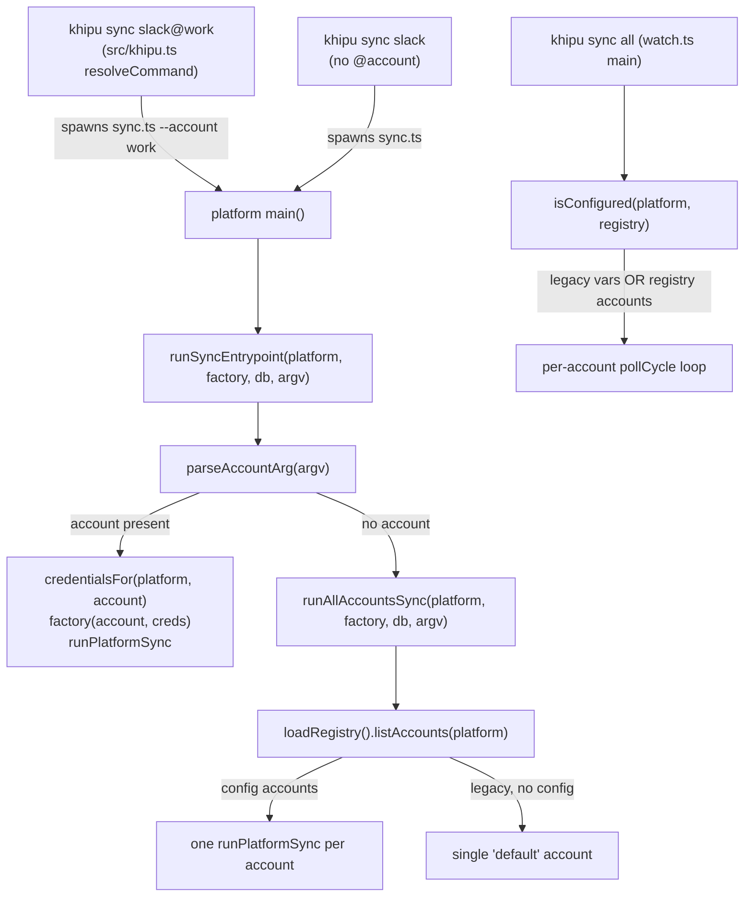
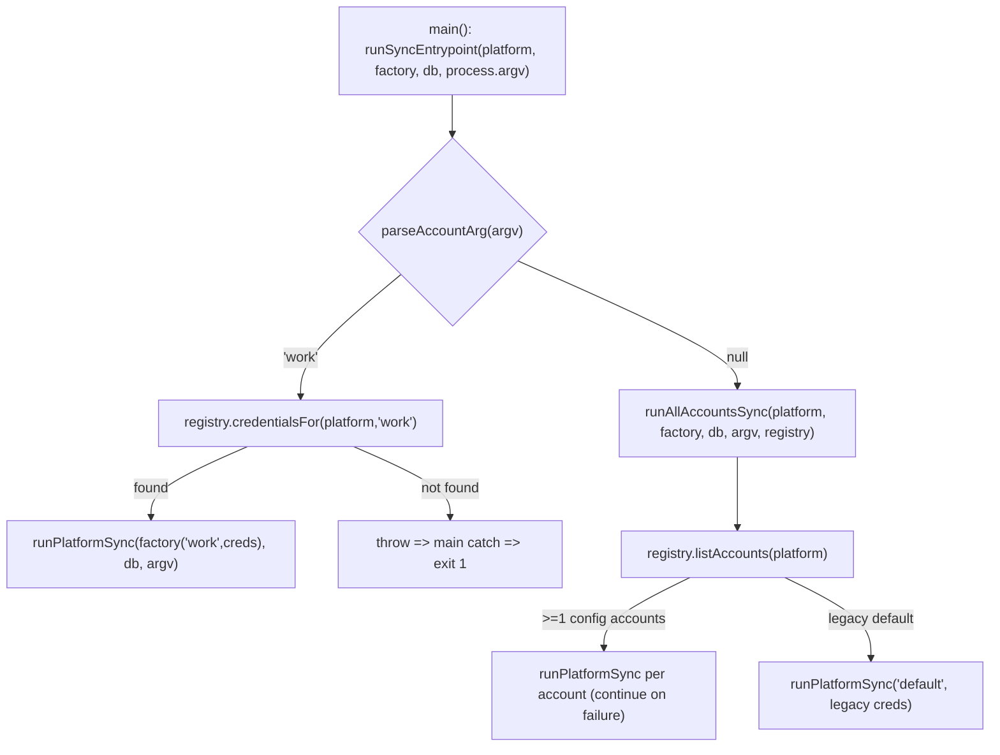

# Design Document: sync-account-routing

## Overview

**Purpose**: This feature makes the one-shot debug command `khipu sync <platform>[@<account>]` route to the correct account, closing the last production gap of the multi-account feature. It also makes the sync daemon's configuration gate registry-aware so config-file-only accounts are not skipped.

**Users**: Operators debugging or scripting per-account syncs, and daemon operators (`khipu sync all`) whose accounts live in `khipu.config.json`.

**Impact**: Replaces the hardcoded module-level `default` adapter used by every env-based platform `main()` with registry-driven account resolution. Adds one shared routing helper to `src/sync-runner.ts` and one registry check to `src/watch.ts isConfigured()`. No schema change, no adapter-internal change, no CLI-resolver change.

### Goals
- `khipu sync <platform>@<account>` syncs exactly that account with its resolved credentials and correct `account` label.
- `khipu sync <platform>` (no `@`) syncs every configured account, or the legacy `default` when no config file exists.
- `watch.ts` treats a platform as configured when it has legacy env vars OR ≥1 registry account.
- Routing logic centralized once; applied uniformly to all six env-based entrypoints.

### Non-Goals
- No changes to adapter factories or adapter internals (already account-aware).
- No changes to `src/account-registry.ts` (parser/fallback already implemented).
- No changes to `src/khipu.ts resolveCommand` (already spawns `--account` correctly).
- No changes to the daemon's per-account loop in `watch.ts main()` (already correct).
- No `signal` entrypoint change (not among the six env-based platforms in scope) and no DB schema change.

## Boundary Commitments

### This Spec Owns
- The account-resolution logic inside `main()` for `slack`, `discord`, `email`, `whatsapp`, `telegram`, `facebook` entrypoints.
- A new shared routing helper `runSyncEntrypoint` and argv parser `parseAccountArg` in `src/sync-runner.ts`.
- Registry-awareness of `isConfigured()` in `src/watch.ts`.
- Routing tests covering single-account, all-accounts, and `isConfigured` behavior.

### Out of Boundary
- Adapter factories / adapter sync logic (`createXAdapter`, `runBackfillImpl`, `syncIncremental`).
- The account-registry parser, `$VAR` resolution, and legacy fallback in `account-registry.ts`.
- CLI command routing in `khipu.ts`.
- Database schema and the `account` column semantics.

### Allowed Dependencies
- `src/sync-runner.ts` (`runPlatformSync`, `runAllAccountsSync`).
- `src/account-registry.ts` (`loadRegistry`, `credentialsFor`, `listAccounts`, `AccountRegistry`, `AccountCredentials`).
- `src/platforms/types.ts` (`Platform`, `PlatformAdapter`, `AdapterFactory`).
- Existing per-platform factories, imported by their own `main()`.

### Revalidation Triggers
- Any change to the `AdapterFactory` signature `(account, credentials) => PlatformAdapter`.
- Any change to `runPlatformSync` / `runAllAccountsSync` signatures or `sync_state` keying.
- Any change to how `resolveCommand` passes the `--account` flag.
- Any change to the registry's legacy-fallback semantics (single `default` account when no config).

## Architecture

### Existing Architecture Analysis
- Adapters follow the `PlatformAdapter` contract and are constructed by `AdapterFactory` from `AccountCredentials`. This contract is already account-aware and is preserved.
- `runPlatformSync(adapter, db, argv)` owns `sync_state` tracking and incremental/backfill mode selection, keyed by `(adapter.platform, adapter.account)`. Routing only chooses which adapter to hand it.
- `runAllAccountsSync(platform, factory, db, argv, registry)` already loops registry accounts. The no-`--account` path adopts it directly.
- The defect is localized entirely in the six `main()` functions and one `isConfigured()` function.

### Architecture Pattern & Boundary Map



**Architecture Integration**:
- Selected pattern: thin shared dispatcher (`runSyncEntrypoint`) fronting existing sync primitives; the "one-shot: all-accounts vs single-account" boundary candidate becomes one function.
- Domain boundaries: routing lives in `sync-runner.ts` (sync orchestration), not in adapters; the daemon gate stays in `watch.ts`.
- Existing patterns preserved: `AdapterFactory`, `PlatformAdapter`, `runPlatformSync` semantics, per-platform missing-credential messaging.
- New components rationale: a single helper removes 6× duplication and makes routing testable in isolation.
- Steering compliance: files stay under the 200-line target where already compliant; synchronous DB untouched; TS strict, no `any`.

### Technology Stack

| Layer | Choice / Version | Role in Feature | Notes |
|-------|------------------|-----------------|-------|
| Backend / Services | TypeScript 5 (strict), Node 24, `tsx` | Routing helper + entrypoint edits | No new deps |
| Data / Storage | `better-sqlite3-multiple-ciphers` (sync) | Unchanged; `runPlatformSync` owns writes | No schema change |
| Testing | Vitest (`--pool=forks`, `:memory:`) | Routing + isConfigured tests | Extend `sync-runner.test.ts`, `watch.test.ts` |

## File Structure Plan

### New / Modified Files
- `src/sync-runner.ts` — **Modify**: add `parseAccountArg(argv): string | null` and `runSyncEntrypoint(platform, factory, db, argv, registry?): Promise<void | AccountSyncOutcome[]>`. Reuses existing `runPlatformSync`, `runAllAccountsSync`, `loadRegistry`, `credentialsFor`. (Currently 90 lines; +~25.)
- `src/watch.ts` — **Modify**: change `isConfigured(platform, registry = loadRegistry())` to also return `true` when `registry.listAccounts(platform).length > 0`. Update the single call site in `main()` (line ~139) to pass the already-loaded `registry`.
- `src/platforms/slack/sync.ts` — **Modify**: `main()` calls `runSyncEntrypoint('slack', createSlackAdapter, db, process.argv)`. Keep `slackAdapter` export.
- `src/platforms/discord/sync.ts` — **Modify**: same shape with `createDiscordAdapter`. Keep `discordAdapter` export.
- `src/platforms/email/sync.ts` — **Modify**: same shape with `createEmailAdapter`. Keep `emailAdapter` export.
- `src/platforms/whatsapp/sync.ts` — **Modify**: same shape with `createWhatsAppAdapter`. Keep `whatsappAdapter` export.
- `src/platforms/facebook/sync.ts` — **Modify**: same shape with `createFacebookAdapter`. Keep `facebookAdapter` export.
- `src/platforms/telegram/sync.ts` — **Modify (scoped)**: honor `--account` for the synced adapter via `runSyncEntrypoint('telegram', createTelegramAdapter, db, process.argv)`; preserve auth-wizard + listener for the legacy default path only. Add the minimum lines given the file is already 393 lines.
- `tests/sync-runner.test.ts` — **Modify**: add `parseAccountArg` and `runSyncEntrypoint` tests.
- `tests/watch.test.ts` — **Modify**: add registry-aware `isConfigured` tests.

> Each file keeps one responsibility. The routing seam is added once; the five simple entrypoints become near-identical two-line `main()` bodies.

## System Flows

### One-shot routing decision (all six entrypoints)



Gating notes: `parseAccountArg` scans argv for the `--account` token and returns the following token, else `null` (ignores unrelated flags like `--force`, mirroring `parseSyncArgs`). Account-not-found errors propagate to the existing `main()` catch block, which logs and exits non-zero — never falling back to `default` (Requirement 1.4).

## Requirements Traceability

| Requirement | Summary | Components | Interfaces | Flows |
|-------------|---------|------------|------------|-------|
| 1.1–1.5 | Single-account routing | `runSyncEntrypoint`, `parseAccountArg`, each `main()` | `credentialsFor`, `AdapterFactory`, `runPlatformSync` | One-shot routing decision |
| 2.1–2.4 | All-accounts routing | `runSyncEntrypoint`, `runAllAccountsSync` | `listAccounts`, `runPlatformSync` | One-shot routing decision |
| 3.1–3.4 | Legacy fallback / singleton preservation | `runAllAccountsSync` (legacy `[default]`), preserved singletons | `loadRegistry` legacy fallback | All-accounts branch (legacy default) |
| 4.1–4.4 | Daemon registry gate | `isConfigured` | `AccountRegistry.listAccounts` | Daemon gate |
| 5.1–5.4 | Cross-platform consistency | shared helper reused by all six; telegram exception | `runSyncEntrypoint` | One-shot routing decision |
| 6.1–6.4 | Verifiable routing | tests in `sync-runner.test.ts`, `watch.test.ts` | Vitest | — |

## Components and Interfaces

| Component | Domain/Layer | Intent | Req Coverage | Key Dependencies | Contracts |
|-----------|--------------|--------|--------------|------------------|-----------|
| `runSyncEntrypoint` | sync-runner | Route argv to single- or all-accounts sync | 1, 2, 5 | `runPlatformSync`, `runAllAccountsSync`, `loadRegistry` (P0) | Service |
| `parseAccountArg` | sync-runner | Extract `--account <name>` from argv | 1, 2 | none | Service |
| `isConfigured` (updated) | watch | Registry-aware config gate | 4 | `AccountRegistry` (P0) | Service |
| Six `main()` bodies | platform entrypoints | Delegate to `runSyncEntrypoint` | 1, 2, 3, 5 | factory, `runSyncEntrypoint` (P0) | Batch (entry) |

### sync-runner

#### runSyncEntrypoint

| Field | Detail |
|-------|--------|
| Intent | Single entry that resolves `--account` and dispatches to single- or all-accounts sync |
| Requirements | 1.1, 1.4, 2.1, 5.2 |

**Responsibilities & Constraints**
- Parse account from argv; if present, resolve credentials and run one adapter through `runPlatformSync`; else delegate to `runAllAccountsSync`.
- Do not swallow a not-found account into a `default` fallback — let it throw.
- Own no `sync_state` logic; delegate all persistence/mode selection to `runPlatformSync`.

**Dependencies**
- Outbound: `runPlatformSync`, `runAllAccountsSync` — perform sync (P0); `loadRegistry` — default registry source (P0).
- Inbound: the six platform `main()` functions.

**Contracts**: Service [x]

##### Service Interface
```typescript
export function parseAccountArg(argv: readonly string[]): string | null

export async function runSyncEntrypoint(
  platform: Platform,
  factory: AdapterFactory,
  db: Database.Database,
  argv: readonly string[],
  registry?: AccountRegistry,
): Promise<AccountSyncOutcome[]>
```
- Preconditions: `factory` is the platform's account-aware factory; `argv` is the raw child `process.argv`.
- Postconditions: when an account is named, exactly one `runPlatformSync` runs for it; otherwise `runAllAccountsSync` runs across all registry accounts. Returns per-account outcomes (single-element array for the named-account path).
- Invariants: never routes a named-but-missing account to `default`; forwards `--force`/`--backfill` unchanged (they live in `argv`).

**Implementation Notes**
- `parseAccountArg`: find index of `--account`; return `argv[index + 1] ?? null`; return `null` if the flag is absent.
- `registry` defaults to `loadRegistry()` and is injectable for tests (mirrors `runAllAccountsSync`).
- For the named-account path, wrap the single run so the return type is uniform (`[{ account, ok }]`) or simply `await runPlatformSync(...)` and return `[{ account, ok: true }]`; on throw the error propagates to `main()`.

### watch

#### isConfigured (updated)

| Field | Detail |
|-------|--------|
| Intent | Treat a platform as configured when it has legacy env vars OR ≥1 registry account |
| Requirements | 4.1, 4.2, 4.3, 4.4 |

**Responsibilities & Constraints**
- Keep local-only short-circuit (`imessage`, `whatsapp` => true).
- Return true if any legacy `REQUIRED_ENV_VARS[platform]` is set (existing behavior).
- Return true if `registry.listAccounts(platform).length > 0` (new).
- Otherwise false.

##### Service Interface
```typescript
export function isConfigured(
  platform: Platform,
  registry?: AccountRegistry,
): boolean
```
- Preconditions: `registry` defaults to `loadRegistry()`; `main()` passes its already-loaded registry to avoid a second load.
- Postconditions: config-file-only platforms are no longer skipped by the daemon.
- Invariants: pure w.r.t. inputs (env + registry); no side effects.

**Implementation Notes**
- Update `main()`'s call site (`if (!isConfigured(platform))`, line ~139) to `isConfigured(platform, registry)`. The subsequent `accounts.length === 0` guard may remain (harmless) — do not remove daemon looping logic.

### Platform entrypoints (six)

**Simple five** (`slack`, `discord`, `email`, `whatsapp`, `facebook`) — `main()` becomes:
```typescript
async function main(): Promise<void> {
  const db = initDb('./khipuchat.db')
  await runSyncEntrypoint('slack', createSlackAdapter, db, process.argv)
}
```
- Preserve the exported module-level singleton (`slackAdapter`, etc.) — legacy tests depend on `slackAdapter` (Requirement 3.4).

**Telegram (scoped exception)** — `main()` keeps its structure:
1. `parseAccountArg(process.argv)`.
2. If an account is named: resolve via `runSyncEntrypoint('telegram', createTelegramAdapter, db, process.argv)`; the adapter itself connects using the account's `TELEGRAM_SESSION_STRING`/`API_ID`/`API_HASH` fields; no auth wizard, no persistent listener; `terminateOcr()` then exit.
3. If no account: preserve legacy default behavior — run the auth wizard when `config.sessionString` is empty, sync via `runSyncEntrypoint('telegram', createTelegramAdapter, db, process.argv)` (which yields the `[default]` account in legacy mode or all configured accounts when a config file exists), then, unless `--backfill-only`, keep the existing `startListener` loop for the default account.
- Constraint: add only the minimum lines; the file is already over the 200-line target (Requirement 5.4).

## Error Handling

### Error Strategy
- **Account not found**: `credentialsFor` throws with a message naming platform + account; propagates to each `main()`'s existing `catch` => `console.error` + `process.exit(1)`. No `default` fallback (Requirement 1.4).
- **Missing legacy credential (default path)**: unchanged — each adapter's `runBackfill`/`syncIncremental` already emits the platform's missing-var message and exits non-zero (Requirement 3.3).
- **Single account failure in all-accounts mode**: `runAllAccountsSync` records `{ ok: false, error }` and continues (Requirement 2.2) — behavior inherited unchanged.

### Monitoring
- Existing stdout/stderr logging (`[platform/account] ...`) is preserved; no new logging surface.

## Testing Strategy

### Unit Tests
- `parseAccountArg`: returns the value after `--account`; returns `null` when the flag is absent; ignores unrelated flags (`--force`, `--backfill`) around it. (Req 1.1, 2.1)
- `runSyncEntrypoint` (named account): with a fake registry (reusing the `makeRegistry` helper in `sync-runner.test.ts`) and `argv=['node','x','--account','work']`, asserts exactly one `runPlatformSync` runs on an adapter with `account==='work'` and the `work` credentials. (Req 1.1, 1.2, 6.1)
- `runSyncEntrypoint` (no account): asserts delegation to `runAllAccountsSync` across all registry accounts (e.g. `['work','personal']`). (Req 2.1, 6.2)
- `runSyncEntrypoint` (missing account): asserts it rejects/throws and does not run a `default` sync. (Req 1.4)
- `isConfigured` registry-aware: returns `true` when `registry.listAccounts(platform).length > 0` and no legacy env var; returns `false` when neither; still `true` for legacy vars and local-only platforms. (Req 4.1–4.4, 6.3)

### Integration Tests
- Full suite (`npm test`) passes, including `tests/adapter-factory.test.ts` (legacy `slackAdapter` singleton assertions) and `tests/watch.test.ts`. (Req 3.4, 6.4)

## Migration Strategy
Not applicable — no data or schema movement. Legacy installs (no `khipu.config.json`) continue to resolve a single `default` account through the same code path.
