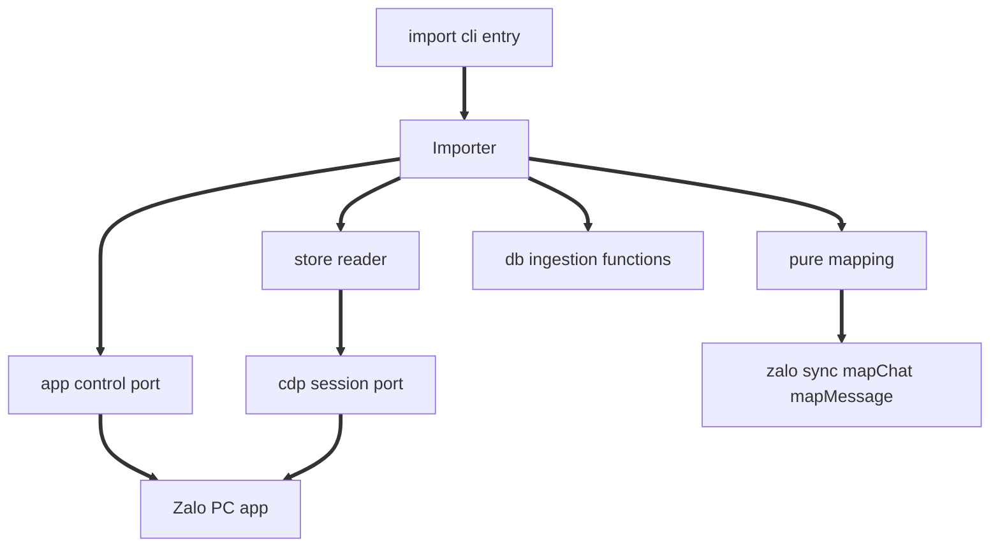
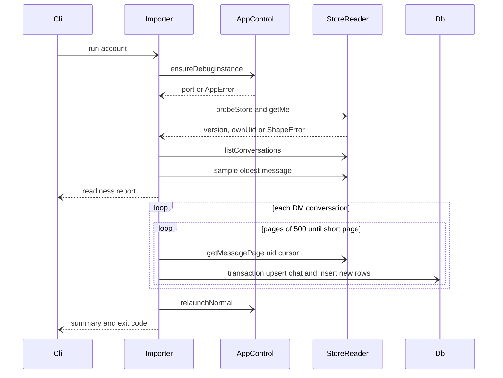

# Design Document: zalo-full-history

## Overview

**Purpose**: This feature recovers a Zalo user's pre-link direct-message history into the KhipuChat archive. It reads the already-decrypted history held by the official Zalo PC desktop app on the same Mac.

**Users**: A KhipuChat operator who already uses Zalo PC and `zalo-sync` runs `khipu import zalo-history [--account <name>]` once, or occasionally, to backfill everything Zalo PC has synced locally.

**Impact**: Adds a new one-shot command and a self-contained `src/platforms/zalo/history/` module. Existing code changes only in a CLI dispatch branch, a legacy account field, and docs. Imported rows land in the existing `chats`/`messages` tables with `zalo-sync`'s identities, so every query surface sees them with no changes.

### Goals
- Reach the macOS go/no-go answer on the very first run: the readiness check runs before any write (1.1 to 1.4).
- Import all DM history visible to Zalo PC, idempotently and per account, with no duplicates against live-synced data (3.x, 4.x, 5.x).
- Fail loudly and safely when Zalo PC internals change, never import garbled data (6.4).

### Non-Goals
- Group and Official Account history, sending, media download or OCR, Windows or Linux.
- Selective import (per conversation or `--since`), a dry-run-only flag, read throttling.
- Running as a `PlatformAdapter` backend or under the watch daemon.

## Boundary Commitments

### This Spec Owns
- The `khipu import zalo-history` command: argument parsing, account resolution, exit codes, progress and summary output, fidelity disclosure.
- Zalo PC process control on macOS: detect, quit, relaunch with a loopback debugging port, wait for readiness.
- A minimal Chrome DevTools Protocol (CDP) client limited to target listing, version lookup, and `Runtime.evaluate`.
- The renderer-store read contract: which Zalo PC internals are called, and runtime validation of their result shapes.
- The pure mapping from Zalo PC rows to the shared `Chat`/`Message` shapes, including multi-device duplicate collapse.

### Out of Boundary
- The database schema and `src/db.ts` ingestion functions (used, never modified).
- `zalo-sync`'s live adapter, its session file, and the `sync_state('zalo', account)` position (never written).
- MCP, CLI query, and web query logic.
- Any network call to Zalo servers. The importer talks only to `127.0.0.1`.
- Zalo PC's own data, settings, or files on disk (never read directly, never written).

### Allowed Dependencies
- `src/db.ts`: `initDb`, `getDb().transaction`, `upsertChat`, `insertMessage`, `getMessageIdByExternalId`.
- `src/platforms/zalo/sync.ts`: pure `mapChat` and `mapMessage` (same-platform directory, allowed by structure.md).
- `src/account-registry.ts`: `loadRegistry`, `listAccounts`, `credentialsFor`.
- Node 24 built-ins: global `fetch`, global `WebSocket`, `node:child_process`, `node:fs`.
- macOS tools: `osascript`, `pgrep`, `pkill`, `/usr/libexec/PlistBuddy` (or `defaults`).
- No new npm dependency.

### Revalidation Triggers
- Zalo PC update that changes its webpack module ids (`XS0u`), store function names, or message row fields.
- A change to `mapChat`/`mapMessage` identity fields (`external_id` sources) in `zalo-sync`.
- A change to `insertMessage` conflict keys `(external_id, chat_id)` or `upsertChat` keys `(platform, account, external_id)`.
- zca-js changing which message id it delivers live (would break overlap dedupe with imported rows).

## Architecture

### Existing Architecture Analysis
- Adapters live in `src/platforms/<platform>/`, import only `src/db.ts` exports, and keep a narrow, mockable port over their external client (precedent: `signal/cli-client.ts` with an injected socket, `zalo/client.ts` with a dynamic import).
- `src/khipu.ts` `resolveCommand` is a pure router that maps subcommands to scripts run through tsx.
- Tests use real `initDb(':memory:')` and hand-rolled fakes for ports.

### Architecture Pattern & Boundary Map

Ports and adapters: one orchestrator over three injected ports (process control, CDP session, store reader), plus pure mapping.



**Dependency direction** (imports only point left): `types` ⇐ `mapping` ⇐ `cdp` ⇐ `store-reader` ⇐ `app-control` ⇐ `uid-store` ⇐ `importer` ⇐ `cli`. `mapping` may import `../sync` (mappers) and `../../../db` types. `importer` is the only file that imports db write functions.

**Key decisions**
- **Built-in WebSocket instead of `chrome-remote-interface`.** Only three CDP calls are needed. Node 24's global `WebSocket` + `fetch` cover them in well under 200 lines, add no dependency, and are easy to fake. The library (MIT, 0.34.0) stays the fallback if the hand-rolled client proves fragile.
- **Reuse `zalo-sync` mappers.** Rows are normalized to `ZaloThread`/`ZaloMessage` and passed to `mapChat`/`mapMessage`, which guarantees identity parity (4.1, 4.2). Type and caption are refined afterwards because `mapMessage` emits `other` and drops captions for non-text.
- **Reimplement, do not copy, ZaloBackup.** It has no licence. Only its documented observations (module ids, function names, row fields) are used.

### Technology Stack

| Layer | Choice / Version | Role in Feature | Notes |
|-------|------------------|-----------------|-------|
| CLI | `src/khipu.ts` router + tsx | New `import zalo-history` subcommand | Existing pattern |
| Integration | CDP over Node 24 global `WebSocket` / `fetch` | Attach to Zalo PC renderer | No new dependency |
| External process | Zalo PC 26.11.10 (Electron 22.3.9, Chromium 108) | Source of decrypted history | Verified installed on target Mac; live read unverified |
| Data | better-sqlite3-multiple-ciphers via `src/db.ts` | Ingestion | Unchanged |
| Runtime | macOS `osascript`, `pgrep`, `pkill` | Quit and detect Zalo PC | macOS only |

## File Structure Plan

### Directory Structure
```
src/platforms/zalo/history/
├── types.ts          # Row/conversation/cursor types, ImportError union, ImportSummary, port interfaces
├── cdp.ts            # Minimal CDP client: listTargets, version, connect(target) => CdpSession
├── app-control.ts    # Zalo PC lifecycle on macOS: locate, isRunning, quit, launchDebug, waitForPage, bundleVersion
├── store-reader.ts   # Renderer expressions + shape guards: probeStore, getMe, listConversations, getMessagePage
├── mapping.ts        # Pure: isDmConversation, collapseDuplicates, toChat, toMessage, classifyType
├── importer.ts       # Orchestrator: readiness check, per-conversation loop, failure isolation, teardown, summary
├── paging.ts         # Backward cursor paging and one-transaction-per-page idempotent ingestion
├── uid-store.ts      # Account <=> Zalo uid bindings in .zalo_uids.json (learned on first run)
└── cli.ts            # Entry: args, account resolution, disclosure, wiring real ports, exit codes
tests/
├── zalo-history-mapping.test.ts   # Pure mapping
├── zalo-history-cdp.test.ts       # CDP client against a fake WebSocket/fetch
├── zalo-history-importer.test.ts  # Orchestrator with fake ports + :memory: DB
├── zalo-history-uid-store.test.ts # Binding rules against a temp file
└── zalo-history-cli.test.ts       # Arg parsing, account resolution, exit codes
```

### Modified Files
- `src/khipu.ts`: add an `import` branch routing `import zalo-history` to `src/platforms/zalo/history/cli.ts`, plus `USAGE`/`SUBCOMMAND_USAGE` entries.
- `src/account-registry.ts`: widen the legacy optional-field map from one variable per platform to a list, and add `ZALO_UID` for zalo (config-file accounts already accept arbitrary fields).
- `.gitignore`: add `.zalo_uids.json`.
- `tests/khipu.test.ts`: routing cases for `import zalo-history` and unknown `import` targets.
- `README.md` (Zalo section): command, prerequisites, bounded fidelity, restart behaviour, manual Export Data fallback (6.5).
- `.kiro/steering/tech.md`: Zalo PC external-process row, next to the signal-cli entry.

## System Flows



**Flow decisions**
- **Readiness gate.** Steps up to the readiness report never touch the DB (1.1, 1.3). Any `ImportError` there exits non-zero.
- **Account check** happens right after `getMe`, before the first write (5.4).
- **One transaction per page.** An interruption leaves complete pages committed and no half pages (5.5). Re-running resumes naturally via dedupe.
- **Final relaunch.** After import, Zalo PC is quit and relaunched without the debugging flag, so the debug port does not stay open (2.6, 8.1). See Open Questions.

## Requirements Traceability

| Requirement | Summary | Components | Interfaces | Flows |
|-------------|---------|------------|------------|-------|
| 1.1 | Verify readability before writes | Importer, StoreReader | `probeStore` | Readiness gate |
| 1.2 | Report version, DM count, sample oldest | Importer, AppControl | `ReadinessReport` | Readiness gate |
| 1.3 | Named failing step, no write, non-zero | Importer, Cli | `ImportError.step` | Readiness gate |
| 1.4 | Never modify Zalo PC data | StoreReader | read-only expression set | All |
| 2.1 | Launch if not running | AppControl | `ensureDebugInstance` | Sequence |
| 2.2 | Silent quit and relaunch if running normally | AppControl | `quit`, `launchDebug` | Sequence |
| 2.3 | Not installed: report paths, non-zero | AppControl, Cli | `AppError{kind:'not_installed'}` | Gate |
| 2.4 | Not logged in: instruct, non-zero | StoreReader | `getMe` returns null uid | Gate |
| 2.5 | Loopback only | Cdp | host fixed to `127.0.0.1` | All |
| 2.6 | Detach cleanly, Zalo usable | Importer, AppControl | `close`, `relaunchNormal` | Final relaunch |
| 3.1 | Enumerate DM conversations | StoreReader, Mapping | `listConversations`, `isDmConversation` | Loop |
| 3.2 | Skip group and OA | Mapping | `isDmConversation` | Loop |
| 3.3 | Page back to oldest | Importer, StoreReader | `getMessagePage` cursor | Inner loop |
| 3.4 | Non-text type + caption | Mapping | `classifyType`, `toMessage` | Inner loop |
| 4.1 | Chat identity = thread id | Mapping | `toChat` via `mapChat` | n/a |
| 4.2 | Message identity = msg id | Mapping | `toMessage` via `mapMessage` | n/a |
| 4.3 | Sent vs received sender fields | Mapping | `isSelf` rule | n/a |
| 4.4 | Pure mapping | Mapping | no I/O | n/a |
| 5.1 | No duplicates | Importer, Mapping | `getMessageIdByExternalId`, `collapseDuplicates` | Inner loop |
| 5.2 | Second run adds zero | Importer | same | Inner loop |
| 5.3 | Account attribution | Cli, Importer | `resolveAccount` | Start |
| 5.4 | Stop on account mismatch | Importer, UidStore | `checkBinding`, `bind` | After getMe |
| 5.5 | Interrupt-safe | Importer | per-page transaction | Inner loop |
| 5.6 | Do not touch sync position | Importer | never calls `setPlatformLastSyncedAt` | n/a |
| 6.1 | Per-conversation progress | Importer | `Reporter.progress` | Loop |
| 6.2 | Summary counts | Importer | `ImportSummary` | End |
| 6.3 | Fidelity disclosure at start | Cli | `DISCLOSURE` text | Start |
| 6.4 | Unrecognised shape: stop | StoreReader | shape guards, `ShapeError` | Gate and loop |
| 6.5 | Docs | README | n/a | n/a |
| 7.1 | Per-conversation isolation | Importer | try per conversation | Loop |
| 7.2 | Per-message isolation | Importer | try per row | Inner loop |
| 7.3 | Connection lost: stop, report, non-zero | Cdp, Importer | `CdpSession.onClose`, `ImportError{kind:'connection_lost'}` | Loop |
| 7.4 | Any failed conversation: non-zero | Cli | `summary.failed > 0` | End |
| 8.1 | No data leaves machine | Cdp, AppControl | loopback, relaunch without port | All |
| 8.2 | No Zalo secret on disk | StoreReader | never reads session or keys | All |
| 8.3 | Query parity | Mapping | shared shapes, platform `zalo` | n/a |
| 8.4 | No query-surface changes | Boundary | Modified Files list | n/a |
| 8.5 | Tests without Zalo PC | All | injected ports | Tests |

## Components and Interfaces

| Component | Layer | Intent | Req Coverage | Key Dependencies | Contracts |
|-----------|-------|--------|--------------|------------------|-----------|
| Types | Types | Shared types and port interfaces | all | none | Service |
| Cdp | Integration | Minimal CDP client | 2.5, 7.3, 8.1 | global WebSocket, fetch (P0) | Service |
| AppControl | Integration | Zalo PC process lifecycle | 2.1, 2.2, 2.3, 2.6, 1.2 | osascript, pgrep (P0) | Service |
| StoreReader | Integration | Read and validate renderer store | 1.1, 1.4, 2.4, 3.1, 3.3, 6.4, 8.2 | Cdp (P0) | Service |
| Mapping | Domain | Pure row to Chat/Message | 3.2, 3.4, 4.x, 5.1, 8.3 | zalo sync mappers (P0) | Service |
| UidStore | Persistence | Account and Zalo uid bindings | 5.4 | node fs (P1) | Service, State |
| Importer | Application | Orchestration and ingestion | 1.x, 3.3, 5.x, 6.1, 6.2, 7.x | all ports, db (P0) | Batch |
| Cli | Entry | Args, account, disclosure, exit codes | 5.3, 6.3, 7.4 | Importer, registry (P0) | Service |

### Types (`types.ts`)

```typescript
export interface ZaloPcConversation { uid: string; name: string; isGroup: boolean | null; isOfficialAccount: boolean }

export interface ZaloPcRow {
  msgId: string            // normalized to string; may carry a "_NNN" device suffix
  cliMsgId: string
  fromUid: string          // "0" means sent by the logged-in user
  toUid: string            // conversation uid
  sendDttm: string         // epoch ms as string
  serverTime: string | null
  msgType: number
  message: string | Record<string, unknown> | null
  dName: string | null
}

export interface PageCursor { sendDttm: string; msgId: string }

export type ImportStep = 'locate' | 'launch' | 'attach' | 'login' | 'shape' | 'account' | 'read'

export type ImportError =
  | { kind: 'not_installed'; step: 'locate'; searched: string[] }
  | { kind: 'launch_failed'; step: 'launch'; message: string }
  | { kind: 'attach_failed'; step: 'attach'; message: string }
  | { kind: 'not_logged_in'; step: 'login' }
  | { kind: 'shape_unrecognised'; step: 'shape'; detail: string; zaloVersion: string | null }
  | { kind: 'account_mismatch'; step: 'account'; expectedUid: string | null; actualUid: string; boundAccount?: string }
  | { kind: 'uid_store_invalid'; step: 'account'; path: string }
  | { kind: 'connection_lost'; step: 'read'; conversationsDone: number }

export type Result<T> = { ok: true; value: T } | { ok: false; error: ImportError }

export interface ReadinessReport {
  zaloVersion: string; chromium: string; ownUid: string; ownName: string
  dmCount: number; sample: { name: string; oldestTs: number | null }
}

export interface ImportSummary {
  conversations: number; added: number; alreadyPresent: number
  skipped: number; failed: Array<{ name: string; reason: string }>
}

export interface Reporter { info(line: string): void; progress(name: string, read: number): void; warn(line: string): void }
```

### Cdp (`cdp.ts`)

**Contracts**: Service [x]

```typescript
export interface CdpTarget { id: string; type: string; url: string; webSocketDebuggerUrl: string }

export interface CdpSession {
  evaluate<T>(expression: string, timeoutMs: number): Promise<Result<T>>
  onClose(handler: () => void): void
  close(): void
}

export interface CdpClient {
  listTargets(port: number): Promise<CdpTarget[]>
  version(port: number): Promise<{ browser: string }>
  connect(target: CdpTarget): Promise<CdpSession>
}

export function createCdpClient(deps?: { fetch?: typeof fetch; WebSocket?: typeof WebSocket }): CdpClient
```
- Preconditions: host is always `127.0.0.1`; a `webSocketDebuggerUrl` whose host is not loopback is rejected (2.5).
- `evaluate` sends `Runtime.evaluate` with `awaitPromise: true, returnByValue: true`. The renderer expression returns a JSON string; the client parses it. `exceptionDetails` maps to `attach_failed` with the message.
- Postcondition: a socket close fires `onClose` exactly once and fails in-flight calls with `connection_lost` (7.3).

### AppControl (`app-control.ts`)

**Contracts**: Service [x]

```typescript
export interface AppControl {
  locate(): Result<{ appPath: string; version: string }>
  isRunning(): boolean
  ensureDebugInstance(): Promise<Result<{ port: number; restarted: boolean; target: CdpTarget }>>
  relaunchNormal(): Promise<Result<true>>   // a failed reopen is reported, never silent
}

export function createAppControl(opts: {
  appPath?: string                      // from --app-path, default /Applications/Zalo.app
  cdp: CdpClient
  exec?: (cmd: string, args: string[]) => { status: number; stdout: string }  // stdout carries stderr on failure
  exists?: (p: string) => boolean
  home?: string
  sleep?: (ms: number) => Promise<void>
  randomPort?: () => number
}): AppControl
```
- `locate` checks the given path, then `/Applications/Zalo.app`, then `~/Applications/Zalo.app`, and reads `CFBundleShortVersionString` (2.3, 1.2).
- `ensureDebugInstance`:
  - If Zalo is running, quit it with `osascript -e 'quit app id "com.vng.zalo"'`. Wait up to 15s for `pgrep -x Zalo` to clear, then `pkill -x Zalo`, then `pkill -9 -x Zalo`. If it is still running, return `launch_failed` without launching. Zalo holds a single-instance lock, so a second launch would hand its flags to the running copy and lose them (2.2).
  - Launch hidden and without stealing focus: `open -g -j -a <appPath> --args --remote-debugging-port=<random 20000 to 40000>`. Arguments reach the app because it was quit first.
  - Poll `listTargets` every 1s for up to 90s until a `page` target whose url contains `index.html` appears.
  - Report `restarted` so the CLI prints the restart line (2.2).
- `relaunchNormal` quits the debug instance and starts the app with `open -g -a <appPath>` (or `open -g -b com.vng.zalo` when no path is known), without flags, so it comes back in the background and never takes focus (2.6). A failed reopen returns `launch_failed` ("open it manually").

### StoreReader (`store-reader.ts`)

**Contracts**: Service [x]

```typescript
export interface StoreReader {
  probeStore(): Promise<Result<true>>   // chromium comes from CdpClient.version
  getMe(): Promise<Result<{ uid: string; name: string } | null>>
  listConversations(): Promise<Result<ZaloPcConversation[]>>
  getMessagePage(uid: string, cursor: PageCursor | null, limit: number): Promise<Result<ZaloPcRow[]>>
}

export function createStoreReader(session: CdpSession, zaloVersion: string | null): StoreReader
```
- All expressions resolve the store through `window.webpackJsonp.push([[Math.random()],{},[["XS0u"]]]).default`. They call only read functions: `getUserId`, `getMe`, `getConversations`, `getMessageFromConversationByLimit(uid, limit, { count, fromMsg, include: false })` (1.4).
- `probeStore` checks that `webpackJsonp` exists, module `XS0u` resolves, and the four functions are callable. Otherwise it returns `shape_unrecognised` naming what is missing (6.4).
- Every returned row passes a hand-written guard (required fields present with expected primitive types). One invalid row in a page fails the page with `shape_unrecognised`, so garbled data is never imported (6.4).
- `getMe` reads `getUserId()` first and only calls `getMe()` when it is non-empty; an empty uid (after polling) maps to `null`, which the importer treats as `not_logged_in` (2.4). Renderer exceptions map to `shape_unrecognised`; timeouts and `connection_lost` pass through.
- Never calls REST/network modules (`fBUP`) or decryption helpers, and never reads session or key material (8.1, 8.2).

### Mapping (`mapping.ts`)

**Contracts**: Service [x] (pure functions)

```typescript
export function isDmConversation(c: ZaloPcConversation): boolean
export function collapseDuplicates(rows: ZaloPcRow[]): ZaloPcRow[]
export function toChat(c: ZaloPcConversation, account: string): Chat
export function toMessage(row: ZaloPcRow, chatId: number, ownUid: string, peerName: string): Message
export function classifyType(msgType: number, message: ZaloPcRow['message']): MessageType
```
- `isDmConversation`: false when `isGroup === true` or uid starts with `g`. Official Account detection is unverified and is an Open Question (3.2).
- `collapseDuplicates`: groups by `cliMsgId` and keeps the row whose `msgId` has no `_NNN` suffix, then the latest `serverTime`, then the larger `msgId` (5.1).
- `toChat` = `mapChat({ threadId: uid, name }, account)` (4.1).
- `toMessage` builds a `ZaloMessage` (`isSelf = fromUid === '0' || fromUid === ownUid`, `senderId = fromUid`, `senderName = dName ?? peerName`, `ts = Number(sendDttm)`), calls `mapMessage`, then overrides `type` with `classifyType` and, for non-text, sets `text` to the caption (`message.title` or `message.description` if a string) (3.4, 4.2, 4.3).
- `classifyType`: string message gives `text`; 2 gives `image`; 7 gives `sticker`; 18 gives `video`; anything else gives `other`.

### UidStore (`uid-store.ts`)

**Contracts**: Service [x] / State [x]

```typescript
export interface UidStore {
  // Errors: account_mismatch (expectedUid null + boundAccount for the cross-account case) or uid_store_invalid.
  checkBinding(account: string, ownUid: string, configuredUid: string | null): Result<{ firstRun: boolean }>
  bind(account: string, ownUid: string): Result<true>   // refuses to overwrite a malformed file
}

export function createUidStore(filePath?: string): UidStore   // default ./.zalo_uids.json
```
- **State model**: a JSON object `{ [account]: zaloUid }` stored next to `.zalo_session.json`. A Zalo uid is an identifier, not a secret (8.2), but the file is still gitignored.
- **Rules for `checkBinding`**, in order:
  1. If `configuredUid` (the `ZALO_UID` account field) is set, it wins and is compared to `ownUid`.
  2. Otherwise, if the file binds this account, compare against that uid.
  3. Otherwise, if `ownUid` is bound to a different account, report a mismatch naming `boundAccount`. This stops a personal Zalo PC login from being imported into a work account.
  4. Otherwise return `firstRun: true`.
- `bind` is called only after a successful readiness check on a first run, before the first message write. It writes atomically (temp file plus rename).
- A missing file is treated as empty. An unreadable or malformed file returns `uid_store_invalid` naming the file, because silently dropping bindings would disable the check.

### Importer (`importer.ts`)

**Contracts**: Batch [x]

```typescript
export interface ImportDeps {
  app: AppControl
  openReader: (instance: { port: number; restarted: boolean; target: CdpTarget }, zaloVersion: string) =>
    Promise<Result<{ reader: StoreReader; session: CdpSession; chromium: string }>>
  reporter: Reporter
  uidStore: UidStore
  pageSize?: number            // default 500
}

export interface Teardown { launched?: boolean; session?: CdpSession }
export function runReadiness(deps: ImportDeps, account: string, configuredUid: string | null, teardown: Teardown):
  Promise<Result<{ report: ReadinessReport; reader: StoreReader; dms: ZaloPcConversation[]; skipped: number; firstRun: boolean }>>
export function runImport(deps: ImportDeps, account: string, configuredUid: string | null): Promise<Result<ImportSummary>>
```
- **Trigger**: called once by the CLI.
- **Readiness**: locate, ensureDebugInstance, openReader, probeStore, getMe, account check, listConversations, filter DMs, then page the most recent DM fully to report its oldest timestamp. Writes nothing (1.1 to 1.3, 5.4).
- **Account check**: `uidStore.checkBinding(account, ownUid, configuredUid)`. A mismatch returns `account_mismatch`. On `firstRun`, print "Linked account <name> to Zalo user <ownName> (<ownUid>)" and call `bind` before any write (5.4).
- **Paging**: start with `cursor = null`. After each page the next cursor is the oldest row by `(Number(sendDttm), msgId)`. Stop on a page shorter than `pageSize` (3.3).
- **Ingestion per page**, in one `getDb().transaction`:
  1. `upsertChat(toChat(...))`.
  2. For each collapsed row: if `getMessageIdByExternalId(chatId, externalId)` exists, increment `alreadyPresent`. Otherwise call `insertMessage` and increment `added`.
  3. A row that throws is logged and skipped (7.2).
  This gives the counts without changing `db.ts` (5.1, 5.2, 6.2).
- **Isolation**: a non-connection error inside one conversation records it in `failed` and continues (7.1). `connection_lost` aborts with `conversationsDone` (7.3).
- **Teardown**: `runReadiness` records what it opened in a `Teardown` object (`launched` is set before `ensureDebugInstance`, `session` after attach). `runImport`'s `finally` closes the session and, once a launch was attempted (including `launch_failed`), calls `app.relaunchNormal()`, warning if the reopen fails (2.6). Not located means nothing was launched, so there is no relaunch.
- **Failure reasons**: a thrown exception inside one conversation (for example a DB error) is recorded as that conversation's failure, like a returned error. Shape errors inside one conversation are per-conversation failures too: that page is not written (6.4, 7.1). Decided by the user on 2026-11-12; the CLI then adds an "importer may need updating" hint. A repeated page (store ignored the cursor) is such a failure, never a silent stop.
- Never calls `setPlatformLastSyncedAt`, `runPlatformSync`, or `runSyncEntrypoint` (5.6).

### Cli (`cli.ts`)

**Contracts**: Service [x]

```typescript
export interface CliArgs { account: string | null; appPath: string | null; help: boolean }
export function parseArgs(argv: string[]): CliArgs | { error: string }
export function resolveAccount(requested: string | null, available: string[]): { account: string } | { error: string }
export function exitCodeFor(result: Result<ImportSummary>): 0 | 1
```
- `resolveAccount`: use `--account` if it is listed. Otherwise use `default` if listed, else the only account. If there are several and none is `default`, return an error listing them (5.3).
- `configuredUid` comes from the account's optional `ZALO_UID` field: `khipu.config.json`, or the `ZALO_UID` env var for legacy installs. Usually it is unset and the uid is learned on first run.
- Prints `DISCLOSURE` before anything else: "Recovers only history already synced to this Zalo PC install. Uses undocumented Zalo PC internals that may break on app updates. Zalo PC will be restarted." (6.3).
- Calls `initDb('./khipuchat.db')`, matching zalo-sync, but only after the arguments and account are valid, so `--help` and argument errors never open the archive. `run(argv, io)` takes its ports (`CliIo`: output, registry lookups, `openArchive`, `runImport`) injected so tests never touch Zalo PC or the real archive (8.5); `main()` wires the real ones.
- Loads `.env` (`dotenv/config`) so `DB_KEY` and a legacy `ZALO_UID` apply.
- Exit code 1 for any `ImportError` or `summary.failed.length > 0`, otherwise 0 (1.3, 7.4).

## Data Models

No schema change. Field mapping into existing tables:

| Target | Source |
|--------|--------|
| `chats.external_id` | conversation `uid` (same as zalo-sync `threadId`) |
| `chats.account` | resolved account |
| `chats.type` | `private` |
| `messages.external_id` | `msgId` after duplicate collapse |
| `messages.timestamp` | `floor(sendDttm / 1000)` |
| `messages.is_sender` | `fromUid` is `"0"` or own uid |
| `messages.sender_id` / `sender_name` | null when sent, else `fromUid` / `dName` |
| `messages.type` / `text` | `classifyType`, caption for non-text |

**Chat names**: zalo-sync owns the names of chats it already knows, so the import keeps an existing chat's name and only names a new chat, from Zalo PC's name or, when Zalo PC has none, the uid (zalo-sync's own fallback). A received message whose `dName` is empty falls back to that archive chat name. Found in the real run (4.2): Zalo PC has no name for contacts whose profile it never loaded.

**Known existing behaviour**: `upsertChat` resets `message_count` to 0. zalo-sync does the same, so it is accepted and left unchanged.

## Error Handling

| Error | Step | Operator message | Exit |
|-------|------|------------------|------|
| `not_installed` | locate | "Zalo PC not found. Looked in: ... Pass --app-path <path to Zalo.app>." | 1 |
| `launch_failed` / `attach_failed` | launch, attach | "Could not start or attach to Zalo PC: <msg>." | 1 |
| `not_logged_in` | login | "Zalo PC is not logged in. Log in to Zalo PC, then re-run." | 1 |
| `shape_unrecognised` | shape | "This Zalo PC version (<v>) is not supported by the importer: <detail>. The importer needs updating." | 1 |
| `account_mismatch` | account | "Zalo PC is logged in as <actual>, but account <name> expects <expected>. Nothing was imported." | 1 |
| `uid_store_invalid` | account | "The Zalo account link file <path> is corrupt. Fix or delete it, then re-run." | 1 |
| `connection_lost` | read | "Lost connection to Zalo PC after <n> conversations. Re-run to continue; nothing is duplicated." | 1 |
| per-conversation failure | read | listed in summary | 1 after summary |

## Testing Strategy

All tests use fakes; none launches Zalo PC (8.5).

**Unit (`zalo-history-mapping.test.ts`)**
- `toChat`/`toMessage` produce the same `external_id`, `platform`, `type: 'private'`, and sender rules as `mapChat`/`mapMessage` for equivalent inputs (4.1 to 4.3).
- `classifyType` maps 2, 7, 18, and unknown types correctly, and captions are kept for non-text (3.4).
- `collapseDuplicates` keeps the unsuffixed copy of a multi-device pair (5.1).
- `isDmConversation` rejects `isGroup: true` and `g`-prefixed uids (3.2).

**Unit (`zalo-history-cdp.test.ts`)**
- A non-loopback `webSocketDebuggerUrl` is rejected (2.5).
- `evaluate` parses the JSON result and maps `exceptionDetails` to an error.
- A socket close fails in-flight calls with `connection_lost` and fires `onClose` once (7.3).

**Integration (`zalo-history-importer.test.ts`, fake ports + `initDb(':memory:')`)**
- A readiness failure at each step (not installed, not logged in, missing `XS0u`) writes zero rows and returns that step (1.1, 1.3, 2.3, 2.4, 6.4).
- Full import over 3 DMs + 1 group with 1,201 messages paged at 500: every DM message is imported, the group is skipped, and the counts are exact (3.1 to 3.3, 6.2).
- Pre-seeding one message via zalo-sync's `mapMessage` path, then importing, counts it as `alreadyPresent`. A second run reports `added = 0` (5.1, 5.2).
- First run binds the account. A later run with a different `ownUid` returns `account_mismatch` with zero rows written (5.4).
- UidStore (`zalo-history-uid-store.test.ts`): configured uid wins, a uid bound to another account is rejected, a malformed file errors, and writes are atomic (5.4).
- A fake socket closing mid-page keeps earlier pages committed, and the next run completes the rest (5.5, 7.3).
- `sync_state` for `('zalo', account)` is unchanged after import (5.6).
- `relaunchNormal` is called on success and on every error path (2.6).

**CLI (`zalo-history-cli.test.ts`, `tests/khipu.test.ts`)**
- `resolveAccount` covers explicit, default, sole, and ambiguous cases (5.3).
- Exit code is 1 when any conversation failed (7.4).
- `resolveCommand(['import','zalo-history'])` routes to the script.

**Manual go/no-go (first implementation task)**
- Run the readiness check against the real Zalo PC 26.11.10 on this Mac and record the result in `research.md`: version, DM count, sample oldest date, and whether `isGroup` and the `g` prefix hold.

## Security Considerations
- While Zalo PC runs with the debugging port, any local process can read its renderer. Mitigation: random high port, loopback only, and Zalo PC is always relaunched without the flag at the end, including on errors.
- The importer never reads the Zalo session, cookies, or SQLCipher keys, and stores nothing outside the archive DB (8.2).

## Open Questions / Risks
- **Restart at the end** (confirmed in review 2026-11-12): Zalo PC is relaunched normally after import so the debug port closes.
- **Live msgId parity** (review decision: verify first): imported rows dedupe against zalo-sync only if zca-js delivers the same `msgId` as the PC row. The go/no-go task compares one message captured both ways. If they differ, implementation pauses and a `cliMsgId` match is designed, which may need a `db.ts` helper and a requirements revisit.
- **Official Account conversations**: no confirmed marker yet. The go/no-go task inspects a conversation row's fields.
- **Zalo PC updates** can break module ids at any time. Mitigated by `probeStore` and the row guards (6.4); not preventable.
