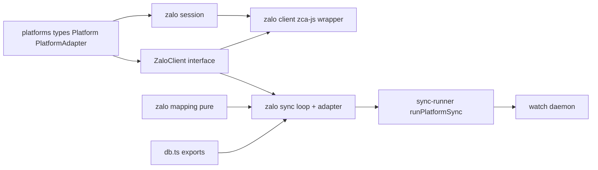

# Design Document: zalo-sync

## Overview

**Purpose**: This feature delivers a `zalo` platform adapter that captures a user's Zalo direct-message conversations into KhipuChat's shared local archive, making them queryable through every existing surface (MCP, CLI, web, FTS, semantic search) with no surface-code changes.

**Users**: A self-hosted KhipuChat operator who uses Zalo (Vietnam's dominant messenger) and wants those conversations archived alongside their other platforms.

**Impact**: Adds a tenth platform to the existing platform-abstraction. It follows the WhatsApp adapter's QR-session, local-only shape and touches only the well-established platform-registration seams; it does not modify the database schema or any query surface. Fidelity is deliberately bounded: `zca-js` is a live/listener client, so the deliverable is authoritative live capture plus best-effort recent-window backfill, not a full historical mirror.

### Goals
- Register `zalo` as a first-class platform across every enumeration touchpoint.
- Authenticate via a QR-code Zalo Web session with local session persistence (scan once).
- Capture direct-message conversations live via the `zca-js` listener, plus the recent window it replays on connect.
- Map Zalo threads/messages onto the shared `Chat`/`Message` model and ingest via existing `src/db.ts` functions, achieving query-surface parity.

### Non-Goals
- Sending messages of any kind.
- Zalo groups and Official Account (OA) broadcast channels.
- Complete deep-history export (not reliably retrievable via `zca-js`).
- Image/attachment download and OCR (deferred to a future `zalo-image-sync` spec).
- Any guarantee of account-ban safety.

## Boundary Commitments

### This Spec Owns
- The `src/platforms/zalo/` adapter: session login + persistence, the bounded live-capture loop, DM-only filtering, and pure `Chat`/`Message` mapping.
- The `zca-js` dependency and its isolation behind a narrow, mockable `ZaloClient` interface.
- Registration of the `zalo` platform value across the union, `PLATFORMS` array, watch daemon maps, account registry local-only set, web icon, and npm script.
- Zalo-specific terminal/error messaging, including the bounded-fidelity and unofficial-client notices.

### Out of Boundary
- The database schema (`src/db.ts` / `db-migrations.ts`) — the adapter calls exported functions (`upsertChat`, `insertMessage`, `setLastSyncedAt`, `getLastSyncedId`) only.
- Query surfaces: MCP tools (`src/mcp.ts`), CLI query logic (`src/cli.ts`, `cli-filters.ts`), and web query logic — parity is achieved by ingesting into shared tables, not by editing surfaces.
- The media/OCR pipeline (`storeMedia`, `ocr.ts`) — deferred to `zalo-image-sync`. Non-text messages are recorded as `type='other'` with null media fields.
- The `PlatformAdapter` interface shape and the sync-runner/watch contract — consumed as-is; not modified.

### Allowed Dependencies
- `src/db.ts` exported ingestion/query helpers.
- `src/sync-runner.ts` (`runPlatformSync`) and the watch daemon's factory registration.
- `src/account-registry.ts` (`AccountCredentials`, local-only registration) and `src/platforms/types.ts` (`Platform`, `PlatformAdapter`, `AdapterFactory`).
- `src/index-embeddings.ts` (`embedNewMessages`, `embedNewChats`) and `src/vec-db.ts` (`isIndexed`), matching the whatsapp/signal per-chat embedding hooks.
- The external `zca-js` library (MIT), imported dynamically so tests can mock it.

### Revalidation Triggers
- Any change to the `PlatformAdapter` interface or the `Chat`/`Message` types.
- Any change to `upsertChat` / `insertMessage` signatures or conflict semantics.
- Adding image support (a future `zalo-image-sync` spec re-checks the mapping's non-text handling).
- A breaking `zca-js` upgrade that changes login, listener, or message-object shape.

## Architecture

### Existing Architecture Analysis
- Platform adapters live in `src/platforms/<name>/`, export an object implementing `PlatformAdapter`, and a factory implementing `AdapterFactory`. They call `src/db.ts` exports only and never touch the schema.
- The sync runner (`runPlatformSync`) and watch daemon (`pollCycle`) invoke `syncIncremental` (when a prior sync point exists) or `runBackfill`; **`startListener` is never called** by either and is a no-op in every existing adapter.
- WhatsApp is the closest template: QR session persisted to a local path, `LOCAL_ONLY` platform (no cloud token, synthesizes a `default` account), unofficial-client error messaging, `startListener` no-op.
- `insertMessage` (`ON CONFLICT(external_id, chat_id)`) and `upsertChat` (`ON CONFLICT(platform, account, external_id)`) are idempotent, making replayed events safe.

### Architecture Pattern & Boundary Map

Selected pattern: **isolated adapter behind a narrow client port**, mirroring whatsapp/signal. The bounded live-capture loop depends only on the `ZaloClient` interface; the concrete client wraps `zca-js`. Mapping is pure. Dependency direction (left imports never point right):



- Domain boundaries: **session/auth** vs **client transport** vs **pure mapping** vs **capture loop + adapter** — the same seams the brief identified and that whatsapp/signal use.
- Existing patterns preserved: one-shot `runBackfill`/`syncIncremental` return model; `startListener` no-op; per-chat embedding hooks; idempotent ingestion; `LOCAL_ONLY` account synthesis.
- New components rationale: a `ZaloClient` port + zca-js wrapper isolate an unofficial dependency and enable mocking; a session module encapsulates QR login and credential persistence.
- Steering compliance: files under 200 lines, TS strict, no `any`, synchronous DB, self-hosted/local-only.

### Technology Stack

| Layer | Choice / Version | Role in Feature | Notes |
|-------|------------------|-----------------|-------|
| CLI / Runtime | Node.js 24, `tsx` | Runs the adapter via `khipu sync zalo` and the daemon | Existing engine pin |
| Platform client | `zca-js` (MIT, Node >= 18) | QR login + `listener.on('message')` live capture | Unofficial; dynamically imported for mockability |
| Data / Storage | `better-sqlite3-multiple-ciphers` via `src/db.ts` exports | Idempotent chat/message ingestion | Schema untouched |
| QR rendering | `qrcode-terminal` (already a dependency) | Render the login QR in the terminal | Reused from whatsapp |
| Web badge | `simple-icons` `siZalo` | Platform badge in web UI | New icon-map entry |

## File Structure Plan

### Directory Structure
```
src/platforms/zalo/
├── client.ts     # ZaloClient interface + createZaloClient() wrapping zca-js (dynamic import);
│                 # session login/persistence + friend enumeration + onMessage/start/stop.
│                 # Exports ZaloThread, ZaloMessage, ThreadType-guard, and session-path resolution.
└── sync.ts       # Pure mapChat/mapMessage; runBackfillImpl/runIncrementalImpl bounded-capture loops;
                  # createZaloAdapter factory (PlatformAdapter); default zaloAdapter; main() entrypoint.
```

> If `client.ts` approaches the 200-line limit, split session/QR handling into `session.ts` (login + persistence) leaving `client.ts` as the transport wrapper. Prefer the split proactively if the wrapper plus session logic would exceed the limit.

### Modified Files
- `src/platforms/types.ts` — add `'zalo'` to the `Platform` union.
- `src/sync-all.ts` — add `'zalo'` to the `PLATFORMS` array.
- `src/watch.ts` — add `zalo: createZaloAdapter` to `ADAPTER_FACTORIES` and `'zalo'` to `LOCAL_ONLY_PLATFORMS`.
- `src/account-registry.ts` — add `'zalo'` to `LOCAL_ONLY_PLATFORMS`.
- `src/web/icons.ts` — import `siZalo` and add `zalo: siZalo` to the `KNOWN` map.
- `package.json` — add `"sync:zalo": "tsx src/platforms/zalo/sync.ts"` and the `zca-js` dependency.
- `tests/sync-all.test.ts` — update any hardcoded platform-count / "last platform" assertions (necessary fallout of registering a new platform, as with facebook).

## System Flows

### Bounded capture session (runBackfill / syncIncremental)
```mermaid
sequenceDiagram
  participant Runner as sync-runner
  participant Adapter as zalo adapter
  participant Session as zalo session
  participant Client as ZaloClient
  participant DB as db.ts

  Runner->>Adapter: runBackfill or syncIncremental since
  Adapter->>Session: resolve saved session or QR login
  Session-->>Adapter: authenticated ZaloClient
  Adapter->>Client: getFriends to seed DM chats
  Client-->>DB: upsertChat per friend
  Adapter->>Client: onMessage handler, start listener
  loop until capture window elapses
    Client-->>Adapter: message event
    Adapter->>Adapter: drop if not DM type; drop if older than since (incremental)
    Adapter->>DB: upsertChat + insertMessage (idempotent)
  end
  Adapter->>Client: stop listener
  Adapter-->>Runner: return (runner records sync point)
```

Gating notes: DM-only filter runs before mapping (Req 3.3); the incremental path additionally skips events at or before `since` (Req 4.4); per-event failures are caught and logged so the loop continues (Req 7.4). The capture window is a bounded duration (configurable via `ZALO_CAPTURE_WINDOW_MS`, sensible default) after which the listener is stopped and the call returns so the runner can persist the sync point and the daemon can proceed.

## Requirements Traceability

| Requirement | Summary | Components | Flows |
|-------------|---------|------------|-------|
| 1.1–1.6 | Platform registration | types.ts, sync-all.ts, watch.ts, account-registry.ts, web/icons.ts, package.json | — |
| 2.1–2.6 | QR login + session persistence | ZaloSession (client.ts) | Capture session |
| 3.1–3.7 | Live DM capture | ZaloCaptureLoop (sync.ts), ZaloClient | Capture session |
| 4.1–4.4 | Bounded fidelity + recent-window backfill | ZaloCaptureLoop, adapter messaging | Capture session |
| 5.1–5.5 | Mapping | mapChat/mapMessage (sync.ts) | — |
| 6.1–6.5 | Query-surface parity | (no new code; ingestion into shared tables) | — |
| 7.1–7.5 | Resilience + error handling | ZaloAdapter, ZaloCaptureLoop | Capture session |
| 8.1–8.3 | Local-only credentials | account-registry.ts, watch.ts, ZaloSession | — |

## Components and Interfaces

| Component | Domain/Layer | Intent | Req Coverage | Key Dependencies (P0/P1) | Contracts |
|-----------|--------------|--------|--------------|--------------------------|-----------|
| ZaloClient + createZaloClient | Transport | Wrap zca-js login/listener/friends behind a mockable port | 2.1–2.6, 3.1, 4.1, 8.3 | zca-js (P0), qrcode-terminal (P1) | Service |
| mapChat / mapMessage | Mapping (pure) | Map Zalo thread/message to `Chat`/`Message` | 5.1–5.5, 3.3, 3.4 | db types (P0) | Service |
| ZaloCaptureLoop | Capture | Bounded session: seed chats, capture DM events, persist idempotently | 3.1–3.7, 4.1, 4.4, 7.4 | ZaloClient (P0), db.ts (P0), index-embeddings (P1) | Batch |
| ZaloAdapter + factory | Adapter | Implement `PlatformAdapter`; error isolation + exit codes | 1.2, 1.4, 2.5, 7.1–7.5, 8.3 | ZaloClient (P0), sync-runner (P0) | Service |
| Platform registration edits | Registration | Make `zalo` first-class everywhere | 1.1–1.6, 8.1, 8.2 | types/sync-all/watch/registry/icons (P0) | State |

### Transport

#### ZaloClient + createZaloClient (`client.ts`)

| Field | Detail |
|-------|--------|
| Intent | Isolate the unofficial `zca-js` library behind a narrow, mockable interface covering login, session persistence, friend enumeration, and the message listener. |
| Requirements | 2.1, 2.2, 2.3, 2.4, 2.5, 2.6, 3.1, 4.1, 8.3 |

**Responsibilities & Constraints**
- Own QR login, session persistence (write/read the local session credential file), and reconnect-from-session. Resolve the session location from an optional `ZALO_SESSION` field, else a default local path.
- Expose friend/DM-thread enumeration for chat seeding and the `onMessage`/`start`/`stop` listener lifecycle.
- Dynamically `import('zca-js')` so tests never load or log into the real library. Never transmit session credentials anywhere except Zalo.
- Wrap login/connection failures in errors that name Zalo and note the unofficial-client/account-lock risk.

**Dependencies**
- External: `zca-js` — login + listener (P0). `qrcode-terminal` — render QR (P1).
- Outbound: local filesystem — persist/read session credentials (P0).

**Contracts**: Service [x]

##### Service Interface
```typescript
export const enum ZaloThreadType { User = 0, Group = 1 }

export interface ZaloThread {
  threadId: string
  name: string
}

export interface ZaloMessage {
  msgId: string
  threadId: string
  threadType: ZaloThreadType
  isSelf: boolean
  senderId: string | null
  senderName: string | null
  /** Raw content: string for text messages, non-string for rich/attachment content. */
  content: unknown
  /** Epoch milliseconds. */
  ts: number
}

export interface ZaloClient {
  /** Enumerate DM contacts/threads to seed chat metadata (best-effort; may be empty). */
  getFriends(): Promise<ZaloThread[]>
  /** Register a handler for incoming message events. */
  onMessage(handler: (msg: ZaloMessage) => void): void
  /** Begin listening (idempotent). */
  start(): void
  /** Stop the listener and release the session connection. */
  stop(): Promise<void>
}

export interface CreateZaloClientOptions {
  /** Session credential file location; defaults to a local path when omitted. */
  sessionPath?: string
  debug?: boolean
}

/** Logs in (saved session or QR) and resolves a connected client. */
export function createZaloClient(opts?: CreateZaloClientOptions): Promise<ZaloClient>
```
- Preconditions: session path is local; if a saved session exists it is used before prompting for QR.
- Postconditions: on resolve, the listener can be started and `getFriends` is callable; a fresh session is persisted to `sessionPath`.
- Invariants: no message sending is ever performed; only DM enumeration and listening.

**Implementation Notes**
- Integration: mirror `createWhatsAppClient` — dynamic import, event wiring, QR render, session-saved notice; normalize the `zca-js` message object into `ZaloMessage` at this boundary so the loop and mapping see a stable shape.
- Validation: on invalid/rejected saved session, throw an actionable "remove session and re-scan" error (Req 2.5).
- Risks: exact `zca-js` context-persistence method names must be confirmed and pinned (Task 0).

### Mapping (pure)

#### mapChat / mapMessage (`sync.ts`)

| Field | Detail |
|-------|--------|
| Intent | Pure translation of `ZaloThread`/`ZaloMessage` to `Chat`/`Message`. |
| Requirements | 5.1, 5.2, 5.3, 5.4, 5.5, 3.3, 3.4 |

**Responsibilities & Constraints**
- `mapChat(thread, account)`: `external_id = threadId`, `name = thread.name`, `type = 'private'`, `username = null`, `platform = 'zalo'`.
- `mapMessage(msg, chatId)`: `external_id = msgId`, `chat_id = chatId`, `sender_id = isSelf ? null : senderId`, `sender_name = isSelf ? null : senderName`, `text = typeof content === 'string' ? content : null`, `type = typeof content === 'string' && content ? 'text' : 'other'`, `timestamp = Math.floor(ts / 1000)`, `is_sender = isSelf ? 1 : 0`, `reply_to_external_id = null`, `platform = 'zalo'`, all `media_*`/`ocr_text` = null.
- Pure: no I/O, no import from `client.ts`; the caller performs DM-only filtering before calling.

**Contracts**: Service [x]
```typescript
export function mapChat(thread: ZaloThread, account?: string): Chat
export function mapMessage(msg: ZaloMessage, chatId: number): Message
```

### Capture

#### ZaloCaptureLoop (`sync.ts`)

| Field | Detail |
|-------|--------|
| Intent | Run a bounded capture session: seed DM chats, capture DM message events, persist idempotently, then stop. |
| Requirements | 3.1, 3.2, 3.3, 3.5, 3.6, 3.7, 4.1, 4.4, 7.4 |

**Responsibilities & Constraints**
- `runBackfillImpl(client, account, windowMs)`: seed chats from `client.getFriends()` via `upsertChat`; register an `onMessage` handler that drops non-DM events, `upsertChat`+`insertMessage` for DM events (idempotent), and counts inserts; `start()`; await the capture window; `stop()`.
- `runIncrementalImpl(client, since, account, windowMs)`: identical, plus skip events with `ts/1000 <= since` (Req 4.4).
- Each event is handled in a try/catch that logs and continues (Req 7.4). Non-text content maps to `type='other'` and never aborts the session (Req 3.6).
- After the session, run per-chat embedding hooks (`embedNewMessages`/`embedNewChats` guarded by `isIndexed`) for chats that received messages, matching whatsapp/signal.

**Contracts**: Batch [x]
- Trigger: `runBackfill`/`syncIncremental` from the runner/daemon.
- Input/validation: an authenticated `ZaloClient`; DM-only, since-window (incremental) gating.
- Output: upserted chats + inserted messages under platform `zalo`; console summary.
- Idempotency & recovery: replays are absorbed by `ON CONFLICT` inserts; the runner records the sync point after return.

### Adapter

#### ZaloAdapter + createZaloAdapter (`sync.ts`)

| Field | Detail |
|-------|--------|
| Intent | Implement `PlatformAdapter`; own credential resolution, error isolation, and exit codes. |
| Requirements | 1.2, 1.4, 2.5, 7.1, 7.2, 7.3, 7.5, 8.3 |

**Responsibilities & Constraints**
- `createZaloAdapter(account, credentials)` returns `{ platform: 'zalo', account, runBackfill, syncIncremental, startListener }`.
- `runBackfill`/`syncIncremental`: build the client via `createZaloClient({ sessionPath: credentials.fields['ZALO_SESSION'], debug })`, run the matching capture-loop impl, and always `stop()` the client in a `finally`.
- On fatal error: write an actionable stderr message naming Zalo and the unofficial-client/account-lock risk, and `process.exit(1)` for the explicit single-platform command (Req 7.1, 7.3, 7.5). Under the daemon, `pollCycle` already catches and continues (Req 7.2).
- `startListener` is a no-op (consistent with all adapters). Export a default `zaloAdapter` using `process.env['ZALO_SESSION']`; add a `main()` guarded by `require.main === module` calling `initDb` + `runPlatformSync`.

**Contracts**: Service [x]
```typescript
export function createZaloAdapter(account: string, credentials: AccountCredentials): PlatformAdapter
```

### Registration (`types.ts`, `sync-all.ts`, `watch.ts`, `account-registry.ts`, `web/icons.ts`, `package.json`)
- Summary-only: mechanical edits making `zalo` first-class. `zalo` joins `LOCAL_ONLY_PLATFORMS` in both `watch.ts` and `account-registry.ts` so it is always "configured" with a synthesized `default` account and no cloud token (Req 8.1, 8.2). Adding `zalo` to `ADAPTER_FACTORIES` (a total `Record<Platform, AdapterFactory>`) is compile-required once the union grows.

## Data Models

No schema changes. The adapter writes through existing `src/db.ts` exports:
- `upsertChat(Chat)` — conflict key `(platform, account, external_id)`.
- `insertMessage(Message)` — conflict key `(external_id, chat_id)`.
- `setLastSyncedAt` / `getLastSyncedId` — reused as by whatsapp/signal; the runner records `sync_state` per `(platform, account)`.

`Chat` and `Message` shapes are unchanged; Zalo populates the text/metadata fields and leaves all media fields null. `type` values used: `Chat.type='private'`; `Message.type` ∈ {`'text'`, `'other'`}.

## Error Handling

### Error Strategy
Fail fast on auth/session errors with actionable guidance; degrade gracefully on per-event and per-chat failures.

### Error Categories and Responses
- **Auth/session errors**: invalid saved session or QR rejection → "remove saved session and re-scan" message, non-zero exit for the explicit command (Req 2.5, 7.1, 7.3).
- **Per-event errors**: a malformed/failed message event → logged, loop continues (Req 7.4).
- **Non-text content**: recorded as `type='other'`, never fatal (Req 3.6).
- **Daemon isolation**: any Zalo error is caught by `pollCycle` and other platforms keep polling (Req 7.2).
- **Unofficial-client notice**: every error path notes zca-js is unofficial and may break / carries account-lock risk (Req 7.5).

### Monitoring
Console summaries per session (`[zalo] ...`): chats seeded, messages inserted, mode (backfill/incremental), and the bounded-fidelity notice (Req 4.3).

## Testing Strategy

### Unit Tests
- `mapMessage`: text vs non-text `content` → `type` and `text`; self vs received → `is_sender`, `sender_id`/`sender_name` null-ing; `ts` ms→s conversion; `platform='zalo'`; media fields null (5.2, 5.3, 5.4, 3.4).
- `mapChat`: DM thread → `private`, `external_id=threadId`, `name` set, `platform='zalo'` (5.1).
- DM-type guard: a group/OA `threadType` event is dropped before mapping (3.3).

### Integration Tests (mocked `ZaloClient`, no live login)
- `runBackfillImpl`: a scripted client that seeds friends and emits DM events upserts chats and inserts messages; a second run inserts zero new rows (idempotent) (3.2, 3.5, 4.1).
- `runIncrementalImpl`: events at/before `since` are skipped; only newer events are inserted (4.4).
- Group/OA events emitted by the mock are not inserted (3.3); a non-text event is stored as `other` without aborting (3.6); an event whose handling throws is logged and the session continues (7.4).
- `createZaloAdapter`: a client-construction failure writes a Zalo-naming stderr message and exits non-zero for the explicit command (mock `process.exit`) (7.1, 7.3, 7.5).
- Registry: no `khipu.config.json` ⇒ `loadRegistry().listAccounts('zalo')` returns `['default']` (8.1, 8.2).

### E2E / Parity Tests
- Seed a mocked Zalo sync into an in-memory DB, then exercise existing handlers: `handleListChats` (incl. `platform='zalo'` filter), `handleListMessages`, `handleSearchMessages` after `rebuildFtsIndex`, and confirm CLI filter parity — with no changes to MCP/CLI/web query logic (6.1, 6.2, 6.4, 6.5).
- Confirm `sync-all` platform-count/order assertions updated for the new platform (1.3).

## Security Considerations
- Session credentials (cookie/imei/userAgent) are sensitive; stored only on the local machine, never transmitted except to Zalo (Req 2.6, 8). Optional DB encryption (`DB_KEY`) and local-only posture already apply to the archive.
- The unofficial client and account-lock risk are documented in output and README (Req 4.3, 7.5); acceptable for a private personal archive per the roadmap.

## Supporting References
- Background investigation, `zca-js` API notes, prior-art (openzca), and the pattern-evaluation table live in `research.md`.
